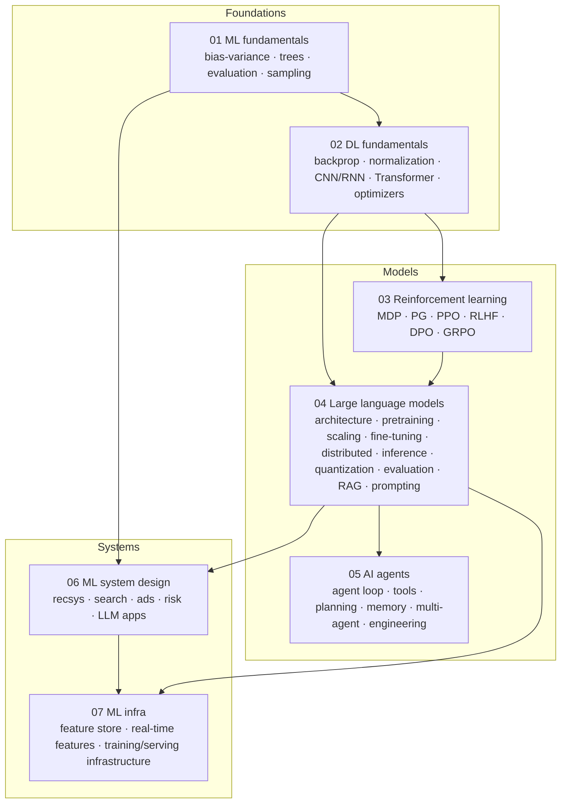

# Knowledge Map

> **One-line summary**: The whole book compresses into one picture — data → model → system. See the structure first, then fill in the details.
>
> **Keywords**: `knowledge map` `concept dependencies` `one-page index`

## 1. The full picture

## 2. Concept dependencies: what to learn first

| Concept | Prerequisite | Chapter |
| --- | --- | --- |
| Gradient descent / backprop | Calculus, chain rule | 02-01 |
| BatchNorm / LayerNorm | Backprop, statistics | 02-03 |
| Self-attention | Matrix multiplication, softmax | 02-05 |
| Transformer | Attention, residual, LayerNorm | 02-05 / 04-02 |
| Scaling laws | Pretraining, loss functions | 04-05 |
| LoRA | Low-rank decomposition, fine-tuning | 04-06 |
| KV cache | Autoregressive decoding, attention | 04-08 |
| RLHF | Policy gradients, PPO | 03-05 |
| DPO | Preference modeling, KL regularization | 03-06 |
| RAG | Retrieval, embeddings, generation | 04-11 |
| Agents | LLMs, tool calling, planning | 05-01 |
| Feature store | Offline/online consistency | 07-02 |

## 3. One-page index

### Formulas (often derived in interviews)

| Formula | Chapter |
| --- | --- |
| Bias-variance decomposition | [01-01](../01-ml-fundamentals/01-bias-variance-and-generalization.md) |
| Logistic regression gradient | [01-02](../01-ml-fundamentals/02-linear-models-and-svm.md) |
| XGBoost second-order objective | [01-03](../01-ml-fundamentals/03-tree-models-and-ensembles.md) |
| AUC probabilistic interpretation | [01-05](../01-ml-fundamentals/05-evaluation-metrics.md) |
| Backprop in matrix form | [02-01](../02-dl-fundamentals/01-neural-networks-and-backprop.md) |
| BN train/inference formulas | [02-03](../02-dl-fundamentals/03-normalization-techniques.md) |
| Self-attention and complexity | [02-05](../02-dl-fundamentals/05-transformer-basics.md) |
| Policy gradient theorem | [03-03](../03-reinforcement-learning/03-policy-gradient-and-actor-critic.md) |
| PPO-clip objective | [03-04](../03-reinforcement-learning/04-ppo-and-trpo.md) |
| DPO loss | [03-06](../03-reinforcement-learning/06-dpo-and-preference-optimization.md) |
| GRPO group-relative advantage | [03-07](../03-reinforcement-learning/07-grpo-and-reasoning-rl.md) |
| KV cache memory | [04-08](../04-llm/08-inference-optimization-and-serving.md) |
| ZeRO memory breakdown | [04-07](../04-llm/07-distributed-training.md) |

### Design questions (often asked in interviews)

| Question | Chapter |
| --- | --- |
| Feed / short-video recommender | [06-02](../06-ml-system-design/02-recommender-system-design.md) |
| Search / ads | [06-03](../06-ml-system-design/03-search-and-ads-design.md) |
| Risk / lending | [06-04](../06-ml-system-design/04-risk-and-finance-design.md) |
| Enterprise knowledge-base QA (RAG) | [06-05](../06-ml-system-design/05-llm-application-design.md) |
| Feature store | [07-02](../07-ml-infra/02-feature-store-and-realtime-features.md) |
| Distributed training platform | [07-03](../07-ml-infra/03-distributed-training-infrastructure.md) |
| GPU serving | [07-04](../07-ml-infra/04-inference-serving-and-gpu-optimization.md) |

## 4. Three main threads

If you remember only three sentences:

1. **Modeling**: every model trades prior/structure for sample efficiency — trees trade for interpretability, CNNs for translation invariance, Transformers for parallelism and long-range dependencies, RL for sequential decisions, LLMs for generality.
2. **Training**: the largest trainable model is bounded by min(memory, communication, data, compute, stability); every parallelization and optimization technique relaxes one of these.
3. **Systems**: offline-online consistency + latency/cost constraints + an evaluation loop decide whether a model actually creates value.

## 5. References

- Chapter READMEs and cheat sheets throughout the book
- System design examples in the appendix of [MLE Interview 2.0](https://www.yuan-meng.com/posts/mle_interviews_2.0/)
