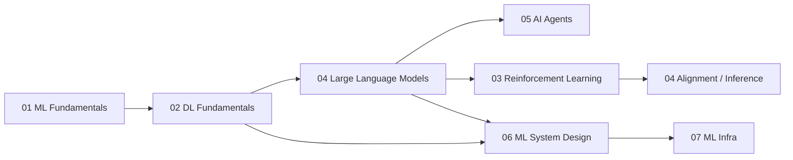

# Chapter 0 · Learning Map and Interview Preparation

> **Overview**: Before diving into formulas, settle three things — what your target role actually tests, how the topics relate, and what order to study them in when time is limited. This chapter has no algorithms, but it decides how efficient the next few weeks will be.
>
> **Keywords**: `role profiles` `8-week plan` `interview rounds` `project deep dive` `retrospective`

## What this chapter covers

| Note | Content | When to read |
| --- | --- | --- |
| [Learning roadmap](01-learning-roadmap.md) | Four role profiles, 8-week plan, minimum reading lists | Before you start |
| [Interview preparation playbook](02-interview-preparation-playbook.md) | What each interview round tests, how to prepare, behavior and project-deep-dive templates | Four weeks before applying |
| [Knowledge map](03-knowledge-map.md) | Full concept map and dependencies across the book | Revisit anytime |

## Assumptions

1. **You can write Python and have shipped at least one ML project.** The notes do not start from `for` loops; they assume tensors, train/validation splits, and gradient descent.
2. **The goal is to explain, not to recite.** Interviewers expose shallow understanding with two follow-up questions, so every note keeps the derivation and the "why".
3. **RL and Agents are optional but increasingly important.** Traditional MLE roles lean on 01/02/06, LLM roles on 03/04, Agent roles on 04/05, and infra roles on 04/07.

## Recommended order

- **Main path**: 01 → 02 → 04 → 05 (or 06). It covers about 80% of roles.
- **RL** is best studied after fine-tuning in chapter 04: you need to know what SFT is before RLHF makes sense.
- **06 / 07** need less math but more intuition about how models are trained and served, so they are easier later.

## Minimum deliverable per chapter

When you finish a chapter, you should be able to:

- **01**: derive the bias-variance decomposition; explain how XGBoost differs from GBDT; state the probabilistic meaning of AUC.
- **02**: derive backprop and batch norm; write the self-attention formula and its complexity; compare Adam and SGD.
- **03**: write the policy gradient and PPO-clip objectives; explain the three RLHF stages; derive the DPO loss.
- **04**: draw the Transformer and explain each component; compute KV cache memory; compare LoRA with full fine-tuning; explain the RAG pipeline.
- **05**: explain the agent loop and ReAct; design a tool-calling protocol; argue when multi-agent is not worth it.
- **06**: complete a recommender/search design in 45 minutes covering metrics, features, model, serving, and monitoring.
- **07**: draw an end-to-end ML pipeline; design a feature store; explain GPU serving bottlenecks and optimizations.

## Mindset

- Interview prep is not about memorizing answers; it is about **compressing scattered knowledge into a retrievable structure**. Notes build the index; they do not replace understanding.
- Interviews are noisy: the same question can be probed from very different angles. Prepare **transferable frameworks**, not standard answers.
- If you truly do not know something, reason out loud and state the boundary; this beats improvising. It matters most in system design and project deep dives.
