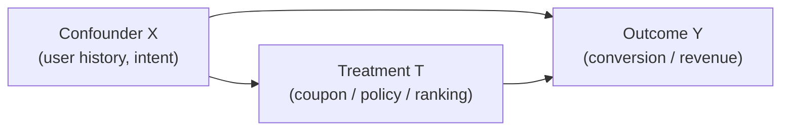

# Causal Inference, Uplift, and Bandits

> **One-line summary**: Predictive models answer "who is likely to act"; causal inference and uplift answer "who acts *because* of our intervention"; bandits balance exploiting what works with exploring what might work better — all three sit on top of counterfactual reasoning and propensity weighting.
>
> **Keywords**: `potential outcomes` `ATE/CATE` `confounding` `propensity score` `IPW` `uplift` `meta-learners` `multi-armed bandit` `UCB` `Thompson sampling` `IPS`

## 1. Core concepts

- **Potential outcomes (Rubin Causal Model)**: each unit $i$ has two potential outcomes under binary treatment $T\in\{0,1\}$: $Y_i(1)$ (treated) and $Y_i(0)$ (control). Only one is ever observed ($Y_i = T_i Y_i(1) + (1-T_i) Y_i(0)$) — the **fundamental problem of causal inference**.
- **Estimands**:
  - **ATE** (Average Treatment Effect): $\tau = \mathbb{E}[Y(1) - Y(0)]$.
  - **CATE** (Conditional ATE / Uplift): $\tau(x) = \mathbb{E}[Y(1) - Y(0) \mid X=x]$ — personalizes *who* to treat.
- **Confounding**: a variable $X$ affecting both treatment assignment $T$ and outcome $Y$ makes naive comparison $\mathbb{E}[Y\mid T=1]-\mathbb{E}[Y\mid T=0]$ biased (e.g., VIP users receive more coupons *and* buy more anyway).
- **Bandits**: online sequential decision-making where pulling arm $a_t$ reveals reward $r_t$ only for the chosen arm (bandit feedback), creating an **exploration vs. exploitation** trade-off measured by cumulative regret.



| Paradigm | Question answered | Data requirement | Typical MLE application |
| --- | --- | --- | --- |
| Prediction | What is $P(Y=1\mid X)$? | Observational logs | CTR, fraud, churn scoring |
| Causal / Uplift | What is $\mathbb{E}[Y(1)-Y(0)\mid X]$? | RCT or observational + identifiability | Coupon targeting, retention incentives |
| Bandits | Which action maximizes cumulative reward? | Online interactive feedback + propensities | Cold-start recsys, homepage slots, model routing |

## 2. Principles and derivations

### 2.1 Identifiability assumptions

To estimate causal effects from observational data, three assumptions must hold:

1. **SUTVA (no interference + consistency)**: one unit's treatment does not affect another's outcome (violated in social networks or two-sided marketplaces).
2. **Unconfoundedness (ignorability)**: $(Y(0), Y(1)) \perp T \mid X$ — no unobserved confounders.
3. **Positivity (overlap)**: $0 < e(x) = P(T=1\mid X=x) < 1$ for all $x$ — every subgroup has a nonzero chance of treatment and control.

### 2.2 Propensity scores, IPW, and Doubly Robust estimation

The **propensity score** $e(x) = P(T=1\mid X=x)$ summarizes all confounders into a scalar (Rosenbaum & Rubin). **Inverse Propensity Weighting (IPW)** reweights samples to mimic a randomized trial:

$$\hat{\tau}_{\mathrm{IPW}} = \frac{1}{n}\sum_{i=1}^{n}\left(\frac{T_i Y_i}{\hat{e}(X_i)} - \frac{(1-T_i) Y_i}{1-\hat{e}(X_i)}\right)$$

IPW is unbiased when $\hat{e}(x)$ is exact, but has **explosive variance** when $\hat{e}(x)$ is near $0$ or $1$ (mitigated by clipping or Self-Normalized IPW / Hájek estimator).

**Doubly Robust (DR / AIPW)** combines an outcome model $\hat{\mu}_t(x) \approx \mathbb{E}[Y\mid X=x, T=t]$ with propensity weighting:

$$\hat{\tau}_{\mathrm{DR}} = \frac{1}{n}\sum_{i=1}^{n}\left[\hat{\mu}_1(X_i) - \hat{\mu}_0(X_i) + \frac{T_i (Y_i - \hat{\mu}_1(X_i))}{\hat{e}(X_i)} - \frac{(1-T_i)(Y_i - \hat{\mu}_0(X_i))}{1-\hat{e}(X_i)}\right]$$

$\hat{\tau}_{\mathrm{DR}}$ is consistent if **either** the outcome model $\hat{\mu}$ **or** the propensity model $\hat{e}$ is correctly specified, and achieves lower variance than IPW. The same formula underpins **Offline Policy Evaluation (OPE)** in bandits and recommenders.

### 2.3 Uplift modeling and meta-learners

Users split into four quadrants: **Persuadables** (act only if treated — target these), **Sure Things** (act anyway — wasted budget), **Lost Causes** (never act), and **Sleeping Dogs** (treatment hurts conversion — avoid).

| Meta-learner | Formulation | Strengths | Weaknesses |
| --- | --- | --- | --- |
| **S-learner** | Single model $\hat{\mu}(x, t)$; $\hat{\tau}(x)=\hat{\mu}(x,1)-\hat{\mu}(x,0)$ | Simple, shares statistical strength | Tree splits may ignore $t$, shrinking $\hat{\tau}$ toward 0 |
| **T-learner** | Two separate models $\hat{\mu}_1(x), \hat{\mu}_0(x)$; $\hat{\tau}=\hat{\mu}_1-\hat{\mu}_0$ | Flexible for heterogeneous effects | Regularization bias & high variance when treatment/control sizes are imbalanced |
| **X-learner** | Impute individual effects using T-models, fit CATE models, blend by $e(x)$ | Strong under imbalanced treatment ratios | Multi-stage complexity |
| **R-learner / Double ML** | Residualize $Y-\hat{m}(x)$ and $T-\hat{e}(x)$ via cross-fitting, minimize Robinson loss | Neyman-orthogonal; robust to nuisance estimation error | Requires clean cross-fitting and good overlap |

**Uplift evaluation**: you cannot compute sample-level MSE on $\tau_i$ because counterfactuals are unobserved. Instead rank users by predicted $\hat{\tau}(x)$ on a held-out RCT and compute the **Qini curve / AUUC** (cumulative incremental conversions vs. share of population treated).

### 2.4 Multi-Armed and Contextual Bandits

Minimize cumulative regret $R_T = \sum_{t=1}^{T}(\mu^* - \mu_{a_t})$ over $K$ arms:

- **$\epsilon$-greedy**: explore uniformly with probability $\epsilon$; simple but wastes exploration on clearly bad arms (linear regret if $\epsilon$ is fixed).
- **UCB1 (Upper Confidence Bound)**: optimism in the face of uncertainty — pick the arm maximizing empirical mean plus an exploration bonus:

$$a_t = \arg\max_a \left(\hat{\mu}_a + c\sqrt{\frac{\ln t}{N_a}}\right)$$

Achieves logarithmic regret $O(\sum_{\Delta_a>0}\frac{\ln T}{\Delta_a})$.

- **Thompson Sampling (TS)**: maintain a posterior over each arm's reward parameter (e.g., $\mathrm{Beta}(\alpha_a, \beta_a)$ for Bernoulli CTR), sample $\tilde{\theta}_a \sim p(\theta_a \mid \mathcal{D})$, and pick $\arg\max_a \tilde{\theta}_a$. Naturally handles delayed batch feedback and is widely used in production.
- **Contextual Bandits (LinUCB / Neural TS)**: arm reward depends on context $x_t$ (user + item features), e.g., LinUCB computes $\hat{\theta}_a^T x_t + \alpha\sqrt{x_t^T A_a^{-1} x_t}$ where $A_a = \sum x x^T + \lambda I$.

## 3. Implementation notes

```python
import numpy as np

def doubly_robust_ate(y, t, e_hat, mu0_hat, mu1_hat, eps=0.05):
    e = np.clip(e_hat, eps, 1.0 - eps)  # prevent variance explosion
    psi = (mu1_hat - mu0_hat
           + t * (y - mu1_hat) / e
           - (1 - t) * (y - mu0_hat) / (1 - e))
    return float(np.mean(psi))

def thompson_sampling_step(alpha, beta):
    # alpha = 1 + successes, beta = 1 + failures per arm
    samples = np.random.beta(alpha, beta)
    return int(np.argmax(samples))
```

Production checklist:
- **Log exact serving propensities** $p(a_t \mid x_t)$ online at impression time — without logged propensities, offline IPS/DR evaluation is impossible.
- **Check covariate balance** (Standardized Mean Difference $< 0.1$ after weighting) and propensity overlap histograms before trusting any observational causal estimate.
- **Cross-fit nuisance models** ($\hat{m}, \hat{e}$) in R-learner / Double ML to avoid overfitting bias.

## 4. Interview Q&A

### Q1. Why can't we just target coupons to users with the highest predicted purchase probability?
**Answer**: High $P(Y=1\mid X)$ mostly selects **Sure Things** who would buy without a coupon, burning margin with zero incremental lift, and misses **Persuadables** who sit at moderate baseline probability. Targeting should rank by predicted **CATE / uplift** $\hat{\tau}(x)$ (or incremental ROI $\hat{\tau}(x)/\text{cost}$), trained on randomized data or debiased observational data.
**Follow-up**: How do you evaluate an uplift model offline? Sort a held-out RCT by $\hat{\tau}(x)$, bucket into deciles, compute treatment minus control conversion per decile, and integrate the Qini / AUUC curve.

### Q2. When does IPW fail, and why is Doubly Robust (AIPW) preferred?
**Answer**: IPW divides by $\hat{e}(x)$ (or $1-\hat{e}(x)$), so near-deterministic policies (positivity violations) cause massive weights and unstable variance; any misspecification in $\hat{e}$ biases the estimate. Doubly Robust combines an outcome regression $\hat{\mu}$ with propensity-weighted residuals, staying consistent if *either* $\hat{\mu}$ or $\hat{e}$ is accurate and substantially lowering variance.
**Follow-up**: What if you clip propensities at 0.05? Clipping reduces variance at the cost of introducing bias on the clipped tail; always report effective sample size (ESS) alongside OPE estimates.

### Q3. Compare UCB and Thompson Sampling in a real-time recommender or ad system.
**Answer**: UCB is deterministic: given fixed counts it always picks the same arm until counts update, so under **batched or delayed feedback** (common in web serving) all traffic in the batch piles onto one arm. Thompson Sampling is randomized by posterior draws, so it naturally diversifies exploration across concurrent requests within a batch and is easy to update asynchronously.
**Follow-up**: When is a full RL algorithm needed instead of a contextual bandit? When an action changes the *future state* (e.g., user fatigue, long-term retention, budget pacing across a day); bandits assume each interaction is independent with immediate/short-horizon reward.

### Q4. How do you test whether unobserved confounding is breaking an observational causal study?
**Answer**: Unconfoundedness cannot be proven directly from data, so use indirect diagnostics: (1) **negative control outcomes / placebo tests** (treatment should have zero effect on pre-treatment outcomes or unrelated metrics); (2) **sensitivity analysis** (Rosenbaum bounds / E-values — how strong would an unmeasured confounder need to be to flip the sign); (3) **natural experiments** (Difference-in-Differences, Instrumental Variables, Regression Discontinuity) or a small randomized validation slice.

### Q5. Why does S-learner underperform when treatment features are weak compared to user features?
**Answer**: In a regularized tree or neural S-learner, $T$ is just one feature among hundreds. If treatment effects are small relative to baseline outcome variance, regularization shrinks $T$'s weights or trees rarely split on $T$, biasing $\hat{\tau}(x)$ toward zero. X-learner or R-learner explicitly isolates the treatment contrast so regularization targets heterogeneity rather than baseline outcome.

## 5. Pitfalls and follow-ups

- **Confusing correlation with uplift**: Observational logs encode past targeting policies; training a standard classifier on historical coupon logs learns the old targeting heuristic, not incrementality.
- **Forgetting to log propensities**: Deterministic greedy policies have $e(x)\in\{0,1\}$, making offline IPS/DR evaluation mathematically impossible without an exploration floor (e.g., 5% random traffic).
- **Evaluating bandits with naive online CTR**: Without controlling for exploration traffic, higher exploration looks worse short-term; measure cumulative regret or hold out a global control bucket.
- **Ignoring budget constraints**: Uplift tells you the marginal lift per user, but under a fixed budget you solve a fractional knapsack (rank by $\hat{\tau}_i / c_i$, or LP when multiple coupon tiers exist).

## 6. Cheat sheet

| Concept | Key formula / takeaway |
| --- | --- |
| CATE / Uplift | $\tau(x) = \mathbb{E}[Y(1)-Y(0)\mid X=x]$; target Persuadables, avoid Sleeping Dogs |
| Identifiability | SUTVA + Unconfoundedness + Positivity ($0<e(x)<1$) |
| IPW vs. DR | DR is consistent if $\hat{\mu}$ *or* $\hat{e}$ is right, and has lower variance |
| Meta-learners | S (simple, shrinks to 0), T (imbalance-sensitive), X (handles imbalance), R/DML (orthogonal) |
| Uplift metric | Qini curve / AUUC on held-out RCT |
| Bandits | UCB (deterministic, $O(\ln T)$ regret), TS (Bayesian sampling, great for batched/delayed feedback) |
| Bandit vs. RL | Bandit = stateless immediate reward; RL = action shifts future state |

Mnemonic: **"Predict who buys, uplift who changes, bandit what to try — and always log propensities."**

## 7. References

- [Causal Inference: What If · Hernán & Robins](https://www.hsph.harvard.edu/miguel-hernan/causal-inference-book/)
- [Metalearners for Estimating Heterogeneous Treatment Effects · Künzel et al., 2019](https://arxiv.org/abs/1706.03461)
- [Double/Debiased Machine Learning · Chernozhukov et al., 2018](https://arxiv.org/abs/1608.00060)
- [A Tutorial on Thompson Sampling · Russo et al., 2018](https://arxiv.org/abs/1707.02038)
- [A Contextual-Bandit Approach to Personalized News Article Recommendation (LinUCB) · Li et al., 2010](https://arxiv.org/abs/1003.0146)
