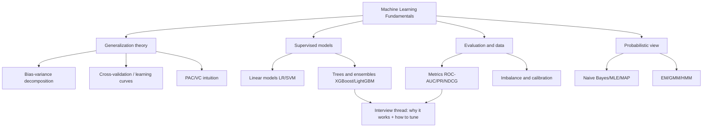

# Chapter 1 · Machine Learning Fundamentals

> **One-line summary**: This chapter answers the question that runs through every ML interview: **why does a model generalize, and why does it fail?** Starting from the bias-variance decomposition, it walks through linear models, tree models, regularization, evaluation metrics, class imbalance, and probabilistic models, compressing each derivation into something you can reproduce at a whiteboard.
>
> **Keywords**: `bias-variance` generalization `regularization` tree models `evaluation metrics` `EM`

## What this chapter covers

- [Bias, variance, and generalization](01-bias-variance-and-generalization.md) — How is generalization error decomposed? Cross-validation, learning curves, and VC-dimension intuition.
- [Linear models and SVM](02-linear-models-and-svm.md) — Closed-form least squares, logistic-regression loss and gradient, margin maximization, and the kernel trick.
- [Tree models and ensembling](03-tree-models-and-ensembles.md) — Split criteria, random forests, GBDT, XGBoost second-order expansion, and LightGBM histograms.
- [Regularization and feature engineering](04-regularization-and-feature-engineering.md) — Geometry and Bayesian views of L1/L2, feature scaling/encoding/selection, and data leakage.
- [Evaluation metrics](05-evaluation-metrics.md) — Confusion matrix, ROC/AUC, PR/AP, regression metrics, ranking metrics, and online A/B tests.
- [Sampling and class imbalance](06-sampling-and-class-imbalance.md) — Resampling, SMOTE, cost sensitivity, threshold moving, and probability calibration.
- [Probabilistic models and EM](07-probabilistic-models-and-em.md) — Naive Bayes, MLE/MAP, EM/ELBO, GMM, HMM, and CRF.

## Chapter map

## Study plan

1. **Read 01 and 05 first** (about half a day): build the frameworks for "generalization" and "evaluation"; every later model can then be measured with the same two rulers.
2. **Then read 02 and 03** (about one day): practice derivations on linear models and engineering details on tree models; you must be able to write the XGBoost objective expansion on a whiteboard.
3. **Finally read 04, 06, and 07** (about one day): these three notes patch the first two parts and often show up as interview follow-ups.
4. For each note, cover the answers and retell the Q&A out loud; if you get stuck, go back to the formulas. The cheat sheet is for the day before an interview.

Expected total time: **2.5-3 days**. If time is tight, prioritize: bias-variance → evaluation metrics → XGBoost → logistic regression/SVM.

## How it connects to other chapters

- [Deep Learning Fundamentals](../02-dl-fundamentals/README.md): the bias-variance, regularization, and optimization views transfer directly; backpropagation and initialization are covered there.
- [Reinforcement Learning](../03-reinforcement-learning/README.md): value-function overestimation and the exploration-exploitation trade-off also reflect a bias-variance trade-off.
- [Large Language Models](../04-llm/README.md): evaluation metrics (AUC/NDCG/calibration) and sampling strategies carry over to recommendation and advertising.
- [ML System Design](../06-ml-system-design/README.md): offline metrics, data leakage, and class imbalance are common follow-ups in system-design interviews.
- [Interview Question Bank](../08-interview-bank/README.md): the conclusions from this chapter are summarized in the [ML/DL cheat sheet](../08-interview-bank/01-ml-dl-cheatsheet.md).

## Interview weight and common questions

| Role | Weight | Most frequently asked |
| --- | --- | --- |
| General algorithms / MLE | High | Bias-variance, overfitting, LR/SVM, XGBoost, AUC |
| Recommendation / advertising | High | Evaluation metrics, class imbalance, feature engineering, GBDT tuning |
| LLM / large models | Medium | Evaluation and calibration, sampling, probabilistic-model intuition (EM/Bayes) |
| ML Infra | Low-medium | Metric definitions, offline/online consistency |

## Self-check list

- [ ] Write the bias-variance decomposition from memory and explain each term
- [ ] Explain why L1 produces sparsity and why L2 produces smoothness
- [ ] Derive the cross-entropy loss and gradient of logistic regression
- [ ] Write the SVM primal problem, dual problem, and KKT conditions
- [ ] Hand-derive the XGBoost second-order objective expansion and split gain
- [ ] Explain LightGBM's histogram, leaf-wise growth, GOSS, and EFB
- [ ] Distinguish when to use ROC-AUC versus PR-AUC
- [ ] List at least five ways to handle class imbalance and their side effects
- [ ] Write the EM E-step/M-step and ELBO, and explain monotonic convergence
- [ ] Distinguish MLE from MAP, and generative from discriminative models

## References

- [MachineLearningFAQ · bagu.md](https://github.com/nxpeng9235/MachineLearningFAQ/blob/main/bagu.md)
- [MLE Interview · ML theory](https://longxingtan.gitbook.io/mle-interview)
- [The Elements of Statistical Learning](https://hastie.su.domains/ElemStatLearn/)
- [scikit-learn User Guide](https://scikit-learn.org/stable/user_guide.html)
