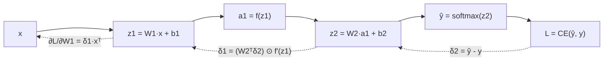

# Neural Networks and Backpropagation

> **One-line summary**: A neural network is a composition of linear transforms and nonlinear activations, and backpropagation is the algorithm that uses the chain rule to compute the loss gradient for every parameter in one backward pass; whether training moves at all depends on keeping the gradient scale under control through initialization, activations, and architecture.
>
> **Keywords**: `MLP` `universal approximation` `chain rule` `computation graph` `vanishing/exploding gradients` `residual connections` `FLOP counting`

## 1. Core concepts

**Neuron**: take a weighted sum of the inputs, add a bias, and pass the result through a nonlinear function:

$$z = \sum_i w_i x_i + b, \qquad a = f(z)$$

**Multilayer perceptron (MLP)**: stack neurons in layers, feeding the output of layer $l$ into layer $l+1$:

$$z^{(l)} = W^{(l)} a^{(l-1)} + b^{(l)}, \qquad a^{(l)} = f\big(z^{(l)}\big), \qquad a^{(0)} = x$$

**Forward pass**: compute from the input to the output and obtain the loss $L$.

**Backward pass (backpropagation)**: start from the loss and use the chain rule to compute $\partial L/\partial \theta$. It only computes gradients; the actual parameter update is done by the optimizer (see [06 Optimizers and training tricks](06-optimizers-and-training-tips.md)).

**Why nonlinearity is mandatory**: if $f$ is the identity, composing layers is still an affine transform, so depth is wasted. Nonlinearity turns the network into a powerful "piecewise-linear or smooth" approximator, which is what enables universal approximation.

## 2. Principles and derivations

### 2.1 Forward pass and notation

Let the input be $x \in \mathbb{R}^{d_0}$, with $L$ layers and width $d_l$ at layer $l$:

$$a^{(0)} = x, \quad z^{(l)} = W^{(l)}a^{(l-1)} + b^{(l)}, \quad a^{(l)} = f(z^{(l)}), \quad l = 1,\dots,L$$

where $W^{(l)} \in \mathbb{R}^{d_l \times d_{l-1}}$ and $b^{(l)} \in \mathbb{R}^{d_l}$. The final output is written $\hat{y} = a^{(L)}$.

**Loss**: cross-entropy (with softmax) for classification, mean squared error for regression:

$$L_{CE} = -\sum_{c} y_c \log \hat{y}_c, \qquad L_{MSE} = \frac{1}{2}\lVert \hat{y} - y \rVert^2$$

### 2.2 Chain rule and error terms

Backpropagation is built around an **error term** per layer (the gradient of the loss with respect to that layer's pre-activation $z^{(l)}$):

$$\delta^{(l)} \triangleq \frac{\partial L}{\partial z^{(l)}}$$

By the chain rule, the error of the next layer propagates to the previous one as:

$$\delta^{(l)} = \left(W^{(l+1)T}\delta^{(l+1)}\right) \odot f'\big(z^{(l)}\big)$$

where $\odot$ is elementwise multiplication. The parameter gradients are:

$$\frac{\partial L}{\partial W^{(l)}} = \delta^{(l)}\big(a^{(l-1)}\big)^T, \qquad \frac{\partial L}{\partial b^{(l)}} = \delta^{(l)}, \qquad \frac{\partial L}{\partial a^{(l-1)}} = W^{(l)T}\delta^{(l)}$$

**Output layer**: softmax plus cross-entropy gives the neat result $\delta^{(L)} = \hat{y} - y$ (derivation in the Q2 follow-up); MSE with an identity output gives $\delta^{(L)} = \hat{y} - y$ as well. Interviews often ask you to start from $\delta^{(L)}$ and work backward, so remembering this starting point saves a lot of time.

### 2.3 The computation-graph view

Treat every operator as a node: record intermediate results on the way forward, then call each operator's vector-Jacobian product (VJP) in reverse topological order on the way back:



Reverse-mode automatic differentiation costs about twice a forward pass, which is why PyTorch's `backward()` is so efficient.

### 2.4 Vanishing and exploding gradients

Expand the recursion for the error term:

$$\delta^{(l)} = \prod_{k=l+1}^{L} \left(W^{(k)T}\,\mathrm{diag}\big(f'(z^{(k-1)})\big)\right)\delta^{(L)}$$

The gradient is a product of matrices. If their singular values are mostly $<1$, the gradient decays exponentially with depth (**vanishing gradients**); if mostly $>1$, it blows up (**exploding gradients**).

Typical sources:

- **sigmoid**: $f'(z)=\sigma(z)(1-\sigma(z)) \le 0.25$, so each layer shrinks the gradient by at least 4x; 20 layers put you in the $4^{-20}$ range.
- **Initialization variance too small or too large**: the element variance of $W$ decides whether activation variance shrinks or diverges layer by layer (see [02 Activation functions and initialization](02-activations-and-initialization.md)).
- **Multiplication along the time axis in RNNs**: the same $W_{hh}$ is multiplied $T$ times, which is especially bad on long sequences (see [04 CNNs and RNNs](04-cnn-and-rnn.md)).

Mitigations: ReLU-family activations, Xavier/He initialization, normalization (BN/LN), residual connections, gradient clipping, and gated architectures.

### 2.5 Residual connections

The core idea of ResNet is to let a layer learn a **residual** instead of the full mapping:

$$y = x + F(x) \quad\Longrightarrow\quad \frac{\partial y}{\partial x} = I + \frac{\partial F}{\partial x}$$

There is always an **identity path** $I$ in the gradient, so even when $\partial F/\partial x$ is small the gradient is not completely killed. Residuals also ease **degradation**: deeper plain networks can have higher training error, which is not overfitting but an optimization problem.

### 2.6 Parameter and FLOP counting

For a linear layer $d_{in} \to d_{out}$:

$$\text{params} = d_{in}d_{out} + d_{out}, \qquad \text{forward FLOPs} \approx 2\,d_{in}d_{out}\ \text{(per sample)}$$

**Example**: a $784 \to 512 \to 256 \to 10$ MLP has $784\times512 + 512\times256 + 256\times10 + (512+256+10) \approx 5.36\times10^5$ parameters.

Rule of thumb: for matrix-multiplication-dominated models, **forward FLOPs ≈ 2 x parameter count** per token or sample, and training ≈ 3x forward ≈ 6 x parameter count x token count. This number comes up constantly when estimating compute and latency in system design (see [ML Infra](../07-ml-infra/README.md)).

## 3. Implementation notes

```python
import torch, torch.nn as nn

class TwoLayerMLP(nn.Module):
    def __init__(self, d_in, d_hidden, d_out):
        super().__init__()
        self.fc1 = nn.Linear(d_in, d_hidden)
        self.fc2 = nn.Linear(d_hidden, d_out)

    def forward(self, x):
        h = torch.relu(self.fc1(x))   # z1 = W1x+b1, a1 = relu(z1)
        return self.fc2(h)            # logits

model = TwoLayerMLP(784, 256, 10)
loss_fn = nn.CrossEntropyLoss()       # internally does log_softmax + NLL, numerically stabler
opt = torch.optim.SGD(model.parameters(), lr=0.1, momentum=0.9)

logits = model(torch.randn(32, 784))
loss = loss_fn(logits, torch.randint(0, 10, (32,)))
loss.backward()                       # backprop; gradients accumulate into .grad
opt.step(); opt.zero_grad()           # update + clear gradients
```

Key points:

1. Use `nn.CrossEntropyLoss` instead of writing `log(softmax)` yourself to avoid numerical underflow.
2. `zero_grad()` must be called before `backward()` or after `step()`, otherwise gradients accumulate.
3. To verify a hand-derived formula, use `torch.autograd.gradcheck` against numerical gradients in **double precision on small inputs**.

## 4. Interview Q&A

### Q1. Why does a neural network absolutely need a nonlinear activation?
**Answer**: Without nonlinearity, $W_2(W_1x+b_1)+b_2 = (W_2W_1)x + (W_2b_1+b_2)$ is still an affine transform, so a network of any depth is equivalent to a one-layer linear model and the parameter count buys no extra capacity. With nonlinearity the network can approximate any continuous function (universal approximation), and depth starts to provide hierarchical feature composition.
**Follow-up**: ReLU is piecewise linear too, so why does it count as nonlinear? Because the composition is not a single affine function and the breakpoints move with the input; a wide enough ReLU network still has the universal approximation property.

### Q2. Derive backpropagation for a two-layer MLP.
**Answer**: Let $z_1=W_1x+b_1$, $a_1=f(z_1)$, $z_2=W_2a_1+b_2$, $\hat{y}=\mathrm{softmax}(z_2)$, with cross-entropy loss. First compute the output error $\delta_2=\hat{y}-y$; propagate back to the hidden layer with $\delta_1=(W_2^T\delta_2)\odot f'(z_1)$; finally $\partial L/\partial W_2=\delta_2a_1^T$, $\partial L/\partial W_1=\delta_1x^T$, and the bias gradient is the corresponding $\delta$. The whole process only uses matrix multiplication, elementwise multiplication, and transposes.
**Follow-up**: Why is $\delta_2=\hat{y}-y$? Because $\partial L/\partial z_{2,i}=\hat{y}_i\sum_j y_j - y_i = \hat{y}_i-y_i$ with $\sum_j y_j=1$, the standard result of pairing softmax with cross-entropy.

### Q3. Can all parameters be initialized to zero or to the same constant?
**Answer**: No. If all neurons in a layer share the same weight, their forward outputs are identical, their backward gradients are identical, and they stay identical after the update; the layer is effectively a single neuron, which breaks the premise that different neurons learn different features and prevents the network from fitting. Random initialization is required to break symmetry.
**Follow-up**: Can biases be initialized to zero? Yes. Biases do not break symmetry across the input dimension, but weights must be random; in practice biases are often initialized to zero.

### Q4. What causes vanishing and exploding gradients, and how do you mitigate them?
**Answer**: The root cause is that backprop multiplies gradients layer by layer, $\delta^{(l)}=\prod(W^T\mathrm{diag}(f'))\delta^{(L)}$; singular values persistently below 1 cause vanishing and above 1 cause exploding. Mitigations: switch to non-saturating activations such as ReLU/GELU, hold the variance steady with Xavier/He initialization, add BN/LN, provide an identity path with residual connections, clip gradients (mostly for exploding), and use LSTM gates on sequences.
**Follow-up**: Can gradient clipping fix vanishing gradients? No. It only rescales by a norm cap to prevent exploding gradients from producing NaN; vanishing must be addressed through architecture, initialization, and normalization.

### Q5. Why do residual connections allow training very deep networks?
**Answer**: The Jacobian of $y=x+F(x)$ is $I+\partial F/\partial x$, so the backward pass has an identity path that passes through no weights and deep gradients do not vanish from repeated multiplication. It also recasts "learn the full mapping" as "learn the residual", which is an easier optimization target. What it fixes is degradation and optimization difficulty, not overfitting.
**Follow-up**: How does this differ from DenseNet's dense connectivity? Residuals add and each layer connects only to the previous one; DenseNet concatenates and each layer connects to all earlier layers, giving stronger feature reuse at higher memory cost.

### Q6. What does the universal approximation theorem say, and what does it not say?
**Answer**: It says a single-hidden-layer network with enough hidden units can approximate any continuous function on a compact set to arbitrary accuracy, i.e. representational capacity is not the bottleneck. But it does **not** say how many parameters are needed, whether the function is learnable from finite data, whether optimization converges, or whether generalization is good - those are the genuinely hard parts of deep learning.
**Follow-up**: Why not use a single "universal" hidden layer in practice? At equal parameter count the width a shallow network needs can grow exponentially; deep networks are more parameter-efficient through hierarchical composition.

### Q7. How do you estimate a model's parameter count and compute?
**Answer**: A linear layer has $d_{in}d_{out}+d_{out}$ parameters and about $2d_{in}d_{out}$ forward FLOPs (a multiply and an add each count once); a convolution layer has $K^2C_{in}C_{out}+C_{out}$ parameters, with FLOPs multiplied by the output spatial size. Sum over all layers. A Transformer layer has about $12d^2$ parameters (see [05 Transformer basics](05-transformer-basics.md)), and inference FLOPs are about $2\times$ parameter count per token.
**Follow-up**: Why is training compute about 3x the forward pass? One forward pass plus roughly one matrix multiply for the input gradient and one for the parameter gradient, so about three passes in total.

### Q8. How do backpropagation and gradient descent relate?
**Answer**: Backpropagation is the algorithm that **computes gradients** (chain rule plus computation graph); gradient descent is the algorithm that **updates parameters with those gradients** ($\theta \leftarrow \theta-\eta\nabla_\theta L$). The former is agnostic to the optimizer: SGD, Adam, and LBFGS can all sit on top of it. The latter does not require backprop at all (numerical gradients or evolution strategies also work), it is just much less efficient.
**Follow-up**: Does backprop run once or once per layer? A single backward traversal yields gradients for all parameters at once, at a cost on the order of one forward pass.

### Q9. What is the difference between dynamic and static graphs?
**Answer**: A static graph is defined first and run later (TF 1.x, TorchScript); it allows global optimization and is deployment-friendly, but debugging is painful. A dynamic graph is built while running (PyTorch); it is easy to debug and supports variable control flow, at the cost of Python overhead and less graph-level optimization. Modern frameworks mostly use "dynamic graph for development plus compile/export optimization" (for example `torch.compile` and ONNX).
**Follow-up**: What does `torch.compile` do? It captures the computation graph and applies operator fusion and memory planning, essentially adding static optimization on top of the dynamic graph.

### Q10. Why is "deep" usually more effective than "wide"?
**Answer**: Depth brings hierarchical composition: shallow layers learn edges and local patterns, deeper layers combine them into semantic parts, which is more parameter-efficient for complex functions at the same budget; residuals, normalization, and initialization make deep models trainable. But depth also brings serial latency, gradient-propagation, and memory issues, so more depth is not always better.
**Follow-up**: When is widening better? When the data or task is simple, when strong parallelism is needed, or when depth has saturated; widening (or scaling parameters via MoE) is then the better trade.

## 5. Pitfalls and follow-ups

- **Mistaking `loss.backward()` for a parameter update**: it only accumulates gradients; you still need `optimizer.step()`.
- **Forgetting `zero_grad()`**: gradients accumulate across batches, which effectively multiplies the learning rate.
- **Blaming vanishing gradients only on sigmoid**: initialization variance, missing normalization, and deep multiplication are equally common causes.
- **Believing residuals fix overfitting**: residuals mainly fix optimization and degradation; overfitting needs regularization, more data, and early stopping.
- **Confusing FLOPs with parameter count**: parameters determine weight memory, FLOPs determine compute and latency; they are set by different dimensions.

## 6. Cheat sheet

| Symptom | Mathematical cause | First-line fix |
| --- | --- | --- |
| Vanishing gradients | Product factors with singular values $<1$ (sigmoid derivative $\le0.25$) | ReLU/GELU, He initialization, LN, residuals |
| Exploding gradients | Product factors with singular values $>1$ | Gradient clipping, Xavier, lower lr, normalization |
| Deep degradation | Identity mapping is hard to learn, optimization is difficult | Residual connections, Pre-LN |
| Symmetry not broken | All weights identical | Random initialization (Xavier/He) |
| Numerical underflow | Computing `log(softmax)` directly | Use `CrossEntropyLoss` / log-sum-exp |

**One-sentence mnemonic**: forward computes values, backward computes gradients, the optimizer takes a step; stable gradients come from "non-saturating activations + correct initialization variance + normalization + residuals".

## 7. References

- [Deep Learning · Goodfellow et al.](https://www.deeplearningbook.org/): Chapters 6 and 8
- [MachineLearningFAQ · bagu.md](https://github.com/nxpeng9235/MachineLearningFAQ/blob/main/bagu.md): backpropagation, vanishing gradients
- [llm_interview_note](https://github.com/wdndev/llm_interview_note): backpropagation and training details
- [ResNet paper](https://arxiv.org/abs/1512.03385)
