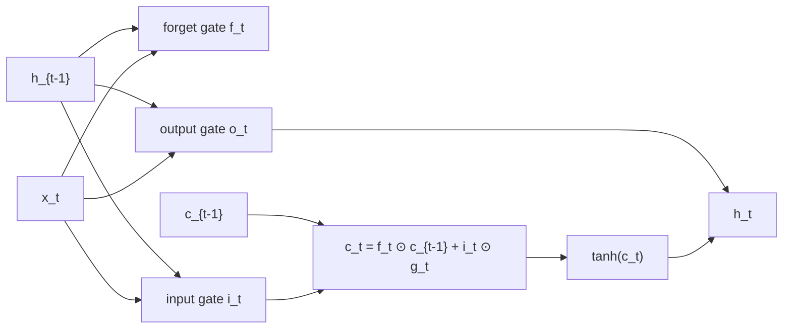

# CNNs and RNNs

> **One-line summary**: CNNs bake the spatial prior of images into the network through local connectivity and weight sharing, while RNNs bake the temporal prior of sequences in through a recurrent hidden state; the former wins on parameter efficiency and parallelism, the latter on variable-length sequences, but multiplication along the time axis makes long-range dependencies hard to train - the direct motivation for the Transformer.
>
> **Keywords**: `convolution` `receptive field` `1x1 convolution` `depthwise separable` `ResNet` `LSTM/GRU` `BPTT` `seq2seq`

## 1. Core concepts

**Inductive biases of convolution**:

- **Local connectivity**: one output depends only on a local input window ($K\times K$), matching the image prior that neighboring pixels are correlated.
- **Weight sharing**: the same kernel slides over the whole image, so the parameter count is independent of image size.
- **Translation equivariance**: shift the input and the feature map shifts the same way (pooling adds approximate translation invariance).

**Inductive bias of RNNs**: every position in the sequence shares one set of parameters, and the hidden state $h_t$ compresses the information up to time $t$, which lets the model handle sequences of any length.

## 2. Principles and derivations

### 2.1 Convolution and output size

What deep learning calls "convolution" is really **cross-correlation** (the kernel is not flipped):

$$y_{i,j}=\sum_{c=1}^{C_{in}}\sum_{u=0}^{K-1}\sum_{v=0}^{K-1}W_{c,u,v}\,x_{c,\,i\cdot S+u,\,j\cdot S+v}+b$$

Output spatial size:

$$O=\left\lfloor\frac{I+2P-K}{S}\right\rfloor+1$$

**Example**: $I=224,K=3,P=1,S=1\Rightarrow O=224$ (same padding); $S=2\Rightarrow O=112$.

**Parameter count** (one convolution layer):

$$\text{params}=K^2\,C_{in}\,C_{out}+C_{out}$$

**Forward FLOPs** (per sample): $2\cdot O^2\cdot K^2\cdot C_{in}\cdot C_{out}$ (a multiply and an add each count once).

### 2.2 Receptive field

The receptive field of layer $l$ satisfies:

$$RF_l=RF_{l-1}+(K_l-1)\prod_{i<l}S_i$$

**Example**: three $3\times3$ convolutions with stride 1 give $RF=1+2+2+2=7$. In other words, stacking three $3\times3$ layers matches the receptive field of one $7\times7$ layer but uses only $3\times9=27$ parameters versus $49$, with more nonlinearity - the core motivation for VGG's small-kernel stacking.

### 2.3 1x1 convolution

A $K=1$ convolution performs a **cross-channel linear combination** at every spatial position. Its uses:

1. **Channel up/down-projection**: compress $C_{in}$ to $C_{bottleneck}$ and greatly reduce the compute of subsequent $3\times3$ convolutions (ResNet bottlenecks, Inception).
2. **Cross-channel information fusion**: equivalent to a per-pixel fully connected layer.
3. **Extra nonlinearity**: a 1x1 followed by ReLU adds a per-pixel nonlinear layer.

### 2.4 Depthwise separable convolution

Split a standard convolution into two steps:

- **Depthwise**: convolve each input channel separately with a $K\times K$ kernel, using $K^2C$ parameters.
- **Pointwise**: a $1\times1$ convolution mixes channels, using $C\cdot C_{out}$ parameters.

The total drops from $K^2CC_{out}$ to $K^2C+CC_{out}$. For $K=3$ the compression ratio is roughly

$$\frac{K^2C+CC_{out}}{K^2CC_{out}}=\frac{1}{C_{out}}+\frac{1}{K^2}\approx\frac{1}{9}+\frac{1}{C_{out}}$$

For large $C_{out}$ this is about $1/8$ to $1/9$ of a standard convolution, the key to running MobileNet on phones.

### 2.5 Dilated convolution and pooling

- **Dilated convolution**: insert $d-1$ holes between kernel elements, giving an effective kernel size $K_{eff}=K+(K-1)(d-1)$; it enlarges the receptive field without extra parameters and without losing resolution, and is common in segmentation (DeepLab).
- **Pooling**: max/avg pooling downsamples, provides some translation invariance, and reduces compute; global average pooling (GAP) replacing fully connected layers cuts parameters and reduces overfitting. The cost is losing precise positional information.

### 2.6 Evolution of classic networks

| Network | Year | Core contribution |
| --- | --- | --- |
| LeNet-5 | 1998 | The first successful recipe: convolution + pooling + fully connected layers |
| AlexNet | 2012 | ReLU, dropout, GPU training, data augmentation; the ImageNet breakthrough |
| VGG | 2014 | All $3\times3$ small kernels stacked, showing that depth matters |
| ResNet | 2015 | Residual connections + BN, trainable to hundreds of layers |
| Inception | 2014 | Multi-scale parallel branches + 1x1 dimension reduction (GoogLeNet) |
| DenseNet | 2017 | Each layer concatenates all previous layers; stronger reuse, fewer parameters |
| MobileNet | 2017 | Depthwise separable convolution, efficient on mobile |

### 2.7 RNN / LSTM / GRU

**Vanilla RNN**:

$$h_t=\tanh\big(W_h h_{t-1}+W_x x_t+b\big), \qquad y_t=W_y h_t$$

**BPTT and vanishing gradients**: backpropagating through time gives

$$\frac{\partial h_t}{\partial h_{t-1}}=\mathrm{diag}\big(\tanh'(\cdot)\big)W_h$$

The gradient is a product of $T$ such matrices. If the spectral radius of $W_h$ is $<1$ the gradient vanishes exponentially, and if $>1$ it explodes; the tanh derivative $\le1$ makes vanishing worse. This is why vanilla RNNs cannot learn long-range dependencies.

**LSTM** (three gates plus a cell state):

$$f_t=\sigma(W_f[h_{t-1},x_t]+b_f), \quad i_t=\sigma(W_i[h_{t-1},x_t]+b_i)$$
$$o_t=\sigma(W_o[h_{t-1},x_t]+b_o), \quad g_t=\tanh(W_g[h_{t-1},x_t]+b_g)$$
$$c_t=f_t\odot c_{t-1}+i_t\odot g_t, \qquad h_t=o_t\odot\tanh(c_t)$$

**The key point**: the cell-state update is **additive**, and $\partial c_t/\partial c_{t-1}=f_t$ is diagonal. When the forget gate $f_t\approx1$, gradients can travel a long way along $c$ almost losslessly - the mathematical reason LSTM mitigates vanishing gradients (it does not fully solve it).

**GRU** (two gates, one fewer state):

$$z_t=\sigma(W_z[h_{t-1},x_t]), \quad r_t=\sigma(W_r[h_{t-1},x_t])$$
$$\tilde{h}_t=\tanh\big(W_h[r_t\odot h_{t-1},x_t]\big), \qquad h_t=(1-z_t)\odot h_{t-1}+z_t\odot\tilde{h}_t$$

**Parameter count** (input dim $d$, hidden size $h$, ignoring biases): each gate has one $(d+h)\times h$ matrix, LSTM has 4 gates and GRU has 3:

$$\text{LSTM}=4\big((d+h)h+h\big), \qquad \text{GRU}=3\big((d+h)h+h\big)$$



### 2.8 seq2seq and the origin of attention

**seq2seq** uses an encoder to compress the input sequence into a fixed-length vector $c$, from which the decoder generates the output. For long inputs the fixed-length vector becomes an **information bottleneck**. Bahdanau attention lets the decoder, at every step, take a weighted sum over all encoder hidden states:

$$e_{tj}=a(s_{t-1},h_j), \qquad \alpha_{tj}=\frac{\exp(e_{tj})}{\sum_k\exp(e_{tk})}, \qquad c_t=\sum_j\alpha_{tj}h_j$$

This is the direct predecessor of self-attention (see [05 Transformer basics](05-transformer-basics.md)).

## 3. Implementation notes

```python
import torch, torch.nn as nn

# sanity check the convolution output shape
conv = nn.Conv2d(3, 64, kernel_size=3, stride=2, padding=1)
x = torch.randn(8, 3, 224, 224)
print(conv(x).shape)          # [8, 64, 112, 112]

# depthwise separable: groups=C_in gives depthwise, 1x1 gives pointwise
dw = nn.Conv2d(64, 64, 3, padding=1, groups=64)
pw = nn.Conv2d(64, 128, 1)

# LSTM: input (batch, seq, feat), output (batch, seq, hidden)
lstm = nn.LSTM(input_size=128, hidden_size=256, num_layers=2,
               batch_first=True, bidirectional=True)
out, (h_n, c_n) = lstm(torch.randn(8, 20, 128))
print(out.shape, h_n.shape)   # [8, 20, 512], [4, 8, 256]
```

## 4. Interview Q&A

### Q1. What advantages does convolution have over fully connected layers?
**Answer**: (1) **Weight sharing**: one kernel is reused across the whole image, so the parameter count depends only on kernel size and channels, not resolution. (2) **Local connectivity**: matches the image prior of local correlation and generalizes better when the prior holds. (3) **Translation equivariance**: the same pattern is detected by the same weights anywhere in the image. The cost is a limited receptive field and weak global modeling, which requires stacking or attention to supplement.
**Follow-up**: Can convolution and fully connected layers be converted into each other? Yes: flattening the image and using a sparse, weight-shared giant fully connected matrix represents convolution, but the parameter count and compute are unacceptable.

### Q2. Given convolution hyperparameters, how do you compute the output size and receptive field?
**Answer**: Output size $O=\lfloor(I+2P-K)/S\rfloor+1$; receptive field $RF_l=RF_{l-1}+(K_l-1)\prod_{i<l}S_i$ with $RF_0=1$. Example: input $224$, $3\times3$, $P=1$, $S=2$ gives $112$; three $3\times3$ layers with stride 1 have receptive field 7.
**Follow-up**: Why is stacking small kernels better than one large kernel? At the same receptive field it uses fewer parameters (three $3\times3$ layers have 27 weights versus 49 for $7\times7$) and adds nonlinearity in between, which strengthens expressiveness.

### Q3. What is a 1x1 convolution good for?
**Answer**: It performs a cross-channel linear combination at each pixel, with three main uses: channel down/up-projection (bottlenecks that reduce the compute of later large kernels), cross-channel information fusion, and added per-pixel nonlinearity. It is a key component in Inception/ResNet/MobileNet.
**Follow-up**: Is a 1x1 convolution equivalent to a fully connected layer? In the "per-pixel, cross-channel" sense yes, but it preserves the spatial structure, shares parameters, and does not change the feature-map size.

### Q4. Why do depthwise separable convolutions save compute?
**Answer**: A standard convolution applies a $K\times K$ kernel over all input channels for every output channel, costing $K^2CC_{out}$; a separable convolution first does spatial convolution with $C$ independent kernels ($K^2C$) and then mixes channels with a 1x1 ($CC_{out}$), roughly $1/C_{out}+1/K^2$ of the original. For $K=3$ and large $C_{out}$ that is about $1/9$.
**Follow-up**: What is the cost? Depthwise convolves each channel independently, so cross-channel interaction is deferred to the pointwise step, slightly reducing expressiveness; in practice a width multiplier balances accuracy and speed.

### Q5. What problem does ResNet solve, and why can it train very deep?
**Answer**: Deep plain networks suffer from **degradation**: training error rises as layers are added, which is an optimization problem rather than overfitting. ResNet has each layer learn a residual $y=x+F(x)$, giving gradients an identity path $I+\partial F/\partial x$ so deep gradients do not vanish; learning something close to the identity is also easier than learning the full mapping. Together with BN and bottlenecks, this trains hundreds of layers stably.
**Follow-up**: Why is a 1x1 convolution sometimes added on the ResNet shortcut? When input and output channel counts or resolutions differ, a 1x1 matches dimensions so the addition is defined.

### Q6. How does LSTM mitigate vanishing gradients?
**Answer**: The cell state updates as $c_t=f_t\odot c_{t-1}+i_t\odot g_t$, and in the backward pass $\partial c_t/\partial c_{t-1}=f_t$ is diagonal, with no repeated multiplication by $W_h$. As long as the forget gate stays near 1, gradients can travel many steps along the cell state. The gates are sigmoid outputs that learn how much to keep, so training is far more stable than the vanilla RNN product.
**Follow-up**: Does LSTM fully solve vanishing gradients? No. It replaces a product of matrices with a product of diagonal scalings, so very long sequences still decay; it also cannot parallelize, a major reason the Transformer replaced it.

### Q7. How do you compute the parameter count of an LSTM/GRU?
**Answer**: Each gate has a $(d+h)\times h$ weight matrix and an $h$-dimensional bias, where $d$ is the input size and $h$ the hidden size. LSTM has 4 gates (forget/input/output/candidate), giving $4((d+h)h+h)$; GRU has 3 gates, giving $3((d+h)h+h)$. A bidirectional layer doubles this, and stacked layers add up per-layer dimensions.
**Follow-up**: Why does LSTM have 4 gates? Three sigmoid gates control writing, keeping, and output, and one tanh candidate generates new content - 4 parameter groups in total.

### Q8. How do GRU and LSTM differ, and how do you choose?
**Answer**: GRU merges the LSTM cell state and hidden state; an update gate $z$ controls both keeping the old state and writing the new one, and a reset gate $r$ controls how much the candidate depends on history. With 2 gates and 3 parameter groups it uses about 25% fewer parameters than LSTM and trains faster. The two are close on most tasks; GRU overfits less on small/medium data, while LSTM is slightly stronger where fine-grained memory control matters.
**Follow-up**: Why are both less used now? They cannot parallelize and still struggle with long dependencies, so Transformer has become the NLP mainstream; they remain useful on edge devices, time-series forecasting, and streaming settings.

### Q9. Why can't RNNs parallelize, and how does the Transformer fix that?
**Answer**: In an RNN, $h_t$ depends on $h_{t-1}$, so time steps have a strict data dependency and training must unroll $T$ steps serially, wasting GPU parallelism; longer sequences are slower, and gradients must BPTT through $T$ steps. Transformer self-attention computes all pairwise relationships at once, so the whole sequence trains in parallel (a causal mask only hides future information, it does not break parallelism), at the cost of $O(n^2)$ compute and memory.
**Follow-up**: Is Transformer inference fully parallel too? No: autoregressive decoding still generates token by token, but a KV cache brings each step down to $O(n)$ (see [Attention and positional encoding](../04-llm/03-attention-and-position-encoding.md)).

### Q10. What is the information bottleneck of seq2seq, and how does attention fix it?
**Answer**: Vanilla seq2seq encodes the whole input into one fixed-length vector $c$; for long inputs information is compressed away and the decoder sees the same $c$ at every step. Attention lets the decoder compute weights over all encoder hidden states at each step and take a weighted sum, dynamically focusing on relevant positions, which both relieves the bottleneck and lets gradients flow directly to distant positions.
**Follow-up**: How does this relate to self-attention? Replace "the decoder queries the encoder" with "the sequence queries itself", with Q/K/V from the same sequence, and you get self-attention; the Transformer then removes the RNN entirely.

### Q11. What are the costs of dilated convolution and pooling?
**Answer**: Dilated convolution enlarges the receptive field and preserves resolution without extra parameters, but causes "gridding": pixels between the holes are skipped, so local information becomes discontinuous. Pooling reduces resolution and compute and adds some translation invariance, but loses precise position information and hurts small objects. Both trade resolution for receptive field or invariance.
**Follow-up**: Why is dilated convolution preferred over pooling in segmentation? Pooling loses spatial detail and segmentation needs per-pixel output; dilated convolution expands the receptive field while keeping resolution, which suits dense prediction better.

## 5. Pitfalls and follow-ups

- **Forgetting the floor in the output-size formula**: use $\lfloor\cdot\rfloor$ when the division is not exact, not rounding.
- **Missing the stride product in the receptive-field recursion**: each step back must multiply by the strides of the layers before it.
- **Thinking LSTM solved long dependencies**: it only mitigates them; very long sequences still decay.
- **Confusing translation equivariance with invariance**: convolution is equivariant; only pooling/global pooling gives approximate invariance.
- **Thinking depthwise convolution mixes channels**: it does not; channel mixing is done by the pointwise step.

## 6. Cheat sheet

| Concept | Formula / result |
| --- | --- |
| Output size | $O=\lfloor(I+2P-K)/S\rfloor+1$ |
| Receptive field | $RF_l=RF_{l-1}+(K_l-1)\prod_{i<l}S_i$ |
| Convolution parameters | $K^2C_{in}C_{out}+C_{out}$ |
| Separable convolution | Compute is about $1/C_{out}+1/K^2$ of standard convolution |
| RNN | $h_t=\tanh(W_hh_{t-1}+W_xx_t+b)$ |
| LSTM | $c_t=f_t\odot c_{t-1}+i_t\odot g_t$, $h_t=o_t\odot\tanh(c_t)$ |
| GRU | $h_t=(1-z_t)\odot h_{t-1}+z_t\odot\tilde{h}_t$ |
| Parameter count | LSTM $4((d+h)h+h)$, GRU $3((d+h)h+h)$ |

**Mnemonic**: the convolution trio is locality, sharing, equivariance; the RNN story is recurrent hidden state plus multiplication along time, which is why it cannot remember the long range.

## 7. References

- [A guide to convolution arithmetic for deep learning](https://arxiv.org/abs/1603.07285): convolution size and receptive field
- [Deep Residual Learning for Image Recognition](https://arxiv.org/abs/1512.03385)
- [MobileNets](https://arxiv.org/abs/1704.04861)
- [Long Short-Term Memory](https://www.bioinf.jku.at/publications/older/2604.pdf)
- [Neural Machine Translation by Jointly Learning to Align and Translate](https://arxiv.org/abs/1409.0473): origin of attention
- [MachineLearningFAQ · bagu.md](https://github.com/nxpeng9235/MachineLearningFAQ/blob/main/bagu.md): RNN/LSTM section
