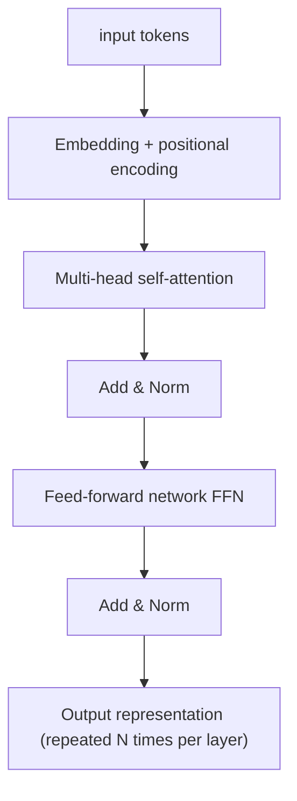

# Transformer Basics

> **One-line summary**: The Transformer uses self-attention to let any two positions in a sequence interact directly, and the whole sequence trains in parallel; the formula is just one line, $\mathrm{softmax}(QK^T/\sqrt{d_k})V$, but the scaling, multi-head split, positional encoding, masks, and Pre-LN each have a clear engineering reason.
>
> **Keywords**: `self-attention` `multi-head` `positional encoding` `RoPE` `FFN` `causal mask` `complexity` `KV cache`

## 1. Core concepts

The basic unit of a Transformer is "**multi-head self-attention + FFN**", with each sublayer wrapped in a residual and a normalization. The original paper is an encoder-decoder architecture for machine translation:



Three key design choices: **self-attention** (each position sees all positions directly, path length $O(1)$, global dependencies), **parallelism** (all positions are computed at once during training, unlike an RNN's step-by-step recurrence), and **positional encoding** (attention is order-agnostic, so position must be injected explicitly).

## 2. Principles and derivations

### 2.1 Scaled Dot-Product Attention

For an input sequence $X\in\mathbb{R}^{n\times d}$, three learnable projections produce query/key/value:

$$Q=XW_Q, \qquad K=XW_K, \qquad V=XW_V, \qquad W_Q,W_K,W_V\in\mathbb{R}^{d\times d_k}$$

$$\mathrm{Attention}(Q,K,V)=\mathrm{softmax}\left(\frac{QK^T}{\sqrt{d_k}}\right)V$$

Step by step:

1. $S=QK^T\in\mathbb{R}^{n\times n}$, where $S_{ij}=q_i\cdot k_j$ is the relevance score of position $i$ for position $j$.
2. Divide by $\sqrt{d_k}$ to scale (reason in Q2).
3. Row-wise softmax gives the attention weights $A_{ij}$, with each row summing to 1.
4. $AV$ takes a weighted sum of all values, producing a new representation for each position.

**Why divide by $\sqrt{d_k}$**: if the dimensions of $q$ and $k$ are independent with mean 0 and variance 1, then $q\cdot k$ has variance $d_k$ and standard deviation $\sqrt{d_k}$. For large $d_k$ the dot products are large and softmax saturates (one position's weight near 1, the rest near 0), so gradients approach 0. Dividing by $\sqrt{d_k}$ brings the variance back to 1 and keeps softmax in a well-conditioned region for gradients.

**Complexity** (single head, sequence length $n$, dimension $d$):

| Operation | Time | Memory |
| --- | --- | --- |
| $QK^T$ | $O(n^2d)$ | $O(n^2)$ (attention matrix) |
| softmax | $O(n^2)$ | $O(n^2)$ |
| $AV$ | $O(n^2d)$ | $O(nd)$ |
| Total | $O(n^2d)$ | $O(n^2+nd)$ |

Doubling the sequence length roughly quadruples compute and memory - the root cause of the high cost of long context (engineering optimizations in [Attention and positional encoding](../04-llm/03-attention-and-position-encoding.md)).

### 2.2 Multi-head attention

Split the $d$ dimensions into $h$ heads of size $d_k=d/h$, run attention in each, concatenate, and apply an output projection:

$$\mathrm{head}_i=\mathrm{Attention}(XW_Q^i,XW_K^i,XW_V^i), \qquad \mathrm{MHA}(X)=\mathrm{Concat}(\mathrm{head}_1,\dots,\mathrm{head}_h)W_O$$

- **Purpose**: different heads attend to different patterns in different subspaces (syntax, coreference, position, etc.), analogous to multiple kernels in a CNN.
- **Parameter count**: $W_Q,W_K,W_V$ are each $d\times d$ and $W_O$ is $d\times d$, for $4d^2$ total - the same as a single head with $d_k=d$. Multi-head does not buy expressiveness with extra parameters; it **changes the subspace partition at the same budget**.
- **Compute**: $h\times O(n^2d/h)=O(n^2d)$, the same order as a single head.

### 2.3 Positional encoding

Attention is **permutation-equivariant** over the input: shuffle the tokens and the output is shuffled the same way, so the model cannot tell which token comes first. Positional encoding is therefore required.

**Sinusoidal positional encoding (original paper)**:

$$PE_{(pos,2i)}=\sin\left(\frac{pos}{10000^{2i/d}}\right), \qquad PE_{(pos,2i+1)}=\cos\left(\frac{pos}{10000^{2i/d}}\right)$$

It has an important property: the encoding of position $pos+k$ can be written as a **linear transform** (rotation matrix) of the encoding at $pos$, so the model can learn the notion of a relative offset $k$ through a linear projection and gains some extrapolation ability.

**Other schemes (overview)**:

| Scheme | Idea | Characteristics |
| --- | --- | --- |
| Learnable absolute positions | One trainable vector per position | Simple, but cannot extrapolate beyond the training length |
| Relative positional encoding | Add a position bias to attention scores | Models relative distance directly; used by T5 and others |
| RoPE | Apply position-dependent rotations to $q,k$ | Dot product depends only on relative position, extrapolation-friendly, mainstream in LLaMA and others |
| ALiBi | Add a linear distance penalty to attention scores | No position embedding needed, simple extrapolation |

The core of RoPE is to apply rotation matrices to $q,k$ so that $\langle R_m q, R_n k\rangle$ depends only on $m-n$. Length extrapolation, NTK/YaRN, and other details live in [Attention and positional encoding](../04-llm/03-attention-and-position-encoding.md).

### 2.4 Feed-forward network (FFN)

Each position independently passes through a two-layer MLP:

$$\mathrm{FFN}(x)=W_2\,\sigma(W_1x+b_1)+b_2, \qquad d\to 4d\to d$$

- **Parameter count**: $d\cdot4d+4d\cdot d=8d^2$, the bulk of each layer's parameters (attention has only $4d^2$).
- **Role**: attention mixes information between positions, while the FFN performs a nonlinear transform within each position, similar to a key-value memory.
- **Why 4x**: an empirical choice from the original paper; a wider intermediate dimension gives more capacity. In LLMs, SwiGLU uses three matrices with a hidden size of about $\tfrac{8}{3}d$ to match the parameter count (see [02 Activation functions and initialization](02-activations-and-initialization.md)).

### 2.5 Residual connections and normalization

Each sublayer:

$$x\leftarrow x+\mathrm{Sublayer}\big(\mathrm{LN}(x)\big) \quad\text{(Pre-LN)}, \qquad x\leftarrow\mathrm{LN}\big(x+\mathrm{Sublayer}(x)\big)\quad\text{(Post-LN)}$$

The original paper used Post-LN, while modern large models almost all use Pre-LN: the residual stream is a pure identity path, gradients flow straight through, and training is stable (details in [03 Normalization techniques](03-normalization-techniques.md)). Pre-LN architectures usually add one final LN at the end.

### 2.6 Encoder / Decoder and masks

- **Encoder**: bidirectional self-attention; every position sees the entire input, and only a padding mask is needed to hide padded tokens.
- **Decoder**: two attention layers - a self-attention with a **causal mask** plus cross-attention over the encoder output ($Q$ from the decoder, $K,V$ from the encoder).

**Implementing a mask**: before softmax, fill disallowed positions with $-\infty$ (in practice $-10^9$ or `torch.finfo(dtype).min`):

$$\mathrm{scores}_{ij}=\begin{cases}q_i\cdot k_j/\sqrt{d_k}, & \text{allowed}\\-\infty, & \text{masked}\end{cases}\quad\Rightarrow\quad \mathrm{softmax}\Rightarrow A_{ij}=0$$

- **Padding mask**: positions where $\text{token}=[PAD]$ do not participate in attention.
- **Causal mask**: lower triangle 1, upper triangle 0, so position $i$ sees only positions $\le i$; this is what makes parallel training possible without leaking the future.

**Why $-\infty$ instead of multiplying by 0**: in softmax, $e^{0}=1$ still receives weight, so the position is not really masked; only $-\infty$ becomes exactly 0 after exp. You can also "softmax, multiply by the mask, and renormalize", but that is an extra step and numerically less clean.

### 2.7 Training vs inference

- **Training**: teacher forcing; the whole sequence goes through in one forward pass and the causal mask ensures each position sees only the prefix, so losses at all positions are computed in parallel. Each layer costs $O(n^2d)$.
- **Inference**: autoregressive token-by-token generation. At step $t$ only the new token's $q$ is computed, but all historical $k,v$ are needed, so they are cached (**KV cache**): each step adds about $O(nd)$ compute, and memory grows linearly with sequence length. The prefill stage processes the prompt (like training, $O(n^2d)$), and the decode stage handles one token at a time ($O(nd)$ per step).

### 2.8 Estimating the parameter count

Per layer, approximately:

$$\underbrace{4d^2}_{\text{attention}}+\underbrace{8d^2}_{\text{FFN}}+\underbrace{4d}_{\text{two LNs}}\approx12d^2$$

**BERT-base**: $d=768$, 12 layers, vocabulary about 30.5k, tied embeddings:

$$12\times12\times768^2+30522\times768\approx84.9\text{M}+23.4\text{M}\approx110\text{M}$$

which matches the official numbers. Inference FLOPs are about $2\times$ the parameter count per token, plus $O(n^2d)$ for the attention part.

## 3. Implementation notes

```python
import math, torch, torch.nn as nn, torch.nn.functional as F

def attention(q, k, v, mask=None):
    # q: (B, H, n, dk), k/v: (B, H, n, dk)
    dk = q.size(-1)
    scores = q @ k.transpose(-2, -1) / math.sqrt(dk)   # (B,H,n,n)
    if mask is not None:                               # mask: broadcastable bool
        scores = scores.masked_fill(~mask, float("-inf"))
    attn = F.softmax(scores, dim=-1)
    return attn @ v, attn

# causal mask: lower triangle True (allowed), upper triangle False (masked)
n = 5
causal = torch.tril(torch.ones(n, n, dtype=torch.bool))
q = torch.randn(2, 4, n, 16)
out, attn = attention(q, q, q, causal)
print(out.shape, attn.shape)        # [2,4,5,16], [2,4,5,5]

# compare against the built-in PyTorch implementation
mha = nn.MultiheadAttention(embed_dim=64, num_heads=4, batch_first=True)
x = torch.randn(2, 5, 64)
y, w = mha(x, x, x, attn_mask=torch.triu(torch.ones(5,5), diagonal=1).bool(),
           need_weights=True)
print(y.shape, w.shape)
```

Note: `nn.MultiheadAttention`'s `attn_mask` semantics are **True means masked**, the opposite of the custom implementation above - the most common place to introduce a bug.

## 4. Interview Q&A

### Q1. Write the self-attention formula and explain each step.
**Answer**: $Q=XW_Q,K=XW_K,V=XW_V$; $S=QK^T$ computes pairwise similarity; dividing by $\sqrt{d_k}$ stabilizes softmax; row-wise softmax gives the weights $A$; $\mathrm{output}=AV$ aggregates the values. Intuition: each position uses itself as a query, searches the keys of all positions for matches, then retrieves the corresponding values according to the match scores.
**Follow-up**: Why project Q and K separately? Using the same projection also happens in some variants, but separating them decouples "what to query" from "what can be queried", which is more flexible and is the standard choice.

### Q2. Why does attention divide by $\sqrt{d_k}$?
**Answer**: Assuming the dimensions of $q$ and $k$ are independent, zero-mean, and unit-variance, the dot product $q\cdot k$ has variance $d_k$. For large $d_k$ (say 64 or 128) the dot products are large, softmax saturates into a one-hot vector, gradients are almost 0, and training stalls. Dividing by $\sqrt{d_k}$ normalizes the variance to 1 and keeps softmax in a region with healthy gradients.
**Follow-up**: Why not divide by $d_k$? That over-shrinks, leaving variance $1/d_k$, which makes the attention distribution too smooth and less discriminative; $\sqrt{d_k}$ exactly cancels the standard deviation.

### Q3. What is the complexity of self-attention, and why is long context expensive?
**Answer**: Time $O(n^2d)$ and memory $O(n^2)$ for the attention matrix, compared with an RNN's $O(nd^2)$ (serial). For large $n$ the $n^2$ term dominates, so doubling the sequence roughly quadruples compute and memory. This motivates FlashAttention (tiling + online softmax to cut memory), sparse/sliding-window attention, and linear attention.
**Follow-up**: Does FlashAttention change the complexity? No. It uses IO-aware tiling to reduce memory traffic, bringing memory from $O(n^2)$ down to $O(n)$, while the compute remains $O(n^2d)$ - but it is much faster in practice.

### Q4. What does multi-head attention do, and does it increase the parameter count?
**Answer**: Multi-head splits the $d$ dimensions into $h$ subspaces and runs attention in parallel, letting different heads focus on different kinds of relations (local/global, syntactic/semantic), then concatenates and fuses them. The parameter count equals that of a single head with $d_k=d$, namely $4d^2$, and the compute is the same order. What it adds is subspace diversity of representations, not parameter budget.
**Follow-up**: Is more heads always better? No. Too many heads make each head's dimension $d/h$ too small and reduce expressiveness; $h=8\sim32$ with $d_k=64\sim128$ is common. MQA/GQA instead share K/V across heads to shrink the KV cache (see Chapter 4).

### Q5. Why can the Transformer parallelize while an RNN cannot?
**Answer**: In an RNN, $h_t$ depends on $h_{t-1}$, so time steps are strictly serial; Transformer self-attention computes all pairwise relations at once, with no recurrence between positions, so the whole sequence trains in parallel (the causal mask hides information but does not break parallelism). This is the fundamental reason the Transformer can exploit GPUs and scale to very long training.
**Follow-up**: Is inference also fully parallel? Not completely: autoregressive decode is still token by token; the KV cache makes each step compute only the new token, while the prefill stage can process the prompt in parallel.

### Q6. Why is positional encoding needed, and how does sinusoidal encoding represent relative position?
**Answer**: Self-attention is permutation-equivariant, so without position information it cannot distinguish "the cat chased the dog" from "the dog chased the cat". Sinusoidal encoding gives each position a unique vector using sin/cos at different frequencies, and $PE_{pos+k}$ can be expressed as a linear transform (rotation) of $PE_{pos}$, so the model can learn relative offsets and in principle extrapolate to longer sequences.
**Follow-up**: Why is RoPE now preferred over sinusoidal encoding? RoPE acts directly on $q,k$, making the dot product depend explicitly only on relative position; it is compatible with linear attention and easy to adapt for extrapolation. Sinusoidal encoding is added to the input, so its relative-position property is implicit.

### Q7. How do Pre-LN and Post-LN affect Transformer training?
**Answer**: Post-LN (original paper) puts LN after the residual addition, so gradients must cross the LN Jacobian, deep models become unstable, and warmup is needed; Pre-LN puts LN before the sublayer input, making the residual stream an identity mapping with a direct gradient path, so training is stable and insensitive to hyperparameters - hence its adoption in large models. The cost is that the residual norm accumulates, a final LN is needed, and final quality sometimes needs tuning to match Post-LN.
**Follow-up**: Are there other placements? Yes, such as Sandwich-LN (normalize both before and after the sublayer) and DeepNorm (scale the residual), all trading off stability and expressiveness.

### Q8. How are masks implemented in a Transformer, and how do padding and causal masks differ?
**Answer**: Set disallowed positions to $-\infty$ before softmax, so their weights are exactly 0 after softmax. A padding mask hides padded tokens so they cannot affect the result; a causal mask is a lower-triangular matrix that hides future positions so autoregressive training does not leak the answer. The two can be merged into a single mask.
**Follow-up**: Why not multiply by 0 after softmax? Then the row no longer sums to 1 and must be renormalized; also, if an entire row is masked (a padding row), handling via $-\infty$ before softmax is more uniform. In practice you must avoid NaN on fully masked rows.

### Q9. How do the training and inference compute patterns differ, and why is the KV cache effective?
**Answer**: Training runs the whole sequence in parallel and computes attention at every position, costing $O(n^2d)$; inference generates token by token, and at step $t$ the new token only needs its own $q$ plus all historical $k,v$. Caching those historical $k,v$ means each step computes only $O(nd)$ and avoids recomputing the prefix. The cost is that memory grows linearly with sequence length, so long context and large batches often make the KV cache the memory bottleneck.
**Follow-up**: How does the KV cache relate to MQA/GQA? MQA/GQA let multiple query heads share a small number of KV heads, directly shrinking the KV cache; MLA compresses it further with low-rank factorization. See Chapter 4 for details.

### Q10. How do you estimate a Transformer's parameter count?
**Answer**: Each layer has about $12d^2$ (attention $4d^2$ + FFN $8d^2$), plus $4d$ for the two LNs; the total is roughly $N\cdot12d^2$ plus embeddings. For BERT-base ($d=768,N=12$, vocab 30.5k), layer parameters are about 85M and embeddings about 23M, for about 110M total.
**Follow-up**: Why is the FFN the bulk? Because it is two matrices, $d\to4d\to d$, for $8d^2$, twice attention; the ratio is even more pronounced in LLMs.

### Q11. Why is the FFN necessary, and can it be removed?
**Answer**: No. Attention only does weighted aggregation between positions, which is essentially a linear mixture (the softmax weights are nonlinear, but the values are combined linearly); the FFN provides a per-position nonlinear transform and much more parameter capacity. Alternating the two is what makes the model expressive. Removing the FFN significantly reduces capacity and quality.
**Follow-up**: How do you remember the division of labor? Attention handles communication between tokens (token mixing), and the FFN handles feature transformation within each token (channel mixing).

### Q12. What is the difference between encoder-decoder and decoder-only?
**Answer**: Encoder-decoder has a separate encoder and decoder; the decoder attends to the encoder output through cross-attention, which suits input-to-output tasks such as translation and summarization. Decoder-only has only causal self-attention, trains with next-token prediction, unifies all tasks in one model, and is the mainstream architecture for GPT/LLaMA-style LLMs. The choice is tightly coupled to the training objective and task shape.
**Follow-up**: Why is decoder-only the LLM mainstream? The training objective is simple and scalable, the KV cache is inference-friendly, zero-shot and in-context learning are strong, and it scales well. See [LLM architecture evolution](../04-llm/02-llm-architecture-evolution.md).

## 5. Pitfalls and follow-ups

- **Getting mask semantics backwards**: `nn.MultiheadAttention`'s `attn_mask` uses True = masked; custom implementations often use True = keep.
- **NaN from fully masked rows**: when an entire row is masked, softmax hits $0/0$; handle it specially or guarantee it cannot happen.
- **Forgetting positional encoding**: attention is order-agnostic, so omitting positions is equivalent to a bag of words.
- **Miscounting multi-head parameters**: each head is $d\times d/h$, and $h$ heads concatenated still give $d\times d$, so the total does not change with the number of heads.
- **Treating prefill and decode as the same**: prefill is $O(n^2d)$ matrix compute, while decode is a memory-bound $O(nd)$ per step; the optimization techniques are completely different.

## 6. Cheat sheet

| Component | Formula | Parameters |
| --- | --- | --- |
| self-attention | $\mathrm{softmax}(QK^T/\sqrt{d_k})V$ | $4d^2$ |
| Multi-head | $\mathrm{Concat}(\mathrm{head}_i)W_O$ | $4d^2$ |
| FFN | $W_2\sigma(W_1x)$, $d\to4d\to d$ | $8d^2$ |
| Per-layer total | attention + FFN + LN | $\approx12d^2$ |

| Concept | Conclusion |
| --- | --- |
| Complexity | Time $O(n^2d)$, memory $O(n^2)$ |
| Scaling | Divide by $\sqrt{d_k}$ to normalize the dot-product variance to 1 |
| Positional encoding | Sinusoidal / learnable / relative / RoPE / ALiBi |
| Mask | Fill $-\infty$ before softmax; padding + causal can be merged |
| Training | Whole sequence in parallel, causal mask prevents leakage |
| Inference | Token by token + KV cache, $O(nd)$ per step |

**Mnemonic**: Q queries K, softmax normalizes, V is aggregated; scaling stabilizes gradients, heads split subspaces, positions add order, masks prevent peeking.

## 7. References

- [Attention Is All You Need](https://arxiv.org/abs/1706.03762)
- [The Annotated Transformer](https://nlp.seas.harvard.edu/annotated-transformer/)
- [RoFormer (RoPE)](https://arxiv.org/abs/2104.09864)
- [Train Short, Test Long (ALiBi)](https://arxiv.org/abs/2108.12409)
- **Further reading**: architecture and engineering evolutions such as MQA/GQA/MLA, FlashAttention, sliding windows, long-context extrapolation, and MoE are covered in [Attention and positional encoding](../04-llm/03-attention-and-position-encoding.md) and [LLM architecture evolution](../04-llm/02-llm-architecture-evolution.md)
