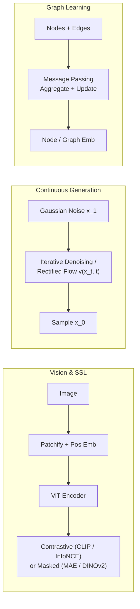

# Vision, Contrastive Learning, Diffusion, and GNNs

> **One-line summary**: Four modern deep-learning paradigms every MLE meets beyond plain text Transformers — **ViT** turns images into patch tokens, **CLIP / SSL** learns aligned representations without labels, **Diffusion / Flow Matching** generates continuous data by reversing noise along curved or straight paths, and **GNNs** aggregate graph neighborhoods with message passing.
>
> **Keywords**: `ViT` `CLIP` `InfoNCE` `MAE` `DINOv2` `DDPM` `Flow Matching` `CFG` `GNN` `over-smoothing` `GraphSAGE`

## 1. Core concepts



| Paradigm | Core inductive bias | Representative models | Main MLE use cases |
| --- | --- | --- | --- |
| **ViT** | Global self-attention over image patches | ViT, SigLIP, Swin | Image/video encoders for VLMs, visual search |
| **Contrastive / SSL** | Pull positives together, push negatives apart (or reconstruct masked views) | CLIP, SigLIP, MAE, DINOv2 | Zero-shot retrieval, multimodal embeddings, pretraining |
| **Diffusion / Flow Matching** | Progressive denoising / velocity field transport from noise to data | DDPM, SDXL, Flux, SD3 | Image/video/audio generation, protein/molecule design |
| **GNN** | Permutation-equivariant neighborhood aggregation on graphs | GCN, GraphSAGE, GAT | Fraud rings, PYMK, item-graph recsys, molecules |

## 2. Principles and derivations

### 2.1 Vision Transformer (ViT)

Split an image $X\in\mathbb{R}^{H\times W\times C}$ into $N = (H/P)(W/P)$ non-overlapping patches of size $P\times P$, flatten and linearly project each patch into $D$ dimensions (equivalently a `Conv2d(C, D, kernel_size=P, stride=P)`), prepend a `[CLS]` token (or use global average pooling), add 2D positional embeddings, and run a standard Transformer encoder.

- **ViT vs. CNN**: CNNs bake in translation equivariance and locality, so they shine on small data; ViTs have weak spatial inductive bias, scale much better with large data/compute, and unify cleanly with text Transformers.
- **Quadratic token cost**: doubling image resolution quadruples patch count $N$ and increases self-attention cost by $16\times$ (addressed by windowed attention like Swin or dynamic tiling in VLMs).

### 2.2 Contrastive Learning (CLIP / InfoNCE) and Self-Supervised Learning

Given a batch of $B$ matched image-text pairs $\lbrace(I_i, T_i)\rbrace_{i=1}^{B}$, encode them into L2-normalized vectors $u_i, v_i$, and optimize symmetric **InfoNCE** with learnable temperature $\tau$:

$$
\mathcal{L}_{I\to T} = -\frac{1}{B}\sum_{i=1}^{B}\log\frac{\exp(u_i^\top v_i / \tau)}{\sum_{j=1}^{B}\exp(u_i^\top v_j / \tau)}, \qquad \mathcal{L}_{\mathrm{CLIP}} = \frac{1}{2}(\mathcal{L}_{I\to T} + \mathcal{L}_{T\to I})
$$

- **Why temperature $\tau$ matters**: small $\tau$ sharpens softmax and focuses gradients on **hard negatives**; too small destabilizes training (CLIP clips $1/\tau \le 100$).
- **Why large batches matter**: in-batch negatives come from the other $B-1$ items; larger $B$ supplies harder negatives. **SigLIP** replaces softmax InfoNCE with pairwise sigmoid binary cross-entropy, removing the global batch-wide normalization dependency and working well at smaller batches.
- **Vision SSL beyond contrastive**: **MAE** masks ~75% of patches and reconstructs pixels (fast pretraining, strong fine-tuning); **DINOv2** uses self-distillation between local/global crops with a momentum teacher (strong dense/frozen features without text).

### 2.3 Generative Models: Diffusion (DDPM) vs. Flow Matching

**DDPM (Denoising Diffusion)** defines a fixed forward noising process:

$$
x_t = \sqrt{\bar{\alpha}_t}\,x_0 + \sqrt{1-\bar{\alpha}_t}\,\epsilon, \qquad \epsilon \sim \mathcal{N}(0, I)
$$

and trains a network $\epsilon_\theta(x_t, t)$ to predict the injected noise via simple MSE: $\mathcal{L} = \mathbb{E}\|\epsilon - \epsilon_\theta(x_t, t)\|^2$ (a weighted ELBO; mathematically linked to score matching $\nabla_x \log p_t(x)$).

**Flow Matching / Rectified Flow** (used in SD3, Flux, modern video models) replaces curved SDE trajectories with **straight linear interpolation** between data $x_0$ and noise $x_1 \sim \mathcal{N}(0, I)$:

$$
x_t = (1-t)x_0 + t x_1, \qquad u_t = \frac{dx_t}{dt} = x_1 - x_0
$$

$$
\mathcal{L}_{\mathrm{FM}} = \mathbb{E}_{t, x_0, x_1}\left\|v_\theta(x_t, t) - (x_1 - x_0)\right\|^2
$$

Because straighter paths have lower curvature, ODE solvers generate high-fidelity samples in **10–30 steps** instead of 50–1000.

**Latent Diffusion + DiT + CFG**:
- **Latent space**: run diffusion inside a VAE latent space ($8\times$ spatial compression) instead of raw pixels to cut compute dramatically.
- **DiT (Diffusion Transformer)**: replaces U-Net with a Transformer conditioned on timestep $t$ and text via **adaLN-Zero** (adaptive LayerNorm).
- **Classifier-Free Guidance (CFG)**: randomly drop the condition $c$ during training (~10%), and extrapolate at inference: $\tilde{v} = v_\theta(x_t, \varnothing) + w\,(v_\theta(x_t, c) - v_\theta(x_t, \varnothing))$. Higher $w$ improves prompt adherence at the cost of diversity.

### 2.4 Graph Neural Networks (GNNs)

Every GNN layer updates node $v$'s representation by aggregating messages from neighbors $\mathcal{N}(v)$:

$$
h_v^{(l+1)} = \mathrm{Update}\left(h_v^{(l)},\; \mathrm{Aggregate}_{u\in\mathcal{N}(v)}\big(m(h_v^{(l)}, h_u^{(l)}, e_{uv})\big)\right)
$$

| Architecture | Aggregation | Key property |
| --- | --- | --- |
| **GCN** | Degree-normalized mean $\sum_{u\in\mathcal{N}(v)\cup\lbrace v\rbrace} \frac{1}{\sqrt{d_v d_u}} W h_u$ | Transductive spectral/spatial smoothing |
| **GraphSAGE** | Fixed-size neighbor sampling + mean/max/LSTM + concat with self | Inductive (generalizes to unseen nodes); scalable |
| **GAT** | Learned attention weights $\alpha_{vu} = \mathrm{softmax}_u(\mathrm{LeakyReLU}(a^\top [Wh_v \| Wh_u]))$ | Assigns different importance to noisy vs. informative neighbors |

- **Over-smoothing**: after $L$ layers, each node mixes its $L$-hop neighborhood; beyond ~3–4 hops on small-world graphs, almost all nodes reach the whole graph and converge to indistinguishable embeddings. Mitigations: keep $L \le 3$, residual / Jumping Knowledge (JK) connections, DropEdge, PairNorm.
- **Scaling to billion-edge graphs**: full-graph backprop causes exponential **neighbor explosion** ($d^L$ nodes). Use **GraphSAGE mini-batch neighbor sampling** (e.g., sample 15 then 10 neighbors), subgraph sampling (**GraphSAINT**), or offline feature propagation (**SIGN**).

## 3. Implementation notes

```python
import torch, torch.nn.functional as F

def clip_loss(img_emb, txt_emb, logit_scale):
    # img_emb, txt_emb: [B, D]
    img = F.normalize(img_emb, dim=-1)
    txt = F.normalize(txt_emb, dim=-1)
    logits = img @ txt.T * logit_scale.exp().clamp(max=100.0)
    labels = torch.arange(logits.size(0), device=logits.device)
    return 0.5 * (F.cross_entropy(logits, labels) + F.cross_entropy(logits.T, labels))

def flow_matching_loss(model, x0, cond):
    t = torch.rand(x0.size(0), device=x0.device)          # U(0, 1) (or logit-normal)
    x1 = torch.randn_like(x0)
    xt = (1 - t[:, None, None, None]) * x0 + t[:, None, None, None] * x1
    v_pred = model(xt, t, cond)
    return F.mse_loss(v_pred, x1 - x0)
```

Engineering tips:
- For CLIP across multiple GPUs, **AllGather embeddings across ranks** (keeping gradients on local rank) so the effective negative batch size scales with world size.
- For Flow Matching, sampling $t$ from a **logit-normal distribution** (SD3) concentrates training on intermediate noise levels where semantic structure forms.
- For fraud/recsys GNNs, always enforce **temporal edge filtering** (only aggregate edges strictly earlier than the target event) to prevent future label leakage.

## 4. Interview Q&A

### Q1. Why does CLIP need large batch sizes, and how does SigLIP fix that?
**Answer**: InfoNCE uses the other $B-1$ items in the mini-batch as negatives; small batches provide mostly easy negatives, giving weak gradients. SigLIP replaces softmax cross-entropy with independent pairwise sigmoid losses per $(I_i, T_j)$ pair, avoiding global batch-wide softmax synchronization and scaling smoothly across both small and huge batches.
**Follow-up**: What happens if false negatives appear in the batch? Identical captions or visually equivalent images get pushed apart; deduplication, soft targets, or caption rewriting reduces this noise.

### Q2. Why did modern image/video generators move from DDPM + U-Net to Flow Matching + DiT?
**Answer**: Flow Matching learns straight velocity fields $x_1 - x_0$ instead of curved diffusion paths, which cuts inference steps dramatically (10–30 vs. 50+) with a simpler objective. DiT replaces convolutional U-Nets with Transformers that inherit standard LLM scaling laws, FlashAttention, and distributed parallelism (TP/FSDP/SP) seamlessly.
**Follow-up**: Why do they operate in VAE latent space rather than pixel space? Pixel space wastes capacity on imperceptible high-frequency noise; an $8\times$ spatial VAE cuts token count by $64\times$.

### Q3. Explain Classifier-Free Guidance (CFG) and its inference trade-off.
**Answer**: At training time, condition $c$ is randomly replaced with a null token $\varnothing$ so one model learns both conditional and unconditional distributions. At inference, $\tilde{v} = v(\varnothing) + w(v(c) - v(\varnothing))$ pushes samples toward regions with high $p(c\mid x)$. Increasing $w$ boosts prompt fidelity but lowers sample diversity, can oversaturate colors, and **doubles NFE** (two forward passes per step unless distilled via guidance distillation).

### Q4. Why do deep GNNs (e.g., 10 layers) perform worse than 2–3 layer GNNs?
**Answer**: **Over-smoothing** — repeated neighborhood averaging acts like a low-pass filter on the graph Laplacian, causing node representations within a connected component to collapse toward the same vector. In addition, real graphs have small diameter, so 4+ hops mix nearly the entire graph (and trigger neighbor explosion). Keep depth shallow (2–3), add residual/JK skips, or use Graph Transformers for long-range interactions.

### Q5. How does a ViT handle images of different resolutions than its training resolution?
**Answer**: Positional embeddings are fixed to the training grid. Options: (1) bicubic interpolation of 2D absolute position embeddings; (2) **2D RoPE** (native resolution extrapolation); or (3) **dynamic tiling / NaViT** (pack variable-resolution patches into sequences with masking, avoiding distortion of aspect ratios and small text).

## 5. Pitfalls and follow-ups

- **Not clamping CLIP's learnable temperature**: $1/\tau$ can diverge and cause NaN logits.
- **Data leakage in GNN splits**: Random node splitting lets test-node labels leak through shared edges or transductive neighbor features; use temporal splits and strictly past-only neighborhoods.
- **Confusing VAE vs. Diffusion**: VAEs encode/decode in one pass (fast, often blurry due to pixel MSE + KL); Diffusion/Flow iteratively refines noise (sharp, multi-step). Modern systems pair both (VAE compressor + Latent Diffusion/Flow).

## 6. Cheat sheet

| Topic | Key formula / takeaway |
| --- | --- |
| ViT | Patchify $P\times P$ → $N=(H/P)(W/P)$ tokens; attention scales $O(N^2)$ |
| CLIP / InfoNCE | Symmetric cross-entropy on cosine similarity / $\tau$; SigLIP uses pairwise sigmoid |
| DDPM vs. Flow Matching | DDPM predicts noise $\epsilon$ along curved path; FM predicts velocity $x_1-x_0$ along straight line |
| CFG | $v_{\mathrm{uncond}} + w(v_{\mathrm{cond}} - v_{\mathrm{uncond}})$; 2× compute unless distilled |
| GNN core | Message passing = Aggregate + Update; GCN / GraphSAGE (inductive) / GAT (attention) |
| GNN failure modes | Over-smoothing (>3–4 layers), neighbor explosion ($d^L$), temporal edge leakage |

Mnemonic: **"ViT patchifies, CLIP contrasts, Flow straightens diffusion, GNN aggregates shallow neighborhoods."**

## 7. References

- [An Image is Worth 16x16 Words (ViT) · Dosovitskiy et al., 2020](https://arxiv.org/abs/2010.11929)
- [Learning Transferable Visual Models (CLIP) · Radford et al., 2021](https://arxiv.org/abs/2103.00020)
- [Sigmoid Loss for Language Image Pre-Training (SigLIP) · Zhai et al., 2023](https://arxiv.org/abs/2303.15343)
- [Flow Matching for Generative Modeling · Lipman et al., 2022](https://arxiv.org/abs/2210.02747)
- [Scalable Diffusion Models with Transformers (DiT) · Peebles & Xie, 2022](https://arxiv.org/abs/2212.09748)
- [Inductive Representation Learning on Large Graphs (GraphSAGE) · Hamilton et al., 2017](https://arxiv.org/abs/1706.02216)
