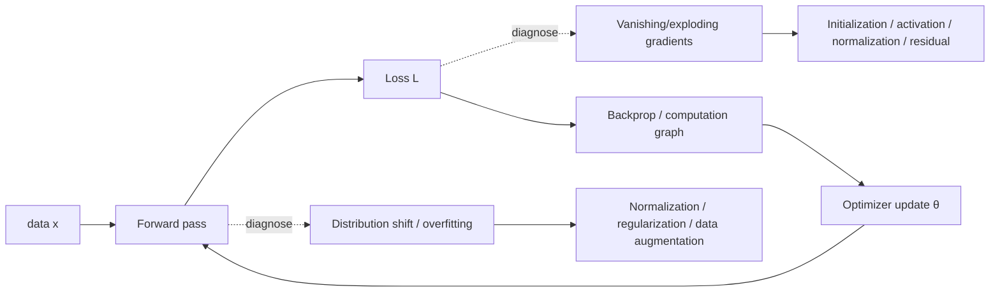

# Chapter 2 · Deep Learning Fundamentals

> **One-line summary**: Chapter 1 covers how to pick and evaluate classical models; this chapter covers what a neural network actually computes and why it can be trained at all. Interviews rarely ask for definitions here - they check three things: can you derive backpropagation by hand, can you explain why BN/LN work, and can you write down self-attention and compute its complexity.
>
> **Keywords**: `backpropagation` `universal approximation` `Xavier/He initialization` `BatchNorm/LayerNorm` `CNN/RNN` `self-attention` `Adam/AdamW`

## What this chapter covers

| File | Core content | Interview weight |
| --- | --- | --- |
| [01 Neural networks and backpropagation](01-neural-networks-and-backprop.md) | MLP, chain rule, computation graphs, matrix-form backprop, vanishing/exploding gradients, residual connections, parameter and FLOP counting | ★★★★★ |
| [02 Activation functions and initialization](02-activations-and-initialization.md) | sigmoid/tanh/ReLU/GELU/SwiGLU, dying ReLU, deriving Xavier/He variance, gradient checking | ★★★★☆ |
| [03 Normalization techniques](03-normalization-techniques.md) | BN in training vs inference, LN/RMSNorm/GN/IN, Pre-LN vs Post-LN, normalization and residuals | ★★★★★ |
| [04 CNNs and RNNs](04-cnn-and-rnn.md) | Convolution output size and receptive field, 1x1 and separable convolutions, classic networks such as ResNet, LSTM/GRU, the origin of seq2seq and attention | ★★★☆☆ |
| [05 Transformer basics](05-transformer-basics.md) | self-attention formula and complexity, multi-head, positional encoding, FFN, masks, training vs inference | ★★★★★ |
| [06 Optimizers and training tricks](06-optimizers-and-training-tips.md) | SGD/Momentum/Adam/AdamW, bias correction, learning-rate schedules, gradient clipping, mixed precision, gradient accumulation | ★★★★☆ |

## Three threads through this chapter

When I review this chapter, I compress it into three threads; every question can be hung on one of them:

1. **How data flows through the network**: forward → loss → backward → update. Every derivation is just a different way of writing the chain rule.
2. **Why training breaks**: vanishing/exploding gradients (initialization, activations, normalization), distribution shift (BN/LN), overfitting (regularization, data).
3. **Why architectures evolve**: MLP has no prior → CNN adds locality and translation equivariance → RNN adds temporal order but cannot parallelize → Transformer trades attention for global dependencies plus parallelism.

## Study plan

- **Order**: 01 → 02 → 03 → 05 → 04 → 06. For LLM roles, master the Transformer first and then go back to CNN/RNN; for classical CV or recommendation roles, move 04 earlier.
- **Time**: 2–3 days. 01/03/05 carry the weight and deserve 60% of the time; 04 is mostly for intuition and a vocabulary index - come back to it when a specific role calls for it.
- **Method**: derive each core formula at least once (the chain rule in backprop, the forward/backward pass of BN, self-attention complexity, Adam's bias correction). One follow-up question exposes whether you only memorized the conclusion.
- **Practice**: implement a two-layer MLP in PyTorch and check gradients against `autograd`; implement single-head self-attention and verify the output shape and the effect of the mask.

## How it connects to other chapters

| Chapter | Relationship |
| --- | --- |
| [Machine learning fundamentals](../01-ml-fundamentals/README.md) | Bias-variance, regularization, and evaluation metrics are the "evaluation language" of this chapter; [Regularization and feature engineering](../01-ml-fundamentals/04-regularization-and-feature-engineering.md) directly connects to dropout and weight decay |
| [LLMs](../04-llm/README.md) | Section 05 here covers only the basic Transformer mechanics; engineering variants such as MQA/GQA/MLA, FlashAttention, long context, and MoE live in [Attention and positional encoding](../04-llm/03-attention-and-position-encoding.md), and architecture evolution in [LLM architecture evolution](../04-llm/02-llm-architecture-evolution.md) |
| [RL and alignment](../03-reinforcement-learning/README.md) | Policy optimization such as PPO speaks the same language as the optimizers and training stability in section 06 |
| [ML system design](../06-ml-system-design/README.md) | Latency, memory, and throughput estimates for training and inference build on the parameter and FLOP counts here |
| [ML Infra](../07-ml-infra/README.md) | Distributed training and inference optimization ([distributed training infrastructure](../07-ml-infra/03-distributed-training-infrastructure.md), [inference serving and GPU optimization](../07-ml-infra/04-inference-serving-and-gpu-optimization.md)) are the engineering scale-up of this chapter |

## One-page cheat sheet

| Topic | Formula / result you must be able to write |
| --- | --- |
| Backprop | $\delta^{(l)} = (W^{(l+1)T}\delta^{(l+1)}) \odot f'(z^{(l)})$, $\partial L/\partial W^{(l)} = \delta^{(l)}(a^{(l-1)})^T$ |
| Initialization | Xavier: $\mathrm{Var}(w)=2/(n_{in}+n_{out})$; He: $2/n_{in}$ |
| BN | $\hat{x}=(x-\mu_B)/\sqrt{\sigma_B^2+\epsilon}$, $y=\gamma\hat{x}+\beta$; inference uses running mean/var |
| LN | Normalizes all features of a single sample; identical behavior in training and inference |
| Attention | $\mathrm{softmax}(QK^T/\sqrt{d_k})V$, time $O(n^2d)$, memory $O(n^2)$ |
| Multi-head | Each head $d_k=d/h$, concatenate and multiply by $W_O$; parameter count stays about $4d^2$ |
| Optimizers | Adam uses first/second moment estimates plus bias correction; AdamW decouples weight decay from the gradient update |

## Common misconceptions (read this first)

- **"Backprop = gradient descent"**: backprop only computes gradients efficiently; the optimizer updates the parameters, and the two can be swapped independently.
- **"BN is always better than LN"**: BN depends on batch statistics; LN/RMSNorm fit better when sequence lengths vary or batches are small.
- **"Most Transformer parameters are in attention"**: for large $d$, the FFN ($4d \to d$) usually takes about two-thirds of each layer's parameters.
- **"Adam always generalizes better than SGD"**: on small datasets and vision tasks, fine-tuned SGD + momentum often generalizes better; Adam's edge is sparse gradients and fast convergence.
- **"Any random initialization works"**: wrong variance makes activations or gradients grow/shrink layer by layer.

## Self-check

- [ ] Derive backprop for a two-layer MLP and write it in matrix form
- [ ] Explain the mathematical roots of vanishing/exploding gradients and at least four mitigations
- [ ] Derive the variance for Xavier and He initialization
- [ ] Write the BN training/inference formulas and explain how LN/RMSNorm differ
- [ ] Write the self-attention formula, explain $\sqrt{d_k}$, and compute time/space complexity
- [ ] Explain what a mask does and how it is implemented
- [ ] Explain Adam's bias correction and what AdamW changes
- [ ] Estimate the parameter count and inference FLOPs of an MLP/Transformer

## References

- [MachineLearningFAQ · bagu.md](https://github.com/nxpeng9235/MachineLearningFAQ/blob/main/bagu.md)
- [llm_interview_note · wdndev](https://github.com/wdndev/llm_interview_note)
- [MLE Interview · longxingtan](https://longxingtan.gitbook.io/mle-interview)
- [Attention Is All You Need](https://arxiv.org/abs/1706.03762)
- [Deep Learning · Goodfellow, Bengio, Courville](https://www.deeplearningbook.org/)
