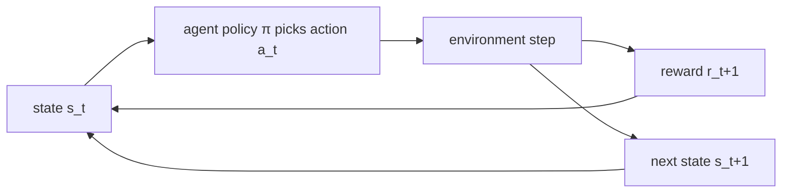

# MDPs and the Bellman Equations

> **One-line summary**: Reinforcement learning casts sequential decision making as a Markov decision process (MDP); the Bellman equations split the long-run return into "immediate reward + discounted future return," turning the search for an optimal policy into solving a recursive equation (a fixed point).
>
> **Keywords**: `MDP` `return` `discount factor` `Bellman expectation` `Bellman optimality` `on/off-policy` `exploration`

## 1. Core concepts

### 1.1 The MDP tuple and the Markov property

An MDP (Markov Decision Process) is described by the tuple $(\mathcal{S},\mathcal{A},P,R,\gamma)$:

| Symbol | Meaning | How to say it in an interview |
| --- | --- | --- |
| $\mathcal{S}$ | State space | The set of all states the environment can be in |
| $\mathcal{A}$ | Action space | Discrete (vocabulary) or continuous (control signals) |
| $P(s'\mid s,a)$ | State transition probability | Environment dynamics; unknown means model-free |
| $R(s,a,s')$ | Reward function | Scalar feedback; in LLMs this often comes from a reward model |
| $\gamma\in[0,1)$ | Discount factor | Controls how far ahead the agent looks |

**Markov property**: the future depends only on the current state and action, not on history.

$$
P(S_{t+1}\mid S_t,A_t)=P(S_{t+1}\mid S_0,A_0,\dots,S_t,A_t) \qquad (1)
$$

If the real environment violates the Markov property (for example, it is partially observable), use a POMDP: treat the observation history as the state, or add a memory mechanism such as an RNN/Transformer.

The agent-environment interaction loop:



### 1.2 Return, policy, and value functions

A policy $\pi(a\mid s)$ maps states to action distributions; a deterministic policy is the degenerate case.

The **discounted return** from time $t$:

$$
G_t=\sum_{k=0}^{\infty}\gamma^{k}R_{t+k+1} \qquad (2)
$$

The two value functions:

$$
V^{\pi}(s)=\mathbb{E}_{\pi}\left[G_t\mid S_t=s\right],\qquad
Q^{\pi}(s,a)=\mathbb{E}_{\pi}\left[G_t\mid S_t=s,A_t=a\right] \qquad (3)
$$

The advantage function measures how much better action $a$ is than the policy's average:

$$
A^{\pi}(s,a)=Q^{\pi}(s,a)-V^{\pi}(s) \qquad (4)
$$

Relation: $V^{\pi}(s)=\sum_a \pi(a\mid s)Q^{\pi}(s,a)$. Policy improvement means increasing the probability of actions with $A^{\pi}>0$, which is exactly where the policy gradient in Chapter 3 starts.

### 1.3 Three solution routes (build the map first)

| Route | Representative methods | Needs a model? | What is optimized |
| --- | --- | --- | --- |
| Dynamic programming | Policy iteration, value iteration | Needs $P,R$ | Value function |
| Sampling-based estimation | MC, TD, DQN | No | Value function |
| Direct policy optimization | REINFORCE, PPO, GRPO | No | Policy parameters |

## 2. Principles and derivations

### 2.1 Why discounting is needed

1. **Mathematically**: $\gamma<1$ guarantees the infinite series converges (when rewards are bounded, $|G_t|\le R_{\max}/(1-\gamma)$) and makes the Bellman operator a contraction.
2. **Modeling**: the future is uncertain, and "a dollar now is worth more than a dollar later"; the effective horizon of $\gamma$ is about $1/(1-\gamma)$ ($\gamma=0.99$ is roughly 100 steps).
3. **Optimization**: discounting prioritizes near-term reward and reduces variance.

$\gamma=1$ also works for **episodic** tasks, but only if every episode is guaranteed to terminate; continuing tasks require $\gamma<1$.

### 2.2 The Bellman expectation equation

Start from the definition and split the return into one step using the law of total expectation:

$$
\begin{aligned}
V^{\pi}(s)
&=\mathbb{E}_{\pi}\left[R_{t+1}+\gamma G_{t+1}\mid S_t=s\right]\\
&=\sum_{a}\pi(a\mid s)\sum_{s',r}p(s',r\mid s,a)\left[r+\gamma V^{\pi}(s')\right]
\end{aligned} \qquad (5)
$$

Similarly:

$$
Q^{\pi}(s,a)=\sum_{s',r}p(s',r\mid s,a)\left[r+\gamma\sum_{a'}\pi(a'\mid s')Q^{\pi}(s',a')\right] \qquad (6)
$$

**Matrix form**: stack all states into a vector, $\mathbf{V}^{\pi}=\mathbf{R}^{\pi}+\gamma P^{\pi}\mathbf{V}^{\pi}$, so

$$
\mathbf{V}^{\pi}=(I-\gamma P^{\pi})^{-1}\mathbf{R}^{\pi} \qquad (7)
$$

Because $\gamma<1$ implies the spectral radius $\rho(\gamma P^{\pi})\le\gamma<1$, the inverse always exists. This also explains why policy evaluation can be solved iteratively: $V_{k+1}=R+\gamma P V_k$ converges geometrically at rate $\gamma$.

### 2.3 The Bellman optimality equation

The optimal value function is $V^{*}(s)=\max_{\pi}V^{\pi}(s)$. The key fact: **a deterministic greedy policy exists that is optimal for all states simultaneously**, hence

$$
V^{*}(s)=\max_{a}\sum_{s',r}p(s',r\mid s,a)\left[r+\gamma V^{*}(s')\right] \qquad (8)
$$

$$
Q^{*}(s,a)=\sum_{s',r}p(s',r\mid s,a)\left[r+\gamma\max_{a'}Q^{*}(s',a')\right] \qquad (9)
$$

$$
\pi^{*}(s)\in\arg\max_{a}Q^{*}(s,a) \qquad (10)
$$

Note that the $\max$ in Eq. (8) is **outside the expectation**: first take the maximum over actions, then average over random transitions. This is the essential difference from the $\sum_a\pi$ in Eq. (5).

### 2.4 Existence and uniqueness of the optimal policy (contraction)

Define the Bellman optimality operator $(\mathcal{T}V)(s)=\max_a\sum_{s',r}p(s',r\mid s,a)[r+\gamma V(s')]$, then

$$
\|\mathcal{T}V-\mathcal{T}U\|_{\infty}\le\gamma\|V-U\|_{\infty} \qquad (11)
$$

(because $\max$ is 1-Lipschitz and the transition expectation is a weighted average). By the Banach fixed-point theorem, $\mathcal{T}$ has a unique fixed point $V^{*}$ in the complete metric space, and iteration converges from any $V_0$. This is the convergence proof for value iteration, and the fundamental reason $\gamma<1$ matters.

### 2.5 Exploration vs exploitation

Pure greediness gets stuck in local optima: an action that is never tried is never known to be good or bad. Common approaches:

- $\varepsilon$-greedy: act greedily with probability $1-\varepsilon$ and uniformly at random with probability $\varepsilon$; decay $\varepsilon$.
- UCB: $a_t=\arg\max_a\left[Q(a)+c\sqrt{\ln t/N(a)}\right]$, a bonus for uncertain actions.
- Entropy regularization: add $\beta\mathcal{H}(\pi(\cdot\mid s))$ to the policy objective, a standard term in PPO/GRPO (see Chapters 3 and 4).

### 2.6 on-policy vs off-policy

| Dimension | on-policy | off-policy |
| --- | --- | --- |
| Behavior vs target policy | The same | Can differ |
| Representative algorithms | Sarsa, A2C/A3C, PPO, GRPO | Q-learning, DQN, DDPG, SAC, DPO (offline) |
| Data efficiency | Low (use once and discard) | High (can replay) |
| Variance/stability | High variance but unbiased target | Low variance but distribution shift |
| Typical pitfall | Expensive samples | Importance-sampling variance, stale replay data |

A common follow-up: **PPO is on-policy, so why can it train for multiple epochs?** Because it reuses the same batch through the importance ratio $r_t(\theta)=\pi_\theta/\pi_{\theta_{\text{old}}}$, while clipping the ratio keeps the update approximately on-policy.

## 3. Implementation notes

Value iteration is essentially one line of backup: $V\leftarrow\max_a\sum p[r+\gamma V]$. Here is a minimal implementation:

```python
import numpy as np

def value_iteration(P, R, gamma=0.99, tol=1e-8, max_iter=10000):
    # P: [S, A, S] transition probabilities; R: [S, A] expected immediate reward
    S, A = R.shape
    V = np.zeros(S)
    for it in range(max_iter):
        Q = R + gamma * P @ V          # [S, A]
        V_new = Q.max(axis=1)
        if np.max(np.abs(V_new - V)) < tol:
            break
        V = V_new
    Q = R + gamma * P @ V
    policy = Q.argmax(axis=1)          # greedy policy
    return V, policy
```

Key points:
- $P$ is an `[S, A, S]` tensor, and `P @ V` computes the expectation for all actions in parallel.
- The convergence test uses $\|V_{k+1}-V_k\|_\infty<\text{tol}$; the theoretical error bound is $\frac{\gamma}{1-\gamma}\|V_{k+1}-V_k\|_\infty$.
- In practice, $\gamma$ closer to 1 converges more slowly (iteration count $\sim 1/(1-\gamma)$), so use more iterations or a better initialization.

## 4. Interview Q&A

### Q1. Why do we need a discount factor $\gamma$?
**Answer**: It plays three roles. (a) Mathematically, it keeps the return bounded, makes the Bellman operator a contraction, and guarantees value iteration converges. (b) In modeling, it reflects that future rewards are uncertain and the present matters more. (c) In optimization, it reduces return variance and shortens the effective horizon (about $1/(1-\gamma)$ steps). $\gamma=1$ is only appropriate for episodic tasks that always terminate.
**Follow-up**: What happens if $\gamma$ is too small? The agent becomes myopic and cannot learn strategies that require long-term planning (Go, long-chain reasoning).

### Q2. What is the difference between the Bellman expectation and optimality equations?
**Answer**: The expectation equation is for a **fixed policy** $\pi$ and averages over actions, $\sum_a\pi(a\mid s)$; it is linear and its solution is $V^{\pi}$. The optimality equation takes a $\max$ over actions; it is nonlinear and its solution is $V^{*}$, whose greedy policy is optimal. The former is used for **policy evaluation**, the latter for **finding the optimal policy** (value iteration).
**Follow-up**: Why can the optimality equation use only one deterministic policy? Because an MDP always admits a deterministic optimal policy; randomization is only necessary under partial observability or in games.

### Q3. Derive the Bellman equation for $V^{\pi}$.
**Answer**: Start with $V^{\pi}(s)=\mathbb{E}_{\pi}[G_t\mid S_t=s]$, substitute $G_t=R_{t+1}+\gamma G_{t+1}$, and expand with the law of total expectation over $A_t\sim\pi(\cdot\mid s)$ and $S_{t+1}\sim p(\cdot\mid s,a)$ to obtain Eq. (5). The last term is $\mathbb{E}[\gamma G_{t+1}\mid S_t=s]=\gamma\sum_{s'}P(s'\mid s)V^{\pi}(s')$. The derivation uses only the Markov property and linearity of expectation.
**Follow-up**: Why is the matrix form invertible? The eigenvalues of $I-\gamma P^{\pi}$ have magnitude at least $1-\gamma>0$.

### Q4. Why does value iteration converge, and how fast?
**Answer**: The Bellman optimality operator is a $\gamma$-contraction (Eq. 11), so by the Banach fixed-point theorem it converges uniquely, with $\|V_k-V^{*}\|_\infty\le\gamma^{k}\|V_0-V^{*}\|_\infty$, that is, geometric convergence at rate $\gamma$. The closer $\gamma$ is to 1, the slower it is.
**Follow-up**: How can it be accelerated? Asynchronous or prioritized sweeps (only update states that changed a lot), or policy iteration (full evaluation plus improvement each round; usually fewer rounds but each round is expensive).

### Q5. How do you choose between policy iteration and value iteration?
**Answer**: Policy iteration = full policy evaluation plus policy improvement; each round is expensive but there are few rounds. Value iteration = one optimal backup per round; each round is cheap but there are many rounds. Both are DP and both require a known model. For large state spaces, use value iteration or asynchronous DP; when the action set is small and evaluation has a closed form, policy iteration is more economical.
**Follow-up**: Why does policy iteration improve monotonically? By the policy improvement theorem: if $\pi'(s)=\arg\max_a Q^{\pi}(s,a)$, then $V^{\pi'}(s)\ge V^{\pi}(s)$ for all $s$.

### Q6. What is the difference between an MDP and a POMDP? Which one is an LLM?
**Answer**: In a POMDP the agent cannot see the full state, only an observation $o$, and must maintain a belief state $b(s)$. LLM generation can be modeled as an MDP whose state is the sequence of tokens generated so far (Markov for the model itself); if the "user's true intent" is treated as the state, it is a POMDP.
**Follow-up**: How do you handle partial observability? Maintain history/belief, encode history with an RNN/Transformer, or use a memory mechanism (see the Agent memory chapter).

### Q7. What are on-policy and off-policy? Give one example of each.
**Answer**: on-policy updates the current policy with data collected by the **current policy**; off-policy updates a target policy with data from **any behavior policy** (for example, a replay buffer). Sarsa is on-policy (the update uses $Q(s',a')$ where $a'$ comes from the current policy); Q-learning is off-policy (the update uses $\max_{a'}Q(s',a')$, independent of the behavior policy).
**Follow-up**: Why does off-policy have lower variance but can be unstable? Replay data covers more states and is less correlated, but the behavior policy differs from the target policy, so you need importance sampling or accept the bias.

### Q8. How do you balance exploration and exploitation? How does UCB work?
**Answer**: The core idea is an "uncertainty bonus". UCB uses $Q(a)+c\sqrt{\ln t/N(a)}$: actions visited less often get a larger bonus, balancing exploitation of the current best action against exploring the unknown, with an $O(\sqrt{T})$ regret bound. In practice, $\varepsilon$-greedy, entropy regularization, and optimistic initialization are more common.
**Follow-up**: How is exploration done in deep RL? Gaussian/OU noise for continuous actions (DDPG), maximum entropy (SAC), and parameter-space noise (NoisyNet).

### Q9. Why is credit assignment the core difficulty of RL?
**Answer**: Rewards are often sparse and delayed (only the final score), so attributing "final success or failure" to each intermediate action or token is hard. Value functions (TD/GAE) do exactly this: they bootstrap the terminal reward backward through time. In LLM RLHF, the sequence-level reward is split into token-level advantages (see Chapters 3 and 5).
**Follow-up**: What are common mitigations? Reward shaping, process reward models (PRM), curriculum learning, longer rollouts, and tuning the GAE $\lambda$.

## 5. Pitfalls and follow-ups

- **Reward indexing**: $R_{t+1}$ is the reward obtained after taking $A_t$; many textbooks write $R_t$, so check the convention before reading a paper.
- **Where the $\max$ goes**: $\max_a\mathbb{E}[\cdot]\ne\mathbb{E}[\max_a\cdot]$; in the optimality equation the $\max$ is outside the expectation.
- **Existence of an optimal policy**: a finite MDP always has a deterministic optimal policy, but it need not be unique (several actions can tie).
- **The $\gamma=1$ trap**: fine for episodic tasks, but a continuing task makes the value function diverge.
- **Discounting and reward scale**: scaling rewards by $k$ is equivalent to changing the learning rate/value scale; do not mix them up when tuning.

## 6. Cheat sheet

| Concept | Formula | One-liner |
| --- | --- | --- |
| Return | $G_t=\sum_{k\ge0}\gamma^kR_{t+k+1}$ | Discounted cumulative reward |
| State value | $V^{\pi}(s)=\mathbb{E}_\pi[G_t\mid s]$ | Average performance from state $s$ |
| Action value | $Q^{\pi}(s,a)=\mathbb{E}_\pi[G_t\mid s,a]$ | Average performance after doing $a$ in $s$ |
| Advantage | $A^{\pi}=Q^{\pi}-V^{\pi}$ | How much better than average |
| Expectation equation | $V^{\pi}=R^{\pi}+\gamma P^{\pi}V^{\pi}$ | Linear, solves for $V^{\pi}$ |
| Optimality equation | $V^{*}=\max_a[R+\gamma P V^{*}]$ | Nonlinear, solves for $V^{*}$ |
| Convergence | $\|TV-TU\|_\infty\le\gamma\|V-U\|_\infty$ | $\gamma$-contraction |

Mnemonic: **"Expectation equations evaluate a policy, optimality equations find one; $\gamma$ makes it a contraction, Bellman gives the fixed point."**

## 7. References

- [Sutton & Barto, Reinforcement Learning: An Introduction (2nd ed.)](http://incompleteideas.net/book/the-book-2nd.html) — Chapters 3 (MDP) and 4 (DP)
- [OpenAI Spinning Up · Key Concepts in RL](https://spinningup.openai.com/en/latest/spinningup/rl_intro.html)
- [Easy-RL tutorial](https://datawhalechina.github.io/easy-rl/)
- [MLE Interview · Reinforcement Learning](https://github.com/longxingtan/MLE-interview)
