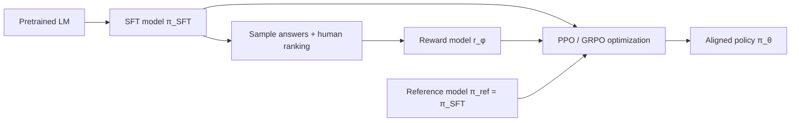

# The Full RLHF Pipeline

> **One-line summary**: RLHF has three stages, SFT as the base, a reward model trained on preference data, and online PPO optimization, which together turn the non-differentiable preference "humans think this answer is better" into a scalar reward that can be optimized; the KL penalty keeps the policy from drifting, and it also explains why reward hacking happens.
>
> **Keywords**: `RLHF` `Bradley-Terry` `reward model` `PPO` `KL penalty` `reward hacking` `RLAIF` `Constitutional AI`

## 1. Core concepts

Why do we need RLHF after SFT?

| Dimension | SFT | RLHF |
| --- | --- | --- |
| Supervision signal | Token-level cross-entropy on a "gold answer" | Preferences of the form "A is better than B" |
| Labeling cost | Write one high-quality answer (expensive) | Compare two answers (cheap and fast) |
| Optimization granularity | Token level, teacher forcing | Sequence level, customizable reward |
| What it can express | Imitation | Helpfulness, harmlessness, style, refusal |

RLHF (Reinforcement Learning from Human Feedback) turns preferences into rewards and then uses RL to optimize the generative policy. Three stages:



The three stages in one sentence each:

1. **SFT**: supervised fine-tuning on high-quality instruction data produces $\pi_{\mathrm{SFT}}$. Data engineering and implementation details are covered in [Chapter 4: Fine-tuning and PEFT](../04-llm/06-fine-tuning-and-peft.md) and are not repeated here.
2. **RM**: train $r_\phi(x,y)$ on preference pairs so it learns to score answers.
3. **PPO**: use $r_\phi$ as the reward and $\pi_{\mathrm{SFT}}$ as the reference for a KL constraint, optimizing $\pi_\theta$ online.

## 2. Principles and derivations

### 2.1 Reward modeling: Bradley-Terry

Assume each answer has a latent "quality score" $s(x,y)$, and the probability that a human picks $y_w$ over $y_l$ is determined by the score difference:

$$
P(y_w\succ y_l\mid x)=\frac{\exp\left(s(x,y_w)\right)}{\exp\left(s(x,y_w)\right)+\exp\left(s(x,y_l)\right)}
=\sigma\left(s(x,y_w)-s(x,y_l)\right) \qquad (1)
$$

Replace $s$ by a reward model $r_\phi$ with parameters $\phi$ and maximize the likelihood of preference data $\mathcal{D}=\{(x,y_w,y_l)\}$; this gives the **pairwise ranking loss**:

$$
\mathcal{L}_{\mathrm{RM}}(\phi)=-\mathbb{E}_{(x,y_w,y_l)\sim\mathcal{D}}\left[\log\sigma\left(r_\phi(x,y_w)-r_\phi(x,y_l)\right)\right] \qquad (2)
$$

**Gradient**: writing $\Delta=r_\phi(x,y_w)-r_\phi(x,y_l)$,

$$
\nabla_\phi\mathcal{L}_{\mathrm{RM}}=-\sigma(-\Delta)\left(\nabla_\phi r_\phi(x,y_w)-\nabla_\phi r_\phi(x,y_l)\right) \qquad (3)
$$

Intuition: when the preference is already ranked correctly ($\Delta$ large), $\sigma(-\Delta)\to0$ and the sample produces almost no gradient; when the ranking is wrong ($\Delta<0$), the gradient is large and pushes $r(y_w)$ up and $r(y_l)$ down. **The reward model only learns relative magnitude; the absolute scale is meaningless** (which is why normalization comes later).

Engineering details:
- Architecture: an SFT model plus a linear scalar head; usually only the **last valid token**'s hidden state is used to produce the score.
- Sample $K$ answers per prompt and have humans rank them, then build $\binom{K}{2}$ preference pairs (saves labeling effort).
- During training, use both $(y_w,y_l)$ and $(y_l,y_w)$ symmetrically to avoid position bias.
- Apply running normalization or mean subtraction to rewards to stabilize the RL stage.

### 2.2 The RL-stage objective

$$
\max_{\pi_\theta}\ \mathbb{E}_{x\sim\mathcal{D},\ y\sim\pi_\theta(\cdot\mid x)}\left[r_\phi(x,y)\right]-\beta\,\mathrm{KL}\left(\pi_\theta(y\mid x)\,\|\,\pi_{\mathrm{ref}}(y\mid x)\right) \qquad (4)
$$

- The first term: make answers score high (exploit the RM).
- The second term: the KL constraint, which prevents the policy from moving to distributions the RM has never seen (where the RM is untrustworthy); $\pi_{\mathrm{ref}}$ is usually $\pi_{\mathrm{SFT}}$ with frozen parameters.
- Larger $\beta$ is more conservative (closer to SFT); smaller $\beta$ is more aggressive (and more prone to reward hacking).

**Token-level reward shaping**: the KL in Eq. (4) is sequence-level, so implementations split it per token:

$$
r_t=\begin{cases}
-\beta\log\dfrac{\pi_\theta(a_t\mid s_t)}{\pi_{\mathrm{ref}}(a_t\mid s_t)}, & t<T\\[6pt]
-\beta\log\dfrac{\pi_\theta(a_t\mid s_t)}{\pi_{\mathrm{ref}}(a_t\mid s_t)}+r_\phi(x,y), & t=T
\end{cases} \qquad (5)
$$

That is, every token pays a small "deviation from the reference" cost, while the RM score for the whole answer is given only at the last token. This lets GAE distribute the advantage across tokens. An equivalent formulation treats KL as an overall penalty $r_\phi(x,y)-\beta\sum_t\log\frac{\pi_\theta}{\pi_{\mathrm{ref}}}$; the two differ slightly in implementation (see `kl_ctl` in DeepSpeed-Chat).

### 2.3 The four models and memory

PPO-RLHF needs four models at the same time:

| Model | Trained? | Role |
| --- | --- | --- |
| Actor (policy) | ✅ | Generates answers and is optimized |
| Critic (value) | ✅ | Estimates $V(s_t)$ and computes GAE |
| Reward Model | ❌ frozen | Scores the whole answer |
| Reference Model | ❌ frozen | Computes KL and prevents drift |

Rough memory estimate: with full-parameter training, actor and critic each need parameters + gradients + Adam states (on the order of 16 bytes/param), while reward and ref only need weights (inference, about 2 bytes/param in bf16). For a 7B model, four weight copies already take ~56GB in bf16, and the training states easily cause OOM. Common savings: LoRA/QLoRA, sharing part of the actor-critic parameters, offloading, and using a separate vLLM engine for rollout.

### 2.4 The training loop (pseudocode)

```python
for prompts in dataloader:
    # 1) rollout: the current actor samples answers
    seqs = actor.generate(prompts)                     # inference mode
    # 2) scoring: RM gives the sequence reward; ref gives per-token log-probs
    rewards = reward_model(prompts, seqs)              # [B]
    logp = actor.log_prob(prompts, seqs)               # [B, T]
    ref_logp = ref_model.log_prob(prompts, seqs)       # [B, T]
    # 3) token-level reward = -β·KL + RM score at the end
    token_rewards = -beta * (logp - ref_logp)
    token_rewards[last_idx] += rewards
    # 4) GAE + actor/critic training
    adv, ret = gae(token_rewards, critic.values(seqs), gamma=1.0, lam=0.95)
    actor_loss = ppo_clip_loss(logp, old_logp, adv)
    critic_loss = mse(critic.values(seqs), ret)
```

Key hyperparameters (empirical; depends on the framework): $\beta$ or `kl_ctl` 0.01~0.1; clip 0.2; actor lr $1\times10^{-6}\sim5\times10^{-6}$ (1~2 orders of magnitude smaller than SFT); PPO epochs 1~4; $\gamma=1$; $\lambda=0.95$; sampling temperature 0.7~1.0.

## 3. Implementation notes

The minimal reward-model loss (PyTorch):

```python
import torch.nn.functional as F

def rm_loss(r_chosen, r_rejected, margin=0.0):
    # r_*: [B], scalar scores for whole answers from the reward model
    diff = r_chosen - r_rejected - margin
    return -F.logsigmoid(diff).mean()
```

Three things on the RL side that are easiest to get wrong:

1. **Cache old_logp**: compute it once during rollout and keep it fixed during PPO updates.
2. **Mask the prompt**: only response tokens participate in the policy loss and KL computation; padding must be masked too.
3. **Normalize rewards**: standardize/clip rewards within the batch, otherwise the value-loss scale runs away.

## 4. Interview Q&A

### Q1. Why does RLHF need three stages? Can't we just do SFT or PPO directly?
**Answer**: SFT can only imitate a "gold answer" and cannot express "both are fine, but A is better"; token-level cross-entropy optimizes likelihood, not human preference. Running PPO directly on a pretrained model lacks an initial policy that follows instructions, so rollouts are poor and the reward signal is sparse. SFT provides a good initial distribution, the RM turns preferences into an optimizable scalar, and PPO then optimizes online; all three are necessary.
**Follow-up**: Can the RM be skipped? Yes, DPO optimizes the policy directly from preference pairs (Chapter 6), or RLVR uses rule-based rewards (Chapter 7).

### Q2. How is the reward-model loss derived? Why Bradley-Terry?
**Answer**: Assume each answer has a latent score $s$ and the human choice probability is logistic in the score difference, $P(y_w\succ y_l)=\sigma(s_w-s_l)$. Parameterize $s$ with $r_\phi$ and maximize the likelihood of preference data to get $-\log\sigma(r_w-r_l)$. BT is the simplest probabilistic model for pairwise comparisons: it only needs relative scores and is cheap to label. Its weakness is that it cannot express ties or multi-dimensional preferences (extensions include tie-aware and K-wise variants).
**Follow-up**: Is the RM's absolute score meaningful? No, only the ranking/relative difference matters, which is why rewards are usually normalized before RL.

### Q3. What is the role of the KL penalty in RLHF? How should $\beta$ be chosen?
**Answer**: It keeps the new policy from drifting too far from SFT for three reasons: (a) the RM is only trustworthy near the SFT distribution, and drifting away is reward hacking; (b) it preserves generation diversity and language quality; (c) it prevents mode collapse onto a single high-reward answer. Large $\beta$ is conservative and close to SFT; small $\beta$ is aggressive with higher reward but more risk. In practice 0.01~0.1, or adaptive KL (increase $\beta$ when above target).
**Follow-up**: Which KL direction? $\mathrm{KL}(\pi_\theta\|\pi_{\mathrm{ref}})$, an expectation under the policy's own distribution, which is exactly what sampling can estimate.

### Q4. Why does PPO-RLHF need a critic? How does it relate to the actor?
**Answer**: The critic estimates $V(s_t)$ at every token position and, together with GAE, distributes the final reward of the whole answer across tokens to produce token-level advantages. Without it you would have only sequence-level returns (high variance) or group-relative rewards (GRPO). The critic is usually the same size as the actor and is initialized from the RM (shared trunk + value head), making it a major memory cost.
**Follow-up**: What happens if the critic trains poorly? Advantages are noisy and the policy update direction is wrong, visible as a value loss that does not decrease and a jittery reward curve.

### Q5. In RLHF the reward is given only at the last token. Why?
**Answer**: Because the RM is trained on the whole answer and has a supervision signal only at the last token, so intermediate-token scores have no reliable semantics. Implementations add the RM score to the last valid token, while other tokens carry only the KL penalty; GAE then propagates the terminal reward backward in time, so every token gets an advantage.
**Follow-up**: Can rewards be token-level? Yes (e.g., PRM, process rewards), but that needs process-level labels or automatic construction (Chapter 7).

### Q6. What is reward hacking and how do you mitigate it?
**Answer**: The policy finds shortcuts that make the RM score high without human approval, such as getting longer, piling on formatting, sycophancy, or repeating safe boilerplate. The root cause is that the RM is a biased proxy for human preference (Goodhart's law) and RL actively searches for its loopholes. Mitigations: KL constraints, reward normalization/clipping, RM ensembles, length penalties, held-out human evaluation for monitoring, and periodically retraining the RM on new data.
**Follow-up**: How do you detect it? Reward rises while win rate/human ratings fall, or length and the frequency of certain phrases grow abnormally.

### Q7. What is the difference between RLAIF and RLHF? What is Constitutional AI?
**Answer**: RLAIF uses AI (usually a strong model) instead of humans to provide preferences/scores: cheaper and more scalable, but it inherits the AI's biases. RLHF uses human labels: higher quality but expensive. Constitutional AI (Anthropic) first has the model critique and revise itself against a set of constitutional principles, then uses AI feedback for RL; it is a form of RLAIF that emphasizes interpretable principle-based constraints.
**Follow-up**: Is RLAIF preference data reliable? It needs calibration against human labels, and you must prevent self-reinforcing bias when the AI judge and the policy share the same origin.

### Q8. What causes unstable RLHF training, and how do you debug it?
**Answer**: Common causes: (1) reward scale/distribution shifts, so normalize and clip; (2) unnormalized advantages, so standardize within the batch; (3) runaway KL, so increase $\beta$ or stop early; (4) critic underfitting/overfitting, so tune the value lr, warmup, and value clipping; (5) changing sampling temperature/length, so fix the sampling configuration and add a length penalty; (6) data distribution shift, so refresh the prompt set. Debug order: look at the reward/KL/entropy/value-loss curves first, then at generation length and repetition rate.
**Follow-up**: Why is the RLHF learning rate smaller than SFT? Aggressive policy updates rapidly leave the RM's trustworthy region, and PPO is sensitive to lr.

### Q9. What are the practical pitfalls of RLHF?
**Answer**: (1) The RM overfits training prompts and collapses on a new distribution. (2) Length bias: the model learns "longer scores higher." (3) Sycophancy: it pleases the user instead of telling the truth. (4) Catastrophic forgetting: general ability degrades after alignment. (5) The four-model memory/communication cost is large. (6) Evaluation is hard: win rate needs a strong baseline and human calibration. (7) SFT data quality sets the ceiling; RL only amplifies it. SFT data engineering itself is covered in Chapter 4 and not expanded here.
**Follow-up**: How do you mitigate forgetting? Mix in pretraining/SFT data, use the KL constraint, use LoRA, and train on multiple tasks.

### Q10. How do RLHF, DPO, and GRPO relate?
**Answer**: RLHF is a pipeline (SFT -> RM -> PPO), and PPO is its optimizer. DPO uses a closed-form solution to merge "RM + PPO" into a single classification loss, removing the RM and online sampling while remaining an offline preference method. GRPO is a PPO variant that replaces the critic with group-relative rewards, often used for verifiable-reward reasoning RL. They are not mutually exclusive: GRPO can also sit inside an RLHF-style pipeline (Chapters 7 and 8).
**Follow-up**: When is full RLHF still worth it? When you need to reuse the RM, when online exploration matters, or when the reward cannot be written as a preference pair (safety rules, tool-call results).

## 5. Pitfalls and follow-ups

- **Treating KL as a regularization term in the loss rather than in the reward**: the equivalence of the two formulations depends on the implementation, so check the framework convention first.
- **Not normalizing RM scores**: different batches have different reward scales, and the value loss swings wildly.
- **Letting the prompt participate in the loss**: this teaches the model to "parrot the question," so it must be masked.
- **Forgetting to freeze $\pi_{\mathrm{ref}}$**: KL becomes meaningless and training may diverge.
- **Not controlling length**: when reward correlates with length, the model writes longer and longer.
- **Self-evaluating with training-set win rate**: a model that overfits the RM looks great in-distribution and falls apart on new prompts.

## 6. Cheat sheet

| Stage | Input | Output | Loss/objective |
| --- | --- | --- | --- |
| SFT | Instruction-answer pairs | $\pi_{\mathrm{SFT}}$ | Cross-entropy (see Chapter 4) |
| RM | Preference pairs $(x,y_w,y_l)$ | $r_\phi$ | $-\log\sigma(r_w-r_l)$ |
| PPO | prompt + RM + ref | $\pi_\theta$ | $r_\phi-\beta\mathrm{KL}$, clipped objective |

| Concept | One-liner |
| --- | --- |
| Bradley-Terry | Model preference with a score difference through a sigmoid |
| KL penalty | Keep the policy inside the RM's trustworthy region |
| reward hacking | The policy exploits loopholes in the RM |
| RLAIF | Replace human feedback with AI feedback |
| Four models | actor/critic/reward/ref |

Mnemonic: **"SFT lays the base, RM scores, PPO optimizes; reward at the end, KL at every step; large β is conservative, small β is aggressive."**

## 7. References

- [InstructGPT · Ouyang et al., 2022](https://arxiv.org/abs/2203.02155)
- [Deep RL from Human Preferences · Christiano et al., 2017](https://arxiv.org/abs/1706.03741)
- [Learning to Summarize from Human Feedback · Stiennon et al., 2020](https://arxiv.org/abs/2009.01325)
- [Constitutional AI · Bai et al., 2022](https://arxiv.org/abs/2212.08073)
- [Secrets of RLHF in LLMs Part I: PPO](https://arxiv.org/abs/2307.04964)
- [DeepSpeed-Chat source code](https://github.com/microsoft/DeepSpeedExamples/tree/master/applications/DeepSpeed-Chat)
- [llm_interview_note · RLHF](https://github.com/wdndev/llm_interview_note)
