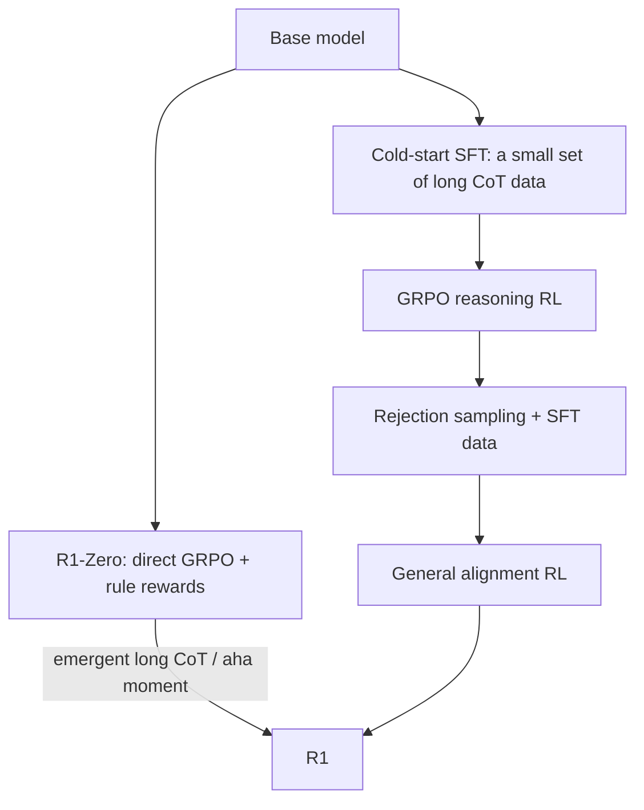

# GRPO and Reasoning RL

> **One-line summary**: GRPO replaces the critic with "sample a group of answers to the same prompt and use the group mean as the baseline," shrinking PPO from 4 models to 3; combined with verifiable rewards (RLVR), it became the main training algorithm for reasoning models such as DeepSeek-R1, where correctness is checked automatically and the model learns long chains of thought on its own.
>
> **Keywords**: `GRPO` `group relative advantage` `RLVR` `DeepSeek-R1` `PRM/ORM` `pass@k` `test-time compute` `DAPO`

## 1. Core concepts

When PPO is used for LLM RL, the critic is as large as the actor, making memory and engineering costs high. GRPO (Group Relative Policy Optimization, DeepSeekMath 2024) observes:

> For the same prompt, a group of answers sampled from the policy **share the same initial state**, so the group's average reward is naturally a Monte Carlo estimate of $V(x)$; why train another critic at all?

GRPO therefore uses **group-relative rewards** as advantages, drops the critic, and treats "multiple answers to the same prompt" as one update unit. It suits tasks whose **rewards can be checked automatically** (math answers, code unit tests, formatting); this setting is called **RLVR (RL with Verifiable Rewards)**.

| Item | PPO | GRPO |
| --- | --- | --- |
| critic | Needed (about actor size) | Not needed |
| Source of advantage | GAE + value | Group-normalized rewards |
| Memory | actor+critic+RM+ref | actor+ref (+ reward function) |
| Use case | General preference alignment | Reasoning tasks with verifiable rewards |
| Representative | InstructGPT | DeepSeekMath / R1 |

## 2. Principles and derivations

### 2.1 Group sampling and advantage estimation

For each question $x$, sample $G$ answers $\{y_1,\dots,y_G\}$ from the old policy and score them with a reward function (RM or rules) to get $\{r_1,\dots,r_G\}$. Define the group-normalized advantage:

$$
\hat A_i=\frac{r_i-\mathrm{mean}\left(\{r_1,\dots,r_G\}\right)}{\mathrm{std}\left(\{r_1,\dots,r_G\}\right)} \qquad (1)
$$

All tokens in one answer share this $\hat A_i$ (a sequence-level advantage, with no token-level GAE).

**Why can the group mean serve as a baseline?** For a fixed $x$, all $y_i$ start from the same state and $\mathbb{E}[r_i\mid x]=V^{\pi}(x)$ (under policy $\pi$); estimating it with the group mean and subtracting it gives "how much better this answer is than the group average." A baseline independent of the action is unbiased (Chapter 3, Eq. 5) and greatly reduces variance; this is exactly the baseline idea from Chapter 3, with Monte Carlo replacing the critic.

### 2.2 The GRPO objective

$$
\mathcal{J}_{\mathrm{GRPO}}(\theta)=\mathbb{E}_{x\sim\mathcal{D},\{y_i\}\sim\pi_{\theta_{\mathrm{old}}}}\left[\frac{1}{G}\sum_{i=1}^{G}\frac{1}{|y_i|}\sum_{t=1}^{|y_i|}\min\left(r_{i,t}\hat A_i,\ \mathrm{clip}\left(r_{i,t},1-\epsilon,1+\epsilon\right)\hat A_i\right)-\beta\,\mathrm{KL}\right] \qquad (2)
$$

where $r_{i,t}=\frac{\pi_\theta(y_{i,t}\mid x,y_{i,<t})}{\pi_{\theta_{\mathrm{old}}}(y_{i,t}\mid x,y_{i,<t})}$ is the token-level importance ratio, and the KL term keeps the policy from drifting too far from the reference. **The structure is identical to PPO-clip; the only difference is that $\hat A_i$ is not computed by GAE but comes from group-relative rewards.**

Two common per-token KL estimators:

$$
\widehat{\mathrm{KL}}_t=\log\frac{\pi_\theta}{\pi_{\mathrm{ref}}}\quad(\text{k1}),\qquad
\widehat{\mathrm{KL}}_t=\frac{\pi_{\mathrm{ref}}}{\pi_\theta}-\log\frac{\pi_{\mathrm{ref}}}{\pi_\theta}-1\quad(\text{k3}) \qquad (3)
$$

The k3 estimator is non-negative and has lower variance, and is commonly used by the DeepSeek family.

### 2.3 Why can the critic be dropped?

- **The critic's job** is to provide $V(s)$ as a baseline; GRPO replaces it with the group mean for the same prompt.
- Group sampling naturally provides "same state, different actions," exactly the structure needed to estimate advantages; PPO needs GAE to propagate backward through time to achieve this.
- The cost: every prompt requires $G$ complete answers, so **sampling cost grows linearly with $G$**; moreover, the advantage is sequence-level and coarser than token-level GAE.

Choosing $G$: too small (e.g., 2) makes the group mean noisy; too large makes sampling expensive. $G=8\sim64$ is common (R1-line work often uses around 16). When a group is all-correct or all-wrong, $\mathrm{std}=0$ and all advantages are 0, wasting the samples, which is why later work such as DAPO introduced dynamic sampling.

### 2.4 Two biases of group normalization (Dr. GRPO)

The 2025 Dr. GRPO paper points out two systematic biases in the standard GRPO objective:

1. **Difficulty bias**: dividing by $\mathrm{std}$ gives larger weight to questions with small reward variance (too easy or too hard), implicitly weighting questions by difficulty instead of by importance.
2. **Length bias**: Eq. (2) averages over tokens first and then over the group, so each token in a long answer gets less weight; for "wrong long answers" the penalty is diluted, objectively encouraging longer outputs.

The fix: drop std normalization (use only $r_i-\mathrm{mean}$) and change length normalization to a group-wide scale (token-level loss / fixed length normalization), i.e., the unbiased version in **Dr. GRPO**.

### 2.5 Engineering improvements such as DAPO

| Improvement | What it does | Problem it solves |
| --- | --- | --- |
| Clip-higher | Asymmetric bounds $\epsilon_{\mathrm{low}}=0.2$ and $\epsilon_{\mathrm{high}}=0.28$ | Prevents low-probability tokens from being over-suppressed, which causes entropy collapse |
| Dynamic sampling | Filter out all-correct/all-wrong groups and resample until a group has signal | Wasted invalid samples |
| Token-level loss | Sum over all tokens in the group first, then average, instead of averaging per answer | Length bias |
| Overlong reward shaping | Soft penalty for overly long answers | Runaway length |
| GSPO (Qwen) | Replace the token-level importance ratio with a sequence-level one | Reduces ratio variance on long sequences |

### 2.6 RLVR: verifiable rewards

**RLVR (RL with Verifiable Rewards)** replaces the RM with programmatic rules:

- Math: extract the answer and compare it with the reference (exact match / sympy equivalence);
- Code: run unit tests and use the pass rate as the reward;
- Format: whether the required structure is present (boxed answer, think tags);
- Others: SQL execution results, tool-call success, constraint satisfaction.

The reward is usually a weighted sum of correctness and format:

$$
r(y)=\mathbb{1}[\text{answer correct}]+\lambda\,\mathbb{1}[\text{format valid}] \qquad (4)
$$

Pros: **no labels, hard to cheat (relative to an RM), and easy to scale**. Cons: it only covers verifiable domains, the model can game format rules (writing only the format without reasoning), and it needs careful reward design, a difficulty curriculum, and a robust verifier.

### 2.7 Reasoning RL: the two R1 routes



- **R1-Zero**: skips SFT and runs GRPO with rule rewards directly on the base model. The resulting model spontaneously learns long chains of thought, self-checking, and backtracking (the aha moment in the paper); the problems are poor readability, mixed Chinese and English, and unstable formatting.
- **R1**: first does cold-start SFT on a few thousand high-quality long CoT examples, then RL; after that it builds SFT data via rejection sampling (including general tasks) and runs another alignment RL round. It is more stable and more readable than R1-Zero.

**Why does RL make reasoning stronger?** One explanation is that the correctness reward associates "multi-step reasoning + self-verification" with "getting the answer right," and long CoT provides more test-time compute. A more conservative view (Yue et al., 2025) is that RLVR mainly **sharpens** reasoning patterns the model already has and improves pass@1, without necessarily raising the capability ceiling (pass@k may not improve). This is an active debate; mention both sides in an interview.

### 2.8 PRM, ORM, and test-time compute

| Type | Supervision granularity | Pros | Cons |
| --- | --- | --- | --- |
| ORM (outcome reward) | Whole answer correct/incorrect | Cheap, can be automated | Sparse, hard credit assignment |
| PRM (process reward) | Each reasoning step | Dense signal, can guide search | Step definition and labeling are expensive, easy to hack |
| RLVR | Programmatic check | No labels, objective | Only verifiable domains |

Automatic PRM labeling commonly follows the **Math-Shepherd** recipe: for each intermediate step, sample multiple completions from the policy and use the frequency of correct final answers as the step's soft label.

**Test-time compute** complements the training signal:

- **self-consistency**: sample several CoTs and take a majority vote on the final answer;
- **best-of-N**: use an ORM/PRM or verifier to pick the best;
- **tree search**: ToT / MCTS guided by a PRM;
- **longer thinking**: simply let the model generate a longer CoT.

**pass@k**: the probability that at least one of $k$ sampled answers is correct. An unbiased estimate from $n$ samples with $c$ correct:

$$
\widehat{\mathrm{pass@}k}=\mathbb{E}\left[1-\frac{\binom{n-c}{k}}{\binom{n}{k}}\right] \qquad (5)
$$

A common interview question: **does RL improve pass@1 or pass@k?** Typically pass@1 improves clearly, while pass@k (especially for large k) may drop because the policy becomes sharper and less diverse. This is the core metric in the "sharpening vs expanding" debate.

## 3. Implementation notes

GRPO advantage computation (a few core lines):

```python
import torch

def grpo_advantages(rewards, group_size, use_std=True, eps=1e-4):
    # rewards: [B*G], the G answers to the same prompt are contiguous
    r = rewards.view(-1, group_size)                     # [B, G]
    mean = r.mean(dim=1, keepdim=True)
    adv = r - mean
    if use_std:
        adv = adv / (r.std(dim=1, keepdim=True, unbiased=False) + eps)
    return adv.view(-1)                                  # broadcast to every token
```

Engineering notes:
- **Group order must be fixed**: the G answers to the same prompt must stay in one group and cannot be shuffled across batches.
- Standardize rewards within the group; **do not** standardize globally again (that reintroduces scale issues).
- For all-correct/all-wrong groups the advantage is 0; skip them or resample (DAPO dynamic sampling).
- Keep sampling temperature and max_len fixed; length changes directly affect rewards and loss.
- Monitor: group reward mean/variance, accuracy, answer length, entropy, and KL.

## 4. Interview Q&A

### Q1. What is the core difference between GRPO and PPO? Why can the critic be dropped?
**Answer**: PPO estimates advantages with a critic + GAE and needs a value network. GRPO samples a group of answers to the same prompt, uses the group mean as the baseline and the group standard deviation for scaling, and directly obtains each answer's advantage. Because all answers to the same prompt start from the same state, the group mean is a Monte Carlo estimate of $V(x)$; the baseline never needed to be parameterized. This turns 4 models into 3 (actor/ref/reward function) and lowers both memory and engineering complexity.
**Follow-up**: Is GRPO's advantage token-level or sequence-level? Sequence-level: all tokens in an answer share one $\hat A_i$, which is coarser than GAE but simpler to implement.

### Q2. What is wrong with the $\mathrm{std}$ normalization in GRPO? What did Dr. GRPO change?
**Answer**: Dividing by std gives larger weight to questions with small reward variance (too easy or too hard), creating difficulty bias; averaging per token dilutes the penalty on long answers, creating length bias. Dr. GRPO removes std normalization and uses an unbiased objective (group-wide length normalization), mitigating both biases.
**Follow-up**: Then why do people still use std? Because empirically it is more stable and converges faster on many tasks; the bias is statistical, and whether it matters depends on the data and the task.

### Q3. How should the group size $G$ be chosen? What goes wrong when it is too small or too large?
**Answer**: Too small and the group mean/variance estimates are noisy, weakening the advantage signal; too large and sampling cost grows linearly while the marginal information from repeated answers shrinks. 8~64 is common (R1-line work often uses around 16). Also consider the all-correct/all-wrong rate: with small $G$ it is higher and more samples are wasted.
**Follow-up**: How can it be adjusted dynamically? Sample groups by difficulty, filter groups with no signal (DAPO), or reduce $G$ for easy questions.

### Q4. What is RLVR? How should rewards be designed? What are the risks?
**Answer**: RLVR replaces the RM with verifiable programmatic rewards (answer matching, unit tests, format checks), suited to math, code, and structured output. The reward is usually correctness + format. Risks: (1) it only covers verifiable domains; (2) the model games the rules (writing only the format, guessing answers, overfitting test cases); (3) the verifier itself has bugs or loopholes; (4) overly sparse rewards slow training. You need robust answer extraction, hidden test sets, a difficulty curriculum, and format penalties.
**Follow-up**: Can RLVR be combined with RLHF? Yes, mix by task: rule rewards for verifiable tasks and RM/preferences for open-ended tasks.

### Q5. What is the DeepSeek-R1 training pipeline? What is the difference between R1-Zero and R1?
**Answer**: R1-Zero runs GRPO with rule rewards (correctness + format) directly on the base model with no SFT, and the model spontaneously develops long CoT and self-checking, at the cost of mixed languages and poor readability. R1 adds cold-start SFT (a small set of high-quality long CoT) -> reasoning RL -> rejection sampling to build SFT data -> general alignment RL; it is more controllable and also distills the capability into smaller models.
**Follow-up**: Why does R1-Zero exhibit emergence? One explanation is that rule rewards associate multi-step reasoning with correct answers and long CoT provides more compute; other work argues it mainly sharpens existing abilities (see Q8).

### Q6. What is the difference between PRM and ORM? When is each appropriate?
**Answer**: ORM scores the whole answer: cheap and automatable, but sparse and hard for credit assignment. PRM scores each reasoning step: dense signal and usable for search (best-of-N, tree search), but step definition and labeling are costly and it is prone to reward hacking. Verifiable tasks such as math/code usually use ORM/RLVR; fine-grained search guidance calls for a PRM.
**Follow-up**: Where do step-level PRM labels come from? Human labeling, or Math-Shepherd-style methods: sample multiple completions per step and use the final correctness frequency as the soft label.

### Q7. What is the difference between self-consistency, best-of-N, and tree search?
**Answer**: Self-consistency samples several complete CoTs and takes a majority vote on the answer, requiring no extra model. Best-of-N scores whole answers with a reward model/verifier and picks the best. Tree search (ToT/MCTS) expands intermediate steps and values them with a PRM; it is more expensive but can correct errors. All three are test-time compute methods and complement training-time RL.
**Follow-up**: Is self-consistency still useful after RL training? Yes, but the gains are usually smaller because the model is already closer to "right on the first try."

### Q8. Does RLVR teach the model new reasoning or sharpen existing abilities? How do you tell with metrics?
**Answer**: There is evidence for both views. The optimistic camp sees R1-Zero developing long CoT, reflection, and backtracking. The conservative camp (Yue et al., 2025) finds that RLVR mainly improves pass@1 while pass@k (large k) improves little or even drops, suggesting the model reweights existing reasoning paths rather than extending the capability ceiling. To judge, report pass@1 and pass@k together, cross-domain transfer, and results stratified by difficulty.
**Follow-up**: Why do pass@1 and pass@k diverge? RL sharpens the policy (entropy drops), so a single sample is more accurate but diversity falls and repeated samples cover fewer distinct paths.

### Q9. What does unstable GRPO training look like, and what causes it?
**Answer**: Common symptoms: entropy drops rapidly (entropy collapse), answer length explodes or collapses, group reward variance disappears (all correct/all wrong), KL blows up, and reward rises while validation does not. Causes: clip too tight or too loose, wrong group size, reward scale, missing length penalty, sampling temperature too low, and a mismatch with data difficulty. Remedies: clip-higher, dynamic sampling, token-level loss, length penalties, entropy/KL monitoring, and a difficulty curriculum.
**Follow-up**: Why is GRPO more prone to entropy collapse than PPO? There is no critic to smooth the signal, and group normalization amplifies gradients for low-variance groups; DAPO's clip-higher targets exactly this.

### Q10. What should you watch in reasoning-RL data and templates?
**Answer**: Data needs **verifiable answers** with a suitable difficulty distribution (too hard means all wrong, too easy means all correct, and neither gives a gradient). Templates should fix the think/answer structure; format rewards should be used only early on, to avoid the model writing only the format later. Answer extraction must be robust (boxed, last line, code block). A length cap and an overlong penalty should go together. Also prevent contamination: the training set must not contain evaluation questions.
**Follow-up**: Where does cold-start SFT data come from? A small amount of hand-written high-quality long CoT, distillation from a strong model, or filtering readable samples from R1-Zero outputs.

## 5. Pitfalls and follow-ups

- **Group samples must share the prompt**: mixing prompts in one group makes the baseline meaningless.
- **All-correct/all-wrong groups**: advantages are all 0 and sampling is wasted; filter or resample.
- **Reward scale**: normalize first when mixing 0/1 rule rewards with RM scores.
- **Do not overdo the length penalty**: it suppresses legitimate detailed reasoning and lowers accuracy.
- **Estimate pass@k with the unbiased formula**; do not simply count how many of k are correct.
- **RLVR verifiers must resist cheating**: robust answer extraction, hidden tests, separation of format and content.
- **Do not look only at training reward**: track held-out accuracy, length, entropy, and pass@k.

## 6. Cheat sheet

| Concept | Formula / key point |
| --- | --- |
| GRPO advantage | $\hat A_i=(r_i-\mathrm{mean})/\mathrm{std}$ |
| Objective | PPO-clip + group advantage + KL |
| Model removed | critic (group mean as baseline) |
| Group size | 8~64; too small is noisy, too large is expensive |
| RLVR | Programmatic verifiable rewards instead of an RM |
| R1 pipeline | Cold-start SFT -> RL -> rejection-sampling SFT -> alignment RL |
| PRM vs ORM | Step-level vs whole-answer; dense vs cheap |
| pass@k | $1-\binom{n-c}{k}/\binom{n}{k}$ |
| Improvements | Dr. GRPO (no std), DAPO (clip-higher/dynamic sampling/token loss) |

Mnemonic: **"Sample a group for the same question, use the group mean as baseline, group-normalize for the advantage; no critic, verifiable rewards; R1 cold-starts then RLs, pass@1 rises but pass@k may not."**

## 7. References

- [DeepSeekMath · Shao et al., 2024 (the original GRPO paper)](https://arxiv.org/abs/2402.03300)
- [DeepSeek-R1 · DeepSeek-AI, 2025](https://arxiv.org/abs/2501.12948)
- [DeepSeek-R1 technical report (GitHub)](https://github.com/deepseek-ai/DeepSeek-R1)
- [DAPO · Yu et al., 2025](https://arxiv.org/abs/2503.14476)
- [Understanding R1-Zero-Like Training (Dr. GRPO) · Liu et al., 2025](https://arxiv.org/abs/2503.20783)
- [Does RL Really Incentivize Reasoning Capacity? · Yue et al., 2025](https://arxiv.org/abs/2504.13837)
- [Math-Shepherd · Wang et al., 2024](https://arxiv.org/abs/2312.08935)
- [Let's Verify Step by Step (PRM) · Lightman et al., 2023](https://arxiv.org/abs/2305.20050)
