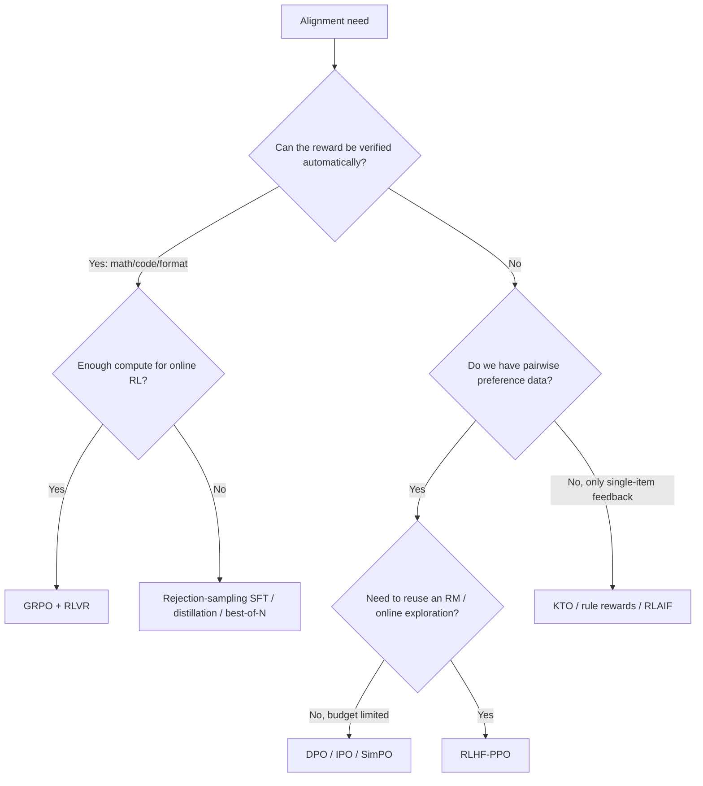

# Comparing LLM Alignment Algorithms

> **One-line summary**: RLHF-PPO, DPO, GRPO, and RLVR are not four mutually exclusive choices but different combinations along three axes: where the reward comes from, whether online sampling is needed, and whether a critic is needed. Start selection with whether the reward can be verified automatically, then look at data shape and compute budget.
>
> **Keywords**: `RLHF` `PPO` `DPO` `GRPO` `RLVR` `alignment` `process reward` `test-time compute`

## 1. Core concepts: put all algorithms in one table first

All LLM alignment methods share the same goal: make model outputs better match human preferences or task objectives. They differ in **the form of the supervision signal** and **the optimization method**:

| Algorithm | What is optimized | Reward source | Online sampling | Models needed | Typical use case |
| --- | --- | --- | --- | --- | --- |
| SFT | Likelihood of instruction data | Human answers | No | 1 | Instruction following, cold start |
| RLHF-PPO | Reward + KL | Explicit RM | Yes | 4 (actor/critic/RM/ref) | General dialogue, helpful/harmless |
| DPO | Likelihood of preference pairs (implicit reward) | Preference data | No | 2 (policy/ref) | Single-turn dialogue, summarization, style |
| GRPO | Reward + KL (group advantage) | RM or rules | Yes | 2~3 (actor/ref/reward function) | Reasoning RL, verifiable tasks |
| RLVR | Same as above, verifiable reward | Programmatic check | Yes | 2~3 | Math, code, structured output |

One-line memory hooks:

- **SFT**: teach it *how* to answer;
- **RLHF/PPO**: tell it *what is better* and let it explore;
- **DPO**: turn *what is better* directly into a classification loss and learn offline;
- **GRPO**: estimate *what is better* from within-group comparisons and drop the critic;
- **RLVR**: hand *what is better* to a program and scale up reasoning RL.

## 2. Principles and derivations: side-by-side comparison

### 2.1 Objective functions side by side

The core objective of all four methods can be written with one template:

$$
\max_\theta\ \mathbb{E}\left[\text{reward}(x,y)\right]-\beta\,\mathrm{KL}\left(\pi_\theta\,\|\,\pi_{\mathrm{ref}}\right) \qquad (1)
$$

The only differences are where the reward comes from and how the expectation is estimated:

| Algorithm | reward | Expectation/sampling | Advantage |
| --- | --- | --- | --- |
| PPO | $r_\phi(x,y)$ | Online sampling from the current policy | GAE (critic) |
| DPO | Implicit $\beta\log\frac{\pi_\theta}{\pi_{\mathrm{ref}}}$ | Offline preference pairs | None needed (closed form) |
| GRPO | $r_\phi$ or rules | In-group sampling for the same prompt | Group normalization |
| RLVR | Rules/verifier | In-group sampling for the same prompt | Group normalization |

DPO is special: it substitutes the **optimal solution** of Eq. (1) back into the preference model, obtaining a loss with no explicit reward, whereas PPO/GRPO optimize Eq. (1) as a policy optimization problem directly.

### 2.2 Data requirements

| Algorithm | What one data point looks like | Labeling cost | Data scale (empirical) |
| --- | --- | --- | --- |
| SFT | (prompt, high-quality answer) | High (write the answer) | 10k~1M examples |
| RM | (prompt, chosen, rejected) | Medium (comparison) | 10k~100k pairs |
| PPO | prompt (answers generated online) | Only prompts + RM | 10k~100k prompts |
| DPO | (prompt, chosen, rejected) | Medium (comparison) | 10k~100k pairs |
| GRPO/RLVR | prompt + verifiable answer/test | Low (existing question bank) | 10k~1M problems |

The key difference: **PPO/GRPO need online generation; DPO does not**. Online generation determines the engineering shape: an inference engine is required, long-tail generation lengths must be handled, and sampling/training consistency must be maintained.

### 2.3 Memory and engineering cost

Rough estimate for a 7B model with bf16 full-parameter training (orders of magnitude only):

| Method | Weight copies | Training states | Main cost |
| --- | --- | --- | --- |
| SFT | 1 | Params + grads + Adam (~16 B/param) | Single model, cheapest |
| DPO | 2 (policy+ref) | Policy training states | ref is inference-only and can be quantized |
| PPO | 4 | actor+critic training states | Largest; often needs offload/sharding |
| GRPO | 2~3 | actor training states | No critic, saves ~1 model vs PPO |
| RLVR | 2~3 | Same as above + verifier CPU/sandbox | Reward computation can become the bottleneck |

Common engineering savings: LoRA/QLoRA, sharing the actor-critic trunk, 4-bit quantizing ref/RM, vLLM/SGLang for rollout, and separating training from inference deployment (colocate or PD disaggregation).

### 2.4 Stability and failure modes

| Algorithm | Stability | Typical failures |
| --- | --- | --- |
| PPO | Medium (sensitive to hyperparameters) | KL explosion, value divergence, reward hacking |
| DPO | Relatively high | Length bias, offline distribution shift, falling absolute probabilities |
| GRPO | Medium | Entropy collapse, wasted all-correct/all-wrong groups, runaway length |
| RLVR | Medium (depends on reward design) | Gaming format rules, verifier loopholes, sharpening without expanding |

## 3. Implementation notes: how to choose

### 3.1 Selection decision tree

### 3.2 Combinations are more common

Real training pipelines rarely use a single algorithm:

- **SFT -> DPO**: the fastest alignment pipeline, good for single-turn dialogue and style control.
- **SFT -> DPO -> GRPO/RLVR**: align format/style with preferences first, then train reasoning with verifiable rewards.
- **R1 style**: cold-start SFT -> GRPO (RLVR) -> rejection-sampling SFT -> general RL.
- **RM + GRPO**: keep the flexibility of an RM while dropping the critic.
- **RLAIF / Constitutional AI**: replace human feedback with AI feedback to cut labeling cost.

### 3.3 Production checklist

1. **Data**: is the preference data from the same distribution as the current policy? Do verifiable problems have hidden test sets?
2. **Reward**: is the RM calibrated, and can it be hacked by length/format? Can the rule rewards be bypassed?
3. **Compute**: do 4 models fit? Do rollout and training throughput match?
4. **Monitoring**: five curves, namely reward, KL, entropy, length, and held-out accuracy/win rate.
5. **Evaluation**: in-distribution win rate overestimates quality; held-out prompts and human calibration are required.

## 4. Interview Q&A

### Q1. Explain the difference between RLHF, DPO, and GRPO in one table.
**Answer**: RLHF is a pipeline (SFT -> RM -> PPO), and PPO optimizes online with a critic + GAE. DPO substitutes the optimal solution of the KL-regularized objective back into Bradley-Terry and uses preference pairs offline with a classification loss, needing no RM and no sampling. GRPO is a PPO variant that replaces the critic with in-group relative rewards for the same prompt, suited to verifiable-reward reasoning RL. The three are "pipeline / offline simplification / online simplification," not replacements for each other.
**Follow-up**: Which works best? There is no universal answer; general alignment depends on data and tuning, reasoning tasks favor GRPO/RLVR, and limited budgets favor DPO.

### Q2. When should you choose DPO over PPO?
**Answer**: Choose DPO when preference data is fixed, the task is single-turn (dialogue, summarization, style), compute/engineering budget is limited, and fast iteration matters. Choose PPO/GRPO when you need to reuse the reward model to score other models, when online exploration matters, or when the reward is not a pairwise preference (safety rules, tool execution results). DPO's offline nature also makes it prone to distribution shift.
**Follow-up**: Can DPO fully replace RLHF? No; DPO drops the explicit RM (reusable and interpretable) and online exploration, so its ceiling is lower on some tasks.

### Q3. Why is GRPO suited to reasoning tasks? What is key to RLVR?
**Answer**: Reasoning rewards are usually verifiable automatically (answer correctness, unit-test pass), so no RM is needed. GRPO uses group-relative rewards, dropping the actor-sized critic, keeps sampling cost manageable, and in-group comparison naturally fits "multiple solutions to the same problem." The key to RLVR is reward design: verifiable, hard to game, with a suitable difficulty distribution, plus answer extraction, hidden tests, and format/length constraints.
**Follow-up**: Can RLVR be used for open-domain dialogue? It is hard; open domains lack a reliable verifier and still need RM/preference methods.

### Q4. How do you estimate memory for PPO, GRPO, and DPO?
**Answer**: Estimate as "number of weight copies x memory per copy + training states." DPO is policy (training states) + ref (inference weights), about 2 copies. PPO is actor+critic (training states) + RM+ref (inference), about 4 copies. GRPO is actor (training states) + ref (inference) + reward (function/RM), about 2~3 copies. A 7B bf16 weight copy is about 14GB, training states (grads + Adam) are about 4x the weights, and activations and KV cache add more, so LoRA/quantization/offload/sharding are required.
**Follow-up**: Why is the critic the most expensive part? It matches the actor's size and needs full training states (gradients plus optimizer states).

### Q5. Where does alignment data come from? How do you cut costs?
**Answer**: SFT uses human-written or strong-model-distilled high-quality answers; RM/DPO use pairwise preferences from humans or AI; RLVR uses existing question banks and test cases. Cost reductions: RLAIF (AI feedback), active learning to pick high-value samples, rejection sampling (generate with the model and filter with rules/RM), synthetic data with deduplication and denoising, and public preference datasets.
**Follow-up**: What are the risks of synthetic data? Narrow distributions, self-reinforcing bias, and mismatch with real user distributions; mix in real data and apply quality filtering.

### Q6. What is a process reward? How is it combined with outcome rewards?
**Answer**: ORM looks only at the final answer: sparse but cheap. PRM scores each reasoning step: dense signal, usable for search and credit assignment, but step-level labeling is expensive and easily hacked. Combine them by training the policy with ORM/RLVR and using a PRM to rerank best-of-N or guide tree search; or mix PRM scores into RL as dense rewards (with anti-hacking safeguards).
**Follow-up**: How is PRM labeled automatically? Math-Shepherd: sample multiple completions for each intermediate step and use the frequency of correct final answers as the soft label.

### Q7. What is the RLVR debate? How do you answer it comprehensively in an interview?
**Answer**: The debate is whether RL expands the capability ceiling for reasoning. Optimistic evidence: R1-Zero develops long CoT and self-reflection from a base model. Conservative evidence (Yue et al., 2025): RLVR mainly improves pass@1, while pass@k (large k) improves little or even drops, suggesting it sharpens existing paths. A complete answer gives both sides and notes that evaluation must look at pass@1/pass@k, cross-domain transfer, and difficulty stratification, not just training reward.
**Follow-up**: If it only sharpens, is RLVR still valuable? Yes: turning "can do it but unreliably" into "reliably right on the first try" has enormous product value.

### Q8. How should alignment algorithms be evaluated? Is win rate enough?
**Answer**: No. Win rate (the preference win rate against a baseline model) is easily affected by length, formatting, and sycophancy, and it overestimates in-distribution. Use a combination: win rate on held-out prompts, standard benchmarks (math/code/knowledge), fine-grained human ratings, safety/refusal rates, length and diversity, pass@k, and online A/B. RL methods should also monitor KL, entropy, and reward curves to distinguish real improvement from reward hacking.
**Follow-up**: What biases does LLM-as-judge have? Position bias, length bias, and self-preference (favoring models from the same family); swap the order, calibrate, and spot-check with humans.

### Q9. If you had to build a math reasoning model from scratch, how would you sequence the training pipeline?
**Answer**: First collect or build math problems with reference answers plus cold-start long CoT data, and run SFT. Then run reasoning RL with GRPO + RLVR (answer correctness + format), filtering all-correct/all-wrong groups, controlling length, and monitoring entropy. After that, build high-quality SFT data via rejection sampling and train another round. Finally, use a PRM/verifier for best-of-N or self-consistency to improve inference-time performance. With limited compute, DPO or rejection-sampling SFT can replace part of the RL.
**Follow-up**: How do you prevent data contamination? Deduplicate the training question bank against the evaluation set, and use fresh/hidden tests at evaluation time.

### Q10. Where will alignment algorithms go in the next 1~2 years?
**Answer**: Several directions: (1) verifiable rewards keep expanding (code, tools, formal proofs), though open domains still belong to RMs; (2) process rewards combined with search, connecting test-time compute to training signals; (3) RL for agents/multi-turn settings (sparse, long-horizon, tool feedback), requiring new credit assignment; (4) more efficient online RL (asynchronous rollout, sparse critics, sequence-level importance sampling); (5) reward robustness and interpretability (anti-reward-hacking, auditable preferences). Meanwhile the "does RLVR generalize" debate will push for more rigorous evaluation.
**Follow-up**: Will DPO be obsolete? No; it is the low-cost alignment baseline and will be combined with online RL.

## 5. Pitfalls and follow-ups

- **Equating RLHF with PPO**: RLHF is a pipeline; PPO is only one optimizer you can use (GRPO/REINFORCE also work).
- **Thinking DPO uses no reward**: it uses an implicit reward and still needs a ref model and preference data.
- **Ignoring the data distribution**: if offline preference data comes from an old policy, the effect degrades.
- **Looking only at training reward**: rising reward is not rising capability; check held-out results.
- **Forgetting activations/KV cache in memory estimates**: for long-sequence RL, activations and KV often exceed the weights.
- **Tuning only the format reward in RLVR**: the model learns to write only the format and accuracy does not improve.

## 6. Cheat sheet

| Dimension | RLHF-PPO | DPO | GRPO | RLVR |
| --- | --- | --- | --- | --- |
| Reward | Explicit RM | Implicit (preference) | RM/rules | Programmatic verification |
| Online | Yes | No | Yes | Yes |
| critic | Needed | None | None | None |
| Model count | 4 | 2 | 2~3 | 2~3 |
| Data | prompt + preference | preference pairs | prompt + reward | prompt + answer/test |
| Fits | General alignment | Low-cost alignment | Reasoning RL | Math/code |
| Main pitfall | Unstable, expensive | Offline shift, length | Entropy collapse, wasted groups | Rewards can be hacked |

Selection mnemonic: **"Verifiable reward -> GRPO/RLVR; preference pairs and a tight budget -> DPO; need to reuse an RM and explore online -> PPO; open domain with no verifier -> you still need RM/preferences."**

## 7. References

- [InstructGPT · Ouyang et al., 2022](https://arxiv.org/abs/2203.02155)
- [DPO · Rafailov et al., 2023](https://arxiv.org/abs/2305.18290)
- [DeepSeekMath (GRPO) · Shao et al., 2024](https://arxiv.org/abs/2402.03300)
- [DeepSeek-R1 · DeepSeek-AI, 2025](https://arxiv.org/abs/2501.12948)
- [DAPO · Yu et al., 2025](https://arxiv.org/abs/2503.14476)
- [Does RL Really Incentivize Reasoning Capacity? · Yue et al., 2025](https://arxiv.org/abs/2504.13837)
- [Let's Verify Step by Step · Lightman et al., 2023](https://arxiv.org/abs/2305.20050)
- [Constitutional AI · Bai et al., 2022](https://arxiv.org/abs/2212.08073)
