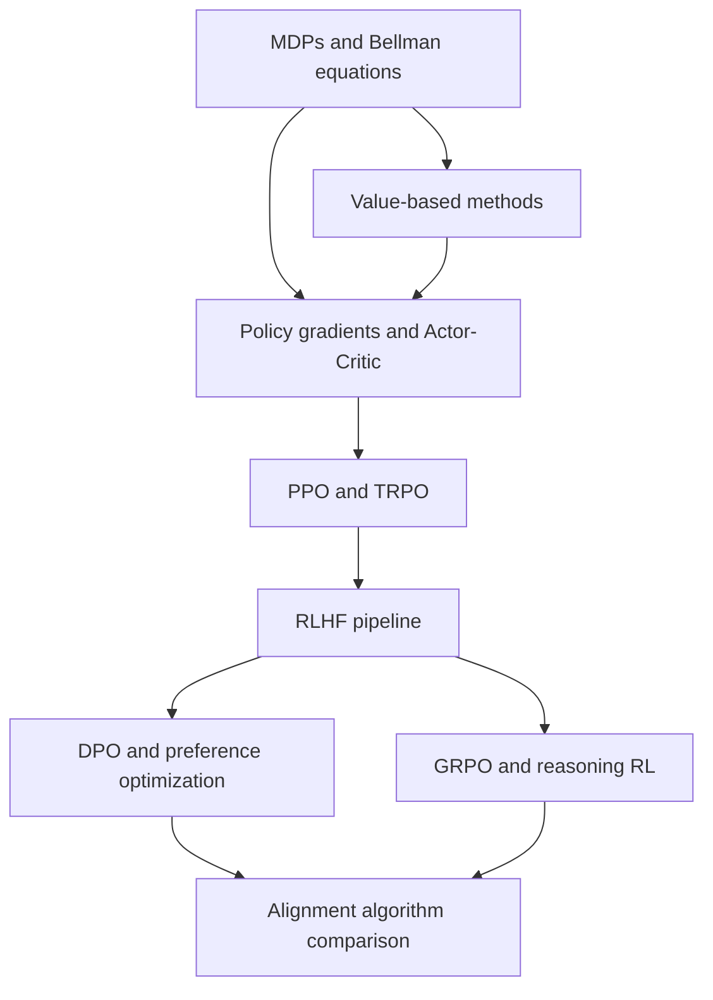

# Chapter 3 · Reinforcement Learning and Alignment Algorithms

> **Chapter overview**: Start from MDPs and the Bellman equations and work up to PPO, RLHF, DPO, GRPO, and reasoning RL. RL interview questions are highly concentrated: **derive policy gradients/GAE/DPO by hand, explain PPO-clip, describe the three RLHF stages and reward hacking, and explain why GRPO can drop the critic**. Alignment algorithms are a common differentiator for LLM and reasoning roles, so study them in three passes: basic RL -> policy optimization -> LLM alignment.
>
> **Interview weight**: Algorithm roles (RL/alignment) ★★★★★; LLM application/Agent roles ★★★☆☆; pure Infra roles ★★☆☆☆.

## What this chapter covers

- [MDPs and the Bellman Equations](01-mdp-and-bellman-equations.md) — MDP tuple, return and discounting, Bellman expectation/optimality equations, exploration vs exploitation, on/off-policy
- [Value-Based Methods](02-value-based-methods.md) — policy iteration/value iteration, MC vs TD, Sarsa/Q-learning, DQN and its improvements, DDPG/TD3/SAC
- [Policy Gradients and Actor-Critic](03-policy-gradient-and-actor-critic.md) — policy gradient theorem derivation, REINFORCE, baseline/advantage, A2C/A3C, GAE derivation, entropy regularization
- [PPO and TRPO](04-ppo-and-trpo.md) — trust region and monotonic improvement, PPO-clip, KL penalty, hyperparameters and implementation details, role in RLHF
- [The Full RLHF Pipeline](05-rlhf-pipeline.md) — SFT -> RM -> PPO, Bradley-Terry, KL penalty, reward hacking, RLAIF
- [DPO and Preference Optimization](06-dpo-and-preference-optimization.md) — full DPO derivation, DPO vs PPO, IPO/KTO/ORPO/SimPO, length bias and limitations
- [GRPO and Reasoning RL](07-grpo-and-reasoning-rl.md) — group-relative advantage, dropping the critic, RLVR, the R1 pipeline, PRM/ORM, pass@k
- [Comparing LLM Alignment Algorithms](08-alignment-algorithms-compared.md) — side-by-side comparison, data and memory costs, a selection decision tree, open debates

## Interview weight and common questions

| Topic | Frequent question | How well you should know it |
| --- | --- | --- |
| Bellman / value functions | Write the Bellman expectation and optimality equations; MC vs TD | Reproduce the formulas and explain convergence |
| Policy gradients | Derive the policy gradient theorem; why a baseline is unbiased | Explain the log-derivative trick clearly |
| GAE | Derive the $(\gamma\lambda)^l$ weights; role of $\lambda$ | Derive the recursion by hand |
| PPO | Write the clipped objective; explain min; compare with TRPO | Write pseudocode and share tuning experience |
| RLHF | Three stages, RM loss, KL penalty, reward hacking | Draw the pipeline and name the pitfalls |
| DPO | Derive the DPO loss from the KL-regularized objective | Complete derivation and why $Z$ cancels |
| GRPO/RLVR | Why drop the critic; group normalization; the R1 pipeline | Compare with PPO and explain the biases |
| Selection | How to choose RLHF/DPO/GRPO | Give a plan based on data, compute, and reward |

## Chapter map

## Study plan

**Recommended order**: 01 -> 02 -> 03 -> 04 -> 05 -> 06 -> 07 -> 08.

| Stage | Content | Suggested time | Goal |
| --- | --- | --- | --- |
| Foundations | 01, 02 | 1.5 days | Write the Bellman equations; explain DP/MC/TD differences |
| Optimization | 03, 04 | 2 days | Derive policy gradients and GAE; write PPO-clip |
| Alignment | 05, 06 | 2 days | Explain the three RLHF stages; derive DPO |
| Reasoning RL | 07, 08 | 1.5 days | Explain GRPO/RLVR; make selection decisions |

Keep three threads in mind while studying:

1. **Value functions -> policy gradients -> PPO**: understand why a critic, a baseline, and a trust region are needed;
2. **Where the reward comes from**: RM (RLHF) -> implicit reward (DPO) -> group comparison (GRPO) -> rule verification (RLVR);
3. **Engineering cost**: 4 models vs 2 models, online vs offline, memory and throughput. This is where interviews separate people who memorized concepts from people who actually trained models.

Self-test: without notes, draw the three-stage RLHF pipeline, write the PPO-clip and DPO losses, explain how GRPO computes advantages, and describe each method's failure modes.

## How it connects to other chapters

- **To [Machine Learning Fundamentals](../01-ml-fundamentals/README.md)**: the Bellman equations are dynamic programming in disguise; evaluation metrics (win rate, pass@k) and the bias-variance tradeoff run through this whole chapter.
- **To [Deep Learning Fundamentals](../02-dl-fundamentals/README.md)**: policy and value networks are MLPs/Transformers; PPO stability is tied to optimizers, normalization, and gradient clipping (see [Optimizers and Training Tricks](../02-dl-fundamentals/06-optimizers-and-training-tips.md)).
- **To [Chapter 4: Large Language Models](../04-llm/README.md)**: SFT data engineering, LoRA, distributed training, and inference engines are the engineering foundation for RLHF/GRPO; this chapter covers algorithms and derivations only, while the practical bridge is [Fine-tuning and PEFT](../04-llm/06-fine-tuning-and-peft.md).
- **To [Chapter 5: AI Agents](../05-agents/README.md)**: multi-step decisions and tool-feedback loops in agents can be modeled as RL; the policy gradient/GAE material here is the basis for understanding Agent RL.
- **To [Chapter 8: Interview Bank](../08-interview-bank/README.md)**: this chapter's Q&A and cheat sheets feed the quick-reference cards.

## Cheat sheet (one page)

| Topic | Conclusion you must remember |
| --- | --- |
| Bellman | Expectation equations evaluate a policy; optimality equations find one; $\gamma$ guarantees a contraction |
| Value functions | TD has bias and low variance; MC is unbiased with high variance; DQN = Q-learning + replay + target network |
| Policy gradient | $\nabla J=\mathbb{E}[\nabla\log\pi\cdot A]$; a baseline is unbiased and reduces variance |
| GAE | $A_t=\sum_l(\gamma\lambda)^l\delta_{t+l}$; $\lambda$ trades bias for variance |
| PPO | Clipping the ratio bounds the update; min takes the pessimistic bound |
| RLHF | SFT -> RM (BT loss) -> PPO (reward - βKL); reward at the last token, KL at every token |
| DPO | Closed-form optimal policy -> implicit reward -> classification loss; no RM and no sampling |
| GRPO | Group mean as baseline, group-normalized reward as advantage; no critic |
| RLVR | Rule-based rewards + reasoning RL; watch the pass@1 vs pass@k debate |

## Common misconceptions

- "RLHF = PPO": RLHF is a pipeline; PPO is just one optimizer you can plug into it.
- "DPO needs no reward": it uses an implicit reward and still depends on a reference model and preference data.
- "PPO's clip is a hard constraint": it is a soft constraint; monitor the actual KL separately.
- "RL always raises the capability ceiling": RLVR may mostly improve pass@1 rather than pass@k, and that is still debated.
- "Rising reward means the model is getting better": it may just be reward hacking; always check held-out and human evaluation.

## References

- [Sutton & Barto, Reinforcement Learning: An Introduction](http://incompleteideas.net/book/the-book-2nd.html)
- [OpenAI Spinning Up](https://spinningup.openai.com/en/latest/)
- [Easy-RL tutorial](https://datawhalechina.github.io/easy-rl/)
- [llm_interview_note · Reinforcement Learning](https://github.com/wdndev/llm_interview_note)
- [LLM-Agent-Interview-Guide · Alignment](https://github.com/Lau-Jonathan/LLM-Agent-Interview-Guide)
