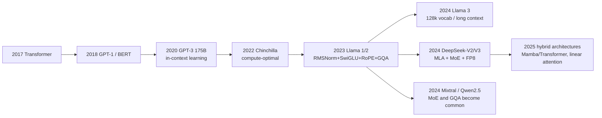

# LLM architecture evolution

> **One-line summary**: Since 2018, LLMs have converged on a standard kit of "decoder-only + Pre-RMSNorm + SwiGLU + RoPE + GQA"; since 2023 the main variables have been **MoE sparsity**, **MLA-compressed KV**, and **long-context extension**.
>
> **Keywords**: `decoder-only` `RMSNorm` `SwiGLU` `RoPE` `GQA` `MLA` `MoE` `load balancing` `Mamba`

## 1. Core concepts

### 1.1 The three mainstream architectures

| Architecture | Examples | Training objective | Strengths | Weaknesses |
| --- | --- | --- | --- | --- |
| Encoder-only | BERT, RoBERTa | MLM | strong bidirectional understanding, good for classification/extraction | cannot generate directly |
| Encoder-Decoder | T5, BART, Whisper | span corruption / seq2seq | decoupled input/output, strong for translation/summarization/speech | two sets of parameters, one extra cross-attention at inference |
| Decoder-only | GPT, Llama, Qwen, DeepSeek | causal language modeling (CLM) | unified objective, simple KV cache, strong in-context learning | weak bidirectional information; long-document understanding relies on scale |

### 1.2 Why decoder-only became dominant

1. **Densest supervision**: every token is one prediction, so any text can be trained on; in an encoder-decoder only the output side gets supervised.
2. **Parameter efficiency**: no separate encoder, so generation is stronger at the same parameter count; the pretraining objective and downstream generation tasks match exactly (no train-test mismatch).
3. **Simpler inference engineering**: only self-attention + KV cache, no cross-attention or encoder forward pass, so the serving path is short.
4. **Good scaling behavior**: after GPT-3, a large body of experiments showed that pure CLM improves zero-shot/few-shot ability fastest as scale grows; in-context learning is essentially "task inference in the forward pass".
5. **Unified ecosystem**: one codebase, one parallelization strategy, one inference engine, so engineering reuse is cheapest.

> Boundary: for tasks where the input and output modalities differ greatly (translation, speech recognition, TTS), encoder-decoder is still more natural; prefix LM (bidirectional prefix + causal suffix) is a compromise but is not mainstream for LLMs.

### 1.3 The "standard kit" of modern LLMs

| Component | 2018 Transformer | 2025 mainstream LLM | Motivation |
| --- | --- | --- | --- |
| Normalization | LayerNorm, Post-LN | **RMSNorm**, Pre-LN + final norm | cheaper compute, more stable deep stacks |
| Activation | ReLU / GELU | **SwiGLU** | gating improves expressiveness |
| Position encoding | sinusoidal / learned absolute | **RoPE** (some ALiBi/NoPE) | relative position + extensibility |
| Attention | MHA | **GQA / MLA** | compress the KV cache |
| Bias | has bias | mostly **no bias** | saves parameters, redundant with LN |
| FFN width | $4d$ | SwiGLU uses $\tfrac{8}{3}d$ | keep parameter count of three matrices aligned |
| Sparsity | none | **MoE** (optional) | large total parameters, small active parameters |

## 2. Principles and derivations

### 2.1 RMSNorm

$$
\mathrm{RMSNorm}(x)=\frac{x}{\sqrt{\frac{1}{d}\sum_{i=1}^{d}x_i^2+\epsilon}}\odot g
$$

The difference from LayerNorm: **no mean subtraction, no bias**, only root-mean-square scaling. LayerNorm is $\frac{x-\mu}{\sigma}\odot g+b$. RMSNorm saves the mean computation and the bias, matches or beats LayerNorm in experiments, and is friendlier to low precision. The Pre-LN structure is $x_{l+1}=x_l+\mathrm{Sublayer}(\mathrm{Norm}(x_l))$, with a final norm added before lm_head.

### 2.2 SwiGLU

$$
\mathrm{FFN}(x)=\big(\mathrm{Swish}(xW_1)\odot xV\big)W_2,\qquad \mathrm{Swish}(z)=z\cdot\sigma(\beta z)
$$

With $\beta=1$ this is SiLU. The gating branch lets the network learn "which dimensions to let through", which beats ReLU/GELU at the same parameter count. Because there is an extra $V$ matrix, the hidden width is usually $\tfrac{8}{3}d$ instead of $4d$, keeping the total parameter count close to the original FFN ($3\times\tfrac{8}{3}=8\approx 2\times4$).

### 2.3 MoE: sparse activation

Replace the FFN with $E$ experts and route each token through only top-$k$ of them:

$$
y=\sum_{i\in\mathrm{TopK}(g(x))} g_i(x)\,E_i(x),\qquad g(x)=\mathrm{softmax}(xW_g)
$$

- **Total parameters vs active parameters**: DeepSeek-V3 has 671B total parameters but activates only about 37B per token; compute is counted on active parameters, memory on total parameters.
- **Load balancing**: routing tends to collapse onto a few experts. Switch Transformer's auxiliary loss is

$$
\mathcal{L}_{aux}=\alpha\cdot E\sum_{i=1}^{E}f_i\,P_i
$$

where $f_i$ is the fraction of tokens dispatched to expert $i$ and $P_i$ is the mean routing probability; the loss is minimized when both are uniform.
- **Capacity factor**: each expert accepts at most $\mathrm{cap}=c\cdot\dfrac{T\cdot k}{E}$ tokens; overflow is dropped (token dropping).
- **DeepSeek-V3's aux-loss-free approach**: keep a bias $b_i$ per expert, adjust it up or down according to load, and route with $\mathrm{softmax}(xW_g+b)$; this avoids extra gradient conflicts. Shared experts absorb general knowledge.
- **Expert parallelism (EP)**: experts live on different GPUs and routing requires all-to-all communication, which is the main bottleneck in MoE training.

### 2.4 MLA: compressing KV into a latent vector

Multi-head Latent Attention does not cache full K/V; instead it caches a low-rank latent vector $c_t^{KV}\in\mathbb{R}^{d_c}$ (with $d_c=512$ in DeepSeek-V2) and a decoupled RoPE component $k_t^{R}\in\mathbb{R}^{64}$, then projects them back to per-head K/V when needed. The effect is that the KV cache drops from "per layer per token $2n_h d_h$" to "$d_c+d_R$", a compression of dozens of times. Details and the memory formula are in [03 Attention and positional encoding](03-attention-and-position-encoding.md).

### 2.5 Architecture timeline



## 3. Implementation notes

```python
# RMSNorm: root-mean-square scaling only, no mean subtraction, no bias
def rms_norm(x, g, eps=1e-6):
    return g * x * torch.rsqrt(x.pow(2).mean(-1, keepdim=True) + eps)

# SwiGLU: gated FFN with hidden ~8/3 d to match the original FFN parameter count
h = F.silu(x @ W1) * (x @ V)      # Swish gate + linear branch
y = h @ W2

# MoE routing: softmax then top-k, then weight the expert outputs
w, idx = (x @ Wg).softmax(-1).topk(k, dim=-1)
```

### 3.1 Mainstream model overview

| Model | Parameters (total/active) | Layers | $d_{model}$ | Q/KV heads | Context | Vocabulary | Notes |
| --- | --- | --- | --- | --- | --- | --- | --- |
| Llama-2-7B | 6.7B | 32 | 4096 | 32/32 | 4k | 32k | MHA, 32k vocabulary |
| Llama-3-8B | 8B | 32 | 4096 | 32/8 | 8k | 128k | GQA, RoPE base 500k |
| Llama-3-70B | 70B | 80 | 8192 | 64/8 | 8k | 128k | GQA, trained on 15T tokens |
| Qwen2.5-7B | 7.6B | 28 | 3584 | 28/4 | 32k | 151k | GQA, bilingual vocabulary |
| Qwen3-8B | 8B | 36 | 4096 | 32/8 | 32k (extendable to 128k) | 151k | unified reasoning/non-reasoning modes |
| Mistral-7B | 7.3B | 32 | 4096 | 32/8 | 8k | 32k | sliding-window attention |
| Mixtral-8x7B | 46.7B / 12.9B | 32 | 4096 | 32/8 | 32k | 32k | 8 experts, top-2 |
| DeepSeek-V3 | 671B / 37B | 61 | 7168 | 128/MLA | 128k | 129k | MLA + 256 routed experts |
| GPT-3 | 175B | 96 | 12288 | 96/96 | 2k | 50k | dense, learned absolute positions |

> The numbers are here to build a sense of magnitude; consult each model's technical report for exact values. In an interview it is enough to recall "layers / width / heads / number of GQA groups / vocabulary".

Additional note: the **GLM family** (Zhipu) used a prefix-LM-style objective in early ChatGLM and converged to the decoder-only standard kit (RMSNorm + SwiGLU + RoPE + GQA) in GLM-4; Qwen moved fully to GQA from Qwen2 onward with a 150k-class multilingual vocabulary.

### 3.2 Mamba / SSM in brief

Mamba replaces attention with a **selective state-space model**: $h_t=\bar{A}_t h_{t-1}+\bar{B}_t x_t$, $y_t=C_t h_t$, where $\bar{A},\bar{B},C$ are input-dependent (the "selective" part), training can use a parallel scan, and inference keeps a constant-size state. The upside is **$O(T)$ time and $O(1)$ inference state**, giving high long-sequence throughput; the downside is weaker exact retrieval/copying than attention. The current mainstream is hybrid architectures (attention layers interleaved with Mamba layers, e.g. Jamba); pure SSMs have not broadly replaced Transformers for general-purpose LLMs.

## 4. Interview Q&A

### Q1. Why did decoder-only become mainstream instead of BERT or T5?
**Answer**: On three levels. **Objective**: CLM supervises every token, works on any text, and matches generation tasks naturally. **Scale**: GPT-3 showed that pure CLM gives the best zero-shot/in-context ability once scaled up. **Engineering**: only self-attention, the simplest KV cache and inference engine, and the lowest ecosystem reuse cost. BERT lacks generation, while T5 carries an extra encoder and sparser training signal.
**Follow-up**: When is encoder-decoder still better? When input/output modalities differ greatly (speech, translation) or explicit alignment is needed.

### Q2. What is the difference between Pre-LN and Post-LN? Why do large models use Pre-LN?
**Answer**: Post-LN is $x_{l+1}=\mathrm{LN}(x_l+F(x_l))$, used by the original Transformer; Pre-LN is $x_{l+1}=x_l+F(\mathrm{LN}(x_l))$. In Post-LN the gradient must pass through every LN in a deep stack, which is unstable and requires warmup; in Pre-LN the residual is an identity path, so gradients flow back directly and deep stacks are more stable. The cost is that activations grow with depth, so Pre-LN models usually add a final norm at the end.
**Follow-up**: What are Pre-LN's downsides? Slightly weaker expressiveness in theory and more sensitivity to initialization, but the stability gain far outweighs the loss in practice.

### Q3. What does RMSNorm do better than LayerNorm?
**Answer**: RMSNorm drops mean subtraction and bias and divides only by the root mean square, so it is cheaper (one fewer reduction) and has fewer parameters, while matching LayerNorm in experiments; it is also friendlier to bf16/fp8 training (one less numerical issue from mean subtraction). Deep large models widely use it.
**Follow-up**: Why is dropping the mean fine? LayerNorm's scaling invariance comes mainly from variance normalization; the mean is absorbed by later layers in the residual stream.

### Q4. Why does SwiGLU work? Why is the hidden width 8/3 d?
**Answer**: SwiGLU is a gated linear unit: one branch passes through SiLU as a "gate" and is multiplied element-wise with the other branch, which effectively lets the network learn how much to let through per dimension, giving more expressiveness than a single GELU path. The extra $V$ matrix makes three $d\times h$ matrices, so $h=\tfrac{8}{3}d$ gives $3\cdot\tfrac{8}{3}=8$, aligned with the original FFN's $2\times4d=8d$.
**Follow-up**: What is the cost of SwiGLU? One extra FFN matrix and more kernels, which may be less economical than GELU in low-compute settings.

### Q5. What are the main architectural differences between Llama and GPT-3?
**Answer**: Llama uses RMSNorm (GPT-3 uses LN), SwiGLU (GELU), RoPE (learned absolute positions), no bias, and GQA (fewer KV heads in 70B/8B); GPT-3 is dense MHA with learned positions. In addition, Llama-3 expands the vocabulary to 128k and raises the RoPE base to 500k for longer contexts.
**Follow-up**: Which change matters most? RoPE + GQA affect long context and inference cost most; RMSNorm/SwiGLU are stable small wins.

### Q6. Why can MoE match a much larger model with less compute?
**Answer**: MoE replicates the FFN into $E$ experts and activates only top-$k$ per token, so **total parameters** (capacity, memory) can be large while **active parameters** (FLOPs) stay small. More capacity brings better knowledge storage and specialization while compute is counted on the active part. Hence at equal training/inference FLOPs, MoE usually beats a dense model.
**Follow-up**: What are MoE's costs? Memory scales with total parameters (expensive to deploy), routing/all-to-all communication, load imbalance, more complex fine-tuning, and poor expert utilization at small batch sizes.

### Q7. How do you fix MoE load imbalance?
**Answer**: Four common families: 1) **auxiliary loss** (Switch's $f_iP_i$) encouraging uniformity; 2) **capacity factor + token dropping** capping each expert; 3) **routing noise/jitter** or random exploration beyond top-k; 4) **aux-loss-free bias adjustment** (DeepSeek-V3), which adjusts routing logits by load without introducing gradient conflicts. In practice you also monitor per-layer expert load and drop rate.
**Follow-up**: Why is token dropping harmful? Dropped tokens skip the FFN entirely (residual pass-through), losing information and creating a train/inference mismatch; modern implementations try to keep capacity large or use dropless schemes.

### Q8. What is MLA's core idea? Why does it save KV cache?
**Answer**: MLA assumes the KV has low-rank structure, so it caches only a low-rank latent vector $c^{KV}$ plus a decoupled RoPE key, and projects back to per-head K/V at inference. The KV cache drops from "$2n_hd_h$ per layer per token" to "$d_c+d_R$" - roughly 576 dimensions in DeepSeek-V2 versus tens of thousands for MHA, a compression of dozens of times - while quality does not drop (the low-rank structure acts as regularization).
**Follow-up**: What is the training cost of MLA? It needs the "absorb" trick to avoid explicitly expanding K/V every step, making kernels complex, and decoupling the up-projection from RoPE is a design challenge.

### Q9. Why is GQA widely adopted?
**Answer**: GQA lets multiple query heads share one set of KV heads (e.g. 32 query heads with 8 KV heads), cutting the KV cache to 1/4 and greatly reducing inference memory and bandwidth, while quality stays close to MHA and far above MQA. It sits at the sweet spot of the quality-cost curve and has become the default for modern open models.
**Follow-up**: Why is MQA weaker? All heads share a single set of K/V, limiting expressiveness, and training is less stable than GQA.

### Q10. Will Mamba/SSM replace Transformers?
**Answer**: Not wholesale in the near term. SSMs offer linear complexity and constant inference state, with good long-sequence throughput; but attention's ability to retrieve, copy, and compare over long ranges exactly is key to in-context learning, and pure SSMs are weaker on tasks that need precise recall. The realistic direction today is **hybrid architectures** (attention interleaved with SSM layers), choosing per task.
**Follow-up**: What is the SSM parallel scan? The recurrence is rewritten as an associative operator and computed with a prefix scan on the GPU, so training does not have to be serial.

### Q11. Why do modern LLMs drop bias almost everywhere?
**Answer**: After LayerNorm/RMSNorm, biases are mostly canceled by normalization or redundant with scaling, so the benefit is tiny; removing them saves parameters, reduces numerical issues at low precision, and simplifies kernels. The Llama family has been bias-free since the first generation.
**Follow-up**: Where is bias still kept? Some models keep it in lm_head or certain linear layers, depending on implementation and precision needs.

### Q12. Why did Llama-3 raise the RoPE base to 500k?
**Answer**: RoPE's $\theta_i=10000^{-2i/d}$ sets the rotation frequency of each dimension. A larger base rotates low-frequency dimensions more slowly, so longer relative distances can be represented. Raising the base from 10k to 500k "stretches" positional resolution, making extrapolation beyond the native length (8k) smoother; with continued pretraining and YaRN it extends to 128k.
**Follow-up**: Can you change only the base without retraining? No - the position distribution changes, so continued pretraining is required or extrapolation degrades.

## 5. Pitfalls and follow-ups

- **"Decoder-only is stronger" is conditional**: it holds at equal token budget and parameter count; for classification/extraction with small models, BERT-style models are still more economical.
- **MoE parameter counts are not directly comparable to dense models**: compare both "active parameters" and "total parameters", and use total parameters for memory.
- **GQA reduces KV heads, not query heads**: attention compute barely changes; what is saved is cache and bandwidth.
- **Pre-LN is not a cure-all**: very deep models still need QK-norm, residual scaling, embedding norm, and similar tricks to prevent loss spikes.
- **MLA and GQA are not mutually exclusive**: MLA is "low-rank compression + decoupled RoPE", and head sharing can still be designed inside it.

## 6. Cheat sheet

| Topic | One-liner |
| --- | --- |
| Decoder-only | unified objective, simple KV cache, strong in-context learning |
| RMSNorm | divides by the RMS only, no mean, no bias, Pre-LN standard |
| SwiGLU | gated FFN, hidden $=\tfrac{8}{3}d$ to align parameters |
| RoPE | rotary positions; the inner product depends only on relative distance; base controls extrapolation |
| GQA | many Q heads share few KV heads, KV cache down to $1/G$ |
| MLA | caches a low-rank latent + decoupled RoPE, compresses dozens of times |
| MoE | large total parameters, small active parameters; routing + load balancing + EP |
| Standard kit | Pre-RMSNorm + SwiGLU + RoPE + GQA (+MoE) |
| Mamba | selective SSM, linear complexity, hybrid architectures are the realistic answer |

## 7. References

- [Attention Is All You Need](https://arxiv.org/abs/1706.03762)
- [Language Models are Few-Shot Learners (GPT-3)](https://arxiv.org/abs/2005.14165)
- [LLaMA: Open and Efficient Foundation Language Models](https://arxiv.org/abs/2302.13971)
- [The Llama 3 Herd of Models](https://arxiv.org/abs/2407.21783)
- [Root Mean Square Layer Normalization](https://arxiv.org/abs/1910.07467)
- [GLU Variants Improve Transformer](https://arxiv.org/abs/2002.05202)
- [RoFormer: Enhanced Transformer with Rotary Position Embedding](https://arxiv.org/abs/2104.09864)
- [GQA: Training Generalized Multi-Query Transformer Models](https://arxiv.org/abs/2305.13245)
- [DeepSeek-V2: A Strong, Economical, and Efficient MoE Language Model](https://arxiv.org/abs/2405.04434)
- [DeepSeek-V3 Technical Report](https://arxiv.org/abs/2412.19437)
- [Switch Transformers](https://arxiv.org/abs/2101.03961)
- [Mamba: Linear-Time Sequence Modeling with Selective State Spaces](https://arxiv.org/abs/2312.00752)
- [llm_interview_note · large language model architectures](https://github.com/wdndev/llm_interview_note)
