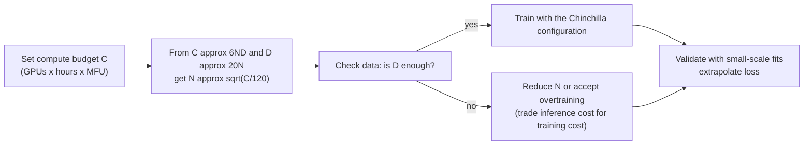

# Scaling laws

> **One-line summary**: Pretraining loss is a power-law function of parameters $N$, data $D$, and compute $C$; **Chinchilla corrected Kaplan's allocation** by showing that parameters and data should grow roughly in proportion, at about 20 tokens per parameter, at the compute optimum; today's models, however, deliberately **overtrain** to save inference cost.
>
> **Keywords**: `Kaplan` `Chinchilla` `compute-optimal` `6ND` `emergent abilities` `overtraining` `data-constrained` `MoE scaling`

## 1. Core concepts

### 1.1 The three scaling laws

1. **Scale power law**: loss decreases as a power law in $N$, $D$, and $C$ (approximately a straight line on log-log axes).
2. **Compute-optimal allocation**: given a compute budget $C$, how to split it between $N$ and $D$ to minimize loss.
3. **Predictability**: fit curves from small-scale experiments and extrapolate the loss of large models (and some downstream capabilities).

The basic training-compute relation:

$$
C\approx 6ND
$$

where $N$ is the parameter count and $D$ the number of training tokens; **6 = 2 forward + 4 backward** (see 2.2).

### 1.2 Kaplan vs Chinchilla

| Dimension | Kaplan et al. 2020 | Chinchilla (Hoffmann et al. 2022) |
| --- | --- | --- |
| Fit form | separable power-law combination of $L(N,D)$ | $L=E+A/N^{\alpha}+B/D^{\beta}$ |
| Experiment scale | smaller models, fewer data points | 400+ models, cross-validated with three methods |
| Allocation result | $N\propto C^{0.73}$, $D\propto C^{0.27}$ | $N\propto C^{0.5}$, $D\propto C^{0.5}$ |
| Tokens per parameter | about 1.7 at GPT-3 scale | **about 20** |
| Representative | GPT-3 175B / 300B tokens | Chinchilla 70B / 1.4T tokens |

In one sentence: **Kaplan made models bigger, Chinchilla made them eat enough**. At equal compute, a smaller model fed more data often beats a larger model kept on a diet.

### 1.3 Data constraints and "overtraining"

Chinchilla assumes infinite data. In reality high-quality tokens are finite, and **inference cost** has to be included:

$$
\text{Total cost}\approx \underbrace{6ND\cdot p_{\text{train}}}_{\text{training}}+\underbrace{2N\cdot T_{\text{infer}}\cdot p_{\text{infer}}}_{\text{inference}}
$$

When a model serves massive request volumes, the inference term dominates, so "**spend more compute at training time to get a smaller model at inference time**" becomes the better trade - which is why Llama-3 8B was trained on 15T tokens (about 1875 tokens per parameter).

## 2. Principles and derivations

### 2.1 The two classic fits

**Kaplan (2020)**:

$$
L(N,D)=\left[\left(\frac{N_c}{N}\right)^{\alpha_N/\alpha_D}+\frac{D_c}{D}\right]^{\alpha_D}
$$

where $\alpha_N=0.076$, $\alpha_D=0.095$, $N_c=8.8\times10^{13}$, $D_c=5.4\times10^{13}$.

**Chinchilla (2022)**:

$$
L(N,D)=E+\frac{A}{N^{\alpha}}+\frac{B}{D^{\beta}}
$$

The fitted values are about $E=1.69$, $A=406.4$, $B=410.7$, $\alpha=0.34$, $\beta=0.28$. The meaning is intuitive: $E$ is the irreducible loss, and the other two terms are the losses from "not enough parameters" and "not enough data".

### 2.2 Why $6ND$

- Forward: each parameter does one multiply-add per token, about $2N$ FLOPs/token, for $2ND$ in total;
- Backward: computing $dW$ and $dX$ costs about $2ND$ each, for $4ND$ in total;
- Total: $6ND$.

This only counts matrix multiplies. For long sequences the attention term $O(ND\cdot T)$ cannot be ignored: the longer the sequence, the larger attention's share of total compute, and $6ND$ underestimates.

### 2.3 Deriving the compute-optimal allocation

Minimize $A N^{-\alpha}+B D^{-\beta}$ subject to $ND=C/6$. The Lagrangian gives the first-order condition:

$$
\alpha A N^{-\alpha}=\beta B D^{-\beta}
$$

Combined with $ND=C/6$, this yields:

$$
N_{\text{opt}}\propto C^{\frac{\beta}{\alpha+\beta}},\qquad
D_{\text{opt}}\propto C^{\frac{\alpha}{\alpha+\beta}}
$$

When $\alpha\approx\beta$, both exponents are close to $1/2$: **parameters and data grow together**. Substituting the fitted values $\alpha=0.34,\beta=0.28$ gives roughly $N\propto C^{0.45}$ and $D\propto C^{0.55}$ (data grows slightly faster than parameters); within fit error the paper treats them as 0.5/0.5 and recommends about 20 tokens per parameter.

**Budget example**: for $C=10^{23}$ FLOPs, using $D=20N$ gives $C=6N\cdot20N=120N^2$, so $N\approx2.9\times10^{10}$ (29B) and $D\approx5.8\times10^{11}$ (580B tokens). With $C=6\times10^{23}$ this is exactly 70B / 1.4T - the Chinchilla configuration.

### 2.4 Inference-optimal vs training-optimal

Let $T_{\text{infer}}$ be the total number of inference tokens. Folding inference cost into the objective makes the optimal $N$ **smaller** and $D$ **larger**:

- Training-optimal (Chinchilla): minimize loss for a training-compute budget;
- Inference-optimal: minimize per-token cost over "training + serving" compute.

Gadre et al. (2024) further showed that even when training far beyond 20 tokens per parameter, loss still falls as a power law in $D$ - "overtraining" is not wasted; it **converts training compute into inference efficiency**.

### 2.5 Emergent abilities: real emergence or a measurement artifact?

- **Wei et al. (2022)**: some abilities are near random on small models and jump abruptly past a certain scale, which they called "emergence".
- **Schaeffer et al. (2023)**: many "emergent" jumps are caused by **discontinuous metrics** - exact match (a 0/1 score) jumps from 0 to a high value as the model gets close to correct; with continuous metrics (token accuracy, edit distance) the curves are smooth.
- **Later work (e.g. Ruan et al. 2024's observational scaling laws)**: using continuous metrics and extrapolating from small models, most capability curves turn out smooth and predictable.

Conclusion: **the underlying capability is probably continuous**; "emergence" is partly an effect of task metrics and thresholds. But "usable or not" really does have a tipping point, so products still observe "suddenly it works".

### 2.6 Scaling for MoE

MoE decouples "total parameters" from "active parameters": compute is counted on active parameters, capacity on total parameters. Empirically, at equal training FLOPs a sparse MoE has lower loss than a dense model (you can read it as "buying more capacity for the same compute"). The costs are memory proportional to total parameters, communication proportional to expert parallelism, and poor expert utilization at small batch sizes.

### 2.7 Budget planning flowchart



## 3. Implementation notes

```python
import numpy as np

# Fit L = E + A/N^alpha + B/D^beta from a few runs (simplified: fix D, sweep N)
def fit_alpha(Ns, losses):
    # log(L - E) = log A - alpha * log N
    E = min(losses) * 0.9          # rough estimate of the irreducible loss
    x = np.log(Ns); y = np.log(np.array(losses) - E)
    slope, intercept = np.polyfit(x, y, 1)   # y = -alpha*x + logA
    return float(-slope), float(np.exp(intercept))

# Budget planning: C -> (N, D), assuming D = 20N
def plan(C, tokens_per_param=20.0):
    N = (C / (6.0 * tokens_per_param)) ** 0.5
    return N, N * tokens_per_param

print(plan(1e23))   # approx (2.9e10, 5.8e11)
```

A practical reminder: fit at least 10+ points at different scales, and keep the **same tokens-per-parameter ratio** or a consistent LR schedule at each point, otherwise the fitted exponents will be biased.

## 4. Interview Q&A

### Q1. What is Chinchilla's core conclusion?
**Answer**: For a given compute budget, model parameters and training tokens should **grow roughly in proportion**, about **20 tokens per parameter**; Kaplan had argued for growing the model first (about 1.7 tokens per parameter). Chinchilla 70B/1.4T beats the 280B Gopher at the same compute, proving that "feeding the data" is more economical than "making the model bigger".
**Follow-up**: How much lower is Chinchilla's loss than GPT-3's? Significantly lower at equal compute, with better downstream results across the board; there is no need to memorize the exact number.

### Q2. Where was Kaplan's conclusion wrong?
**Answer**: Mainly in **experimental scope and methodology**: the coverage of model/data points was small, and the learning rate and training length were not fully adjusted with scale, so the fit underestimated the marginal return of data; Chinchilla cross-validated with three methods (fixed model, fixed data, IsoFLOP) and expanded the scale by more than an order of magnitude. Strictly speaking it was not "wrong" but **extrapolated over a different range**.
**Follow-up**: What does this imply for engineering? The fitting range of a scaling law must cover the target scale, or extrapolation will be systematically biased.

### Q3. Where does $C\approx6ND$ come from? When is it inaccurate?
**Answer**: Forward costs about 2 FLOPs per parameter per token and backward about 4, giving $6ND$ in total. It is inaccurate when sequences are long (attention's share rises), for MoE (only active parameters count), for sparse/low-rank structures, and at very small batch (low utilization). In practice you apply an MFU correction when estimating wall-clock time.
**Follow-up**: What is MFU? The achieved FLOPs utilization = measured FLOPs / peak FLOPs; LLM training typically runs at 35%-50%.

### Q4. Why are today's models all "overtrained"?
**Answer**: Because inference dominates total cost. Once deployed, a model serves a huge number of tokens, and parameter count directly determines per-call compute and memory; spending more training compute to make the model smaller and train longer lowers the per-token inference cost. Llama-3 8B with 15T tokens (about 1875 tokens per parameter) is a typical "inference-optimal" choice.
**Follow-up**: Is there a limit to overtraining? Repeated/overtraining studies show loss still follows a power law, but returns diminish and are limited by data quality and repetition count.

### Q5. Are emergent abilities real?
**Answer**: Distinguish "capability" from "measurement". Many so-called emergent jumps are artifacts of **discontinuous metrics** (such as exact match); with continuous metrics the curves are smooth and extrapolable. But product experience does show "it only becomes usable past a threshold". The safer statement is: capability is continuous, usability has a threshold.
**Follow-up**: What does this mean for interviews/business? Do not judge a model by a single 0/1 benchmark; look at continuous metrics and the task distribution.

### Q6. What can a scaling law predict, and what can it not?
**Answer**: It predicts **pretraining loss** as a function of $N/D/C$ fairly accurately, plus some continuous metrics; it cannot reliably predict specific downstream task performance (especially multi-step reasoning), the capability structure under a changed data distribution, the effect of RLHF/post-training, or the constants after a major architecture change (MoE, SSM).
**Follow-up**: Why can loss fall without tasks improving? Loss is average token likelihood, while task ability depends on data mix and format; they correlate but are not equivalent.

### Q7. What do you do when high-quality data runs out?
**Answer**: 1) Multiple epochs (usually still effective within 4 repeats, then returns fall sharply); 2) synthetic data (textbook-style rewriting, self-instruct, guarding against diversity collapse and error amplification); 3) improve filtering and mixing efficiency; 4) reallocate $N$ and $D$ under the "inference-optimal" objective (smaller model, more data); 5) reinforce with high-quality data during an annealing phase.
**Follow-up**: Does synthetic data contaminate evaluation? Yes, so decontaminate separately and keep real data as a backstop.

### Q8. How does MoE fit into scaling laws?
**Answer**: MoE requires modeling "total parameters (capacity, memory)" separately from "active parameters (FLOPs)". Empirically, at equal training FLOPs a sparse MoE has lower loss, which is equivalent to "trading communication and memory for capacity"; scaling fits usually use active parameters $N_{\text{act}}$ as the compute variable and total parameters $N_{\text{tot}}$ as the capacity variable, fitting separate exponents.
**Follow-up**: What are MoE's bottlenecks? Expert-parallel all-to-all communication, load balancing, and memory proportional to total parameters at deployment.

### Q9. Given a compute budget, how do you choose model size and data volume?
**Answer**: First use $C=6ND$ and $D\approx20N$ to get $N\approx\sqrt{C/120}$ and $D\approx20N$; then check data availability and inference budget: if data is scarce or inference volume is large, reduce $N$ and increase $D$ (overtraining). Finally validate the extrapolation with small-scale fits and convert to GPU hours using MFU.
**Follow-up**: How do you estimate $C$? GPUs x per-GPU peak FLOPs x training hours x MFU (using the bf16/FP8 peak).

### Q10. When do scaling laws fail?
**Answer**: Extrapolation can be biased when the architecture or training paradigm changes (MoE, SSM, distillation, RL post-training), when the data distribution shifts (multilingual/code ratios), when hyperparameters are not tuned with scale (learning rate, batch, warmup), when evaluation metrics are discontinuous, or when the data repetition rate is high. In practice you must **re-validate at every scale** rather than plugging in constants.
**Follow-up**: Then why still use them? They turn "blindly trying a huge model" into "small-scale fitting + budget planning", saving a lot of compute.

### Q11. How does the scaling law change when training multiple epochs on the same data?
**Answer**: The effective data volume of repeated data must be discounted. Empirically, the first ~4 epochs give returns close to fresh data, then decay quickly; the higher the repetition rate and the larger the model, the more pronounced the decay. When fitting, you can write $D_{\text{eff}}$ as a concave function of the repetition count, or model it directly as "unique tokens + a repetition penalty".
**Follow-up**: Why does repetition hurt? Memorization, a narrower distribution, lower effective diversity, and easier amplification of noise in the data.

### Q12. Why can't loss/PPL be compared directly across models?
**Answer**: Loss is "cross-entropy per token", and tokens are defined by the tokenizer; different vocabularies and segmentations mean different information per token, so PPL is naturally incomparable. Cross-model comparisons should convert to **bits/byte** or **bits/char** and compute on the same evaluation set.
**Follow-up**: What about comparing scaling laws across papers? Unify the tokenizer or convert everything to bits/byte, otherwise the constants are not comparable.

## 5. Pitfalls and follow-ups

- **Chinchilla's 20 tokens per parameter is approximate**, not a hard constraint; modern models are far above it.
- **$6ND$ excludes attention**: long-context training must add attention FLOPs.
- **"Emergence" does not mean "unpredictable"**: most of it is a measurement issue and extrapolates with continuous metrics.
- **The constants in a scaling-law fit depend on the data distribution**: changing corpora/tokenizer requires refitting.
- **Do not compare MoE total parameters with dense compute**: compute uses active parameters, memory uses total parameters.

## 6. Cheat sheet

| Topic | One-liner |
| --- | --- |
| $C\approx6ND$ | 2 forward + 4 backward; long sequences add attention |
| Kaplan | $N\propto C^{0.73}$, model-first, ~1.7 tokens/parameter |
| Chinchilla | $N\propto C^{0.5}$, $D\propto C^{0.5}$, ~20 tokens/parameter |
| Fit form | $L=E+A/N^\alpha+B/D^\beta$, $\alpha\approx0.34,\beta\approx0.28$ |
| Compute-optimal | Lagrangian: $\alpha AN^{-\alpha}=\beta BD^{-\beta}$ |
| Budget conversion | $D=20N\Rightarrow N\approx\sqrt{C/120}$ |
| Overtraining | saves inference cost; Llama-3 8B ~1875 tokens/parameter |
| Emergence | continuous capability, discontinuous metrics; extrapolable |
| MoE | compute on active parameters, capacity/memory on total |
| Failure cases | architecture/data/metric changes require refitting |

## 7. References

- [Scaling Laws for Neural Language Models (Kaplan et al., 2020)](https://arxiv.org/abs/2001.08361)
- [Training Compute-Optimal Large Language Models (Chinchilla, 2022)](https://arxiv.org/abs/2203.15556)
- [Beyond Chinchilla-Optimal: Accounting for Inference in Language Model Scaling Laws](https://arxiv.org/abs/2401.00448)
- [Language Models Scale Reliably with Over-Training and on Downstream Tasks](https://arxiv.org/abs/2403.08540)
- [Are Emergent Abilities of Large Language Models a Mirage?](https://arxiv.org/abs/2304.15004)
- [Observational Scaling Laws and the Predictability of Language Model Performance](https://arxiv.org/abs/2405.10938)
- [The Llama 3 Herd of Models](https://arxiv.org/abs/2407.21783)
- [Mixtral of Experts](https://arxiv.org/abs/2401.04088)
- [ML Infra Interviews · Yuan Meng](https://www.yuan-meng.com/posts/ml_infra_interviews/)
