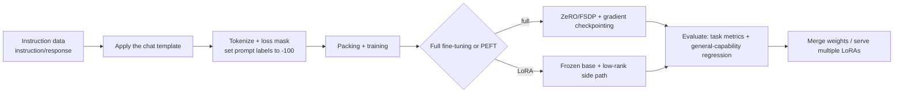

# Fine-tuning and PEFT

> **One-line summary**: SFT teaches a model to "talk in instructions", and PEFT does it with a tiny number of trainable parameters (LoRA usually <1%); memory estimation and data quality are the two main threads of this note.
>
> **Keywords**: `SFT` `loss mask` `LoRA` `QLoRA` `DoRA` `Adapter` `prefix tuning` `catastrophic forgetting` `full fine-tuning memory`

## 1. Core concepts

### 1.1 What SFT is doing

The pretraining objective is to continue text the way a human would; **supervised fine-tuning (SFT)** uses paired "instruction -> response" data to turn a "continuation engine" into an "assistant":

- It learns **format and behavior**: follow instructions, answer in the right role, and stop at the right moment (emit EOS).
- It is not mainly about knowledge: knowledge lives in pretraining; SFT datasets are usually tens of thousands to a few million examples, far smaller than pretraining.
- A classic result (LIMA): **1000 high-quality, diverse instruction examples** can substantially activate instruction-following ability - quality >> quantity.

### 1.2 Why PEFT is needed

| Dimension | Full fine-tuning | PEFT (LoRA as an example) |
| --- | --- | --- |
| Trainable parameters | 100% | 0.01%-1% |
| Memory (7B) | 160GB+ | 16-24GB |
| Per-task weights | a full model copy (14GB) | tens of MB |
| Multi-task switching | swap the whole model | swap adapters / load dynamically |
| Catastrophic forgetting | more severe | milder (base frozen) |
| Quality ceiling | highest | close to full fine-tuning (with enough data) |

There is also a hidden engineering benefit: **PEFT makes "one base + many LoRAs" possible**, so one base model serves several businesses and deployment cost drops significantly.

### 1.3 Method landscape

| Method | Insertion point | Trainable parameters | Extra inference latency | Mergeable |
| --- | --- | --- | --- | --- |
| LoRA | side path $BA$ on linear layers | $r(d+k)$ per layer | 0 after merging | yes |
| QLoRA | same, with a 4-bit base | same as LoRA | dequantization overhead | yes |
| DoRA | magnitude + direction decomposition | slightly more than LoRA | 0 after merging | yes |
| Adapter | bottleneck layer after FFN/attention | moderate | **yes** (serial) | no |
| Prefix tuning | per-layer KV prefix | small | consumes context | no |
| Prompt tuning | input embeddings | tiny | consumes context | no |
| IA3 | scaling vectors | tiny | 0 after merging | yes |
| BitFit | bias only | tiny | 0 | yes |

## 2. Principles and derivations

### 2.1 SFT loss and loss masking

SFT computes the loss only on the **response part**:

$$
\mathcal{L}_{\text{SFT}}=-\sum_{t\in\text{response}}\log p_\theta(y_t\mid x,\,y_{<t})
$$

In code, set the labels of the prompt span to `-100` (PyTorch cross-entropy's ignore_index); the denominator counts only valid tokens. This way the model is not asked to "predict the user's question" and does not learn the prompt template format as a generation target.

```python
# Compute loss only on the assistant span
labels = input_ids.clone()
labels[: prompt_len] = -100
loss = torch.nn.functional.cross_entropy(
    logits[:, :-1].reshape(-1, vocab_size),
    labels[:, 1:].reshape(-1),
    ignore_index=-100,
)
```

### 2.2 Memory estimate for full fine-tuning (worth memorizing)

With mixed-precision AdamW, each parameter carries:

| Item | Precision | Bytes per parameter |
| --- | --- | --- |
| Weights | bf16 | 2 |
| Gradients | bf16 | 2 |
| fp32 master weights | fp32 | 4 |
| Adam first moment $m$ | fp32 | 4 |
| Adam second moment $v$ | fp32 | 4 |
| **Total** | | **16** |

Add activations, attention intermediates, and logits. For a **7B model** the states alone are $7\times10^9\times16\approx112$ GB; logits are sizeable too: batch=1, seq=4096, 150k vocabulary, bf16 gives about $4096\times151000\times2\approx1.2$ GB, and real training multiplies that by chunking. So full fine-tuning of 7B usually needs **8x80GB or ZeRO/FSDP**; gradient checkpointing significantly reduces activation memory at the cost of about 30% extra compute.

### 2.3 LoRA: the low-rank increment assumption

LoRA assumes the weight increment for task adaptation is low-rank:

$$
W'=W+\Delta W=W+\frac{\alpha}{r}BA,\qquad B\in\mathbb{R}^{d\times r},\ A\in\mathbb{R}^{r\times k},\ r\ll\min(d,k)
$$

- Forward: $h=Wx+\frac{\alpha}{r}BAx$; the base $W$ is frozen and only $A,B$ are trained.
- Parameter count: $r(d+k)$, negligible compared with $dk$ (e.g. $d=k=4096$, $r=16$ gives about 130k, or 0.8% of the original matrix).
- **Initialization**: $A$ is random with small variance and $B=0$, so $\Delta W=0$ at the start and pretrained behavior is not disturbed.
- **Scaling** $\alpha/r$: decouples rank from update magnitude, so changing rank does not require retuning the learning rate; usually $\alpha=2r$. rsLoRA uses $\alpha/\sqrt{r}$, which is more stable at large rank.
- **Merging**: before inference, compute $W+\frac{\alpha}{r}BA$ and write it back for zero extra latency; only keep the side path when serving multiple LoRAs from one base (e.g. vLLM multi-LoRA).
- **Common target modules**: `q_proj, k_proj, v_proj, o_proj` are standard; adding `gate_proj, up_proj, down_proj` helps more but doubles the parameters.

### 2.4 The three key techniques of QLoRA

1. **NF4 (4-bit NormalFloat)**: non-uniform quantization by normal-distribution quantiles, which packs more information per 4 bits than uniform quantization and suits approximately normal weights.
2. **Double quantization**: the quantization constants (per-block absmax) are themselves quantized, saving about another 0.4 bits per parameter.
3. **Paged optimizer**: spill optimizer states to CPU at memory peaks and use unified memory to avoid OOM.

At compute time the 4-bit weights are dequantized to bf16 for matrix multiplies, and gradients flow only through the LoRA branch. QLoRA is close to 16-bit LoRA on most tasks but trains a bit slower; a 7B model can be fine-tuned on a single 16GB GPU.

### 2.5 DoRA and LoRA+

- **DoRA**: decompose the weight into a magnitude $m$ and a direction $V/\|V\|$, update only the direction with LoRA and learn the magnitude separately. The intuition is that pretrained weights have good directions but need magnitude adjustment; at small rank it gets closer to full fine-tuning than LoRA.
- **LoRA+**: use different learning rates for $A$ and $B$ (higher for $B$) because their gradient scales differ; a one-line implementation that often gives a 1-2 point gain.

### 2.6 Adapter / prefix / prompt family

- **Adapter (Houlsby 2019)**: insert a small bottleneck MLP after each layer (down-project -> activation -> up-project) and train only that. It works well, but **serial computation adds inference latency** and cannot be merged, so today it is mostly used for multi-task research.
- **Prefix tuning**: learn a K/V prefix for each attention layer, effectively a "soft prompt", but it consumes context and is complex to implement.
- **Prompt tuning / P-Tuning v2**: learn only input embeddings (v2 adds them at every layer); very few parameters, suitable for multi-task serving of very large models, but weaker than LoRA on small models.

### 2.7 Catastrophic forgetting and multi-task

SFT improves the target task while losing general ability (especially full fine-tuning on small data). Mitigations:

- **Data mixing**: blend 5%-20% general data (replay) into the SFT set.
- **PEFT**: the base stays frozen, so forgetting is naturally milder.
- **Regularization**: EWC, L2-SP (penalize deviation from pretrained weights).
- **Early stopping + small learning rate**: SFT usually runs 1-3 epochs at 1e-5 to 2e-5 (full fine-tuning) or 1e-4 to 2e-4 (LoRA).
- **Model merging**: combine task LoRAs with task arithmetic / model soup.

### 2.8 Fine-tuning flowchart



## 3. Implementation notes

```python
from peft import LoraConfig, get_peft_model, TaskType
from transformers import AutoModelForCausalLM

model = AutoModelForCausalLM.from_pretrained("Qwen/Qwen2.5-7B", torch_dtype="bfloat16")
cfg = LoraConfig(
    task_type=TaskType.CAUSAL_LM,
    r=16, lora_alpha=32, lora_dropout=0.05,
    target_modules=["q_proj", "k_proj", "v_proj", "o_proj"],
    bias="none",
)
model = get_peft_model(model, cfg)
model.print_trainable_parameters()     # usually <1%

# Merge after training for zero extra inference latency
merged = model.merge_and_unload()
```

Two easy-to-miss points: 1) LoRA's `lora_alpha` and `r` must be read together - the effective learning-rate scaling is $\alpha/r$; 2) save only the adapter weights, and load them with the **same base version**, otherwise the mismatch fails silently.

## 4. Interview Q&A

### Q1. What is the difference between SFT and pretraining?
**Answer**: Pretraining learns language and world knowledge from massive unlabeled text with a next-token objective; SFT uses a small set of instruction-response pairs to learn "behavior and format", so the model follows instructions, answers in role, and stops appropriately. SFT data is orders of magnitude smaller, but quality and diversity determine the result.
**Follow-up**: Does SFT inject new knowledge? A little, but that is not its main job; for knowledge, rely more on RAG or continued pretraining.

### Q2. Why does SFT compute loss only on the response?
**Answer**: The SFT goal is "generate a response given an instruction", so the prompt is a condition rather than something to predict. If the prompt were also supervised, the model would spend capacity fitting templates and user phrasing, and at inference we do not need it to generate user questions. In code, set the prompt labels to -100.
**Follow-up**: When would you supervise the prompt too? Multi-turn setups where you also want the model to learn to generate the user side (e.g. simulated dialogue), which is a special objective.

### Q3. How much memory does full fine-tuning of 7B need? How do you compute it?
**Answer**: With mixed-precision AdamW each parameter takes about 16 bytes (bf16 weights 2 + bf16 gradients 2 + fp32 master 4 + $m$ 4 + $v$ 4), so 7B is about 112GB; adding activations, logits, and temporary buffers usually pushes it above 160GB, which does not fit on a single 80GB GPU. You need ZeRO-2/3 or FSDP sharding plus gradient checkpointing to cut activations.
**Follow-up**: How much for LoRA on 7B? About 14GB for the bf16 base + a few adapters + activations, so a 24GB card works (more comfortably with checkpointing).

### Q4. Why does LoRA work?
**Answer**: The core assumption is that "the weight change needed for task adaptation is low-rank" (the intrinsic dimension is very low). Freezing the base and learning only a low-rank increment fits the task without destroying pretrained knowledge, and with few trainable parameters both memory and overfitting risk are low. In practice it approaches full fine-tuning on most instruction tasks.
**Follow-up**: When does the low-rank assumption fail? When the task differs greatly from the pretraining distribution or needs substantial new knowledge or a new language, low-rank capacity is insufficient and you must raise the rank or switch to full fine-tuning.

### Q5. Why is LoRA's B initialized to zero?
**Answer**: To guarantee $\Delta W=BA=0$ at the start, so the model's initial behavior exactly matches pretraining and random perturbation does not damage the base; gradients update $B$ from the first step, and keeping $A$ randomly initialized breaks symmetry. If both $A$ and $B$ were random, noise would be injected at the start and training would be less stable.
**Follow-up**: Can A also be initialized to zero? No - then both gradients degenerate to zero and it never learns.

### Q6. What is LoRA's α/r? How do you choose the rank?
**Answer**: $\alpha/r$ is the increment scaling factor that decouples "rank" from "update magnitude": changing $r$ keeps the effective learning rate stable via $\alpha$. Ranks are commonly 8-64: harder tasks and more data call for larger rank; simple style/format adaptation is fine at 8-16, general instruction tuning at 32-64. A more robust recipe is to sweep $r\in\{8,16,32,64\}$ with $\alpha=2r$ fixed.
**Follow-up**: Is a larger rank always better? Beyond a point returns saturate and overfitting/memory grow; for large ranks use rsLoRA's $\alpha/\sqrt{r}$.

### Q7. Can LoRA be merged? Is there extra inference latency?
**Answer**: Yes. After training, write $W+\frac{\alpha}{r}BA$ back into the original weights, and inference is identical to the base model with zero latency. Only when "one base with multiple LoRAs switched dynamically" do you keep the side path; then each forward pass does one extra small matrix multiply (negligible latency but extra memory).
**Follow-up**: Can you keep training after merging? Yes, but you lose adapter independence; for multi-task scenarios keep adapters stored separately.

### Q8. What are QLoRA's three key techniques? How much accuracy is lost?
**Answer**: NF4 quantile quantization, double quantization (quantizing the quantization constants), and the paged optimizer. The 4-bit base is frozen, computation dequantizes to bf16, and only LoRA receives gradients. It is close to 16-bit LoRA on most tasks, possibly slightly worse on long-tail/hard tasks; training is slower than LoRA.
**Follow-up**: Can QLoRA do full fine-tuning? No - a 4-bit base cannot carry full gradients; it is PEFT-only.

### Q9. How do you choose between LoRA, Adapter, and prefix tuning?
**Answer**: Prefer LoRA/QLoRA - mergeable, zero inference latency, and the most mature ecosystem; Adapter works well but adds serial latency and cannot be merged; prefix/prompt methods use very few parameters and suit multi-task serving of very large models, but consume context and are mediocre on small models. Rule of thumb: **default to LoRA, go QLoRA when memory is tight, and consider prompt methods only when you must minimize parameters**.
**Follow-up**: Why does Adapter add latency? It inserts serial computation in the middle of the network and cannot be merged into linear layers the way LoRA can.

### Q10. What do you do about catastrophic forgetting after fine-tuning?
**Answer**: 1) Mix general replay data into the training set; 2) freeze the base with PEFT; 3) small learning rate + 1-3 epochs + early stopping; 4) add L2-SP/EWC to penalize deviation; 5) multi-task joint training or model merging. Evaluation must check both the target task and general benchmarks (e.g. MMLU) for regression.
**Follow-up**: How do you detect forgetting? A drop beyond a threshold (e.g. 2-3 points) on a general benchmark, or degraded formatting/language ability.

### Q11. How much SFT data is needed? How many epochs?
**Answer**: It depends on quality and diversity: 1k-10k high-quality examples can noticeably change behavior; general instruction tuning commonly uses 100k-1M examples. Typically 1-3 epochs; more tends to overfit and forget. With little data, use early stopping, a smaller LR, and dropout. Evaluate with a held-out set plus general-capability regression.
**Follow-up**: What happens with repeated data? Repeating a small dataset over many epochs causes memorization and worse generalization; better to broaden diversity.

### Q12. What should you watch out for when training LoRA on multiple GPUs?
**Answer**: LoRA has few parameters, so DDP suffices; if the base is too large, use ZeRO-3/FSDP, which requires compatible `peft` configuration (e.g. `stage3_gather_16bit_weights_on_model_save`), otherwise saving breaks. Make sure adapters stay in sync across ranks (DDP does this automatically) and merge weights only on rank 0.
**Follow-up**: Any issue with LoRA + gradient accumulation? No, but adjust the LR when the effective batch changes.

### Q13. How do you evaluate whether a fine-tuning run succeeded?
**Answer**: Three layers: 1) **task metrics** (accuracy/pass rate/human preference); 2) **general-capability regression** (MMLU, C-Eval, etc., to catch forgetting); 3) **behavioral metrics** (instruction-following rate, refusal rate, format validity, average length, repetition rate). Ideally use a fixed evaluation set and A/B tests - do not look only at loss.
**Follow-up**: Why not look only at loss? SFT loss correlates weakly with human preference/task success and is easily lowered by template memorization. **Do you still need RLHF/DPO after SFT?** It depends on the goal: for helpfulness/harmlessness/style and preference alignment you need preference optimization (see [03 · The full RLHF pipeline](../03-reinforcement-learning/05-rlhf-pipeline.md), [03 · DPO](../03-reinforcement-learning/06-dpo-and-preference-optimization.md)); SFT alone tends to be verbose, refuse inappropriately, and have unstable formatting.

## 5. Pitfalls and follow-ups

- **Treating SFT as knowledge injection**: knowledge comes from pretraining/RAG; SFT mainly changes behavior.
- **Forgetting to mask the prompt**: the loss is diluted by templates and the model never learns to "answer only".
- **Tuning rank without tuning alpha**: the effective learning rate changes and experiments are not comparable.
- **Merging with an inconsistent base version**: adapter and base must match exactly, otherwise you get a silent mismatch.

## 6. Cheat sheet

| Topic | One-liner |
| --- | --- |
| SFT | instruction-response pairs, response loss only, 1-3 epochs |
| Full fine-tuning memory | 16 B/parameter (bf16 weights+grads + fp32 master/Adam), 7B ~112GB |
| LoRA | $W+\frac{\alpha}{r}BA$, $r(d+k)$ parameters, B initialized to 0 |
| α/r | decouples rank from update magnitude; usually $\alpha=2r$ |
| Merge | $W\leftarrow W+\frac{\alpha}{r}BA$, zero inference latency |
| QLoRA | NF4 + double quantization + paged optimizer, 7B on 16GB |
| DoRA | magnitude and direction decomposition, stronger at small rank |
| Adapter | serial, adds latency, not mergeable |
| Forgetting | replay + PEFT + small LR + general-benchmark regression |
| Evaluation | task metrics + general regression + behavior metrics |

## 7. References

- [LoRA: Low-Rank Adaptation of Large Language Models](https://arxiv.org/abs/2106.09685)
- [QLoRA: Efficient Finetuning of Quantized LLMs](https://arxiv.org/abs/2305.14314)
- [DoRA: Weight-Decomposed Low-Rank Adaptation](https://arxiv.org/abs/2402.09353)
- [LoRA+](https://arxiv.org/abs/2402.12354)
- [Parameter-Efficient Transfer Learning for NLP (Adapter)](https://arxiv.org/abs/1902.00751)
- [Prefix-Tuning](https://arxiv.org/abs/2101.00190)
- [The Power of Scale for Parameter-Efficient Prompt Tuning](https://arxiv.org/abs/2104.08691)
- [LIMA: Less Is More for Alignment](https://arxiv.org/abs/2305.11206)
- [llm_interview_note · supervised fine-tuning](https://github.com/wdndev/llm_interview_note)
