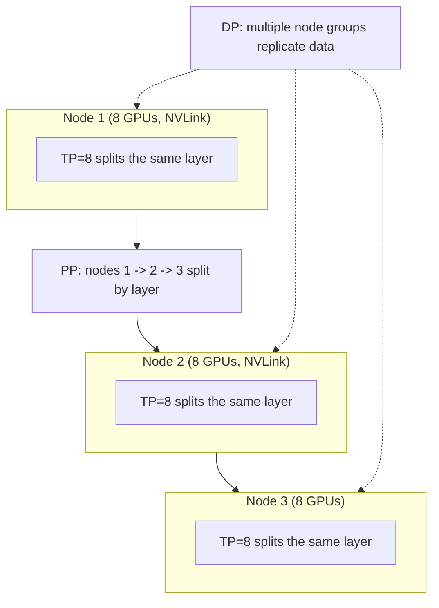

# Distributed training

> **One-line summary**: When a model does not fit on one GPU or trains too slowly, split the problem: **DP splits data, TP splits intra-layer matrices, PP splits layers, ZeRO/FSDP splits parameter states, SP/CP splits the sequence, EP splits experts**; the choice is decided jointly by memory, bandwidth, and topology.
>
> **Keywords**: `DDP` `ZeRO` `FSDP` `tensor parallelism` `pipeline parallelism` `1F1B` `sequence parallelism` `expert parallelism` `memory estimation` `MFU`

## 1. Core concepts

### 1.1 Why distributed training

- **Memory wall**: mixed-precision AdamW costs about 16 bytes per parameter, so a 70B model needs about **1.1 TB** for weights/gradients/optimizer states alone, far beyond a single 80GB GPU.
- **Compute wall**: training a 70B model on 15T tokens takes about $6\times70\times10^9\times15\times10^{12}\approx6.3\times10^{24}$ FLOPs, which would take decades on one GPU.
- **Communication wall**: the finer the split, the more communication; parallelization is fundamentally about balancing memory, compute, and bandwidth.

### 1.2 Overview of parallel dimensions

| Parallelism | What is split | Communication per step | Typical placement |
| --- | --- | --- | --- |
| DP / DDP | batch | gradient all-reduce | across nodes |
| ZeRO / FSDP | parameters, gradients, optimizer states | all-gather / reduce-scatter on demand | across nodes |
| TP | intra-layer matrices (heads, FFN dims) | all-reduce per layer | **within a node** (NVLink) |
| PP | layers | point-to-point between adjacent stages | across nodes |
| SP / CP | sequence dimension | all-gather / ring communication | within or across nodes |
| EP | MoE experts | all-to-all | depends on expert count |

### 1.3 Communication primitives

| Primitive | Semantics | Typical use | Data per call |
| --- | --- | --- | --- |
| broadcast | one to many | initial parameter sync | $M$ |
| reduce-scatter | reduce then scatter | ZeRO gradients/FSDP | $\frac{N-1}{N}M$ |
| all-gather | gather scattered data | ZeRO-3 parameters, TP | $\frac{N-1}{N}M$ |
| all-reduce | reduce then broadcast to all | DDP gradients, TP output | $\approx 2M$ |
| all-to-all | every rank sends different data to every rank | MoE expert routing | depends on routing |

**Ring all-reduce** = reduce-scatter + all-gather, with data volume about $2\frac{N-1}{N}M$, approaching $2M$ for large $N$. This number matters: DDP's per-step communication is proportional to the **parameter count** and almost independent of the number of GPUs; the cross-machine bottleneck for DP is therefore fixed bandwidth, not "more GPUs means slower".

## 2. Principles and derivations

### 2.1 DP / DDP

Each GPU holds the **full model**, is fed a different micro-batch, and after backward the gradients are all-reduced and averaged:

$$
g=\frac{1}{N}\sum_{i=1}^{N}g_i
$$

DDP's engineering trick: group gradients into buckets and **start the all-reduce as soon as one bucket's backward finishes**, overlapping it with the remaining backward pass; combined with gradient accumulation (several micro-batches before one sync) it simulates a large batch. Note that DDP **does not save memory** - a 70B model that does not fit on one GPU still cannot use it.

### 2.2 The three ZeRO stages

ZeRO's core idea is to **split the training state and communicate to swap it back when needed**:

| Stage | What is split | Memory per GPU (per parameter) | Communication (relative to DP) |
| --- | --- | --- | --- |
| Baseline DP | nothing | 16 B | 1x |
| ZeRO-1 | optimizer states (fp32 master + $m,v$) | about $4+12/N$ B | 1x |
| ZeRO-2 | + gradients | about $2+14/N$ B | 1x |
| ZeRO-3 | + parameters | about $16/N$ B + activations | about 1.5x |

($N$ is the data-parallel degree; ZeRO-1/2 still keep full bf16 weights, and only ZeRO-3 shards the parameters by $N$.) ZeRO-3 all-gathers a layer's parameters before forward/backward and frees them immediately, then reduce-scatters gradients on the way back, so memory drops to about $\sim1/N$ at the cost of extra communication and implementation complexity.

### 2.3 FSDP

FSDP (Fully Sharded Data Parallel) is PyTorch's native take on the "ZeRO-3 idea":

- **Flatten** each layer's parameters into one big tensor, then shard it by rank;
- all-gather a layer's parameters before its forward pass and free them right after;
- the same in reverse, with gradients reduce-scattered back.

The difference from ZeRO-3 is mainly **ownership and ecosystem**: FSDP lives in PyTorch and integrates well with `torch.compile`/DTensor; ZeRO-3 lives in DeepSpeed with more mature offload and configuration options. At scale, **HSDP** (shard within a node, replicate across nodes) is common to reduce cross-machine all-gathers.

### 2.4 TP: tensor parallelism

Take the MLP $Y=XA$:

- **Column parallel**: split $A=[A_1,A_2]$ by columns; each GPU computes $Y_i=XA_i$ with **no communication** in forward and concatenates the outputs; backward needs an all-reduce for $dX$.
- **Row parallel**: split $A$ by rows; $Y=X_1A_1+X_2A_2$ needs an all-reduce in forward and **no communication** in backward.

Combined in a Transformer: attention Q/K/V are split by head (naturally column parallel) and the output projection is row parallel; the first FFN layer is column parallel and the second row parallel. So each Transformer block has **2 all-reduces** in forward (attention output, FFN output) and 2 more in backward.

Because every layer all-reduces, TP demands very high bandwidth and is usually **limited to 8 GPUs within a node (NVLink)**; cross-node TP is dragged down by network bandwidth.

### 2.5 PP: pipeline parallelism

Split the model into $p$ stages by layer and the input into $m$ micro-batches executed in a pipeline.

- **GPipe**: run forward for all micro-batches, then backward for all, with activation memory $O(m)$ and bubble ratio $\frac{p-1}{m+p-1}$.
- **1F1B** (one-forward-one-backward): after warmup, alternate one forward and one backward; memory drops to $O(p)$ and the bubble ratio is the same; this is the Megatron/DeepSpeed default.
- **Interleaved 1F1B**: split each stage into $v$ virtual stages, reducing the bubble roughly to $1/v$ of the original at the cost of more communication and scheduling complexity.

**Bubble formula** ($p$ stages, $m$ micro-batches):

$$
\text{bubble fraction}=\frac{p-1}{m+p-1}
$$

So either increase $m$ (limited by memory), decrease $p$, or use interleaved virtual stages.

### 2.6 SP / CP: long context

- **Sequence parallelism (SP)**: split LayerNorm/dropout and similar ops along the sequence dimension, working with TP to reduce per-GPU activations; Megatron's SP avoids storing the full sequence redundantly inside the TP group.
- **Context parallelism (CP)**: split the sequence into segments; attention exchanges K/V across segments, and Ring Attention passes KV blocks around a ring via p2p, enabling 128k+ long-context training.

### 2.7 EP: expert parallelism

MoE experts are spread across GPUs, and tokens must be **all-to-all** dispatched to the right expert and gathered back:

- uneven routing creates hotspots, controlled by capacity factor/token dropping/aux loss (see [02 LLM architecture evolution](02-llm-architecture-evolution.md));
- all-to-all has high latency, so it is usually combined with DP/TP and experts are kept within the same node where possible;
- at large expert-parallel degrees, **communication becomes the main bottleneck**, requiring overlap of compute and communication.

### 2.8 Memory estimation and hybrid parallel layout

**Total memory**:

$$
M\approx \underbrace{16N}_{\text{state}}+\underbrace{M_{\text{act}}}_{\text{activations}}+\underbrace{M_{\text{logits/buffer}}}_{\text{temporary}}
$$

($N$ is the parameter count, and states use 2+2+4+4+4 bytes; with ZeRO-3 the state term is about $16N/N_{\text{gpu}}$.)

**Example: 70B model**, $16\times70\times10^9=1.12$ TB. With 64 GPUs and ZeRO-3 the states are about 17.5 GB per GPU, which fits in an 80GB card after adding activations; with only 8 GPUs you must also use TP/PP.

**Hybrid layout** (3D parallelism) in practice:



Rule of thumb: **TP inside a node (<=8), PP across nodes, DP on the outside; add CP for long context and EP for MoE.**

### 2.9 MFU: measuring training efficiency

$$
\text{MFU}=\frac{6ND/t}{P_{\text{peak}}\cdot N_{\text{gpu}}}
$$

That is "achieved FLOPs / hardware peak FLOPs". LLM training typically runs at **35%-50%** (A100/H100, bf16); PP bubbles, communication stalls, and inefficient kernels all lower it.

**Estimation example**: a 7B model on 2T tokens with 1024 A100s (bf16 peak about 312 TFLOPS per GPU):

$$
\frac{6\times7\times10^9\times2\times10^{12}}{1024\times312\times10^{12}\times0.4}\approx6.6\times10^{5}\,\text{s}\approx7.6\ \text{days}
$$

## 3. Implementation notes

```python
# Minimal PyTorch FSDP example
from torch.distributed.fsdp import FullyShardedDataParallel as FSDP

model = FSDP(model, use_orig_params=True)  # shard each layer's parameters, all-gather on demand
# Saving: use FULL_STATE_DICT or sharded checkpoints, otherwise each rank holds only part of the parameters
```

## 4. Interview Q&A

### Q1. What is the difference between DP and DDP?
**Answer**: DP is the early single-process multi-GPU implementation (`nn.DataParallel`); it copies the model to each GPU every step, gathers gradients, and bottlenecks on the main GPU, so it is inefficient. DDP is multi-process, one process per GPU, all-reducing gradients in buckets overlapped with backward - the current standard. Both require the **model to fit on one GPU**.
**Follow-up**: Does DDP save memory? No, it only speeds things up; saving memory requires ZeRO/FSDP/TP/PP.

### Q2. What do ZeRO stages 1/2/3 shard?
**Answer**: ZeRO-1 shards the **optimizer states** ($m,v$ and fp32 master weights); ZeRO-2 additionally shards **gradients**; ZeRO-3 additionally shards the **parameters** themselves. The more you shard, the more you save, but ZeRO-3 all-gathers parameters on every forward/backward, increasing communication by about 1.5x and complicating the implementation.
**Follow-up**: ZeRO-3 vs TP? ZeRO-3 shards "the full parameter set" and trades communication for memory; TP shards "the computation of a single matrix" and is parallelism at the model-structure level.

### Q3. What is the difference between FSDP and ZeRO-3?
**Answer**: The idea is almost identical (parameters/gradients/optimizer all sharded, all-gathered on demand). The difference is ecosystem: FSDP is PyTorch-native and integrates well with `torch.compile` and DTensor; ZeRO-3 lives in DeepSpeed, with more mature offload, configuration, and MoE support. At scale, HSDP (shard within a node, replicate across nodes) is common to cut cross-machine communication.
**Follow-up**: What should you watch for when saving FSDP checkpoints? By default each rank stores only its shard; use a full state dict or distributed checkpoint, otherwise loading breaks. **How do you resume after an interruption?** Load sharded checkpoints with the same parallel topology (model/optimizer/data position/RNG); if the topology changed, reshard the shards.

### Q4. Why is TP usually limited to within a node?
**Answer**: Every Transformer block in TP needs 2 all-reduces in forward and 2 in backward, which is frequent and high-volume; NVLink bandwidth within a node (hundreds of GB/s) is far higher than cross-machine InfiniBand/Ethernet, so TP only pays off inside a node. Cross-node TP is dragged down by communication, and PP is used instead.
**Follow-up**: Is TP=8 a hard limit? No, it depends on bandwidth; 8 GPUs per node is the common ceiling, and larger TP needs better interconnect.

### Q5. What is the difference between GPipe and 1F1B? How is the bubble computed?
**Answer**: GPipe runs forward for all micro-batches and then backward for all, so activation memory grows with the number of micro-batches; 1F1B alternates one forward and one backward after warmup, so memory depends only on the number of stages $p$, and the bubble ratio is $(p-1)/(m+p-1)$ for both. 1F1B saves memory and is the mainstream implementation.
**Follow-up**: How do you reduce the bubble further? Interleaved virtual stages (bubble down to $1/v$), more micro-batches, or fewer stages.

### Q6. How do you lay out 3D parallelism?
**Answer**: Order by topology and communication volume: **TP inside a node** (most frequent, use NVLink); **PP across nodes** (only activations between adjacent stages, low volume); **DP on the outside** (gradient all-reduce can overlap with compute and is acceptable across machines). Add EP for MoE and CP for long context.
**Follow-up**: Why not the reverse (PP inside a node, TP across nodes)? TP communicates every layer, so cross-machine becomes a bottleneck; PP's p2p volume is small and insensitive to bandwidth.

### Q7. How do you estimate memory for training a 70B model?
**Answer**: States are about 16 B per parameter = 1.12 TB; activations and logits are extra. With 64 GPUs and ZeRO-3, states are about 17.5 GB per GPU and, with activations, fit in 80GB cards; with only 8 GPUs you need a TP/PP combination. As a first cut, check "does it fit on one GPU", then decide which dimension to split.
**Follow-up**: Why is actual usage higher than 16 B per parameter? Activations, attention intermediates, communication buffers, and fragmentation, so leave 10%-20% headroom.

### Q8. How much data does all-reduce move? Why does DP scale reasonably well?
**Answer**: Ring all-reduce moves about $2\frac{N-1}{N}M\approx2M$ ($M$ is the total gradient size), roughly independent of the number of GPUs and determined only by model size; DDP also overlaps it with backward computation, so DP scales reasonably. The real bottlenecks are bandwidth (across machines) and latency.
**Follow-up**: Why does ZeRO-3 communicate more? Parameter all-gather plus gradient reduce-scatter, about 1.5x plain DP.

### Q9. How is MFU computed? What values are normal?
**Answer**: $\text{MFU}=(6ND/t)/(P_{\text{peak}}N_{\text{gpu}})$. $6ND$ is the total training FLOPs, $t$ the training time, and $P_{\text{peak}}$ the per-GPU peak. LLM training typically reaches 35%-50%, while inference/small batches are much lower; PP bubbles, communication, and inefficient operators all lower it.
**Follow-up**: How does MFU differ from GPU utilization? MFU is "compute" utilization, GPU util is "time" utilization; the former reflects real efficiency better.

### Q10. What are the difficulties of MoE expert parallelism?
**Answer**: 1) all-to-all communication has high latency and depends on the load distribution; 2) uneven routing causes hotspots and token dropping; 3) many experts make memory fragmentation and scheduling complex; 4) training and inference use different parallel strategies (inference often uses EP + dynamic batching). In practice, monitor per-expert load, compute/communication overlap, and the token drop rate.
**Follow-up**: How does DeepSeek handle it? Aux-loss-free bias balancing + shared experts + fine-grained experts, with FP8 communication compression.

### Q11. What does distributed training need for 128k long context?
**Answer**: Sequence/context parallelism (CP) splits the sequence into segments and attention uses ring attention or all-gathers KV, combined with TP/PP/DP into 4D parallelism. Also watch out for activation memory growing linearly with sequence length, larger communication volume, and varlen support in the attention kernel.
**Follow-up**: Why can't long context rely on DP alone? A single GPU cannot hold the activations and KV of a long sequence, so the sequence dimension must be split.

## 5. Pitfalls and follow-ups

- **DDP does not save memory**, it only speeds things up; memory problems require sharding.
- **ZeRO-3 communication is not 1x**: parameter all-gather makes it about 50% more than DP.
- **More TP is not always better**: beyond intra-node bandwidth, returns drop sharply.
- **More PP stages is not always better**: increasing $p$ also increases the bubble, which needs more micro-batches to amortize.

## 6. Cheat sheet

| Topic | One-liner |
| --- | --- |
| DP/DDP | splits the batch, gradient all-reduce, no memory savings |
| ZeRO-1/2/3 | shard optimizer states / gradients / parameters in turn |
| FSDP | PyTorch's ZeRO-3, flatten + all-gather on demand |
| TP | splits intra-layer matrices, all-reduce per layer, NVLink within a node |
| PP | splits layers, 1F1B saves activations, bubble $(p-1)/(m+p-1)$ |
| SP/CP | splits the sequence, ring attention supports long context |
| EP | splits experts, all-to-all, load balancing is key |
| Memory | 16 B per parameter (mixed-precision AdamW) + activations |
| All-reduce | ring moves about $2M$, weakly dependent on GPU count |
| MFU | $6ND/t$ / peak, LLM training usually 35%-50% |

## 7. References

- [Megatron-LM: Training Multi-Billion Parameter Language Models Using Model Parallelism](https://arxiv.org/abs/1909.08053)
- [ZeRO: Memory Optimizations Toward Training Trillion Parameter Models](https://arxiv.org/abs/1910.02054)
- [PyTorch FSDP documentation](https://pytorch.org/docs/stable/fsdp.html)
- [GPipe: Efficient Training of Giant Neural Networks using Pipeline Parallelism](https://arxiv.org/abs/1811.06965)
- [Efficient Large-Scale Language Model Training on GPU Clusters Using Megatron-LM (1F1B)](https://arxiv.org/abs/2104.04473)
- [Ring Attention with Blockwise Transformers for Near-Infinite Context](https://arxiv.org/abs/2310.01889)
- [Switch Transformers (expert parallelism)](https://arxiv.org/abs/2101.03961)
- [DeepSeek-V3 Technical Report (FP8 training and EP)](https://arxiv.org/abs/2412.19437)
- [ML Infra Interviews · Yuan Meng](https://www.yuan-meng.com/posts/ml_infra_interviews/)
