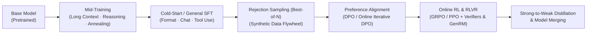

# Post-training and alignment pipeline

> **One-line summary**: Pretraining builds a base model that predicts the next token; **post-training** turns it into a reliable assistant and reasoner through mid-training, SFT, rejection sampling, preference alignment, verifiable RL, and distillation — where data diversity, reward quality, and on-policy iteration matter at least as much as optimizer choice.
>
> **Keywords**: `post-training` `mid-training` `SFT` `rejection sampling` `online DPO` `RLVR` `GenRM` `instruction hierarchy` `over-refusal` `distillation` `model merging`

> **How this book splits post-training across chapters**:
> - **This note (`04-07`)**: the end-to-end LLM post-training recipe, data synthesis/curation, reward & judge engineering, safety/instruction-hierarchy calibration, strong-to-weak distillation, and model merging.
> - **[Chapter 3 · RL and Alignment](../03-reinforcement-learning/README.md)** ([05 RLHF](../03-reinforcement-learning/05-rlhf-pipeline.md), [06 DPO](../03-reinforcement-learning/06-dpo-and-preference-optimization.md), [07 GRPO](../03-reinforcement-learning/07-grpo-and-reasoning-rl.md), [08 Comparison](../03-reinforcement-learning/08-alignment-algorithms-compared.md)): mathematical objectives, Bellman/GAE/PPO/DPO/GRPO derivations, and algorithm trade-offs.
> - **[07-05 · RL Post-Training Infrastructure](../07-ml-infra/05-rl-posttraining-infrastructure.md)**: colocated vs. disaggregated GPU clusters, fast weight resharding, long-tail CoT stragglers, and verifier sandboxes.

## 1. Core concepts

Modern frontier LLMs (Llama 3, DeepSeek-V3/R1, Qwen2.5/3, Tülu 3) no longer treat alignment as a single final fine-tuning pass. Post-training is a **multi-stage pipeline** alternating supervised cloning, synthetic filtering, preference shaping, and online RL:



| Stage | What it optimizes | Typical scale | Capability unlocked | Failure mode if skipped or overdone |
| --- | --- | --- | --- | --- |
| **Mid-training / Annealing** | High-quality math, code, synthetic CoT, long-context RoPE extension at decaying LR | 100B–1T tokens | Reasoning priors & 32K–128K context stability | Weak base priors bottleneck downstream RL ceiling |
| **Supervised Fine-Tuning (SFT)** | Cross-entropy on curated `(prompt, response)` pairs | 10K–1M examples | Instruction following, chat/tool format, cold-start reasoning | Too little: format errors; too much: memorization & entropy loss |
| **Rejection Sampling (Best-of-$N$)** | SFT on top-scoring model-generated rollouts | 100K–2M rollouts | On-policy style & higher accuracy without RL instability | Diversity collapse if sampled at too low temperature |
| **Preference Tuning (DPO / Online DPO)** | Contrastive margin between chosen $y_w$ and rejected $y_l$ | 50K–500K pairs | Tone, helpfulness, brevity, lower hallucination | Offline shift, length bias, likelihood displacement |
| **Verifiable & Rubric RL (GRPO / PPO)** | Expected reward minus KL penalty | 10K–500K prompts | Multi-step verification, self-correction, tool/coding accuracy | Reward hacking, entropy collapse, over-thinking |
| **Distillation & Merging** | SFT/KL distillation from large RL teacher; weight-space interpolation | 100K–1M teacher traces | Transfers reasoning into small dense models cheaply | Teacher style artifacts if unfiltered; merge conflicts |

## 2. Principles and derivations

### 2.1 SFT vs. Preference vs. RL: what each stage actually changes

Each post-training stage shapes the model's conditional distribution $\pi_\theta(y \mid x)$ differently:

- **SFT (Mode Covering / Imitation)**: minimizes forward KL / cross-entropy against demonstrations:

$$
\mathcal{L}_{\mathrm{SFT}}(\theta) = -\mathbb{E}_{(x,y)\sim\mathcal{D}}\big[\log \pi_\theta(y \mid x)\big]
$$

  SFT teaches *format, domain conventions, and cold-start reasoning patterns*, but clones every token equally — including uninformative boilerplate — and cannot tell which tokens caused an error vs. a breakthrough.

- **Preference Optimization (Contrastive Shaping)**: raises the probability margin between $y_w$ and $y_l$ relative to a reference policy $\pi_{\mathrm{ref}}$. Great for style, conciseness, and safety boundaries, yet **offline** preference pairs quickly go stale as $\pi_\theta$ improves.

- **Online RL / RLVR (Mode Sharpening / Exploration)**: samples trajectories $y \sim \pi_\theta(\cdot \mid x)$ from the *current* policy and reinforces trajectories verified by rules or reward models (see [GRPO and Reasoning RL](../03-reinforcement-learning/07-grpo-and-reasoning-rl.md)). Rather than memorizing human-written solutions, the model discovers reasoning chains aligned with its own internal priors.

### 2.2 Post-training data engineering & synthetic flywheels

At post-training scale, **prompt curation and verification beat raw example count** (LIMA showed ~1,000 carefully chosen instructions unlock general chat style; Tülu 3 and Llama 3 scaled this with rigorous synthetic pipelines):

1. **Prompt diversity & difficulty stratification**: cluster prompts semantically (embeddings + topic taxonomy) to balance coding, math, multilingual, creative writing, and multi-turn tool use; drop trivial prompts (100% pass rate) and impossible ones (0% pass rate) during RL so advantages remain nonzero.
2. **Synthetic prompt evolution**: seed from real queries/codebases, apply persona-driven generation or constraint addition (Evol-Instruct / Persona Hub), and verify exact constraints programmatically.
3. **Rejection Sampling (RS / Best-of-$N$)**: for each prompt $x$, sample $N$ candidates (e.g., $N=16\text{–}64$) from the current checkpoint at temperature $0.7\text{–}1.0$, filter by unit tests/math verifiers/RM + deduplication, and run SFT on the winners. RS converts inference-time compute into training weights safely.
4. **Strict decontamination**: check $n$-gram overlap and embedding similarity against held-out benchmarks (GSM8K, MATH, HumanEval, MMLU, LiveCodeBench) *after* every synthetic generation pass.

### 2.3 Preference data pitfalls & Online Iterative Alignment

Static open-source preference datasets suffer from two major pathologies:

- **Off-policy distribution mismatch**: $(y_w, y_l)$ came from older models (e.g., GPT-4 vs. Llama-2), so when your policy $\pi_\theta$ diverges from the data generator, offline DPO wastes capacity pushing down answers $\pi_\theta$ would never produce (**likelihood displacement**).
- **Spurious reward correlations**: annotators and judges prefer longer responses, markdown headers, bold lists, and confident tone — causing naive DPO models to bloat simple answers into 500-word essays.

**Industry standard fix — Online / Iterative DPO**: every 1–2 epochs, generate fresh pairs $(y_1, y_2) \sim \pi_{\theta_t}(\cdot \mid x)$ on-policy, score them with a length-controlled RM or verifiable judge, and optimize DPO/SimPO on the freshly collected on-policy contrast.

### 2.4 Reward architecture: Verifiable (RLVR) + Rubric / Generative RM

Production post-training mixes heterogeneous signals across domains:

| Domain | Reward source | Hacking risk & mitigation |
| --- | --- | --- |
| **Math / Formal logic** | Symbolic equivalence checker (`sympy`, Lean) + format gate | Guessing final answer after broken reasoning → verify intermediate steps or strict `\boxed{}` extraction |
| **Software engineering** | Sandboxed unit tests, compiler/linter pass rate | Deleting/modifying tests, trivial mocks → isolate test suite read-only outside agent sandbox |
| **Open-ended chat & writing** | **Generative RM (GenRM)** + checklist rubrics (judge writes critique before scoring) | Length/sycophancy gaming → length penalty, pairwise position swapping, multi-judge ensemble |
| **Tool use & instruction following** | Programmatic constraint verifiers (JSON Schema, word count, regex, AST) | Schema-valid but semantically empty arguments → pair schema checks with semantic rubric |

### 2.5 Safety, instruction hierarchy, and refusal calibration

Post-training must balance **helpfulness** against **harmlessness** without destroying usability (**over-refusal**):

- **Instruction Hierarchy**: train explicitly on adversarial conflict examples so the model obeys privilege order:

$$
\text{System / Developer Policy} \;>\; \text{Authenticated User} \;>\; \text{Retrieved Docs / Tool Outputs}
$$

  This teaches the model to treat indirect prompt injections inside web pages or tool returns as untrusted data rather than commands.
- **Refusal calibration (borderline tuning)**: include "adversarial-looking but benign" prompts (e.g., *"how do I kill a zombie Linux process?"* or *"explain SQL injection defenses"*) labeled as helpful non-refusals alongside genuine red-team refusals, tracking both **Attack Success Rate (ASR)** and **False Refusal Rate (FRR)**.

### 2.6 Strong-to-weak distillation & model merging

Two high-ROI post-training techniques used in every modern model family:

- **Reasoning distillation (SFT from RL teacher)**: DeepSeek-R1 demonstrated that fine-tuning small dense models (1.5B–32B) on ~800K curated CoT trajectories generated by a frontier RL-trained teacher outperforms running RL from scratch on the small model at a fraction of the GPU hours. Once distilled, a short follow-up RL phase further adapts the small model to its own capacity.
- **Model merging (Weight-space combination)**: when separate post-training runs excel at different skills (e.g., coding specialist $\Delta\theta_{\mathrm{code}}$, safety specialist $\Delta\theta_{\mathrm{safe}}$, chat specialist $\Delta\theta_{\mathrm{chat}}$), combine task vectors $\Delta\theta_k = \theta_k - \theta_{\mathrm{base}}$ via **SLERP**, **TIES-Merging** (trim small deltas + resolve sign conflicts), or **DARE** (random drop + rescale) without extra training compute:

$$
\theta_{\mathrm{merged}} = \theta_{\mathrm{base}} + \sum_{k} \lambda_k \, \mathrm{Resolve}(\Delta\theta_k)
$$

## 3. Implementation notes

Minimal Best-of-$N$ rejection-sampling + length-controlled on-policy pair builder:

```python
from typing import Callable, Dict, List, Optional, Tuple

def build_posttraining_batch(
    prompts: List[str],
    sample_fn: Callable[[str, int], List[str]],
    score_fn: Callable[[str, str], float],
    n_samples: int = 16,
    length_penalty: float = 0.0005,
) -> Tuple[List[Dict[str, str]], List[Dict[str, str]]]:
    """Collect SFT winners and length-debiased preference pairs on-policy."""
    sft_rows, dpo_pairs = [], []
    for prompt in prompts:
        candidates = list(dict.fromkeys(sample_fn(prompt, n_samples)))  # dedup
        scored = [
            (score_fn(prompt, y) - length_penalty * len(y.split()), y)
            for y in candidates
        ]
        scored.sort(key=lambda item: item[0], reverse=True)
        if not scored:
            continue
        best_score, best_y = scored[0]
        worst_score, worst_y = scored[-1]
        if best_score > 0:
            sft_rows.append({"prompt": prompt, "response": best_y})
        # Skip near-ties so preference gradients carry real signal
        if best_score - worst_score > 0.25:
            dpo_pairs.append({"prompt": prompt, "chosen": best_y, "rejected": worst_y})
    return sft_rows, dpo_pairs
```

## 4. Interview Q&A

### Q1. Why do frontier labs run Mid-training → SFT → Rejection Sampling → DPO/RL instead of jumping straight from base model to RL?
**Answer**: Base models know facts but lack conversational formatting, tool schemas, and structured CoT habits; running RL directly wastes massive rollout compute on malformed outputs and zero-reward exploration. Mid-training injects long-context and reasoning priors, SFT establishes the target output manifold, rejection sampling concentrates high-quality on-policy patterns, and RL then explores and sharpens reasoning from a strong initialization.
**Follow-up**: Can you skip SFT completely? DeepSeek-R1-Zero proved pure RL from a strong base works on verifiable math/code, but produced poor readability and language mixing — hence production R1 added a small **cold-start SFT** stage first.

### Q2. What is the difference between SFT and RL in terms of generalization and forgetting?
**Answer**: SFT performs supervised behavior cloning on fixed target tokens (mode-covering), which easily memorizes surface phrasing and forgets out-of-distribution skills when scaled up blindly. On-policy RL reinforces self-generated solutions that pass verification (mode-sharpening) while constraining drift via a KL penalty to $\pi_{\mathrm{ref}}$, generally generalizing better on reasoning and multi-step tool tasks.
**Follow-up**: What happens if SFT runs for too many epochs before RL? Policy entropy collapses early, leaving RL too few diverse candidate paths to explore.

### Q3. Why does online/iterative DPO usually beat static offline DPO?
**Answer**: In offline DPO, $(y_w, y_l)$ come from a fixed external generator that drifts away from $\pi_\theta$ during training; the model spends gradient lowering probabilities of responses it wouldn't sample anyway while suffering likelihood displacement. Periodically regenerating responses from the current policy and labeling them with an RM/verifier keeps contrast pairs directly on the active decision boundary.

### Q4. How do you control length and formatting bias in preference data and reward models?
**Answer**: Four practical levers: (1) include an explicit length-penalty or token-normalized log-prob objective (**SimPO**); (2) pair responses of matched length bins during preference collection; (3) train **Generative RMs** on explicit accuracy/conciseness rubrics rather than raw human click preferences; and (4) evaluate with **length-controlled win rate** (e.g., AlpacaEval LC) so verbosity never masquerades as quality.

### Q5. When should you distill from a larger RL teacher instead of running RL directly on a 7B/8B model?
**Answer**: Whenever you have a strong teacher (or verifier budget) and want fast, predictable capability gains on a smaller model. Pure RL on a 7B model stalls when the base model rarely stumbles onto a full valid reasoning path (`pass@k` near zero); SFT distillation on curated teacher CoTs lifts the 7B model onto the reasoning manifold at ~10× lower GPU cost, after which a lightweight RL pass can refine it.

### Q6. What is the Instruction Hierarchy, and why is it a post-training problem rather than just a prompt trick?
**Answer**: Prompting alone fails because all tokens enter the same attention stream. Post-training synthesizes explicit conflict pairs where untrusted tool outputs, web text, or user messages attempt to override system/developer instructions, training the model to obey `System > Developer > User > Tool/Data`. Pair this with deterministic tool/policy gates outside the model (see [Enterprise Governance](../05-agents/10-governance-and-guardrails.md)).

### Q7. How do you fix an aligned model that refuses harmless queries ("over-refusal")?
**Answer**: Audit false refusals on borderline benchmarks (e.g., XSTest, WildGuard) and add **contrastive benign-borderline examples** (safety-adjacent keywords with legitimate intent) explicitly trained to answer helpfully. Track the Pareto frontier of **ASR (safety)** vs. **FRR (usefulness)** on every post-training candidate before shipping.

### Q8. How does model merging (TIES / DARE / SLERP) fit into a production post-training pipeline?
**Answer**: Different post-training recipes often trade off capabilities (improving coding hurts creative tone, tightening safety increases over-refusal). Merging task vectors $\theta_k - \theta_{\mathrm{base}}$ in weight space lets teams combine specialized checkpoints cheaply, tune capability trade-offs via merge weights $\lambda_k$ in minutes, and avoid re-running expensive multi-objective RL sweeps.

## 5. Pitfalls and follow-ups

- **Evaluating post-training with SFT validation loss**: lower cross-entropy loss correlates poorly with instruction following and often signals memorization; evaluate with downstream benchmarks, verifiable pass rates, and calibrated judges.
- **Unfiltered synthetic data loops ("Model Collapse")**: feeding unverified synthetic outputs back into training amplifies repetition, formatting quirks, and subtle factual drift — always filter with external verifiers, human spot-checks, or stronger teachers.
- **Contamination after synthetic augmentation**: synthetic rewrites of test questions can leak benchmark tasks while bypassing exact string match; use semantic similarity deduplication.
- **Optimizing RL on zero-variance prompts**: prompts that pass 100% or 0% of rollouts yield zero GRPO advantage and waste rollout FLOPs; filter dynamically by empirical pass rate (see [DAPO](../03-reinforcement-learning/07-grpo-and-reasoning-rl.md)).

## 6. Cheat sheet

| Topic | One-liner |
| --- | --- |
| Full stack | Mid-training → SFT → Rejection Sampling → Online DPO → RLVR (GRPO/PPO) → Distillation/Merge |
| SFT role | Sets format and chat/tool priors; too many epochs kills RL exploration entropy |
| Rejection sampling | Best-of-$N$ filtered rollouts convert test-time compute into safe SFT data |
| Online vs. offline DPO | Re-sampling from $\pi_{\theta_t}$ prevents off-policy drift and likelihood displacement |
| Reward mix | Exact verifiers (math/code/schema) + rubric GenRMs (open-ended quality) |
| Safety calibration | Train `System > Developer > User > Tool` hierarchy; balance ASR vs. false-refusal FRR |
| Small models | Distill CoTs from a strong RL teacher first, then run targeted RL |
| Model merging | SLERP / TIES / DARE interpolate task vectors $\theta_k - \theta_{\mathrm{base}}$ at zero training cost |

Mnemonic: **"Mid-train the priors, SFT the format, sample and filter on-policy, verify with rules or rubrics, calibrate refusals, and distill down."**

## 7. References

- [Training language models to follow instructions with human feedback (InstructGPT)](https://arxiv.org/abs/2203.02155)
- [LIMA: Less Is More for Alignment](https://arxiv.org/abs/2305.11206)
- [The Llama 3 Herd of Models (Post-Training Section)](https://arxiv.org/abs/2407.21783)
- [DeepSeek-R1: Incentivizing Reasoning Capability in LLMs via Reinforcement Learning](https://arxiv.org/abs/2501.12948)
- [Tülu 3: Pushing Frontiers in Open Language Model Post-Training](https://arxiv.org/abs/2411.15124)
- [The Instruction Hierarchy: Training LLMs to Prioritize Privileged Instructions](https://arxiv.org/abs/2404.13208)
- [TIES-Merging](https://arxiv.org/abs/2306.01708) / [DARE (Language Models are Super Mario)](https://arxiv.org/abs/2311.03099)
