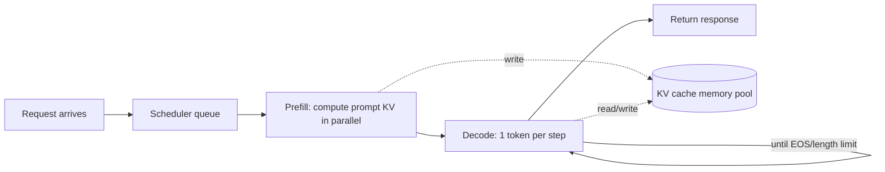

# Inference optimization and deployment

> **One-line summary**: LLM inference splits into prefill (compute-bound) and decode (memory-bandwidth-bound); every optimization boils down to "read less memory, raise the batch size, and stop idling".
>
> **Keywords**: `prefill/decode` `KV Cache` `PagedAttention` `continuous batching` `speculative decoding` `TTFT/TPOT` `PD disaggregation`

## 1. Core concepts

Autoregressive inference splits a request into two phases with completely different compute shapes, which is why they need different optimizations:

| Phase | What happens | Compute shape | Bottleneck | Main effect |
| --- | --- | --- | --- | --- |
| Prefill | Process the whole prompt at once, compute K/V for every position, emit the first token | GEMM (matrix x matrix), parallel over the token dimension | Compute (FLOPs) | TTFT |
| Decode | Generate one token per step, attend over historical KV | GEMV (matrix x vector), serial per token | Memory bandwidth (HBM traffic) | TPOT / ITL |



Four metrics dominate production. Pin the definitions down first (stating them precisely already earns points):

| Metric | Definition | Who cares |
| --- | --- | --- |
| TTFT (time to first token) | From request arrival to the first token, including queueing + prefill | Chat/interactive UX |
| TPOT / ITL (time per output token) | Average gap between adjacent tokens in decode | Typewriter smoothness, streaming output |
| Throughput (tokens/s or req/s) | Tokens produced by the whole system per unit time | Cost, capacity |
| Goodput | Useful throughput that still meets the SLA | The real target for capacity planning |

My one-liner: **TTFT is set by prefill + queueing, TPOT by decode bandwidth, throughput by batch size, and the three fight each other.**

## 2. Principles and derivations

### 2.1 Why decode is bandwidth-bound

One decode step reads two things: all model weights and the KV cache of every request. Its arithmetic intensity is about 1 FLOP/Byte, while the A100/H100 ridge point is roughly 150-300 FLOP/Byte, so decode sits firmly in the bandwidth-bound regime. The per-step time is approximately:

$$t_{decode} \approx \frac{N_{params}\cdot p + B\cdot S\cdot 2L n_{kv} d_{head} p}{\text{HBM bandwidth}}$$

where $p$ is bytes per element (FP16=2), $B$ is the number of concurrent sequences, and $S$ is the current average length. A 7B FP16 model has 14 GB of weights and an A100 80G delivers about 2 TB/s of HBM, so the theoretical single-request limit is about $14/2000 \approx 7$ ms/token, i.e. ~140 tok/s; in practice kernel efficiency, KV reads, and scheduling cap you at roughly half of that.

**This is the whole reason batching exists**: a larger batch amortizes the weights, pushing arithmetic intensity from 1 up to $B$, and only then does the GPU actually get busy.

### 2.2 KV cache memory formula (memorize this)

KV cache per token:

$$\text{KV per token} = 2 \times L \times n_{kv} \times d_{head} \times p \;(\text{bytes})$$

Total footprint multiplies by batch and sequence length:

$$\text{KV total} = 2 \cdot L \cdot n_{kv} \cdot d_{head} \cdot S \cdot B \cdot p$$

- The factor 2: one copy for K and one for V;
- $n_{kv}$ is the **number of KV heads** (equal to the head count for MHA, smaller for GQA/MQA - see [03 Attention and positional encoding](03-attention-and-position-encoding.md));
- $L$ layers, $d_{head}$ per-head dimension, $S$ sequence length (prompt + generated), $p$ bytes per element.

Two examples you must be able to do in your head:

| Model | Config | KV per token | One 4K sequence |
| --- | --- | --- | --- |
| Llama-2-7B (MHA) | L=32, $n_{kv}$=32, $d_{head}$=128, FP16 | $2\cdot32\cdot32\cdot128\cdot2$ = 512 KiB | 2 GiB |
| Llama-3-8B (GQA-8) | L=32, $n_{kv}$=8, $d_{head}$=128, FP16 | 128 KiB | 512 MiB |
| Llama-2-70B (GQA-8) | L=80, $n_{kv}$=8, $d_{head}$=128, FP16 | 320 KiB | 1.25 GiB |

Note that KV grows linearly with the **token count**, so for long contexts it overtakes the weights and becomes the memory hog - which is the entire justification for KV quantization, GQA, and MLA.

### 2.3 Back out the maximum concurrency from the memory budget

$$B_{max} \approx \frac{\text{GPU memory}\times\text{utilization} - \text{weights} - \text{activation/framework overhead}}{\text{KV per token}\times\text{average sequence length}}$$

In practice, use 0.85-0.9 utilization on an 80 GB card and reserve 2-4 GB beyond the weights for activations and the CUDA context. This formula is also the starting point for the interview question "how many QPS can one 8xA100 node serve": compute $B_{max}$, multiply by single-request decode speed, then divide by the average output length.

### 2.4 PagedAttention: managing KV cache like virtual memory

Static pre-allocation is the problem: the length is unknown, so you reserve contiguous memory for "max length x max batch", which produces **internal fragmentation** (reserved but unused) plus **external fragmentation** (requests of different lengths fragment the pool). Empirically, traditional systems only reach 20%-40% KV utilization, wasting more than half of the card.

PagedAttention (vLLM) borrows OS paging:

- KV is split into fixed-size **blocks** (16 tokens by default), physically non-contiguous;
- Each sequence keeps a **block table** (logical block -> physical block), and the attention kernel gathers blocks through it;
- Allocate on demand, free when done, so waste only happens in the last block of each sequence - the paper reports **< 4%**;
- Fragments can be **shared** naturally: blocks of a common prefix are reference-counted across parallel sampling/beam search, with copy-on-write.

The result: higher memory utilization -> a bigger batch fits -> throughput rises (the paper reports 2-4x over the baselines of the time).

### 2.5 Continuous batching and chunked prefill

**Static batching** means "gather a batch, then wait for the slowest sequence before starting over", so short requests ride along with long ones and the GPU idles heavily at the tail. **Continuous batching (iteration-level scheduling)** drops the scheduling granularity to a single decode step: a finished sequence leaves immediately and a new request's prefill fills the slot. The Orca paper reports 2-3x+ throughput gains, and vLLM/TGI/TRT-LLM all use it.

**Chunked prefill** (the SARATHI idea) fixes another source of jitter: a 32K prompt prefilled as one block monopolizes a step and blows up everyone else's TPOT. The fix is to split the long prefill into chunks and mix them into the same batch as decode requests, trading a bit of TTFT for stable TPOT. In vLLM this is `--enable-chunked-prefill`.

**Prefix caching**: multi-turn chats, a fixed system prompt, and few-shot examples share a prefix whose KV can be reused, so a cache hit skips prefill entirely. vLLM's automatic prefix caching hashes blocks; SGLang turns it into RadixAttention (a radix tree), which pays off even more in multi-turn/branching agent workloads.

### 2.6 Speculative decoding

The idea: a cheap draft model guesses $\gamma$ tokens first; the large target model validates all $\gamma$ positions in one forward pass, accepts the longest correct prefix, and resamples the first rejected position from the target distribution. **The output distribution is exactly the same as sampling from the large model alone** (not an approximation), hence "lossless speedup".

With acceptance rate $\alpha$, the expected number of tokens produced per target forward pass is:

$$E[\#\text{tokens}] = \frac{1-\alpha^{\gamma+1}}{1-\alpha}$$

If one draft forward costs $c$ times a target forward, the speedup is:

$$\text{speedup} = \frac{1-\alpha^{\gamma+1}}{(1-\alpha)\,(\gamma c + 1)}$$

Key points: you only win when $\alpha$ is high, $\gamma$ is moderate, and the draft is cheap enough; with low $\alpha$, a larger $\gamma$ loses more. Variants include Medusa (multiple decoding heads guessing in parallel), EAGLE (guessing in feature space, higher acceptance), and lookahead/n-gram (using repeated prompt fragments as a zero-cost draft). Verification is simpler under greedy decoding; sampling requires rejection sampling to keep the distribution identical.

### 2.7 PD disaggregation and kernel-level optimizations

- **PD disaggregation (disaggregated prefill/decode)**: prefill is compute-heavy and decode is bandwidth-heavy, so co-locating them makes them interfere. Split them onto separate GPU pools and ship the KV over NVLink/RDMA once prefill finishes (DistServe, Mooncake, etc.). The cost is KV transfer (GB-scale for long contexts) plus scheduling complexity; it suits "long prompt + strict TPOT" workloads.
- **Kernel fusion**: RMSNorm+residual, fusing the three QKV projections, fused MoE, FlashAttention/FlashInfer/FlashDecoding. Decode kernels are tiny, so launch overhead and memory traffic dominate; fusion pays off clearly.
- **CUDA graph**: record a chain of kernel launches and replay it as a graph, eliminating CPU-side launch overhead; only works for decode with fixed shapes (vLLM uses piecewise CUDA graphs to cover a few common batch buckets).
- **Parallelism**: TP within a node (split every layer, frequent all-reduce), PP across nodes (split by layer, point-to-point), EP for MoE (all-to-all). See [07 Distributed training](07-distributed-training.md) and [ML Infra · Inference serving and GPU optimization](../07-ml-infra/04-inference-serving-and-gpu-optimization.md).

## 3. Implementation notes

Estimation script (you can write this on a whiteboard):

```python
def kv_per_token_bytes(layers, n_kv_heads, head_dim, dtype_bytes=2):
    return 2 * layers * n_kv_heads * head_dim * dtype_bytes

def max_concurrency(gpu_gb, weight_gb, per_token_kv, avg_len,
                    util=0.9, overhead_gb=3.0):
    free_bytes = (gpu_gb * util - weight_gb - overhead_gb) * 1024**3
    return max(int(free_bytes // (per_token_kv * avg_len)), 1)

kv = kv_per_token_bytes(32, 8, 128)          # Llama-3-8B: 131072 B
print(kv / 1024, "KiB/token")
print(max_concurrency(80, 16, kv, avg_len=4096))  # 80 GB card, 4K average length
```

The vLLM serving flags that actually move throughput:

```bash
vllm serve meta-llama/Llama-3-8B-Instruct \
  --tensor-parallel-size 1 \
  --gpu-memory-utilization 0.90 \
  --max-model-len 8192 \
  --max-num-seqs 256 \
  --enable-chunked-prefill \
  --enable-prefix-caching
```

The core of speculative decoding (pseudocode; the acceptance rule is the point):

```python
# the draft guesses gamma tokens; the target does one forward pass to get p at each position
for i, tok in enumerate(draft_tokens):
    q, p = draft_prob[i][tok], target_prob[i][tok]
    if random() < min(1.0, p / q):        # accept
        out.append(tok)
    else:                                  # reject: resample from normalized max(0, p-q)
        out.append(sample(normalize(max(target_prob[i] - draft_prob[i], 0))))
        break
# if everything is accepted, sample one extra token from the target's last position (bonus token)
```

## 4. Interview Q&A

### Q1. What is the difference between prefill and decode, and why are the optimizations completely different?
**Answer**: Prefill processes the whole prompt at once, is naturally parallel over the token dimension, is a GEMM, and is compute-bound; decode handles one token per step, must read all weights plus the historical KV, is a GEMV, and is memory-bandwidth-bound. So prefill work targets FLOPs utilization and parallelism (TP, chunked prefill), while decode work targets "read fewer bytes + bigger batch" (KV quantization, GQA/MLA, continuous batching, speculative decoding).
**Follow-up**: Why does batching help decode far more than prefill? - decode's arithmetic intensity is only ~1, so batching multiplies it directly; prefill is already near compute saturation, and batching only affects tail efficiency.

### Q2. Derive KV cache memory: how much for Llama-2-7B, 4K context, FP16?
**Answer**: $2 \times 32 \text{ layers} \times 32 \text{ KV heads} \times 128 \times 4096 \times 2\,\text{B} = 2$ GiB. That is 512 KiB per token. With GQA-8, as in Llama-3-8B, the same 4K only needs 512 MiB. Key point: KV grows linearly with batch x length and overtakes the weights at long context.
**Follow-up**: What else occupies memory? - weights, KV, activations/temp buffers, CUDA context, and fragmentation; the 70B model's weights alone need 140 GB in FP16.

### Q3. What problem does PagedAttention solve, and why does it save memory?
**Answer**: It removes the internal/external fragmentation caused by "length unknown, so pre-allocate the max length contiguously". KV is split into fixed blocks stored non-contiguously, with a block table mapping logical to physical blocks and allocation on demand; waste is limited to the last block of each sequence (<4%), and prefix sharing plus copy-on-write come for free. The freed memory turns directly into a larger batch, so throughput follows.
**Follow-up**: What does it cost? - the kernel must gather through the table, tiny blocks inflate metadata overhead, cross-block access loses some bandwidth, and you need a dedicated PagedAttention kernel.

### Q4. Why is continuous batching faster than static batching?
**Answer**: Static batching schedules whole batches, so it must wait for the longest sequence to finish while short requests hold slots and the GPU idles at the tail; continuous batching schedules at the granularity of one decode step, so a finished sequence is replaced by a new request immediately and the batch stays full. In essence it raises GPU utilization from "batch average" to "near-full every step".
**Follow-up**: What side effect does it have? - a single request's TPOT can get worse because others compete for compute, so you cap concurrency with something like `max-num-seqs`.

### Q5. Why is speculative decoding "lossless", and what determines the speedup?
**Answer**: Verification uses rejection sampling: a drafted token is accepted with probability $\min(1, p/q)$, and a rejected position is resampled from normalized $\max(0, p-q)$, which is mathematically equivalent to sampling from the target distribution, so the distribution is identical. The speedup is $\frac{1-\alpha^{\gamma+1}}{(1-\alpha)(\gamma c+1)}$, driven by the acceptance rate $\alpha$, the guess length $\gamma$, and the draft/target cost ratio $c$; with low $\alpha$, a longer $\gamma$ is a net loss.
**Follow-up**: How do you raise $\alpha$? - use a small model from the same family, guess in feature space with EAGLE, use multiple Medusa heads, or build a zero-cost draft by copying n-grams/prompt spans (great for code completion and summarization rewrites).

### Q6. How do you optimize high TTFT? How do you optimize high TPOT?
**Answer**: High TTFT -> look at queueing first (add replicas, autoscale; if raising the batch cap does not help, add machines), then at prefill (chunked prefill lengthens TTFT, a prefix cache hit skips it entirely, TP speeds it up, shorten the prompt or replace long context with retrieval). High TPOT -> look at bandwidth: KV quantization, GQA/MLA, prioritizing decode inside the continuous batch, reducing batch size, speculative decoding, PD disaggregation.
**Follow-up**: Can both be optimized at once? - Rarely; PD disaggregation decouples them and tunes each separately, which is "spending resources to decouple".

### Q7. How do you make 128K long-context inference work in production?
**Answer**: Four layers: (1) algorithmic (GQA/MLA/sliding-window/sparse attention) to shrink KV; (2) caching (PagedAttention + prefix caching + KV quantization to FP8/INT8); (3) scheduling (chunked prefill, PD disaggregation, a separate queue for long requests); (4) systems (Ring/Context parallelism, more TP cards for memory). Then accept the cost reality: 128K prefill FLOPs are at least 32x those of 4K (attention grows quadratically on top), so production usually mixes "retrieval + a long window" instead of blindly filling the context.
**Follow-up**: Why does "filling the context" not necessarily help? - lost in the middle: information in the middle is underused and noise dilutes the key evidence.

### Q8. When do you use TP, PP, and EP?
**Answer**: TP splits individual layers with frequent communication (all-reduce per layer) and suits a single node with NVLink; PP splits by layer with only point-to-point between adjacent stages, acceptable across nodes but with pipeline bubbles; EP is MoE-specific, routing tokens to different experts via all-to-all, used together with DP/TP. The usual inference recipe: TP within a node, PP/multiple replicas across nodes, and EP on top for large MoE models.
**Follow-up**: Why is DP rarely used to "speed up a single request" in inference? - DP replicates the model to raise throughput and does not cut single-request latency; in production it shows up as "multiple replicas + load balancing".

### Q9. What are the benefits and costs of PD disaggregation?
**Answer**: The benefit is letting the prefill pool and the decode pool scale independently on their own bottlenecks, so a long prompt cannot wreck decode TPOT; DistServe and similar work report clearly higher goodput at the same SLA. The costs are cross-node KV transfer (bandwidth/latency/serialization), global scheduling and fault tolerance, and more deployment complexity; short prompts and low concurrency see little gain.
**Follow-up**: How big is the KV transfer? - exactly the formula in 2.2: 70B, 8K context, GQA-8 is about 2.5 GiB, so you normally need RDMA plus chunked pipelined transfer.

### Q10. Given a QPS target and an SLA, how do you estimate how many GPUs you need?
**Answer**: (1) Compute tokens per request from the average input/output lengths; (2) estimate per-GPU throughput from load tests or the formula ($B_{max}/t_{decode}$, then discount 50%-70%); (3) $\text{num cards} = \lceil \text{QPS} \times \text{tokens per request} / \text{tokens/s per card} \rceil$, then add 1.5-2x headroom for peaks; (4) sanity-check concurrency with Little's law: concurrency = QPS x end-to-end latency, which must stay below $B_{max}$. Base the capacity conclusion on goodput, not peak throughput.
**Follow-up**: Why not buy cards based on "peak throughput"? - the SLA constrains P99 TPOT/TTFT, and queueing latency explodes at saturation, so you must size against throughput under the SLA.

## 5. Pitfalls and follow-ups

- **Calling decode a compute bottleneck**: decode is bandwidth-bound, which is why quantization and cutting KV reads help most; getting this backwards poisons everything downstream.
- **Dropping the factor 2 or the KV head count from the KV formula**: GQA models have an $n_{kv}$ far below the head count, so omitting it overestimates by 4-8x.
- **Thinking KV cache "compresses the model"**: it only avoids recomputation and itself occupies memory; saving memory requires GQA/MLA/quantization/paging.
- **Assuming continuous batching always lowers latency**: it mainly raises throughput, and single-request latency can worsen, so you need `max-num-seqs` to throttle.
- **Ignoring CUDA graph shape constraints**: dynamic batches miss the graph, so you capture per bucket; changing the model structure requires re-capturing.
- **Treating speculative decoding as approximate**: the standard implementation is lossless; if you cut corners with "accept and move on, never resample", the distribution drifts.
- **Watching only TTFT and not TPOT**: in streaming, users feel TPOT; a fast first token followed by stutter is a worse experience.

## 6. Cheat sheet

| Problem | Lever |
| --- | --- |
| Out of memory | Weights (quantization/TP) + KV (GQA/MLA/quantization/paging) + activations (chunking) |
| High TTFT | Queueing (scale out), prefill (prefix cache, TP, chunked prefill is the counterexample), shorter prompt |
| High TPOT | KV reads (quantization, GQA, batch control), speculative decoding, PD disaggregation |
| Low throughput | Continuous batching, PagedAttention, larger batch, kernel fusion |
| Long context | Sparse/sliding-window attention, KV quantization, prefix cache, PD disaggregation, context parallelism |

Mnemonic: **prefill fights for FLOPs, decode fights for bandwidth, scheduling fights for utilization, speculation fights for acceptance rate.**

Numbers to memorize: 7B FP16 ~ 14 GB; 70B FP16 ~ 140 GB; Llama-2-7B KV 512 KiB/token (4K -> 2 GiB); Llama-3-8B KV 128 KiB/token; PagedAttention waste <4%; speculative decoding expected output $(1-\alpha^{\gamma+1})/(1-\alpha)$.

## 7. References

- [Mastering LLM Techniques: Inference Optimization · NVIDIA](https://developer.nvidia.com/blog/mastering-llm-techniques-inference-optimization/)
- [Efficient Memory Management for LLM Serving with PagedAttention · vLLM (SOSP'23)](https://arxiv.org/abs/2309.06180)
- [Orca: A Distributed Serving System for Transformer-Based Generative Models (OSDI'22)](https://www.usenix.org/conference/osdi22/presentation/yu)
- [Fast Inference from Transformers via Speculative Decoding](https://arxiv.org/abs/2211.17192)
- [Accelerating Large Language Model Decoding with Speculative Sampling · DeepMind](https://arxiv.org/abs/2302.01318)
- [SARATHI: Efficient LLM Inference by Piggybacking Decodes with Chunked Prefills](https://arxiv.org/abs/2308.16369)
- [SGLang: Efficient Execution of Structured Language Model Programs](https://arxiv.org/abs/2312.07104)
- [DistServe: Disaggregating Prefill and Decoding for Goodput-optimized LLM Serving](https://arxiv.org/abs/2401.09670)
- [Preparing for ML Infra Interviews · Yuan Meng](https://www.yuan-meng.com/posts/ml_infra_interviews/)
- [llm_interview_note · wdndev (inference optimization)](https://github.com/wdndev/llm_interview_note)
