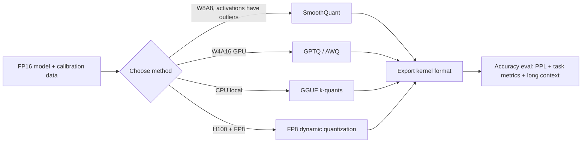

# Quantization and compression

> **One-line summary**: LLM inference is bound by memory bandwidth, and quantization represents weights/activations/KV with fewer bits, directly cutting the bytes that must be read; the accuracy loss is paid for with calibration, grouping, outlier handling, and a little training.
>
> **Keywords**: `PTQ` `QAT` `INT8/INT4/FP8` `GPTQ` `AWQ` `SmoothQuant` `GGUF` `KV cache quantization`

## 1. Core concepts

Quantization maps floats onto low-bit integers (or FP8). Separate three axes first:

| Axis | Values | Meaning |
| --- | --- | --- |
| What is quantized | Weights / activations / KV cache | Weights are safest (static, stable distribution); activations with outliers are hardest; KV is the long-context lever |
| Bit width and pairing | W4A16 (weight-only), W8A8, W4A8, FP8 | Weight-only saves bandwidth but not compute; W8A8 can use INT8 Tensor Cores |
| Timing | PTQ (post-training), QAT (quantization-aware training) | 99% of production is PTQ; QAT is only for extreme low bit |

Granularity decides accuracy and overhead:

| Granularity | Parameters shared per channel/group | Accuracy | Metadata overhead |
| --- | --- | --- | --- |
| per-tensor | 1 scale | Worst | Smallest |
| per-channel | 1 per output channel | Good | Small |
| per-group (e.g. group_size=128) | 1 per 128 weights | Best (INT4 default) | Medium (1-2 params per group) |
| per-block (fine-grained FP8) | per 128x128 tile | Very good | Medium |



## 2. Principles and derivations

### 2.1 Quantize/dequantize formulas and error sources

Symmetric quantization (common for weights):

$$q = \text{clamp}\left(\text{round}\left(\frac{x}{s}\right), -2^{b-1}, 2^{b-1}-1\right), \qquad \hat{x} = s\cdot q$$

Asymmetric quantization adds a zero point $z$ (common for activations, whose distributions are skewed): $q=\text{round}(x/s)+z$, $\hat{x}=s(q-z)$.

Two error sources fight each other:

- **Rounding error**: $|\hat{x}-x| \le s/2$; a larger step $s$ is coarser, and the error is roughly uniform with variance $s^2/12$;
- **Clipping error**: to stop a few large values from blowing up $s$, you deliberately cut the outliers - but cut too much and you lose information.

So the core of PTQ is **choosing the scale**: min-max (keeps the dynamic range, fears outliers), percentile (cut the top 0.1%), or MSE-optimal (directly search for the smallest reconstruction error). In practice weights use per-channel min-max, and activations use percentile or MSE-based calibration.

### 2.2 Why quantization speeds things up: find the bottleneck first

Decode is bandwidth-bound (see [08 Inference optimization and deployment](08-inference-optimization-and-serving.md)), so halving weight bytes doubles the theoretical ceiling:

| Precision | 7B weights | 70B weights | Decode ceiling (vs FP16) |
| --- | --- | --- | --- |
| FP16 | 14 GB | 140 GB | 1x |
| INT8 | 7 GB | 70 GB | ~2x |
| INT4 | 3.5 GB | 35 GB | ~4x |

But **theory is theory**: a W4A16 GEMM must first dequantize INT4 back to FP16 (GPUs have no 4bit x FP16 multiply-add unit), and dequantization itself reads metadata and does shift/scale work, so measured gains are usually only 1.5-2.5x (AWQ/GPTQ kernels on A100, Marlin on H100 approaches the ceiling). **Only W8A8 both saves bandwidth and raises compute**, because INT8 Tensor Cores deliver 2x the throughput of FP16.

Another trap: prefill is compute-bound, so weight-only quantization barely helps prefill (it even adds a dequantization pass), so evaluate end-to-end gains for long-prompt workloads.

### 2.3 Activation outliers: SmoothQuant and LLM.int8()

A handful of LLM activation channels are tens to hundreds of times larger than the rest ("massive activations"); with per-tensor quantization, one outlier blows up the scale and every other channel collapses to 0.

- **LLM.int8()**: mixed-precision decomposition - keep the few outlier dimensions (about 0.1%) in FP16, run the rest in INT8, and add the results. Simple idea, but the kernel is complex and the speedup is limited.
- **SmoothQuant**: a **mathematically equivalent** transform that migrates part of the activation's quantization difficulty onto the weights:

$$Y = XW = \underbrace{\left(X\,\text{diag}(s)^{-1}\right)}_{\tilde X \text{ easier to quantize}}\;\underbrace{\left(\text{diag}(s)W\right)}_{\tilde W \text{ slightly harder but fine}}$$

The per-channel scale is $s_j = \dfrac{\max |X_j|^\alpha}{\max |W_j|^{1-\alpha}}$ with $\alpha\in[0,1]$ controlling how much difficulty moves (0.5 is typical). $\alpha=1$ moves everything to the weights (crushing them), $\alpha=0$ moves nothing. Because $\text{diag}(s)$ folds into the previous operator (the LayerNorm scale or the previous layer's output), inference has **zero extra cost**. This is the standard prerequisite for deploying W8A8.

### 2.4 GPTQ: per-column error compensation with the Hessian

The objective is to minimize the **layer output** error, not the Euclidean distance between weights:

$$\min_{\hat W} \|WX - \hat W X\|_2^2$$

GPTQ follows OBQ (Optimal Brain Quantization): quantize the weights column by column, compute the error $e = w_q - \text{quant}(w_q)$ for column $q$, then use the inverse Hessian $H^{-1}=(2XX^\top)^{-1}$ to **compensate that error proportionally onto the not-yet-quantized columns**:

$$\delta = -\frac{e}{[H^{-1}]_{qq}}\,H^{-1}_{:,q}, \qquad W_{:,q+1:} \mathrel{+}= \delta_{q+1:}$$

Intuition: the output shift caused by quantizing one column is cancelled by a small adjustment of the remaining columns. Engineering details: Cholesky factorization for speed, block-wise updates, `act-order` (quantize in order of activation magnitude, so important columns go later), group_size=128, and a calibration set of about 128 samples. At 4-bit, GPTQ is one of the quality benchmarks, but **quantization requires a calibration pass** (tens of minutes) and depends on a GPU.

### 2.5 AWQ: protect only the top 1% of channels

AWQ's observation: weights are not equally important - **about 1% of channels (identified by activation magnitude)** produce most of the output; keeping higher effective precision for those channels sharply reduces quantization error.

The trick is to scale each channel by a factor $s$ (and fold $1/s$ into the previous layer):

$$W' = W\cdot\text{diag}(s), \qquad X' = X\cdot\text{diag}(s)^{-1}$$

$s$ is found by grid search over the calibration set minimizing output MSE (no backpropagation), plus "clipped max" on the weights to reduce clipping error. Upside: **cheap calibration, good generalization, and usually better than GPTQ at the same 4-bit width**, with friendly kernels (AWQ's GEMM kernel uses per-group scale and is fast). Downside: no per-column error compensation, so optimality is weaker in theory and some tasks are beaten by GPTQ - which is why "which is better" must be measured on your own eval set.

### 2.6 GGUF, FP8, and KV cache quantization

- **GGUF / llama.cpp**: block quantization plus mixed precision, with formats like `Q2_K`...`Q8_0`, keeping important tensors (first layer, `lm_head`, attention output) at higher width. Aimed at CPU / Apple Silicon / edge devices, used with llama.cpp and Ollama. It is not an "algorithm" but a "format + kernel ecosystem", which interviewers often probe.
- **FP8 (E4M3/E5M2)**: natively supported on H100; E4M3 covers forward weights/activations, E5M2 has a wider dynamic range for backward gradients. DeepSeek-V3 used fine-grained (tile/block level) FP8 scaling plus FP32 accumulation for large-scale training, an important engineering proof that "FP8 works". FP8's advantage over INT8 is **no calibration** (dynamic per-tensor/per-block scales suffice), which simplifies deployment.
- **KV cache quantization**: cut KV from FP16 to INT8/FP8 for a 2x memory saving, with the biggest payoff in long context. Key points: **K is more sensitive than V** (K has per-channel outliers, so quantize per-channel; V can go per-token); common setups are K per-channel and V per-token, or FP8 for both. 4-bit KV usually needs to keep some high-precision portion (recent tokens or outlier channels), otherwise long-context quality degrades noticeably.

### 2.7 Compression beyond quantization: pruning, distillation, low rank

| Method | How | Status |
| --- | --- | --- |
| Unstructured pruning | Remove weights by \|w\| or activation importance (SparseGPT, Wanda can prune 50% in one shot) | Unfriendly to sparse kernels; limited real speedup |
| Structured pruning (2:4) | Keep 2 of every 4 weights | Ampere/Hopper sparse Tensor Cores give a theoretical 2x, but fine-tuning is still needed to recover |
| Distillation | A large model's logits/layers teach a small one | Effective but needs training; good for "a smaller model of the same family" |
| Low-rank decomposition | SVD / low-rank approximation | Limited payoff, mostly research |
| Speculative decoding | A small draft model | Orthogonal to quantization and composable (a quantized draft is cheaper) |

## 3. Implementation notes

Hand-write per-channel symmetric quantization to get a feel for the error magnitude:

```python
import torch

def quantize_per_channel(w, bits=4, group_size=None):
    w = w.float()
    qmax = 2 ** (bits - 1) - 1
    if group_size:                      # split the input dimension into groups
        w = w.reshape(-1, group_size)
    scale = w.abs().amax(dim=1, keepdim=True).clamp(min=1e-8) / qmax
    q = torch.clamp(torch.round(w / scale), -qmax - 1, qmax)
    return q.to(torch.int8), scale

w = torch.randn(4096, 4096) * 0.02
q, s = quantize_per_channel(w, bits=4, group_size=128)
deq = (q.float() * s).reshape(4096, 4096)
print("4bit group128 relative error:", ((deq - w).norm() / w.norm()).item())  # about 0.1~0.2
```

The SmoothQuant equivalent transform (math only; a real implementation handles bias and operator folding):

```python
def smooth_scale(act_max, w_max, alpha=0.5):
    # act_max: [C_in], max activation magnitude per input channel on the calibration set
    return (act_max.pow(alpha) / w_max.pow(alpha)).clamp(min=1e-5)

s = smooth_scale(act_max, w.abs().amax(dim=0))
W_tilde = w * s                       # weights multiplied by s
X_tilde = x / s                       # activations divided by s: equivalent transform
```

In production you normally call an existing tool and only specify the format on the vLLM side:

```bash
# quantize with llm-compressor (or autoawq / gptqmodel)
llmcompressor-quantize --model meta-llama/Llama-3-8B-Instruct \
  --scheme W4A16 --output ./llama3-8b-w4a16

# at inference time
vllm serve ./llama3-8b-w4a16 --quantization compressed-tensors
vllm serve meta-llama/Llama-3-70B-Instruct --quantization fp8 \
  --kv-cache-dtype fp8
```

## 4. Interview Q&A

### Q1. Why does quantization speed things up? Why is it not always 4x?
**Answer**: LLM decode is memory-bandwidth-bound; going from FP16 to INT4 cuts the bytes read to 1/4, so the theoretical ceiling is 4x. But W4A16 must dequantize back to FP16 before the GEMM (GPUs have no mixed-precision multiply-add), and dequantization reads metadata and does scaling, so measured gains are usually 1.5-2.5x; only W8A8 borrows INT8 Tensor Cores to raise compute as well. Also, prefill is compute-bound, so weight-only quantization gives essentially no prefill gain.
**Follow-up**: Then why does everyone still ship 4-bit? - For **memory capacity**: a 70B model does not fit on one 80 GB card in FP16, but INT4 needs only 35 GB, and fitting on one card means no TP and a much lower deployment cost.

### Q2. How do you choose between W4A16 and W8A8?
**Answer**: W4A16 quantizes only weights and keeps activations in FP16; it is simple, keeps accuracy loss relatively controllable, and mainly captures bandwidth and capacity gains, so it suits decode-heavy online serving with tight memory. W8A8 quantizes both weights and activations for INT8 compute, so it suits prefill-heavy or high-concurrency throughput workloads, but it first needs the activation outlier problem solved (SmoothQuant). In practice start with W4A16/AWQ, and only move to W8A8 + SmoothQuant if needed.
**Follow-up**: What about W4A8? - A middle ground when you want both more capacity and faster compute; it is more complex to implement and has less mature kernel support than the other two.

### Q3. What is GPTQ's principle, and how does it differ from plain round-to-nearest?
**Answer**: GPTQ quantizes column by column; after quantizing a column it uses the inverse Hessian $H^{-1}=(2XX^\top)^{-1}$ to compensate that column's error proportionally onto the columns not yet quantized, aiming to minimize the **layer output** $\|WX-\hat W X\|^2$ rather than the weight Euclidean error. RTN rounds every weight independently and lets errors accumulate; GPTQ makes later columns "absorb the blame", so accuracy is better at the same width. The cost is a calibration set and computing the inverse Hessian (sped up with Cholesky).
**Follow-up**: What does group_size do? - Each 128 weights share one scale; finer granularity improves accuracy but adds metadata; group_size=128 is the common 4-bit default.

### Q4. What is the difference between AWQ and GPTQ? Which should I actually pick?
**Answer**: AWQ assumes only about 1% of channels matter (identified by **activation magnitude**) and protects them with per-channel scaling; scales come from an MSE grid search on the calibration set, with no error compensation and no backpropagation. GPTQ does per-column error compensation with the Hessian. AWQ calibrates more cheaply and usually generalizes better, edging ahead on most 4-bit tasks; GPTQ is more stable on some tasks/models. Always compare on your own eval set instead of trusting paper tables.
**Follow-up**: Why is AWQ's scaling "free"? - $\text{diag}(s)$ folds into the previous layer (the LayerNorm or the previous Linear's output), so no operator is added to the inference graph.

### Q5. What problem does SmoothQuant solve, and how is the formula derived?
**Answer**: It fixes W8A8 quantization collapsing because of outlier activation channels. The trick is the mathematically equivalent transform $Y=XW=(X\text{diag}(s)^{-1})(\text{diag}(s)W)$, shifting activation quantization difficulty per channel onto the weights; $s_j=\max|X_j|^\alpha/\max|W_j|^{1-\alpha}$, and with $\alpha=0.5$ both sides have roughly comparable dynamic range. Weights are easy to quantize anyway and can absorb extra difficulty; once activations are "tamed", INT8 becomes usable.
**Follow-up**: How do you pick $\alpha$? - Larger $\alpha$ pushes more difficulty onto the weights; in practice you search 0.4-0.6 per model/layer, leaning toward 0.5-0.7 when outliers are severe.

### Q6. PTQ vs QAT: when do you use QAT?
**Answer**: PTQ quantizes a trained model directly; it is cheap and iterates fast, essentially lossless at 8-bit and usable at 4-bit for most cases, so it is the default. QAT inserts fake quantization during training/fine-tuning so the model adapts to quantization error, which suits extreme 2-3 bit compression or zero-tolerance accuracy requirements (edge devices, for instance). It costs training data, compute, and tuning, and the resulting model may not be portable across kernels/formats.
**Follow-up**: Where does QLoRA fit? - A 4-bit quantized base plus LoRA fine-tuning; the quantization itself is PTQ (NF4) and what trains is the adapter, so it is a "quantization + fine-tuning" combination rather than strict QAT.

### Q7. Why are activations harder to quantize than weights?
**Answer**: Weights are static, roughly symmetric, and can be calibrated finely per channel; activations are dynamic (they change with the input) and contain massive activations - a tiny number of extremely large channels - so a per-tensor scale gets blown up by outliers and every other channel loses precision. Activation quantization therefore needs mixed precision (LLM.int8), difficulty migration (SmoothQuant), or the dynamic range of FP8.
**Follow-up**: Why do only large models show these outliers? - As scale grows, systematic "attention sink" channels appear in attention/FFN, with magnitudes that grow with depth; this is an empirical phenomenon reported in the LLM.int8 paper.

### Q8. How do you evaluate a quantized model? Is PPL enough?
**Answer**: No. PPL is insensitive to generation quality, long-form output, and instruction following. Use at least four layers: (1) language-modeling PPL (same tokenizer, same data, coarse filter only); (2) task metrics (MMLU/GSM8K/HumanEval, keeping prompt and parsing consistent); (3) **generation quality** (long-text coherence, format adherence, code that actually runs); (4) **long context** (KV quantization hurts most beyond 32K). Also test calibration/data mismatch (calibrating a Chinese model on English data loses points).
**Follow-up**: Why can a 1-point benchmark drop after quantization be a big deal? - It may be concentrated in one capability (multi-step math, say); the average hides long-tail degradation, so inspect per-category scores and error types.

### Q9. What should you watch out for with KV cache quantization?
**Answer**: KV memory grows linearly with length, so quantization pays off most (INT8/FP8 halves it outright). But **K is more sensitive than V**: K has per-channel outliers and must be quantized per-channel, while V can be per-token. Low bit (4-bit) usually needs to keep recent tokens or outlier channels in higher precision, otherwise long-context retrieval/recitation degrades noticeably. KV quantization also changes attention numerics, so test it together with speculative decoding and prefix caching.
**Follow-up**: Does KV quantization conflict with GQA/MLA? - No, they are orthogonal: GQA cuts the number of heads, quantization cuts the bit width, and they compose.

### Q10. How do you choose among pruning, distillation, and quantization?
**Answer**: For production, quantization first (low PTQ cost, mature ecosystem, direct speedup); use distillation when you need "a smaller model" or an architectural change (but it needs retraining plus a teacher and data); pruning's sparse speedup depends on hardware (only 2:4 gives stable gains) and usually needs fine-tuning to recover, so in practice it is research or niche. The three compose: distill a small model -> quantize -> speculative decoding, but each layer added requires re-measuring accuracy and latency.
**Follow-up**: Why does Wanda/SparseGPT pruning not speed things up? - Unstructured sparsity is still dense compute on GPUs; the gain is only in memory/bandwidth, and you need dedicated sparse kernels to see speed.

## 5. Pitfalls and follow-ups

- **"4-bit means 4x faster"**: It saves 4x in capacity, but speed is limited by dequantization and kernels, typically 1.5-2.5x; keep the two claims separate.
- **Forgetting group_size metadata**: With group 128, every 128 weights carry 1-2 extra FP16 parameters (scale, optionally zero), so the effective average width is about 4.1-4.25 bits.
- **Concluding from FP16 PPL vs INT4 PPL**: You must hold tokenizer, data, and context length fixed; test long-context tasks separately.
- **Using the same width for every layer**: `lm_head`, embeddings, and the first/last layers are usually more sensitive; keeping them at higher precision is a better trade.
- **Calibration set not matching the production distribution**: Calibration data must cover the real input domain (Chinese/code/multilingual), otherwise activation scales are biased.
- **Ignoring kernel support**: GPTQ/AWQ/FP8 each require matching kernels and framework versions; a model that exports but will not run is a common incident.
- **KV quantization and long context**: 4-bit KV degrades clearly beyond 32K; start with FP8 and only then consider lower.

## 6. Cheat sheet

| Method | Bits | Type | Key point | Where it fits |
| --- | --- | --- | --- | --- |
| LLM.int8() | W8A8 | PTQ | Mixed-precision decomposition of outlier channels | General GPU |
| SmoothQuant | W8A8 | PTQ | Equivalent transform migrates activation difficulty to weights, $\alpha\approx0.5$ | High-throughput GPU serving |
| GPTQ | 3/4-bit | PTQ (W4A16) | Hessian per-column error compensation, group 128, act-order | GPU with tight memory |
| AWQ | 4-bit | PTQ (W4A16) | Activation-aware protection of ~1% salient channels, per-channel scale | One of the default GPU choices |
| GGUF | 2-8-bit | PTQ | Block quantization + mixed-precision format, CPU/edge | llama.cpp/Ollama |
| FP8 | 8-bit | PTQ/training | E4M3/E5M2, dynamic scale needs no calibration | H100/H200, DeepSeek-V3 |
| NF4 (QLoRA) | 4-bit | PTQ + LoRA | Normal-float quantile quantization + double quantization | Fine-tuning |
| KV quantization | 8/4-bit | PTQ | K per-channel, V per-token | Long context/high concurrency |

Mnemonic: **weights quantize easily, activations do not, KV depends on length; 8-bit needs no calibration, 4-bit lives on grouping, 2-bit needs QAT.**

## 7. References

- [GPTQ: Accurate Post-Training Quantization for Generative Pre-trained Transformers](https://arxiv.org/abs/2210.17323)
- [AWQ: Activation-aware Weight Quantization for LLM Compression and Acceleration](https://arxiv.org/abs/2306.00978)
- [SmoothQuant: Accurate and Efficient Post-Training Quantization for Large Language Models](https://arxiv.org/abs/2211.10438)
- [LLM.int8(): 8-bit Matrix Multiplication for Transformers at Scale](https://arxiv.org/abs/2208.07339)
- [QLoRA: Efficient Finetuning of Quantized LLMs](https://arxiv.org/abs/2305.14314)
- [FP8 Formats for Deep Learning · NVIDIA](https://arxiv.org/abs/2209.05433)
- [llm_interview_note · wdndev](https://github.com/wdndev/llm_interview_note)
- [Mastering LLM Techniques: Inference Optimization · NVIDIA](https://developer.nvidia.com/blog/mastering-llm-techniques-inference-optimization/)
