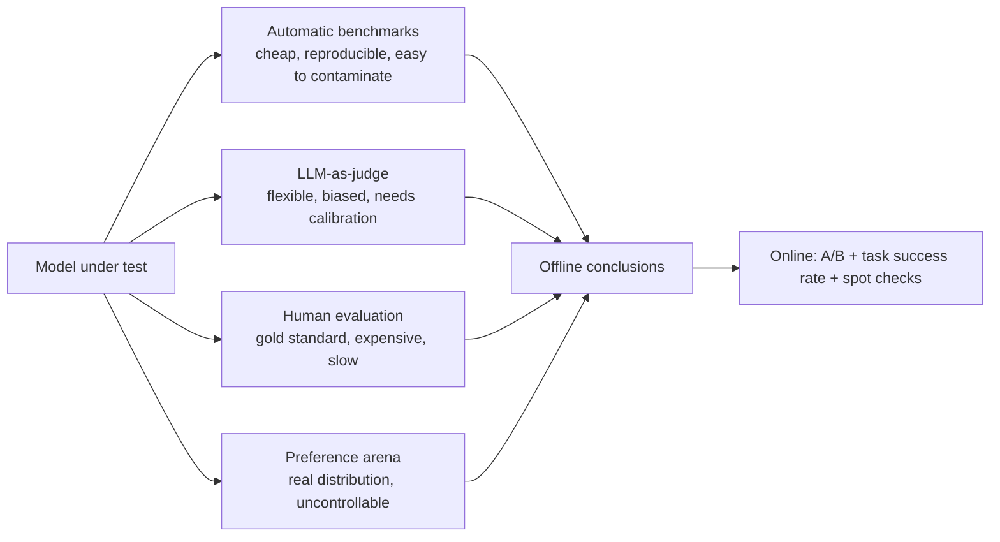

# Evaluation and hallucination

> **One-line summary**: Evaluation answers "is the model actually good", while hallucination answers "when does the model make things up"; the former needs a mix of benchmarks + LLM-as-judge + human review + online metrics, and the latter must be traced to data, training, and decoding and mitigated layer by layer.
>
> **Keywords**: `benchmark` `data contamination` `LLM-as-judge` `pass@k` `Elo` `hallucination` `faithfulness` `red teaming`

## 1. Core concepts

When evaluating an LLM I break it down by capability first, then decide how to measure each one:

| Capability | Representative benchmarks | Main measurement |
| --- | --- | --- |
| World knowledge | MMLU, C-Eval, CMMLU | Multiple-choice accuracy |
| Math reasoning | GSM8K, MATH | Exact match + CoT |
| Code | HumanEval, MBPP, LiveCodeBench | pass@k / unit-test pass rate |
| Instruction following | IFEval, MT-Bench | Rule checks / judge scores |
| Chat preference | AlpacaEval 2.0, Chatbot Arena | Pairwise win rate / Elo |
| Long context | LongBench, RULER | Task metrics + length sweeps |
| Truthfulness and safety | TruthfulQA, SafetyBench | Human/classifier + red teaming |

Evaluation methods fall into four categories, each with an irreplaceable role:



## 2. Principles and derivations

### 2.1 Benchmark details you must know

| Benchmark | Size/format | Metric | Notes |
| --- | --- | --- | --- |
| MMLU | 57 subjects, ~14K four-way questions | accuracy (5-shot standard) | Questions come from exams/textbooks; **a contamination hotspot** |
| GSM8K | ~8.5K grade-school word problems | exact match (extract the final number) | 8-shot CoT is the standard setup |
| MATH | ~12.5K competition problems | exact match | Difficulty tiers (levels 1-5) |
| HumanEval | 164 hand-written function problems | pass@1 | Function signature + unit tests, the coding benchmark |
| MT-Bench | 80 multi-turn questions, 8 categories | GPT-4 judge, 1-10 score | The classic combo of multi-turn ability + instruction following |
| AlpacaEval 2.0 | 805 instructions | Length-controlled win rate | Corrects for length bias |
| Chatbot Arena | Real users comparing pairs | Elo / Bradley-Terry | Closest to real preference, but uncontrollable |

**Unbiased estimate of pass@k** (a must for coding questions):

$$\text{pass@}k = 1 - \frac{\binom{n-c}{k}}{\binom{n}{k}}$$

With $n$ generated samples and $c$ of them passing, the formula gives an unbiased estimate of "at least one passes". $n$ must be much larger than $k$ (e.g. $n=200, k=1$), otherwise the variance explodes; this is also why pass@1 numbers from different papers are not directly comparable - sample count, temperature, and prompt may all differ.

**Elo and Bradley-Terry**: Arena rankings come from pairwise wins and losses. Elo updates $R_A' = R_A + K(S_A - E_A)$ with $E_A = 1/(1+10^{(R_B-R_A)/400})$; Bradley-Terry instead maximum-likelihood estimates a "strength score" per model. Limitation: human preference favors long answers, pretty formatting, and an authoritative tone, which is not the same as being correct.

### 2.2 Data contamination: the biggest source of inflated benchmark scores

Definition: evaluation questions (or close paraphrases) appear in the pretraining data, so the model "memorized the answer" instead of "being able to solve it".

Detection:
- **n-gram overlap + variant tests**: exact-match 13-grams against the training corpus; then change the numbers/option order/names and re-test - a sharp drop means memorization;
- **Likelihood anomalies + time splits**: an answer whose likelihood is an order of magnitude above the distribution is suspicious; use questions published after the training cutoff (LiveCodeBench) or a private holdout.

Mitigation: dynamic benchmarks, private eval sets, periodic question rotation, and stating the contamination risk in reports. When asked "is an MMLU-85 model necessarily better than an 80 one", the standard answer is: **not necessarily - first check whether prompt/parsing/contamination levels match, then look at per-category scores**.

### 2.3 LLM-as-judge: useful but systematically biased

Three modes: **pairwise** (pick the better of two answers, most stable), **pointwise** (score 1-10 against a rubric, cheap but scale-drifting), and **reference-based** (compare against a reference answer for correctness/coverage).

The main biases (memorize these):

| Bias | Symptom | Mitigation |
| --- | --- | --- |
| Position bias | Prefers the first (or second) answer | Swap the order and only keep consistent verdicts |
| Length/verbosity bias | Longer answers look "more complete" | Length control (AlpacaEval LC), cap length, rubric states conciseness first |
| Self-preference | Favors the style of its own family | Use 2-3 judges from different families, or switch to human/rules |
| Sycophancy bias | Swayed by a confident tone | Require evidence before scoring, anchor with reference criteria |
| Format bias | Gives Markdown/lists higher scores | Normalize formatting, strip it before judging |
| Authority/source bias | More citations and jargon means higher score | Judge prompt states "citations must be relevant to the answer" |

Key engineering practice:
1. **Align the judge with humans**: sample 100-200 items, double-annotate, and compute Cohen's kappa $\kappa=\frac{p_o-p_e}{1-p_e}$; only $\kappa>0.6$ is usable;
2. **Never treat judge scores as absolute**: use them only for comparisons within the same distribution / regression gates, and pin the judge version and prompt across batches;
3. **Make the judge output structured results** (criteria + score + rationale); the rationale is for spot checks, not for self-justification;
4. The MT-Bench paper reports GPT-4 judge agreement with humans above 80%, close to human-human agreement - but that is a **task-specific finding**, and you must re-validate it in a new domain.

### 2.4 Hallucination: definition, taxonomy, and sources

**Hallucination = fluent generation that lacks grounding or conflicts with facts**, whose core is "confidently making things up", distinct from an incorrect answer (grounded but wrongly reasoned).

| Type | Meaning | Example |
| --- | --- | --- |
| Factual hallucination | Conflicts with objective facts | Invented paper authors, years, legal clauses |
| Factual fabrication | Unverifiable in the real world | Invented APIs, product model numbers |
| Faithfulness hallucination | Output contradicts the given context/instructions | A summary adds content absent from the source; RAG ignores retrieved evidence |
| Self-contradiction | Long reasoning/multi-turn output conflicts with itself | CoT step 1 says A, step 3 uses not-A |

Sources can be attributed on three layers - "data, training, inference" (this is the clearest framework to present in an interview):

1. **Data layer**: the training corpus itself is wrong/outdated; long-tail knowledge is under-covered (the ICML 2023 paper "Large Language Models Struggle to Learn Long-Tail Knowledge"); duplicated data leads to memorization-style overfitting; social biases get imitated.
2. **Training layer**: decoder-only causal attention lacks bidirectional verification; teacher forcing during training versus autoregressive inference creates **exposure bias**, so one wrong step compounds; RLHF makes the model "please humans" (it flips when challenged - sycophancy), and SFT data that exceeds pretrained knowledge induces fabrication; the model is poorly calibrated and does not know what it does not know.
3. **Inference layer**: higher temperature/top-p means more divergence and more hallucination; long-context attention decays and the latter half starts "freestyling"; the softmax bottleneck (a single-token distribution struggles to express complex constraints); error accumulation.

### 2.5 Detecting and mitigating hallucination

Detection approaches (ordered by cost):

| Approach | How | Where it fits |
| --- | --- | --- |
| Uncertainty | Sequence logprob, entropy, multi-sample consistency (self-consistency) | Fast screening of suspicious samples |
| Faithfulness | An NLI model judges "does the context entail the answer"; entity/triple overlap | Summarization, RAG |
| Retrieval verification | Split into factual claims -> retrieve -> check one by one | Factual QA |
| Reverse QA | Regenerate questions from the answer and answer them, then compare | General |
| LLM self-review | A judge scores "is there evidence" | Large-scale offline evaluation |

Mitigation must be layered; do not expect a single fix:

- **Data/knowledge layer**: RAG (put the evidence into context), knowledge editing (ROME/MEMIT for a small number of fact updates), data cleaning and deduplication;
- **Training layer**: high-quality SFT data, teaching the model to say "I don't know" (R-Tuning-style methods), RLHF calibration of confidence, de-sycophantic preference data;
- **Decoding layer**: lower temperature, factual-nucleus, DoLa (contrast shallow vs deep logits to reinforce factual knowledge), CAD (context-aware decoding, suppressing internal knowledge that conflicts with context), contrastive decoding;
- **Product layer**: mandatory citations, traceable answers, human handoff in high-risk cases, refusal and disclaimer wording, post-launch spot checks. But note that **RAG is not a panacea**: retrieval noise, retrieval failure, and the model ignoring context (faithfulness hallucination) all turn "grounded" into "grounded nonsense", so RAG must be evaluated too (see [11 RAG](11-rag.md)).

### 2.6 How to build a production evaluation system

In my experience it is a four-layer funnel, and missing any layer leads to failures:

1. **Public benchmarks**: for horizontal positioning and regression only, not as product metrics (contamination + irrelevance to the business).
2. **Scenario golden set**: sample 200-1000 items from real traffic covering high-frequency/long-tail/adversarial cases, with human-annotated reference answers and a scoring rubric; every model/prompt change must regress against it.
3. **Batch LLM-judge evaluation**: align with humans on the golden set first, then scale to thousands of samples; used for fast iteration and A/B pre-screening.
4. **Online metrics**: task success rate, end-to-end latency/cost, user feedback (likes/regenerations/handoffs), human spot checks, safety incidents; paired with canarying and rollback. Supporting requirements: version the eval set, prompt, and parsing code together, record the model version and sampling parameters, and report per-category scores rather than only the average.

## 3. Implementation notes

Unbiased pass@k (mind numerical stability; use logs or exact combinations):

```python
from math import comb

def pass_at_k(n: int, c: int, k: int) -> float:
    """c of n samples are correct; estimate pass@k"""
    if n - c < k:
        return 1.0
    return 1.0 - comb(n - c, k) / comb(n, k)

print(pass_at_k(200, 40, 1))   # about 0.2
print(pass_at_k(200, 40, 10))  # clearly above pass@1
```

A judge call that cancels position bias (pairwise, with order swapped):

```python
import json

def judge_pairwise(llm, question, ans_a, ans_b, rubric):
    prompt = f"""You are a strict reviewer. Score against the rubric and output JSON.
{rubric}
Question: {question}
Answer 1: {ans_a}
Answer 2: {ans_b}
Output: {{"winner": "1" | "2" | "tie", "reason": "..."}}"""
    return json.loads(llm(prompt))

r1 = judge_pairwise(llm, q, a, b, rubric)   # A first
r2 = judge_pairwise(llm, q, b, a, rubric)   # B first
consistent = (r1["winner"] == "1" and r2["winner"] == "2") or \
             (r1["winner"] == "2" and r2["winner"] == "1")
final = r1["winner"] if consistent else "tie"   # disagreement becomes a tie, avoiding position bias
```

Check judge usability with Cohen's kappa: $\kappa=(p_o-p_e)/(1-p_e)$; $\kappa<0.4$ is unusable, $0.4\sim0.6$ is marginal, $>0.6$ is usable.

## 4. Interview Q&A

### Q1. How do you systematically evaluate a large model?
**Answer**: Select benchmarks per capability (knowledge/reasoning/code/instruction following/long context/safety/multilingual) for horizontal positioning; use a scenario golden set + LLM-judge for product-relevant regression; use Arena/humans for preference and subjective quality; finally look at online A/B, task success rate, cost, and safety incidents. The key is **layering**: public leaderboards are for positioning only, product decisions rely on the scenario set, and launch decisions rely on online metrics.
**Follow-up**: How do you evaluate when there is only one model and no labels? - Use a strong model as judge aligned with a small amount of human review, plus human spot checks for calibration; without labels you can also build weak signals from "self-consistency + verifiable subtasks (unit tests/math answers)".

### Q2. How do you tell whether benchmark scores are inflated/contaminated?
**Answer**: Check n-gram overlap between training data and the eval set; create question variants (change numbers/option order/names) and see whether scores collapse; check whether the model's likelihood for the answers is anomalously high; use questions published after the training cutoff (LiveCodeBench) or a private holdout. Reports must state the prompt template, shot count, and answer-extraction rules, otherwise the numbers are not comparable.
**Follow-up**: Why is leaderboard gaming harmful to the product? - Score gains may come from memorization rather than capability, real-distribution performance can regress, and it misallocates resources.

### Q3. What biases does LLM-as-judge have, and how do you handle them in engineering?
**Answer**: Position bias, length/verbosity bias, self-preference, sycophancy bias, and format bias. Handling: swap the order in pairwise judging and take only consistent verdicts; length-control or state conciseness in the rubric; cross-validate with judges from multiple families; require evidence before scoring in the judge prompt; compute kappa against human labels to confirm usability; pin the judge version to avoid cross-batch drift.
**Follow-up**: Can GPT-4 judge GPT-4? - Same-family self-preference gets overestimated; mix in at least one heterogeneous judge or human spot checks.

### Q4. Why does MT-Bench use pairwise instead of direct 1-10 scores?
**Answer**: Pairwise only asks "which is better", which is more stable than absolute scoring, drifts less on scale, and is closer to real human preference; 1-10 scores are easily affected by a model's own scale (some models always give 7) and are not comparable across batches. MT-Bench actually supports both, but conclusions usually cite pairwise win rates.
**Follow-up**: What are the downsides of pairwise? - $O(n^2)$ comparisons, no absolute level, ambiguous tie handling, and it still suffers from position bias.

### Q5. How do you define hallucination, and how does it differ from "wrong answer"?
**Answer**: Hallucination is **fluent generation that lacks grounding or conflicts with facts**, emphasizing "confident fabrication"; a wrong answer is a reasoning/computation error. The taxonomy covers factual hallucination (contradicts facts/unverifiable), faithfulness hallucination (inconsistent with the given context or instructions), and self-contradiction. The practical difference is that mitigation differs: factual errors need knowledge/retrieval, faithfulness needs context constraints and training, and self-contradiction needs decoding and verification.
**Follow-up**: Does "refusing to answer" count as hallucination? - No, but excessive refusal hurts usability, so evaluation must track the refusal rate alongside the hallucination rate.

### Q6. What are the root causes of hallucination?
**Answer**: Three layers. Data: wrong/outdated corpus, insufficient long-tail knowledge, duplication causing memorization. Training: causal attention, exposure bias from teacher forcing, sycophancy from alignment, SFT data inducing answers beyond the knowledge boundary, poor calibration. Inference: sampling randomness, attention decay in long context, error accumulation, the softmax expressiveness bottleneck.
**Follow-up**: Why is there still hallucination with RAG? - Retrieval misses, retrieved noise, the model not having learned to "use only the context" (a faithfulness problem), and wrong trade-offs when sources conflict.

### Q7. How do you reduce hallucination in engineering practice?
**Answer**: Combine layers: (1) knowledge layer uses RAG/citations to put evidence explicitly in context; (2) training layer uses high-quality SFT + "allowed to say I don't know" data + calibration; (3) decoding layer lowers temperature and uses contrastive decoding such as DoLa/CAD; (4) product layer mandates citations, traces answers, hands high-risk cases to humans, and has refusal wording; (5) evaluation layer builds a factual eval set + spot checks and treats the hallucination rate as a launch gate.
**Follow-up**: Why can't a "do not make things up" prompt suffice? - Instructions only lower the probability, never eliminate it; the model's "I don't know" signal is itself unreliable, so external verification is mandatory.

### Q8. How do you detect hallucination?
**Answer**: Four kinds of signals: uncertainty (logprob/entropy/multi-sample consistency), faithfulness (NLI judging whether the context entails the answer, entity/triple overlap), retrieval verification (split claims and check each), and reverse QA/LLM self-review. In practice, use cheap signals to screen suspicious samples and then run expensive verification on those, forming a cascade.
**Follow-up**: Is uncertainty always reliable? - No, models can be "low-entropy but wrong" (overconfident), so external evidence is needed; self-consistency is only a weak signal for open-ended generation.

### Q9. What are the limitations of Arena's Elo rankings?
**Answer**: Human preference favors long answers, pretty formatting, and a confident tone, which does not fully match "correct/safe"; the voter population and prompt distribution are uncontrolled (self-selection bias); scores fluctuate a lot when a new model enters; tie handling, the K factor, and Bradley-Terry assumptions all affect the ranking; and there is leaderboard-style prompt-distribution shift. Arena is therefore good for "overall popularity" but cannot replace domain and safety evaluation.
**Follow-up**: How large a score gap is meaningful? - Confidence intervals are often tens of Elo points wide, so small gaps should not be over-interpreted, especially with few samples for a new model.

### Q10. How do you build a production evaluation system?
**Answer**: A four-layer funnel: public benchmarks (positioning) -> scenario golden set (200-1000 real-traffic items + human labels, regressed on every change) -> scaled LLM-judge evaluation (aligned with humans via kappa first) -> online A/B and monitoring (task success rate, latency/cost, user feedback, human spot checks, safety incidents). Supporting practices: versioning (model/prompt/eval set), per-category reporting, and canary/rollback.
**Follow-up**: How do you keep the eval set from overfitting? - Keep a private holdout, periodically add new traffic, make final decisions on the private set, and avoid tuning prompts directly against the eval set.

## 5. Pitfalls and follow-ups

- **Using PPL/training loss as a capability metric**: PPL reflects fit only and correlates weakly with instruction following, reasoning, and factuality.
- **Ignoring prompt and parsing differences**: 5-shot vs 0-shot, CoT vs direct answer, regex vs LLM extraction can shift the same leaderboard score by several points.
- **Treating absolute judge scores as conclusions**: judge scores only support same-distribution comparisons; pin the judge and rerun baselines across versions.
- **Reporting only the average**: averages hide long-tail capability regressions; always inspect per-category scores and error types.
- **Equating hallucination with "factual error"**: faithfulness hallucination (ignoring context) is more common and more damaging in products.
- **Testing without a regression set, and watching hallucination but not refusal**: iterating without a versioned eval set is guesswork, and a drop in hallucination paired with a spike in refusals is not a win either.

## 6. Cheat sheet

| Question | One-line answer |
| --- | --- |
| How to evaluate | Public leaderboard for positioning + scenario golden set + scaled judge + online metrics |
| Are scores trustworthy | Check contamination first (n-gram/variants/time split), then normalize prompt and parsing |
| Judge biases | Position, length, self-preference, sycophancy, format; swap order + multiple judges + human-aligned kappa |
| Three hallucination types | Factual, faithfulness, self-contradiction |
| Three root-cause layers | Data (wrong/outdated/long-tail), training (exposure bias/sycophancy/overreach), inference (sampling/decay/accumulation) |
| Mitigations | RAG for evidence, train "I don't know", lower decoding randomness, mandatory citations and human handoff |
| Formulas to memorize | $\text{pass@}k = 1-\binom{n-c}{k}/\binom{n}{k}$; $\kappa=(p_o-p_e)/(1-p_e)$; $E_A=1/(1+10^{(R_B-R_A)/400})$ |

Mnemonic: **leaderboards for trends, eval sets for the product, judges for alignment, online for results; hallucination is beaten by evidence, not by attitude.**

## 7. References

- [Measuring Massive Multitask Language Understanding (MMLU)](https://arxiv.org/abs/2009.03300)
- [Training Verifiers to Solve Math Word Problems (GSM8K)](https://arxiv.org/abs/2110.14168)
- [Evaluating Large Language Models Trained on Code (HumanEval)](https://arxiv.org/abs/2107.03374)
- [Judging LLM-as-a-Judge with MT-Bench and Chatbot Arena](https://arxiv.org/abs/2306.05685)
- [AlpacaEval 2.0: Length-Controlled Win Rate](https://arxiv.org/abs/2404.04475)
- [A Survey on Hallucination in Large Language Models](https://arxiv.org/abs/2311.05232)
- [Siren's Song in the AI Ocean: A Survey on Hallucination in LLMs](https://arxiv.org/abs/2309.01219)
- [LLM-Agent-Interview-Guide · Safety and evaluation](https://github.com/Lau-Jonathan/LLM-Agent-Interview-Guide)
- [llm_interview_note · wdndev (evaluation and hallucination)](https://github.com/wdndev/llm_interview_note)
