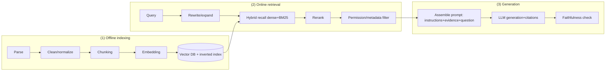

# RAG

> **One-line summary**: RAG replaces "memory in the parameters" with "memory in an external index" and constrains generation with retrieved evidence; the quality ceiling is set by **retrieval**, and the final experience is set by **whether the generation stays faithful to the evidence**.
>
> **Keywords**: `chunking` `embedding` `HNSW/IVF-PQ` `BM25` `RRF` `rerank` `HyDE` `GraphRAG` `RAGAS` `faithfulness`

## 1. Core concepts

RAG solves four classes of problems: **long-tail knowledge** (never learned), **private data** (never seen), **freshness** (knowledge has expired), and **traceability** (a source must be cited). It turns an LLM from "parametric memory only" into "parametric memory + working memory (the context window)".



| Dimension | RAG | Fine-tuning (SFT) | Long-context stuffing |
| --- | --- | --- | --- |
| Knowledge updates | Edit the index, minutes | Retrain, days | Swap the input, real time |
| Private data | Native support | Needs data and training | Limited by the window |
| Cost | Retrieval + long prompt | High training cost | Long prompt's $O(n^2)$ attention + KV |
| Capability/style | Weak | Strong | None |
| Traceability | Strong (citations) | Weak | Medium |
| Fits | Knowledge-intensive QA, enterprise corpora | Style/format/domain skills | Few documents + strong reasoning |

## 2. Principles and derivations

### 2.1 Indexing side: parsing, cleaning, chunking

Parsing is the first invisible killer: two-column PDFs, tables, scans, headers and footers, code blocks - parse them wrong and everything downstream is wrong. Preserve structural information (heading hierarchy, tables, page numbers) in metadata, for both filtering and context assembly.

| Strategy | How | Upside | Downside |
| --- | --- | --- | --- |
| Fixed length | Hard split by token count | Simple, length-controlled | Cuts sentences/tables |
| Recursive split | Paragraph -> sentence -> word | General, keeps semantic boundaries | Needs delimiter tuning |
| Semantic split | Break where adjacent-sentence embedding similarity drops | More coherent topics | Slow, unstable |
| Parent-child blocks | Retrieve small chunks, feed parent to the LLM | Accurate recall + full context | Needs two-tier storage |
| Contextual enhancement | Prepend a document summary before embedding each chunk | Reduces out-of-context reads | Higher indexing cost |

Rules of thumb: chunks of 256-1024 tokens with 10%-20% overlap; smaller for QA and larger for summarization; tables and code as separate chunks that keep headers and function signatures. Anthropic's contextual retrieval reports a clear drop in retrieval failure after adding context, with further gains when combined with rerank (see the original for exact numbers).

### 2.2 Embeddings and ANN indexes

- **bi-encoder**: query and doc are encoded separately, the index is built offline, and the online step is an inner product; fast but weakly interactive. Asymmetric retrieval needs an instruction-tuned embedding model, otherwise the query and passage distributions are misaligned.
- **Normalization**: after L2 normalization cosine equals inner product, and most ANN libraries only support inner product.
- **Dimensions**: 1024/1536 are common; Matryoshka representations allow truncating dimensions to save storage. General models lose points on medical/legal/code data, where domain fine-tuning helps.

| Index | Structure | Key parameters | Notes |
| --- | --- | --- | --- |
| HNSW | Multi-layer navigable graph | $M$ (16-64), efSearch | High recall, low latency; large memory, hard deletes |
| IVF | Cluster first, then inverted lists | nlist (~$\sqrt{N}$), nprobe | Memory-friendly, recall tuned by nprobe |
| PQ | Segment vectors into codebooks | m segments x 8 bit | 1/4~1/32 compression, lossy |
| IVF-PQ | IVF + PQ | The two sets above | Standard at billion scale (Faiss) |
| DiskANN | Graph + SSD | beam width | Very large scale, cost-sensitive |

Tuning is fundamentally the same **recall-latency curve**: larger efSearch/nprobe means higher recall and higher latency; plot the curve on a labeled set and pick the point with "95% recall and P99 within budget". Permission/tenant/time filters must be pushed down as **pre-filter**; with post-filter, high filter rates leave you with empty results.

### 2.3 Hybrid recall and fusion

BM25 (sparse) excels at exact matches - model numbers, error codes, names, legal clauses, code identifiers - but does not understand paraphrase; dense retrieval excels at semantic matching but is insensitive to rare entities and numbers. Their failure modes are complementary, so the mainstream choice is hybrid + fusion:

$$\text{RRF}(d) = \sum_{r \in R} \frac{1}{k + \text{rank}_r(d)}, \qquad k \approx 60$$

RRF uses only ranks, not scores, which neatly sidesteps incompatible score scales across retrievers and needs almost no tuning; you can also weight normalized scores, but the weights are sensitive to distribution shift.

### 2.4 Rerank: turning "close enough" into "actually relevant"

Bi-encoder recall trades query-doc interaction for speed, so its precision is limited; a **cross-encoder** encodes both together and can judge "does this passage really answer the question", but only for a small candidate set - hence two stages:

$$\text{Full corpus} \xrightarrow{\text{ANN}} \text{Top-}50 \xrightarrow{\text{cross-encoder}} \text{Top-}5 \xrightarrow{\text{LLM}} \text{answer}$$

The price is latency: reranking 50 passages usually costs 20-200 ms and must fit the end-to-end budget; an LLM reranker (RankGPT-style) works better but is more expensive, so it is reserved for offline evaluation or high-value queries. Set a relevance threshold after rerank - better to drop low-scoring candidates than to let noise pull the LLM off course.

### 2.5 Query understanding, rewriting, and multi-hop retrieval

| Method | How | What it fixes |
| --- | --- | --- |
| Coreference resolution | Fill in "it/this" from dialogue history | Multi-turn chat |
| Multi-Query | Generate 3-5 rewrites, retrieve each, then fuse | Phrasing diversity |
| HyDE | Generate a hypothetical answer first, then retrieve with it | Query/doc semantic gap |
| Step-back | Abstract to a more general question first | Over-specific queries under-recall |
| Sub-question decomposition | Split complex questions into sub-queries | Multi-hop, comparison questions |

Rewriting adds latency and the risk of drifting, so enable it only when retrieval metrics show "query and document semantics do not match", and keep recall on the original query as a fallback.

Multi-hop questions ("who is the CEO of the company that acquired A") need chained retrieval: retrieve -> read -> generate a new query -> retrieve again (Self-Ask, IRCoT, Agentic RAG). **GraphRAG** extracts entities/relations offline to build a graph, runs community detection and generates community summaries, then answers with local search (entity neighborhood) or global search (global themes); it suits relational and "summarize the whole corpus" questions, at the cost of expensive graph construction, awkward incremental updates, and sensitivity to extraction quality.

### 2.6 Evaluation: score retrieval and generation separately

| Layer | Metric | How it is computed |
| --- | --- | --- |
| Retrieval | Recall@k / Hit Rate@k | Is the document containing the gold answer in the top-k |
| Retrieval | MRR | Mean of the reciprocal rank of the first relevant result |
| Retrieval | NDCG@k | $\sum \frac{2^{rel_i}-1}{\log_2(i+1)}$ normalized to [0,1] |
| Generation | Faithfulness | Can every claim in the answer be supported by the retrieved context |
| Generation | Answer Relevance | Is the answer on-topic (reverse-generate a question and compare) |
| Generation | Context Precision/Recall | Share of useful information in the retrieved content / whether it covers what is needed |

RAGAS, TruLens, and DeepEval are all essentially **LLM-as-judge + embedding similarity**. Three steps to land it: (1) human-annotate 100-300 golden items (query, relevant doc ids, reference answer), with retrieval metrics that are reproducible; (2) align the generation-side judge with humans first (see [10 Evaluation and hallucination](10-evaluation-and-hallucination.md)); (3) add online metrics: no-answer rate, refusal rate, citation accuracy, end-to-end latency.

### 2.7 Failure modes and engineering practice

| Symptom | Root cause | Fix |
| --- | --- | --- |
| Documents exist but are not retrieved | Chunks too small / semantic gap / mismatched embedding | Tune chunking, hybrid retrieval, swap the embedding, rewrite the query |
| Retrieved but off-topic | Noisy recall, top-k too large | Add rerank, lower k, set a threshold |
| First half right, second half invented | The model is not faithful to context | Prompt constraints + citation marks + sentence-level verification |
| Wrong tables/numbers | Parsing lost structure, chunks split tables | Separate table chunks, keep headers |
| Multi-hop answered only halfway | One retrieval round cannot cover it | Sub-question decomposition, Agentic RAG, GraphRAG |
| Answers instead of refusing | No "insufficient evidence" branch | Add confidence checks and a refusal policy |
| Document edits/deletes do not take effect | Index update/delete not synced | Incremental upsert + stable chunk ids |
| Users see other tenants' documents | Filtering happens after generation | Push ACL/metadata filtering into retrieval |

Engineering also has to handle: **caching** (exact + semantic caches, mind the threshold and invalidation), **latency budget** (embedding 10-30 ms + ANN 5-20 ms + rerank 20-200 ms + LLM first token), **versioning** (archive the index/embedding model/prompt together), and **monitoring** (hit rate, empty-result rate, citation rate).

### 2.8 Do we still need RAG in the long-context era

| Scenario | Better fit |
| --- | --- |
| Corpus larger than the window, or updated daily | RAG (or retrieval + a long window mixed) |
| Precise citations, permission isolation, auditing required | RAG |
| A single task with only a few documents (<100K) | Straight long context: 100% recall and simpler to build |
| High concurrency, cost-sensitive | RAG (long-context cost grows with length) |
| Cross-document global understanding | GraphRAG / long context + hierarchical summaries |

Conclusion: long context cannot replace RAG's "selection" ability (cost, latency, lost-in-the-middle), and RAG cannot replace the "complete view" that long context gives over an entire contract or codebase; production usually mixes "retrieve a few high-quality chunks + long-window synthesis".

## 3. Implementation notes

Hybrid recall + RRF fusion (vector-store details omitted):

```python
def rrf_fuse(rankings, k=60, top_n=5):
    score = {}
    for ranking in rankings:                 # one ordered id list per retriever
        for rank, doc_id in enumerate(ranking, start=1):
            score[doc_id] = score.get(doc_id, 0.0) + 1.0 / (k + rank)
    return sorted(score.items(), key=lambda x: -x[1])[:top_n]

dense_ids = vector_store.search(q_vec, top_k=50)    # semantic recall
sparse_ids = bm25.search(query, top_k=50)           # keyword recall
candidates = rrf_fuse([dense_ids, sparse_ids], top_n=50)
final = cross_encoder.rerank(query, candidates)[:5]  # rerank, then go into the prompt
```

A generation prompt constrained by evidence (the key to fewer faithfulness hallucinations is "allowed to say I don't know"):

```text
You are an enterprise knowledge-base assistant. Answer only from the content in <evidence>; do not use outside knowledge.
If the evidence is insufficient, output "Based on the available material I cannot answer" and state what is missing.
Cite the source as [n] after each conclusion.

<evidence>
[1] {chunk_1}
[2] {chunk_2}
</evidence>

Question: {question}
```

Evaluation side (RAGAS-style): faithfulness splits the answer into claims and judges whether the contexts support each one; answer_relevancy reverse-generates a question from the answer and compares it with the original question; context_recall checks whether the claims in the reference answer are covered by the contexts.

## 4. Interview Q&A

### Q1. What is RAG's full pipeline and what are the key modules?
**Answer**: Three offline stages - parsing, cleaning/normalization, chunking, embedding, and index building (vector + inverted index); three online stages - query understanding/rewriting, hybrid recall (dense + BM25), rerank, prompt assembly, generation + citation checks. The key modules are parsing, chunking, embedding, ANN, rerank, and evaluation, and **every module can be the bottleneck**, so evaluate each stage instead of only the final answer.
**Follow-up**: If you could optimize only one module, which first? - Retrieval (Recall@k) first, since nothing downstream can recover from a miss; then faithfulness.

### Q2. How do you choose chunk size and overlap?
**Answer**: By task: factual QA prefers small chunks (256-512 tokens, less noise), summarization/analysis prefers larger ones (512-1024, more context); overlap of 10%-20% prevents boundary information from being cut; prefer semantic boundaries (paragraph/heading) over hard splits; keep tables and code as separate chunks with headers/signatures. Finally, sweep parameters with Recall@k on the golden set instead of guessing.
**Follow-up**: What goes wrong when chunks are too small or too large? - Too small loses context and fragments recall; too large dilutes semantics, blurs the embedding, and eats the prompt budget.

### Q3. How do you choose among vector retrieval, BM25, and hybrid retrieval?
**Answer**: Vectors excel at semantics/paraphrase; BM25 excels at exact matches (error codes, model numbers, legal clauses, code identifiers). Their failure modes are complementary, so the default is hybrid + RRF fusion; pure vectors stumble on jargon and numbers, while pure BM25 recalls poorly for colloquial queries.
**Follow-up**: Why does RRF use ranks instead of scores? - Different retrievers have different score scales (BM25 unbounded, cosine bounded), and normalized weighting is sensitive to distribution shift; RRF uses ranks only, is robust, and needs almost no tuning.

### Q4. How do you choose among HNSW, IVF, and PQ?
**Answer**: Up to a few million vectors with high recall and low latency, pick HNSW (memory for performance); with tight memory or larger scale use IVF (trade nprobe for recall); at billion scale use IVF-PQ or DiskANN (PQ compresses to 1/4~1/32, lossy). All three live on the same recall-latency curve, so plot it on a labeled set to pick the point, and leave operational room for index rebuilds.
**Follow-up**: Why are deletes awkward in HNSW? - Graph nodes reference each other, so deletion either uses tombstones (filter at query time, lower recall) or a rebuild; be careful with workloads that insert/delete frequently.

### Q5. Why is rerank needed, and how do you control its latency?
**Answer**: Bi-encoder recall sacrifices query-doc interaction for speed; a cross-encoder encodes both together and can judge "does this passage really answer the question", clearly improving top-n precision. To control latency: rerank only the top-30~50, use a distilled small model, batch requests, and tier by query type (skip simple queries).
**Follow-up**: Do you still need a threshold after rerank? - Yes; better to drop low-scoring candidates than to let noise pull the LLM off course, and tune the threshold on the labeled set.

### Q6. What query-rewriting methods exist, and when do you use them?
**Answer**: For multi-turn chat, start with coreference resolution; for short queries use Multi-Query and HyDE (generate a hypothetical answer first, then retrieve); for over-specific queries use Step-back; for complex questions decompose into sub-questions; for domain jargon normalize terminology. Rewriting adds latency and drift risk, so enable it only when retrieval metrics show "query and document semantics do not match", and keep a fallback on the original query.
**Follow-up**: What is HyDE's risk? - If the hypothetical answer is itself wrong, it steers retrieval off course; be cautious when domain knowledge is weak.

### Q7. When do you need multi-hop retrieval or GraphRAG?
**Answer**: When the question requires chained reasoning across documents ("who is the CEO of the company that acquired A") or a global thematic summary ("what are the main risks across this document set"), a single retrieval round is not enough. Multi-hop uses sub-question decomposition + IRCoT/Agentic RAG; global/relational questions use GraphRAG (entity graph + community summaries). The cost is indexing expense and latency, so avoid it when single-hop suffices.
**Follow-up**: What are GraphRAG's main risks? - Extraction errors pollute the graph, updates are expensive, and community summaries are costly and hard to evaluate.

### Q8. How do you evaluate a RAG system?
**Answer**: Split it into retrieval and generation layers. Retrieval uses Recall@k, Hit Rate, MRR, and NDCG@k against a human-labeled query -> relevant-doc golden set, which is reproducible; generation uses faithfulness, answer relevance, and context precision/recall, with an LLM judge that must first be aligned with humans. Online, add no-answer rate, citation accuracy, end-to-end latency, and user feedback. The key is that labels must point to specific chunk ids.
**Follow-up**: What if you have no labeled data? - Bootstrap with LLM-synthesized query-doc pairs (mind the distribution bias), then replace them with real traffic + human spot checks.

### Q9. When a RAG answer is wrong in production, how do you debug it?
**Answer**: Inspect the intermediate results along the pipeline: (1) did parsing lose structure; (2) did chunking cut key information; (3) did retrieval recall the right document (check Recall@k and the top-k content); (4) did ranking put noise on top (check rerank scores); (5) does the prompt enforce "use only the evidence"; (6) is the model faithful (verify sentence by sentence). Print the query, the recalled list and scores, the final context, and the points where the answer and citations disagree.
**Follow-up**: What is the most common trap? - Parsing + chunking account for most of it; many "the model is bad" cases are really poor index quality.

### Q10. With 1M-token context available, do we still need RAG?
**Answer**: Yes. (1) Cost and latency grow with length, and long prompts make prefill and KV cache expensive; (2) long context suffers from lost-in-the-middle, so filling it is not the same as using it; (3) permissions/auditing/incremental updates/citation tracing can only be solved at the index layer; (4) the corpus is usually far larger than any window. The right approach is hybrid: retrieve a few high-quality evidence chunks + a long window for synthesis.
**Follow-up**: When is a plain long context better? - When a single task has few documents (a few contracts / one codebase), when 100% recall is required, or in a prototype where development cost dominates.

## 5. Pitfalls and follow-ups

- **Tuning only the LLM and never looking at retrieval**: 80% of RAG bottlenecks are in parsing/chunking/recall; print the intermediate results first.
- **Assuming bigger top-k is better**: noise dilutes the key evidence and eats the context; rerank first, then take a small k.
- **Hard chunking with no regard for structure**: cutting headings, tables, and code blocks breaks both retrieval and generation.
- **Filtering after generation**: permission filtering must happen before retrieval, otherwise you both leak and miss; unsynced index deletes are another classic production incident.
- **End-to-end-only evaluation**: without per-stage evaluation you can neither localize nor regress.

## 6. Cheat sheet

| Stage | Default choice | Key parameters |
| --- | --- | --- |
| Parsing | Structured parsing + keep metadata | Tables/headings/page numbers |
| Chunking | Recursive splitting + 10-20% overlap | 256-1024 tokens |
| Embedding | Domain-adapted bilingual model | Normalization, instruction prefix |
| Index | HNSW (millions) / IVF-PQ (billions) | M, efSearch / nlist, nprobe |
| Recall | dense + BM25 hybrid | top-50 |
| Fusion | RRF, $k=60$ | Ranks, not scores |
| Rerank | cross-encoder | top-50 -> top-5 |
| Generation | Mandatory citations + allowed refusal | Low temperature |
| Evaluation | Retrieval Recall@k + generation faithfulness | Human golden set |

Mnemonic: **the index sets the ceiling, retrieval sets the floor, rerank adds precision, prompt keeps faithfulness, and evaluation must be per stage.**

## 7. References

- [Retrieval-Augmented Generation for Knowledge-Intensive NLP Tasks](https://arxiv.org/abs/2005.11401)
- [Dense Passage Retrieval for Open-Domain Question Answering](https://arxiv.org/abs/2004.04906)
- [Efficient and Robust ANN Search with HNSW](https://arxiv.org/abs/1603.09320)
- [Reciprocal Rank Fusion Outperforms Condorcet and Individual Rank Learning Methods](https://plg.uwaterloo.ca/~gvcormac/cormacksigir09-rrf.pdf)
- [Precise Zero-Shot Dense Retrieval without Relevance Labels (HyDE)](https://arxiv.org/abs/2212.10496)
- [RAGAS: Automated Evaluation of Retrieval Augmented Generation](https://arxiv.org/abs/2309.15217)
- [From Local to Global: A Graph RAG Approach to Query-Focused Summarization](https://arxiv.org/abs/2404.16130)
- [Introducing Contextual Retrieval · Anthropic](https://www.anthropic.com/news/contextual-retrieval)
- [llm_interview_note · wdndev (retrieval-augmented RAG)](https://github.com/wdndev/llm_interview_note)
