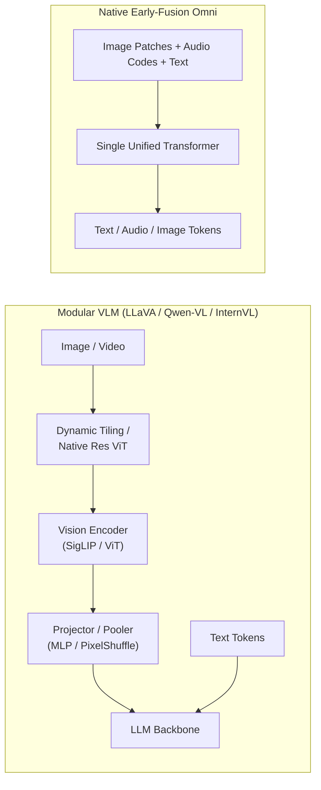

# Multimodal LLMs (VLMs & Omni Models)

> **One-line summary**: Multimodal LLMs fuse vision, audio, and text into one sequence model — most production VLMs pair a pretrained vision encoder with a lightweight projector and **dynamic high-resolution tiling** to preserve small text, while native omni models unify all modalities as tokens under one Transformer.
>
> **Keywords**: `VLM` `vision projector` `AnyRes tiling` `native multimodal` `video token compression` `audio tokenization` `multimodal hallucination`

## 1. Core concepts



| Architecture family | How modalities enter | Strengths | Weaknesses |
| --- | --- | --- | --- |
| **Modular Encoder + Projector** (LLaVA, Qwen2.5-VL, InternVL) | Frozen/tuned ViT → MLP or resampler → LLM input embeddings | Data-efficient; leverages strong pretrained ViT + LLM | Vision encoder bottleneck; extra visual-token budget; text-only output unless paired with decoder |
| **Cross-Attention Fusion** (Flamingo, Llama 3.2 Vision) | Interleaved cross-attention layers attend to visual features | Zero impact on text-only weights if frozen | Harder to optimize end-to-end; less unified for interleaved multi-image reasoning |
| **Native Early-Fusion / Omni** (Chameleon, GPT-4o / Gemini style) | Discrete VQ/RVQ or continuous patch tokens directly inside one Transformer | Unified generation & understanding across text/image/audio | Expensive pretraining; modality interference and balancing |

## 2. Principles and derivations

### 2.1 Vision-to-LLM connectors (Projectors)

A ViT outputs $N_v$ visual tokens of dimension $d_v$, which must map to the LLM's $d_{\mathrm{llm}}$ without exploding the context window:

1. **2-layer MLP projector** (LLaVA-1.5): simple, preserves fine spatial detail (OCR, grounding), but keeps all $N_v$ tokens (e.g., 576 tokens for $336\times 336$, patch 14).
2. **Spatial token merging / PixelShuffle**: merge $2\times 2$ adjacent patches into 1 token before the MLP, cutting visual tokens by **$4\times$** with minimal OCR loss (used in Qwen2-VL, InternVL).
3. **Q-Former / Perceiver Resampler**: fixed $K$ learnable queries (e.g., 64) cross-attend to ViT patches; cheap context cost, but compresses away fine-grained text/coordinates.

### 2.2 High-resolution handling: Dynamic Tiling (AnyRes) vs. Native Resolution

Resizing a $2000\times 1500$ PDF screenshot to $336\times 336$ makes text unreadable. Two mainstream solutions:

- **Dynamic Tiling (AnyRes / InternVL / LLaVA-NeXT)**: match the image's aspect ratio to a grid of $r \times c$ fixed tiles (e.g., up to 6–12 crops of $448\times 448$) **plus one downsampled global thumbnail** so the model retains both global layout and fine local text.
- **Native Dynamic Resolution (NaViT / Qwen2.5-VL)**: keep original aspect ratio and variable resolution using **2D RoPE (M-RoPE)** and variable-length FlashAttention packing, avoiding tile-boundary cuts altogether.

**Visual token budget math**: an image of $H \times W$ with patch size $P=14$ and $2\times 2$ spatial merge produces:

$$
N_{\mathrm{vis}} = \frac{H}{2P} \times \frac{W}{2P} = \frac{H \cdot W}{784}
$$

A $1120 \times 1120$ page uses $1600$ tokens — equivalent to ~1,200 words of prompt prefill! Controlling max pixels per image directly controls TTFT and KV-cache footprint.

### 2.3 Video and Audio modalities

- **Video**: 60 seconds at 1 FPS × 256 tokens/frame = 15,360 tokens. Mitigations: adaptive frame sampling (scene-change detection), temporal pooling ($3\text{D}$ Conv / spatiotemporal merge), **SlowFast** pathways (dense low-res frames + sparse high-res frames), and 3D M-RoPE (time + height + width).
- **Audio & Speech-to-Speech**:
  - **Cascaded pipeline**: ASR (Whisper) → LLM → TTS — modular, easy to debug, but loses paralinguistics (tone, emotion, laughter) and adds 800 ms–2 s latency.
  - **Native / End-to-End Audio**: encode waveform via **Residual Vector Quantization (RVQ)** or continuous Whisper/Conformer features directly into the LLM, and emit audio codec tokens (or dual text+audio streams) for **<300 ms** full-duplex voice interaction with barge-in.

### 2.4 Typical VLM training stages

1. **Stage 1 — Alignment pretraining**: freeze ViT and LLM, train only the projector on image-caption pairs (aligns visual features to text embedding space).
2. **Stage 2 — Full multimodal pretraining / mid-training**: unfreeze ViT + projector + LLM on interleaved web pages, OCR, PDFs, charts, code screenshots, and video captions (builds dense visual grounding).
3. **Stage 3 — Multimodal SFT + RL / DPO**: instruction-following, grounded bounding-box/point prediction, visual reasoning (RLVR on geometry/chart math), and hallucination reduction (DPO on fabricated-object negatives).

### 2.5 Multimodal hallucination and evaluation

VLMs suffer from **language-prior dominance**: when an image is ambiguous or cropped, the LLM guesses plausible objects from text statistics rather than looking at pixels.
- **Benchmarks**: **MMMU** (college-level multidisciplinary), **DocVQA / ChartQA / OCRBench** (document & text reading), **MathVista / MathVerse** (visual math), **Video-MME** (long video), **POPE / HallusionBench** (object & visual hallucination).
- **Mitigations**: higher resolution / dynamic tiling, grounded verification ("point/box before answering"), visual-contrastive decoding, and RLVR/DPO with negative image-text pairs.

## 3. Implementation notes

```python
import torch, torch.nn as nn

class PixelShuffleProjector(nn.Module):
    """Merge 2x2 spatial patches (4x fewer visual tokens) -> MLP -> LLM dim."""
    def __init__(self, d_vis: int, d_llm: int, scale: int = 2):
        super().__init__()
        self.scale = scale
        self.mlp = nn.Sequential(
            nn.Linear(d_vis * scale * scale, d_llm),
            nn.GELU(),
            nn.Linear(d_llm, d_llm),
        )

    def forward(self, x: torch.Tensor) -> torch.Tensor:
        # x: [B, H, W, D]
        B, H, W, D = x.shape
        s = self.scale
        x = x.view(B, H // s, s, W // s, s, D).permute(0, 1, 3, 2, 4, 5)
        x = x.reshape(B, (H // s) * (W // s), D * s * s)
        return self.mlp(x)
```

Serving notes:
- **Prefill dominates VLM latency**: one high-res image equals hundreds to thousands of tokens; cache encoded vision embeddings across multi-turn chats over the same image/document.
- **Vision-encoder batching**: images of mixed resolutions create padding waste — use **NaViT-style sequence packing** or fixed tile sizes in vLLM/SGLang multimodal serving.
- **Position IDs**: ensure visual tokens carry proper 2D/3D RoPE coordinates so bounding-box grounding and multi-image comparisons stay accurate.

## 4. Interview Q&A

### Q1. Why do modern VLMs use an MLP + spatial merge instead of a Q-Former?
**Answer**: Q-Formers compress an entire image into a tiny fixed set of queries (e.g., 32–64), which loses fine spatial detail needed for OCR, dense tables, and GUI grounding. Spatial token merging ($2\times 2$ PixelShuffle) + a 2-layer MLP cuts token count $4\times$ while preserving 2D locality and trains much more cleanly end-to-end.
**Follow-up**: When is a Q-Former / resampler still useful? Ultra-long videos or tight edge latency budgets where you need an aggressive fixed cap on visual tokens per frame.

### Q2. Why does a VLM fail on small text in a screenshot, and how do you fix it?
**Answer**: Downsampling a high-res screenshot to a fixed $336\times 336$ ViT grid destroys legibility before the LLM ever sees it. Fix it with **dynamic tiling (AnyRes)** + global thumbnail or **native-resolution ViT (2D RoPE)**, raise the per-image `max_pixels` budget, and include OCR/document-parsing data in mid-training.
**Follow-up**: What is the serving cost? Prefill FLOPs and KV cache grow linearly (or quadratically for attention) with pixel count, so enforce a per-request visual token cap.

### Q3. Modular VLM vs. Native Early-Fusion Multimodal LLM — what are the trade-offs?
**Answer**: Modular VLMs reuse a strong pretrained ViT and LLM, converge with far less compute, and let you swap vision encoders independently. Native early-fusion models tokenize all modalities into one Transformer, enabling unified understanding + generation (image/audio output) without a lossy encoder bottleneck, but require huge balanced multimodal pretraining and careful modality-gradient balancing.

### Q4. How do you serve a VLM efficiently in production when users ask 10 follow-up questions about the same PDF page?
**Answer**: Two levels of caching: (1) **Vision encoder embedding cache** keyed by image hash so the ViT runs once; (2) **Prefix KV caching** (RadixAttention / vLLM APC) over the system prompt + image tokens so turns 2–10 skip prefill over the image entirely. Also downsample images dynamically based on task intent (thumbnail for classification, high-res for OCR).

### Q5. Why do VLMs hallucinate objects that aren't in the image, and how do you test for it?
**Answer**: Strong LLM language priors overpower weak or over-compressed visual tokens (e.g., seeing a kitchen and hallucinating a toaster). Test with **POPE** (binary existence probing on frequent/adversarial objects) and **HallusionBench** (visually edited counterexamples). Mitigate with higher-res visual tokens, grounding/pointing supervision, negative-sample DPO/RL, and abstention training.

## 5. Pitfalls and follow-ups

- **Forgetting the global thumbnail in tiling**: local crops without a global view lose layout relationships (which header belongs to which table column).
- **Ignoring attention masks across packed images**: in multi-image batches, leaking attention across unrelated images corrupts representations.
- **Evaluating VLMs on text-solvable questions**: many VQA benchmarks can be answered from the question text alone; always run a **blind (no-image) baseline** to verify visual dependence.

## 6. Cheat sheet

| Topic | Key point |
| --- | --- |
| Mainstream VLM stack | ViT/SigLIP + $2\times 2$ spatial merge + MLP projector + LLM |
| High-res handling | Dynamic tiling (AnyRes + thumbnail) or Native-res ViT + 2D/3D M-RoPE |
| Token budget | $N_{\mathrm{vis}} = (H\cdot W)/(2P)^2$ (with $2\times 2$ merge); dominates TTFT |
| Video scaling | Adaptive FPS + temporal pooling + SlowFast pathways |
| Voice / Omni | Cascaded (modular, slower, no tone) vs. native audio tokens (<300 ms, barge-in) |
| Hallucination | Language-prior dominance; test with POPE + blind baseline |

Mnemonic: **"Tile or keep native res, merge 2×2 to save tokens, cache vision + prefix KV, and always run a blind baseline."**

## 7. References

- [Visual Instruction Tuning (LLaVA) · Liu et al., 2023](https://arxiv.org/abs/2304.08485)
- [Qwen2.5-VL Technical Report · Bai et al., 2025](https://arxiv.org/abs/2502.13923)
- [InternVL / Dynamic High-Resolution Tiling · Chen et al., 2024](https://arxiv.org/abs/2404.16821)
- [Patch n' Pack (NaViT) · Dehghani et al., 2023](https://arxiv.org/abs/2307.06304)
- [Evaluating Object Hallucination in LVLMs (POPE) · Li et al., 2023](https://arxiv.org/abs/2305.10355)
