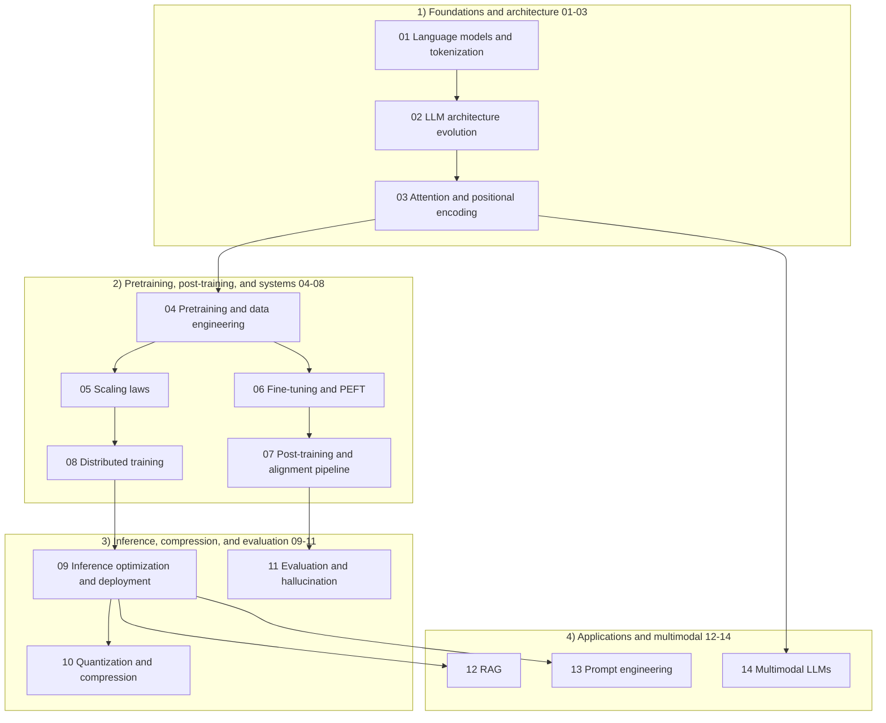

# Chapter 4 · Large Language Models (LLM)

> **Chapter intro**: This chapter answers four questions: **how text becomes tokens** (01), **what the model looks like** (02, 03), **how the model gets trained and aligned** (04–08), and **how a trained model is served, evaluated, and applied across modalities** (09–14). These 14 notes are the backbone of LLM interviews: architecture details, memory estimates, post-training recipes, and scaling laws come up in almost every round, while the second half covers inference, quantization, evaluation, RAG, prompting, and multimodal VLMs.

## Chapter map

## What this chapter covers

### Part 1: Foundations and architecture (01-03)

- [01 Language models and tokenization](01-language-models-and-tokenization.md) - from n-gram to neural LMs, autoregressive factorization, cross-entropy/perplexity, BPE/WordPiece/Unigram/SentencePiece, vocabulary-size trade-offs, Chinese tokenization, and chat templates.
- [02 LLM architecture evolution](02-llm-architecture-evolution.md) - why decoder-only won; architecture comparison across Llama/Qwen/DeepSeek/Mistral/GPT; RMSNorm, SwiGLU, RoPE, GQA/MLA, MoE routing and load balancing; a short intro to Mamba/SSM.
- [03 Attention and positional encoding](03-attention-and-position-encoding.md) - memory comparison of MHA/MQA/GQA/MLA, the KV cache formula, FlashAttention (tiling + online softmax), sparse/sliding-window attention, RoPE and NTK/YaRN context extension.

### Part 2: Pretraining, post-training, and training systems (04-08)

- [04 Pretraining and data engineering](04-pretraining-and-data.md) - CLM/MLM/T5/FIM objectives; data collection, deduplication, quality filtering, mixing ratios, packing; batch/LR/bf16; loss spikes and z-loss; data contamination.
- [05 Scaling laws](05-scaling-laws.md) - Kaplan vs Chinchilla; power-law formulas and compute-optimal allocation; the 6ND budget; data constraints and "overtraining"; the emergent-abilities debate; MoE scaling.
- [06 Fine-tuning and PEFT](06-fine-tuning-and-peft.md) - SFT data and loss masking; full fine-tuning memory; LoRA/QLoRA/DoRA; adapter/prefix/prompt tuning; catastrophic forgetting and evaluation.
- [07 Post-training and alignment pipeline](07-post-training-pipeline.md) - Mid-training → SFT → rejection sampling (Best-of-N) → online DPO → RLVR (GRPO/PPO), synthetic data, rubric GenRMs, instruction hierarchy, over-refusal, strong-to-weak distillation, and model merging.
- [08 Distributed training](08-distributed-training.md) - DP/DDP, ZeRO 1/2/3, FSDP, TP, PP (1F1B), SP/CP, MoE expert parallelism; communication primitives and memory estimates; MFU; checkpoint recovery.

### Part 3: Inference, compression, and evaluation (09-11)

- [09 Inference optimization and deployment](09-inference-optimization-and-serving.md) - prefill/decode, KV cache, PagedAttention, continuous batching, speculative decoding, PD disaggregation, TTFT/TPOT.
- [10 Quantization and compression](10-quantization-and-compression.md) - INT8/INT4/FP8, PTQ/QAT, GPTQ/AWQ/SmoothQuant/GGUF, KV cache quantization, distillation and pruning.
- [11 Evaluation and hallucination](11-evaluation-and-hallucination.md) - benchmarks, data contamination, LLM-as-judge, hallucination sources and mitigation, safety evaluation.

### Part 4: Applications and multimodal (12-14)

- [12 RAG](12-rag.md) - chunking, embeddings, ANN indexes, hybrid retrieval and reranking, GraphRAG, RAG evaluation.
- [13 Prompt engineering](13-prompt-engineering.md) - zero/few-shot, CoT, ReAct, structured output, prompt-injection defenses, context engineering.
- [14 Multimodal LLMs (VLMs & Omni)](14-multimodal-llms.md) - modular ViT+projector vs. native early-fusion, dynamic high-res tiling (AnyRes / NaViT), video token compression, audio tokenization, and multimodal hallucination.

## Study plan

- **Recommended order**: 01 -> 02 -> 03 -> 04 -> 05 -> 08 -> 06 -> 07 -> 09 -> 10 -> 11 -> 12 -> 13 -> 14. You can swap 02 and 03: seeing the architecture panorama first makes the attention details easier to follow.
- **Time budget**: 3-4 days. 01/03/05/08 are worth doing by hand (KV cache, memory, scaling-law budgets); for the rest, aim to explain the trade-offs clearly.
- **Interview weight**: architecture evolution (02), KV cache and GQA/MLA (03), Chinchilla (05), LoRA/post-training (06/07), and distributed memory (08) are asked in nearly every LLM role; 09-14 matter more for application and multimodal roles.
- **Review method**: cover the Q&A first and answer from memory, then reproduce the one-page version from the cheat sheet; cross-cutting questions (such as "why is everyone overtraining now") should connect 05 + 08 + 09.

## One-page summary

| Topic | Key takeaway | Details |
| --- | --- | --- |
| Language modeling | $p(x)=\prod_t p(x_t\mid x_{<t})$; the training objective minimizes cross-entropy, and PPL = $\exp(\text{CE})$ | [01](01-language-models-and-tokenization.md) |
| Decoder-only | Unified training objective, KV-cache friendly, strong zero-shot generalization; encoder-decoder still wins for translation/summarization | [02](02-llm-architecture-evolution.md) |
| Attention variants | KV cache size scales with the number of KV heads; MHA -> GQA (-> MQA) trades quality for memory, while MLA compresses via a low-rank latent | [03](03-attention-and-position-encoding.md) |
| FlashAttention | Exact attention; tiling + online softmax cut HBM traffic from $O(N^2)$ to $O(N^2 d/M)$ | [03](03-attention-and-position-encoding.md) |
| Compute-optimal | Chinchilla: $N_{opt}\propto C^{0.5}$, $D_{opt}\propto C^{0.5}$, about 20 tokens per parameter | [05](05-scaling-laws.md) |
| Training cost | Training FLOPs $\approx 6ND$ (forward $2ND$ + backward $4ND$) | [05](05-scaling-laws.md) |
| LoRA | $\Delta W=BA$, $r(d+k)$ trainable parameters, $\alpha/r$ scaling, mergeable with zero inference latency | [06](06-fine-tuning-and-peft.md) |
| Post-training | Mid-training → SFT → Rejection Sampling → Online DPO → RLVR → Distillation & Merge | [07](07-post-training-pipeline.md) |
| Memory | Full-parameter AdamW needs about 16-20 B per parameter; ZeRO-3 shards parameters, gradients, and optimizer states | [08](08-distributed-training.md) |

## How it connects to other chapters

- [02 · Transformer basics](../02-dl-fundamentals/05-transformer-basics.md): the standard derivation of self-attention, multi-head attention, and FFN - assumed knowledge here; review it first if you are rusty.
- [02 · Normalization techniques](../02-dl-fundamentals/03-normalization-techniques.md): details of RMSNorm and Pre-LN/Post-LN live there.
- [02 · Optimizers and training tricks](../02-dl-fundamentals/06-optimizers-and-training-tips.md): AdamW, warmup, gradient clipping, mixed precision.
- [03 · RL & Alignment](../03-reinforcement-learning/README.md) ([05 RLHF](../03-reinforcement-learning/05-rlhf-pipeline.md), [06 DPO](../03-reinforcement-learning/06-dpo-and-preference-optimization.md), [07 GRPO](../03-reinforcement-learning/07-grpo-and-reasoning-rl.md)): covers the RL/alignment **mathematical derivations and objectives**, whereas [07 Post-training and alignment pipeline](07-post-training-pipeline.md) covers the LLM **multi-stage recipe, data synthesis, judges, safety, and distillation**.
- [07 · Distributed training infrastructure](../07-ml-infra/03-distributed-training-infrastructure.md) & [07 · RL post-training infrastructure](../07-ml-infra/05-rl-posttraining-infrastructure.md): cluster scheduling, NCCL, weight sync, and rollout stragglers; note 08 here focuses on parallelism algorithms and memory.
- [08 · LLM cheat sheet](../08-interview-bank/03-llm-cheatsheet.md): the compressed version of this chapter's conclusions, for the day before an interview.

> Note: notes 09-14 focus on inference, compression, evaluation, RAG, prompting, and multimodal systems; this README only indexes them and does not duplicate their content.
