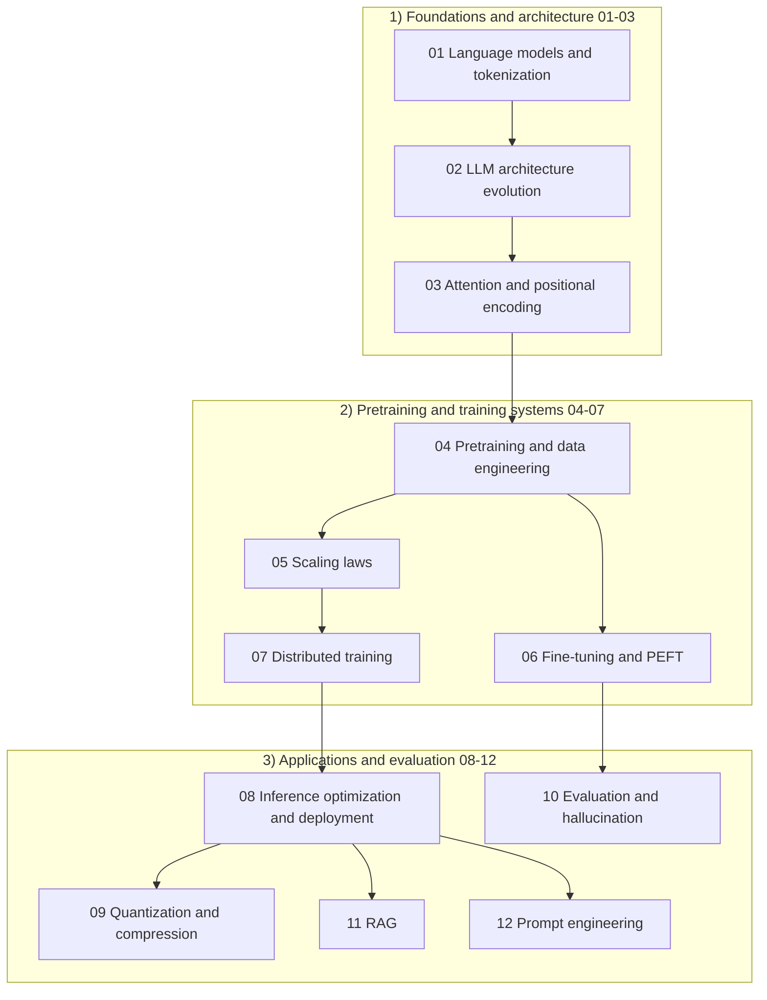

# Chapter 4 · Large Language Models (LLM)

> **Chapter intro**: This chapter answers four questions: **how text becomes tokens** (01), **what the model looks like** (02, 03), **how the model gets trained** (04, 05, 07), and **how a trained model becomes a product** (06). These 12 notes are the backbone of LLM interviews: architecture details, memory estimates, and scaling laws come up in almost every round. The last five notes (inference, quantization, evaluation, RAG, prompting) lean toward applied engineering and sit in the second half of the chapter.

## Chapter map

## What this chapter covers

### Part 1: Foundations and architecture (01-03)

- [01 Language models and tokenization](01-language-models-and-tokenization.md) - from n-gram to neural LMs, autoregressive factorization, cross-entropy/perplexity, BPE/WordPiece/Unigram/SentencePiece, vocabulary-size trade-offs, Chinese tokenization, and chat templates.
- [02 LLM architecture evolution](02-llm-architecture-evolution.md) - why decoder-only won; architecture comparison across Llama/Qwen/DeepSeek/Mistral/GPT; RMSNorm, SwiGLU, RoPE, GQA/MLA, MoE routing and load balancing; a short intro to Mamba/SSM.
- [03 Attention and positional encoding](03-attention-and-position-encoding.md) - memory comparison of MHA/MQA/GQA/MLA, the KV cache formula, FlashAttention (tiling + online softmax), sparse/sliding-window attention, RoPE and NTK/YaRN context extension.

### Part 2: Pretraining and training systems (04-07)

- [04 Pretraining and data engineering](04-pretraining-and-data.md) - CLM/MLM/T5/FIM objectives; data collection, deduplication, quality filtering, mixing ratios, packing; batch/LR/bf16; loss spikes and z-loss; data contamination.
- [05 Scaling laws](05-scaling-laws.md) - Kaplan vs Chinchilla; power-law formulas and compute-optimal allocation; the 6ND budget; data constraints and "overtraining"; the emergent-abilities debate; MoE scaling.
- [06 Fine-tuning and PEFT](06-fine-tuning-and-peft.md) - SFT data and loss masking; full fine-tuning memory; LoRA/QLoRA/DoRA; adapter/prefix/prompt tuning; catastrophic forgetting and evaluation.
- [07 Distributed training](07-distributed-training.md) - DP/DDP, ZeRO 1/2/3, FSDP, TP, PP (1F1B), SP/CP, MoE expert parallelism; communication primitives and memory estimates; MFU; checkpoint recovery.

### Part 3: Applications and evaluation (08-12)

- [08 Inference optimization and deployment](08-inference-optimization-and-serving.md) - prefill/decode, KV cache, PagedAttention, continuous batching, speculative decoding, PD disaggregation, TTFT/TPOT.
- [09 Quantization and compression](09-quantization-and-compression.md) - INT8/INT4/FP8, PTQ/QAT, GPTQ/AWQ/SmoothQuant/GGUF, KV cache quantization, distillation and pruning.
- [10 Evaluation and hallucination](10-evaluation-and-hallucination.md) - benchmarks, data contamination, LLM-as-judge, hallucination sources and mitigation, safety evaluation.
- [11 RAG](11-rag.md) - chunking, embeddings, ANN indexes, hybrid retrieval and reranking, GraphRAG, RAG evaluation.
- [12 Prompt engineering](12-prompt-engineering.md) - zero/few-shot, CoT, ReAct, structured output, prompt-injection defenses, context engineering.

## Study plan

- **Recommended order**: 01 -> 02 -> 03 -> 04 -> 05 -> 07 -> 06 -> 08 -> 09 -> 10 -> 11 -> 12. You can swap 02 and 03: seeing the architecture panorama first makes the attention details easier to follow.
- **Time budget**: 3-4 days. 01/03/05/07 are worth doing by hand (KV cache, memory, scaling-law budgets); for the rest, aim to explain the trade-offs clearly.
- **Interview weight**: architecture evolution (02), KV cache and GQA/MLA (03), Chinchilla (05), LoRA and memory (06/07) are asked in nearly every LLM role; 08-12 matter more for application roles.
- **Review method**: cover the Q&A first and answer from memory, then reproduce the one-page version from the cheat sheet; cross-cutting questions (such as "why is everyone overtraining now") should connect 05 + 07 + 08.

## One-page summary

| Topic | Key takeaway | Details |
| --- | --- | --- |
| Language modeling | $p(x)=\prod_t p(x_t\mid x_{<t})$; the training objective minimizes cross-entropy, and PPL = $\exp(\text{CE})$ | [01](01-language-models-and-tokenization.md) |
| Decoder-only | Unified training objective, KV-cache friendly, strong zero-shot generalization; encoder-decoder still wins for translation/summarization | [02](02-llm-architecture-evolution.md) |
| Attention variants | KV cache size scales with the number of KV heads; MHA -> GQA (-> MQA) trades quality for memory, while MLA compresses via a low-rank latent | [03](03-attention-and-position-encoding.md) |
| FlashAttention | Exact attention; tiling + online softmax cut HBM traffic from $O(N^2)$ to $O(N^2 d/M)$ | [03](03-attention-and-position-encoding.md) |
| Compute-optimal | Chinchilla: $N_{opt}\propto C^{0.5}$, $D_{opt}\propto C^{0.5}$, about 20 tokens per parameter | [05](05-scaling-laws.md) |
| Training cost | Training FLOPs $\approx 6ND$ (forward $2ND$ + backward $4ND$) | [05](05-scaling-laws.md) |
| LoRA | $\Delta W=BA$, $r(d+k)$ trainable parameters, $\alpha/r$ scaling, mergeable with zero inference latency | [06](06-fine-tuning-and-peft.md) |
| Memory | Full-parameter AdamW needs about 16-20 B per parameter; ZeRO-3 shards parameters, gradients, and optimizer states | [07](07-distributed-training.md) |

## How it connects to other chapters

- [02 · Transformer basics](../02-dl-fundamentals/05-transformer-basics.md): the standard derivation of self-attention, multi-head attention, and FFN - assumed knowledge here; review it first if you are rusty.
- [02 · Normalization techniques](../02-dl-fundamentals/03-normalization-techniques.md): details of RMSNorm and Pre-LN/Post-LN live there.
- [02 · Optimizers and training tricks](../02-dl-fundamentals/06-optimizers-and-training-tips.md): AdamW, warmup, gradient clipping, mixed precision.
- [03 · The full RLHF pipeline](../03-reinforcement-learning/05-rlhf-pipeline.md) and [03 · DPO](../03-reinforcement-learning/06-dpo-and-preference-optimization.md): preference alignment after SFT; note 06 in this chapter stops at SFT/PEFT.
- [07 · Distributed training infrastructure](../07-ml-infra/03-distributed-training-infrastructure.md): the same problem seen from clusters, NCCL, and scheduling; note 07 here focuses on algorithms and memory.
- [08 · LLM cheat sheet](../08-interview-bank/02-llm-cheatsheet.md): the compressed version of this chapter's conclusions, for the day before an interview.

> Note: notes 08-12 are maintained by the application track; this README only indexes them and does not duplicate their content.
