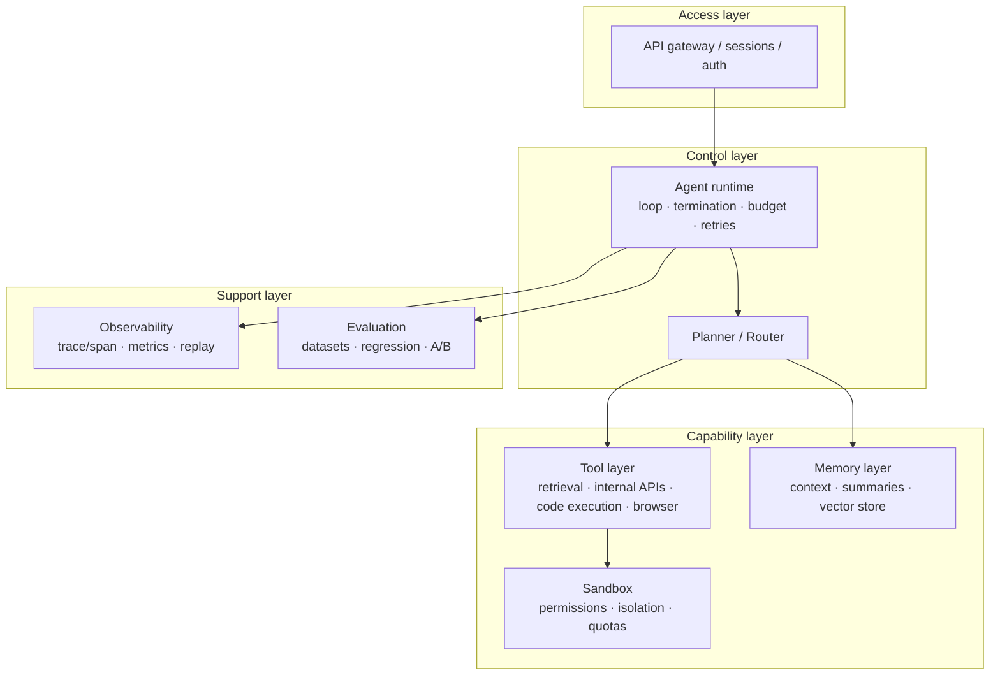

# Agent basics and architecture

> **One-line summary**: An agent is an LLM (the policy) plus planning, tools, and memory; in essence it is an observe → think → act loop controller. The hard engineering is not the loop itself but **when to stop, how to bound the blast radius, and how to evaluate it**.
>
> **Keywords**: `agent loop` `ReAct` `workflow vs agent` `tool use` `MCP` `A2A` `computer use`

## 1. Core concepts

### 1.1 What counts as an agent

Here is an operational test: **does the system decide "what to do next" at runtime?**

- A fixed flow whose branches are hard-coded is a **workflow**; the LLM only fills in local generations.
- A model that picks the next action from the current observation and feeds the previous result into the next step is an **agent**.

A more formal definition: a system that uses an LLM as its decision core and has the ability to **perceive (read tool results and environment state) → plan (decompose the task) → act (call tools or emit output) → remember (store and reuse information)**, iterating until the task completes or a termination condition fires.

### 1.2 The four components and their jobs

| Component | Role | Typical implementation | Typical failure |
|---|---|---|---|
| LLM (policy / brain) | Picks the next action, writes arguments, decides when to stop | GPT / Claude / Qwen / DeepSeek | Loops, hallucinated arguments, wrong tool |
| Planning | Task decomposition, ordering, replanning | CoT / ReAct / Plan-Execute / ToT | Plan does not match real capability |
| Tools | Interaction with the outside world (retrieve, execute, write) | function calling, MCP servers | Bad arguments, timeouts, side effects |
| Memory | State across steps and sessions | Context window, summaries, vector store | Forgetting, cross-user leakage, context overflow |

### 1.3 Agent vs chain vs chatbot

| Dimension | ChatBot | LLM chain (fixed orchestration) | Agent |
|---|---|---|---|
| Control flow | Driven by the user | A hard-coded DAG | Decided dynamically by the model |
| Tool calls | Usually none | Fixed order, fixed argument templates | Dynamic choice plus dynamic arguments |
| Predictability | High | High | Low (guardrails required) |
| Debugging difficulty | Low | Medium | High (long trajectories, many branches) |
| Best for | FAQ, chit-chat | Stable pipelines | Open-ended tasks that need exploration |

In one sentence: **if a workflow can solve it, do not use an agent**. This is the engineering judgment interviewers most often probe, and it earns easy points.

### 1.4 Workflow vs agent: how to choose

Anthropic separates the two in "Building effective agents" and recommends **starting with the simplest option**:

- Task paths are **enumerable** and you care about stability, latency, or cost → workflow (prompt chaining, routing, parallelization, orchestrator-workers, evaluator-optimizer).
- Task paths are **not enumerable**, the strategy must change based on intermediate results, or the task interacts with a real environment → agent.

Rule of thumb: **"do you know the steps in advance?"** Yes → workflow; no → agent; partially → an agent with workflows inside it (freeze the sub-flows).

> Bonus point in interviews: a mature system is usually "a workflow carrying the trunk plus an agent handling the long tail", not free-form autonomy end to end.

### 1.5 Autonomy levels (useful for aligning vocabulary with the interviewer)

| Level | Capability | Example |
|---|---|---|
| L0 | Single-turn generation | Translation, summarization, classification |
| L1 | Single-step tool call | Check the weather, look up an order |
| L2 | Multi-step loop with planning | Retrieve → write → self-check |
| L3 | Long-horizon tasks with memory and human review | Fix a bug, operate across systems |
| L4 | Long-running autonomy | Only viable today in tightly constrained domains |

## 2. Principles and derivations

### 2.1 Formalizing the agent loop

At each step the policy (LLM) sees context $c_t$ and emits an action $a_t$:

$$
a_t \sim \pi_\theta(\cdot \mid c_t),\qquad
c_{t+1} = c_t \oplus \mathrm{obs}(a_t)
$$

where $\mathrm{obs}(a_t)$ is the tool return or environment feedback (a result, an error, a page state), and $\oplus$ means appending the new observation to the context (in practice you also trim or summarize). Termination fires when $a_t=\text{finish}$ or a budget is hit.

Two engineering implications:

1. **Policy parameters do not change** (no training). Capability comes from prompts, tool quality, and context organization, so an agent's ceiling is largely the ceiling of "tools + context".
2. **Errors compound**: with per-step success rate $p$, the success rate of a $T$-step task is roughly $p^T$ under independence. That is why $p=0.95$ with $T=20$ leaves only about 36%, and why the goal is "fewer steps plus more reliable steps".

### 2.2 Stop conditions (must be designed explicitly)

Do not rely on the model saying "I am done":

1. **Self-termination**: the model emits finish or a final answer (most common, least reliable).
2. **Step cap** $T_{\max}$: a hard guard against loops.
3. **Budget cap**: tokens, cost, wall-clock time, tool-call count.
4. **Verifier termination**: unit tests pass, schema validation passes, a target-state assertion holds (most reliable).
5. **Loop detection**: the same action with the same arguments repeated N times aborts the run.

### 2.3 Three control paradigms (details in [Planning and reasoning](03-planning-and-reasoning.md))

| Paradigm | Loop structure | Strengths | Weaknesses |
|---|---|---|---|
| ReAct | Thought → Action → Observation, step by step | Flexible, interpretable, easy to implement | Myopic, many steps, expensive |
| Plan-and-Execute | Produce a full plan, then execute it, replan on failure | Global view, parallelizable, controllable cost | Plans go stale, replanning is required |
| Reflection | Execute, self-review, retry | Higher accuracy (notably for code and writing) | Depends on review quality, may feel falsely confident |

### 2.4 A layered architecture for an agent system



The benefit of layering is that **planning, execution, permissions, and observability are decoupled**: swapping models touches only the control layer, adding tools only the capability layer, and debugging can jump straight to a span in the trace.

### 2.5 Framework comparison (interview framing)

| Framework | Core abstraction | Strengths | Watch out for |
|---|---|---|---|
| LangChain | Chain / AgentExecutor / Tool | Largest ecosystem, most integrations | Thick abstraction, loop control not explicit enough |
| LangGraph | Graph (nodes, conditional edges) plus global state | Explicit state machine, persistence, native HITL | You design the state schema yourself |
| LlamaIndex | Data and index first, plus workflows | Best-in-class RAG and document handling | Agent orchestration usually paired with another framework |
| AutoGen | Multi-agent conversation (GroupChat) | Multi-role collaboration, fast research prototypes | Conversations drift, high cost |
| CrewAI | Role plus task | Business-oriented multi-agent is quick to start | Less freedom than a state machine |
| OpenAI Agents SDK | Agent plus handoff plus guardrail | Lightweight, built-in tracing and guardrails | Tight coupling to the OpenAI ecosystem |
| Dify / Coze | Low-code visual orchestration | Business teams can self-serve, fast builds | Limited expressiveness for complex logic |

Selection rule of thumb: **single agent → LangGraph or the Agents SDK; retrieval-heavy → LlamaIndex; many roles → AutoGen or CrewAI; business teams must edit it → low-code platform.**

## 3. Implementation notes

A minimal runnable loop (LLM call details omitted):

```python
def run_agent(task, tools, llm, max_steps=12, max_tokens=100_000):
    ctx = [{"role": "system", "content": SYSTEM_PROMPT},
           {"role": "user", "content": task}]
    used = 0
    for step in range(max_steps):
        resp = llm.chat(ctx, tools=to_schema(tools))      # one model call
        used += resp.usage.total_tokens
        if used > max_tokens:
            return "budget exhausted, progress: " + summarize(ctx)
        ctx.append(resp.as_message())
        if not resp.tool_calls:                            # no tool call = ready to answer
            return resp.content
        for call in resp.tool_calls:                       # independent calls can run in parallel
            try:
                out = tools[call.name](**call.args)
            except Exception as e:                         # feed errors back into context too
                out = f"ERROR {type(e).__name__}: {e}"
            ctx.append({"role": "tool", "tool_call_id": call.id,
                        "content": str(out)[:4000]})       # truncate so context cannot blow up
    return "step cap reached, final state: " + summarize(ctx)
```

Four details worth putting on a resume: **feeding errors back into context** (so the model can self-correct), **truncating tool output**, **budgeting rather than counting steps only**, and **running independent tools in parallel**.

## 4. Interview Q&A

### Q1. How is an agent different from a "chatbot with tools"?
**Answer**: The difference is **who owns the control flow**. A chatbot with tools typically does "user asks → one tool call → answer", so the user owns the control flow. An agent lets the model decide how many calls to make, which tool to use, and which path to take after a failure, so the model owns it, and that requires extra guardrails: stop conditions, budgets, permissions, and observability.
**Follow-up**: Is an agent always stronger? No. It wins on open-ended tasks and is slower, more expensive, and less controllable on fixed ones.

### Q2. Why is the bottleneck often the context rather than the model?
**Answer**: Every loop iteration appends tool results to the context, so long tasks inflate it: cost rises, latency rises, key information gets diluted by noise (lost in the middle), and it may be truncated outright. That is why a lot of real engineering is **context management**: summaries, retrieval-based memory, returning only structured fields, compressing tool output. A strong model still fails when you feed it the wrong context.
**Follow-up**: How do you quantify it? Track the ratio of useful information to context tokens and the per-step cost.

### Q3. How do you design an agent's stop conditions?
**Answer**: Layer four of them: (1) the model reports finish; (2) a hard cap (steps, budget, wall-clock time); (3) an external verifier passes (unit tests, schema, state assertions); (4) loop detection (repeated action plus arguments). In production, (2) and (3) carry the weight and (1) is only a hint; never bet everything on the model being self-aware.
**Follow-up**: Why not rely on a step cap alone? A cap is a coarse backstop: it wastes budget and kills legitimately long tasks.

### Q4. Why does the per-step success rate matter so much?
**Answer**: Under independence, a $T$-step task succeeds with probability about $p^T$. With $p=0.95$, $T=20$ gives about 36% and $T=5$ gives about 77%. So the optimization target is **fewer necessary steps plus more reliable steps** (better tools, stricter schemas, verifiers that catch errors early), not more reasoning rounds.
**Follow-up**: Is the approximation accurate? Models tend to repeat the same class of error, so errors are correlated and the real decay is often faster than $p^T$.

### Q5. ReAct or Plan-and-Execute?
**Answer**: Short tasks with strong environment feedback and uncertain paths → ReAct. Long, decomposable, parallelizable tasks where you want to show the plan to a human first → Plan-and-Execute with replanning. A common structure is **Plan-and-Execute outside, ReAct inside**: produce the plan, then run a small ReAct loop per subtask.
**Follow-up**: What is the biggest trap in Plan-and-Execute? The plan is based on what the model believes it can do rather than on real tool capabilities, so the planner prompt must list tools and limits explicitly.

### Q6. Why "if a workflow can do it, don't use an agent"?
**Answer**: A workflow is testable, predictable, controllable on latency and cost, and easy to debug. An agent adds model decisions: high variance, hard debugging, and often several times the cost of a workflow. You need an agent only when the task paths cannot be enumerated. Saying this shows **engineering judgment** instead of name-dropping.
**Follow-up**: What signals an upgrade to an agent? "The call order or count must be decided dynamically" or "maintaining the fixed branches is exploding".

### Q7. What are the main failure modes of agents?
**Answer**: (1) wrong tool or hallucinated arguments; (2) loops and repeated actions; (3) plans that cannot be executed (capability mismatch); (4) context overflow or forgotten key facts; (5) injection from external content (indirect prompt injection); (6) irreversible side effects (wrong delete, wrong send). Countermeasures: schema constraints and argument validation, step caps and loop detection, capability inventories, context management, permissions plus confirmations, sandboxes and rollback.
**Follow-up**: Which is the most dangerous? Irreversible actions with side effects; they require HITL and least privilege.

### Q8. What are the three most important changes in agents in 2025-2026?
**Answer**: (1) **Protocol standardization**: MCP unifies how models connect to tools and data, and A2A-style protocols attempt to standardize agent-to-agent collaboration. (2) **computer use**: capability expands from calling APIs to operating graphical interfaces, but reliability is still the bottleneck. (3) **From demo to measurable engineering**: tracing, regression evaluation, cost governance, and sandboxes become table stakes, and evaluation shifts from "feels good" to task success rate plus trajectory analysis.
**Follow-up**: Does MCP conflict with function calling? No. MCP is an **access and discovery protocol** for tools; the call still reaches the model as a function call.

### Q9. You have one week to ship a support agent. What do you do?
**Answer**: Back the common requests with a workflow first (intent routing plus RAG plus template answers), and build an agent only for the long-tail cases that need multi-step lookups in internal systems. Expose read-only tools, force confirmation for write actions, and ship with tracing, session replay, human handoff, and a daily review of failed samples. Fix **handoff rate and first-contact resolution** before talking about automation rate.
**Follow-up**: How do you measure it? A/B tests plus human takeover rate, average handling time, and satisfaction.

### Q10. Why should an agent keep its state outside the prompt?
**Answer**: In long tasks, state (completed subtasks, TODOs, intermediate artifacts) stored only in the prompt disappears when the context is trimmed. The engineering answer is to externalize state (files, a database, a LangGraph checkpoint) and keep only the current slice in the prompt. That also buys recoverability, replayability, and human takeover.
**Follow-up**: What goes into a checkpoint? The inputs and outputs of each step, tool results, the current plan, and budget consumption.

## 5. Pitfalls and follow-ups

- **Treating multi-turn chat as an agent**: without tools or environment feedback, it is just a chatbot.
- **Ignoring variance**: one successful demo is not a success rate; run N times on a fixed task set and look at pass@k.
- **No budget control**: one runaway loop can burn hundreds of thousands of tokens.
- **Irreversible tool side effects**: delete, send, and payment tools need confirmation or undo.
- **Judging only the final answer**: correct answers reached by broken paths (random tool poking, overreach) get amplified in production.
- **State living in the prompt**: externalize it for long tasks and keep only the current slice in the prompt.
- **Follow-up trap**: "What is your agent's accuracy?" Break it into per-step success rate, task success rate, and tool-call accuracy instead of giving one vague number.

## 6. Cheat sheet

| Question | One-line answer |
|---|---|
| Agent definition | An LLM policy plus planning, tools, and memory in a loop |
| Core loop | Observe → think → act → observe |
| Selection rule | If a workflow can do it, skip the agent |
| Steps vs success | $p^T$: fewer steps, more reliable steps |
| Stop conditions | Self-termination plus budget, verifier, loop detection |
| Most common failures | Wrong tool, loops, injection, context overflow |
| Three trends | MCP standardization, computer use, measurable engineering |
| Must-mention engineering | Tracing, budgets, sandboxes, HITL, regression evaluation |

**Mnemonic**: "**The model is the brain, tools are the hands, memory is the notebook, guardrails are the insurance**; ship only with all four."

## 7. References

- [Building effective agents · Anthropic](https://www.anthropic.com/research/building-effective-agents)
- [ReAct: Synergizing Reasoning and Acting in Language Models](https://arxiv.org/abs/2210.03629)
- [Model Context Protocol documentation](https://modelcontextprotocol.io/)
- [LangGraph documentation](https://langchain-ai.github.io/langgraph/)
- [AI Agent Interview Guide · bcefghj](https://github.com/bcefghj/ai-agent-interview-guide)
- [LLM-Agent-Interview-Guide · Lau-Jonathan](https://github.com/Lau-Jonathan/LLM-Agent-Interview-Guide)
