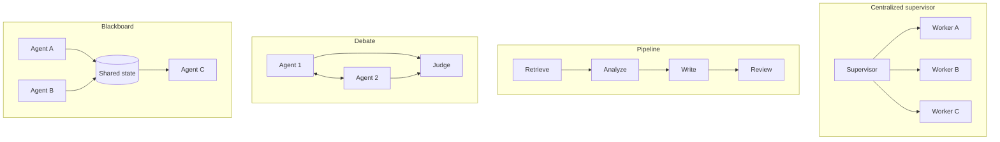

# Multi-agent systems

> **One-line summary**: Multi-agent replaces "one model does everything" with "several roles share the work". The real gains are **context isolation, specialization, parallelism, and cross-checking**; the price is **communication cost, unpredictability, and debugging difficulty**. It is an architectural choice, not an upgrade in capability.
>
> **Keywords**: `multi-agent` `supervisor` `handoff` `debate` `blackboard` `A2A` `AutoGen` `CrewAI`

## 1. Core concepts

### 1.1 What multi-agent buys you (and what it does not)

| Gain | Mechanism | Precondition in practice |
|---|---|---|
| Context isolation | Each sub-agent sees only its own slice of context, undiluted by irrelevant information | The task really is decomposable and subtasks have few information dependencies |
| Specialization | Different roles use different system prompts, tool sets, or models | Role boundaries are crisp, otherwise it is the same model in a different costume |
| Parallelism | Subtasks run concurrently, cutting wall-clock time | Subtasks are independent and results can be merged |
| Cross-checking | Independent solutions are compared or debated, reducing single-point hallucination | There is a trustworthy way to arbitrate |
| Auditability | Each role's input and output can be inspected separately | You have tracing in place |

**What it does not buy**: splitting into 5 agents does not raise model IQ, and it adds communication error. Papers and engineering practice repeat the same point: **for most tasks, a single agent with good tools and a good prompt is the better deal**.

### 1.2 When not to go multi-agent

| Signal | Why |
|---|---|
| Strongly sequential task with tightly coupled information | After splitting, every agent reloads the full context, so communication cost exceeds the gain |
| Latency sensitive | Multiple message rounds and model calls multiply P95 latency |
| Budget sensitive | Multi-agent token use is often several to a dozen times that of a single agent (Anthropic reports its multi-agent research system consumes about 15x the tokens of chat) |
| Strong consistency required | Several agents writing the same state conflict easily |
| The team has no tracing capability | When it breaks, nobody can tell which role is at fault |

A one-line test: **"after splitting, can every subtask be completed independently and verified?"** If not, do not split.

### 1.3 Five collaboration topologies



| Topology | Control flow | Strengths | Weaknesses | Typical use |
|---|---|---|---|---|
| Centralized supervisor | One orchestrator dispatches and aggregates | Clear control, easy to terminate, easy to audit | The supervisor becomes a bottleneck and a single point of failure | Research assistants, well-partitioned complex tasks |
| Pipeline | Fixed sequential hand-off | Simple, predictable, easy to test | Inflexible; early errors propagate forward | Content production, ETL-like flows |
| Debate | Roles critique each other, a judge decides | Surfaces errors, improves factuality | Expensive, can converge on a shared mistake | Fact-checking, high-stakes decisions |
| Blackboard | Shared state, anyone with the ability writes | Loose coupling, easy to extend | Hard to keep consistent, easy to overwrite each other | Multi-tool collaboration, incremental builds |
| Handoff | Transfer control to another agent on demand | Fits specialization, context can be trimmed | Ping-pong and loops are common | Support routing, Copilot expert switching |

## 2. Principles and derivations

### 2.1 Communication cost model

With $n$ agents each sending one message per round, a fully connected topology yields:

$$
M_{\text{full}} = O(n^2), \qquad
\text{tokens} \approx M \times \bar{L} \times (1 + r_{\text{ctx}})
$$

where $\bar{L}$ is the average message length and $r_{\text{ctx}}$ is the context inflation attached to each message (multi-agent setups often ship the shared history along). That explains why "one more agent" does not add cost linearly but roughly quadratically.

**Three ways to save cost**: (1) replace full connectivity with a centralized star ($2n$ edges); (2) send **structured summaries** instead of the full context; (3) cap rounds and message length, and stop early when there is no progress.

### 2.2 Communication mechanisms: messages, shared state, protocols

- **Message passing**: A's output becomes B's input (most common, simple, but with serialization overhead).
- **Shared state (blackboard)**: all agents read and write the same state (for example LangGraph's State). The upside is that you do not ship the full context point to point; the downside is concurrent write conflicts and the loss of control that comes with "anyone can change it".
- **Protocol layer**: **A2A (Agent2Agent)**-style protocols try to standardize **capability discovery, task delegation, and state synchronization** between agents. Note the division of labor with **MCP**: MCP covers "how an agent uses tools and data", A2A covers "how agents collaborate". A2A is still early, so in an interview the right level is "the direction plus how it differs from MCP".
- **Context isolation is the key design variable**: feeding each agent only the slice it needs is the only move that lowers cost and raises accuracy at the same time.

### 2.3 Task allocation

| Approach | How it works | Strengths | Weaknesses |
|---|---|---|---|
| Static roles | Predefine each agent's responsibility (CrewAI roles) | Predictable, prompts can be deeply optimized | Inflexible, edge cases have nowhere to go |
| Dynamic supervisor | The orchestrator picks the next executor from the current state | Flexible, handles the long tail | Depends on the orchestrator's judgment, easily overloaded |
| Capability routing | Match sub-agents by tool or domain tags | Simple and efficient | Tag maintenance cost, cross-domain tasks are hard |

The most common allocation mistake: **one model playing several roles while sharing one context**. That is just "many calls", with none of the isolation benefit.

### 2.4 Consensus and conflict resolution

**Voting**: every agent returns an answer with a confidence, aggregated with weights:

$$
\hat{y} = \arg\max_{y} \sum_{i=1}^{n} w_i \cdot \mathbb{1}[y_i = y]
$$

The weights can be model confidence, historical accuracy, or role trust. **Caution**: if several agents share the same base model and the same prompt template, their errors are highly correlated and voting gains are far smaller than an ensemble of independent models.

**Debate**: multiple rounds of mutual questioning, converging on "agreement", "maximum rounds", or "a stable judge verdict". It works when errors can be exposed by argument (facts, logic) and participants do not share identical information. On subjective preference questions, debate just argues in circles.

**Arbitration**: appoint a judge (a stronger model, rules, or a human) and give it explicit criteria (for example: cited sources win, passing tests win).

**Conflict types and handling**:

| Conflict | Example | Handling |
|---|---|---|
| Factual | Two agents retrieve different numbers | Check the source, compare recency, defer to raw data |
| Plan | Two agents want to edit the same file | Serialize plus optimistic locking (version number) |
| Goal | One wants speed, one wants completeness | Resolve with the higher-level objective and explicit priorities |
| Responsibility | Everyone denies failing | Attribute to a specific step using the trace |

### 2.5 Typical failure modes

| Failure mode | Symptom | Mitigation |
|---|---|---|
| Delegation loop | A hands to B, B hands back to A | Cap delegation counts and disable the return edge |
| Endless group chat | Everyone talks, nothing ends | Max rounds plus judge termination plus budget cap |
| Context contamination | One agent's wrong conclusion is taken as fact by others | Conclusions must carry evidence and sources, traceably |
| Diffused responsibility | Nobody owns the final result | Appoint an explicit final owner (usually supervisor or judge) |
| Premature convergence | The group immediately agrees with the first speaker | Let everyone answer independently before aggregating (avoid anchoring) |
| Cost explosion | Many rounds, duplicated context | Star topology, summary passing, early stopping |

### 2.6 Framework implementation notes

| Framework | Multi-agent abstraction | Key point |
|---|---|---|
| AutoGen | ConversableAgent + GroupChat + speaker selection | A selector picks the next speaker; always set max_round and termination conditions |
| CrewAI | Agent(role/goal/backstory) + Task + Process | sequential and hierarchical processes; role descriptions drive quality |
| LangGraph | Nodes + conditional edges + global State + Command | The supervisor pattern is most common; State is shared memory, watch concurrent writes |
| OpenAI Agents SDK | Agent + handoff + guardrail | A handoff transfers control plus context to another agent; lightweight and clear |

**Common denominator**: every framework reduces to "state + routing function + termination conditions", packaged as an API. Explaining those three things beats reciting APIs.

### 2.7 Evaluation

| Metric | Description |
|---|---|
| Task success rate | Whether the task completes end to end; run several times and report pass@1 / pass^k |
| Cost | Tokens per task, model calls, message count |
| Latency | Wall-clock time (only parallelism gives an edge) |
| Round efficiency | Rounds used divided by the theoretical minimum |

## 3. Implementation notes

A LangGraph supervisor skeleton:

```python
from typing import TypedDict

class State(TypedDict):
    task: str
    history: list        # structured summaries only, to keep the context from inflating
    next_worker: str
    rounds: int

def supervisor(state: State) -> State:
    if state["rounds"] >= 8 or judge_done(state):       # termination conditions
        return {**state, "next_worker": "FINISH"}
    pick = llm.route(state["task"], state["history"], workers=WORKERS)
    return {**state, "next_worker": pick}

def worker_node(name):
    def run(state: State) -> State:
        out = workers[name].run(state["task"], context=state["history"][-3:])
        return {**state, "history": state["history"] + [summarize(out)],
                "rounds": state["rounds"] + 1}
    return run

for w in WORKERS:
    graph.add_node(w, worker_node(w))
    graph.add_edge(w, "supervisor")                     # return to the scheduler when done
graph.add_conditional_edges("supervisor", lambda s: s["next_worker"],
    {**{w: w for w in WORKERS}, "FINISH": END})
```

## 4. Interview Q&A

### Q1. Are multi-agent systems always better than a single agent?
**Answer**: No. On most tasks a single agent with good tools is cheaper, more controllable, and easier to debug. Multi-agent only pays off under specific conditions: the task splits into subtasks with **few information dependencies**, you need **different tools and roles**, or you need **independent verification**. Anthropic's multi-agent research system performs better but uses about 15x the tokens of ordinary chat and is a poor fit for strongly dependent tasks (most coding, for example).
**Follow-up**: When is it worth it? Research-style, breadth-first, parallelizable information gathering, and high-stakes cases that need "generate plus independent review".

### Q2. How do you estimate multi-agent communication overhead?
**Answer**: With full connectivity the message count is $O(n^2)$ and each message carries context, so token cost grows roughly quadratically. Therefore prefer **star or hierarchical topologies** ($2n$ edges), send **structured summaries** instead of full history, and cap rounds and message length. Evaluate with "tokens per task" and "share of useful information".
**Follow-up**: How do you decide whether one more agent is worth it? Ablate it: remove the agent and measure how much success rate and cost change.

### Q3. How do you prevent multi-agent loops or endless discussion?
**Answer**: Four layers of termination: (1) max rounds (hard cap); (2) budget cap (tokens, cost, time); (3) convergence criteria (a stable judge verdict, consistent votes, no new information); (4) loop detection (the same delegation or the same argument recurring). Also appoint a **final owner** so somebody closes the loop.
**Follow-up**: Why is a max round count not enough? It is only a backstop; a legitimate task that needs 10 rounds would be killed, so you also need convergence criteria.

### Q4. When does debate help?
**Answer**: When **errors can be exposed by argument** and participants **do not hold identical information**: fact-checking, mathematical reasoning, trade-off analysis. Multiple rounds of questioning surface omissions and misquotes. It does nothing for subjective preferences, and if all agents share the same base model, prompt, and retrieval source, their errors are highly correlated and the debate just fails together.
**Follow-up**: How do you make debate more effective? Use different evidence sources or models, require citations, appoint an independent judge, cap rounds, and detect "no new argument".

### Q5. Single agent with many tools, or multiple agents? How do you choose?
**Answer**: Three dimensions. (1) **Does context contaminate itself** (too many tools to fit or they interfere with each other → split). (2) **Do you need parallelism** (independent, slow subtasks → split). (3) **Do you need independent verification** (high stakes → split into generate plus review). If none applies, stay single-agent. Team capability matters too: without tracing and evaluation, multi-agent debugging costs run away.
**Follow-up**: A middle ground? "One controlling agent plus a few dedicated sub-agents (retrieval, code execution)", balancing control and cost.

### Q6. How do you attribute failures in a multi-agent system?
**Answer**: Through tracing: every role, call, and message gets a span recording an input summary, output, tool results, tokens, and latency. When it fails, locate **the earliest node that produced a wrong conclusion**, not just the final output. Typical attribution buckets: routing error (wrong role), execution error (tool or arguments), information-passing error (the summary dropped key facts), coordination error (an unresolved conflict).
**Follow-up**: Is there a public failure taxonomy? Research groups multi-agent failures into specification, coordination, and verification categories (MAST-style work); mentioning that "there is systematic failure-classification research" is enough.

### Q7. What is the difference between A2A and MCP?
**Answer**: MCP solves "how an agent connects to tools and data sources" (vertical: agent to tool); A2A-style protocols solve "how agents discover each other, delegate tasks, and synchronize state" (horizontal: agent to agent). The former is already a de facto standard; the latter is still early. They are complementary: an agent uses tools through MCP and collaborates with other agents through A2A.
**Follow-up**: Why are agent-to-agent protocols harder? They involve identity, permissions, billing, and responsibility boundaries, not just message formats.

### Q8. How do you optimize the cost of a multi-agent system?
**Answer**: (1) Topology: star or hierarchy instead of full connectivity. (2) Passing: structured summaries instead of full context. (3) Model tiers: a strong model for scheduling, cheaper models for execution. (4) Parallelism: run independent subtasks concurrently to cut wall-clock time. (5) Early stopping: stop at convergence. (6) Caching: reuse results of identical subtasks. (7) Pruning: route to the most likely role first instead of broadcasting to everyone.
**Follow-up**: In what order? Cut useless rounds and duplicated context first (largest gain), then consider swapping models.

### Q9. How do you handle permissions and security in a multi-agent system?
**Answer**: (1) **Least privilege per role** (a retrieval agent is read-only; only an execution agent may write). (2) **Tool allowlists** per role so not every agent shares every tool. (3) **Restrict writes to shared state** (for example, only the supervisor may change the plan). (4) Human confirmation for critical actions. (5) Audit each agent's call chain so responsibility is traceable.
**Follow-up**: Why not let all agents share one credential? If one agent gets injected, the blast radius is the whole system.

## 5. Pitfalls and follow-ups

- **Calling one model multiple times "multi-agent"**: without role and information isolation, the gain is near zero.
- **No termination conditions**: the group chat runs forever; always have rounds, budget, and convergence.
- **Sharing the full context with every agent**: cost explodes and agents contaminate each other.
- **Debating with the same model and prompt**: correlated errors make debate useless.
- **Follow-up trap**: "Why didn't you use multi-agent?" Give a clear criterion instead of "because it is complex".

## 6. Cheat sheet

| Question | One-line answer |
|---|---|
| Where gains come from | Context isolation, specialization, parallelism, cross-checking |
| When not to use | Tightly coupled tasks, latency or budget sensitive, no tracing |
| Cost law | Full connectivity is $O(n^2)$, a star is $O(n)$ |
| Most common topology | Supervisor (centralized) plus handoff |
| Termination | Rounds plus budget plus convergence plus loop detection |
| Protocol split | MCP for tools, A2A for agent-to-agent |
| Must-report metrics | Success rate, tokens per task, latency, attribution ability |

**Mnemonic**: "**Do not split if you can avoid it; if you split, split cleanly (roles, context, permissions), and make sure someone closes the loop.**"

## 7. References

- [AutoGen: Enabling Next-Gen LLM Applications via Multi-Agent Conversation](https://arxiv.org/abs/2308.08155)
- [MetaGPT: Meta Programming for Multi-Agent Collaborative Framework](https://arxiv.org/abs/2308.00352)
- [Anthropic · How we built our multi-agent research system](https://www.anthropic.com/engineering/multi-agent-research-system)
- [Why Do Multi-Agent LLM Systems Fail?](https://arxiv.org/abs/2503.13657)
- [AI Agent Interview Guide · multi-agent](https://github.com/bcefghj/ai-agent-interview-guide)
