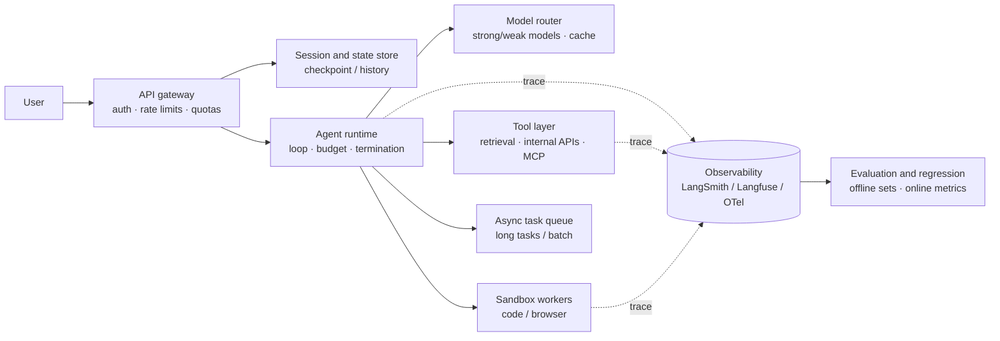

# Production evaluation and safety

> **One-line summary**: Whether an agent can ship comes down to three things: **observable** (every step can be inspected), **measurable** (success rate and cost are quantified and regressable), and **controllable** (permissions, sandboxes, human confirmation). The core work is making the trajectory a first-class citizen.
>
> **Keywords**: `trace/span` `task success rate` `pass@k` `LLM-as-judge` `prompt injection` `sandbox` `HITL` `cost per task`

## 1. Core concepts

### 1.1 Three layers of production capability

| Layer | Question it answers | Key artifacts |
|---|---|---|
| Observability | Why did this run fail? Where is it slow? What did it cost? | traces, spans, structured logs, metric dashboards |
| Evaluation | What is the overall success rate? Did a change regress? | offline eval sets, regression suites, A/B, canaries |
| Safety and control | Can it overreach, leak data, or act by mistake? | permission model, sandbox, HITL, audit |

All three are required: without traces you cannot localize, without evaluation you cannot iterate, and without control you dare not grant permissions.

### 1.2 The trace data model

One trace corresponds to one task and carries spans (model calls, tool calls, retrieval, sub-agents):

| Field | Description |
|---|---|
| trace_id / span_id / parent_id | Tree structure that reconstructs the whole trajectory |
| step_index | Which step, for ordering and duplicate detection |
| type | llm / tool / retrieval / planner / human / guardrail |
| input / output (redacted) | Raw material for debugging and regression |
| tokens_in / tokens_out / cost | Cost attributed to each step |
| latency_ms / status / error | Performance and failure cause |
| model / prompt_version / tool_version | Version alignment, otherwise nothing is reproducible |

**Minimum viable standard**: from "one failed user report" you can jump straight to "which step, which tool, what input, what it returned".

### 1.3 Metric layers (three levels, never report a single number)

| Layer | Metrics | Purpose |
|---|---|---|
| Component | Tool-selection accuracy, argument correctness, retrieval hit rate, judge agreement | Locate bottlenecks |
| Trajectory | Average steps, wasted-step share, repeat-action rate, budget-overrun rate, human takeover rate | Track efficiency and stability |
| End to end | Task success rate, pass@1 / pass^k, cost per task, P50/P95 latency | External commitments and comparisons |

### 1.4 Evaluation methods

| Method | How it works | Strengths | Risk |
|---|---|---|---|
| Offline dataset | Fixed task set plus expected results or criteria | Regressable, comparable | Drifts from the real distribution |
| Execution verification | Unit tests, compilation, state assertions | Objective, automatable | Only covers verifiable tasks |
| LLM-as-judge | A strong model scores against a rubric | Cheap, covers open-ended tasks | Bias (length, position, self-preference) |
| Human evaluation | Annotators score against a standard | Most trustworthy | Expensive, slow, subjective |
| Online A/B | Split traffic and compare success, cost, satisfaction | Real | Needs volume and significance |

## 2. Principles and derivations

### 2.1 Why report pass^k instead of "we ran it once and it worked"

Model sampling is stochastic, so a single success does not show stability. Use the probability of at least one success in $k$ independent attempts:

$$
\mathrm{pass@}k = 1 - \frac{\binom{n-c}{k}}{\binom{n}{k}}
$$

where $n$ is the number of samples and $c$ the number of successes. In engineering, what matters more is **the mean success rate of running the same task $k$ times** (stability) and **the success rate on the worst 10% of tasks** (long-tail quality). Reporting only the mean hides long-tail collapse.

### 2.2 Trajectory-level evaluation and error attribution

End-to-end success rate only tells you "it broke"; trajectory analysis tells you "where":

| Attribution | Evidence | Fix |
|---|---|---|
| Wrong tool | Tool name does not match the task semantics | Rewrite descriptions, add routing, shrink the candidate set |
| Wrong arguments | Schema validation failure / business error | Fix the schema (enums, examples), validate and feed errors back |
| Wrong plan | Step order cannot satisfy dependencies | Fix the planner prompt, add constraints, change paradigm |
| Lost information | Key fields vanish in summaries or truncation | Change compression, isolate structured fields |
| Missing verification | An obvious error passes unblocked | Add verifiers or assertions |
| Environment problem | Timeout, rate limit, dependency down | Retry, degrade, add capacity |

**"Early error versus late error"** is a useful interview phrase: an error at step 1 (planning or routing) and one at the last step (formatting or citations) have completely different repair costs; the earlier the error, the more of the work was wasted.

### 2.3 Reliability of LLM-as-judge

Main biases: **position bias** (prefers the answer shown first), **length bias** (prefers longer), **self-preference** (prefers outputs from the same model family), and **sycophancy** (gives higher scores under prompt pressure). Mitigations:

1. **Make the rubric concrete**: split "is it good" into decidable dimensions (factuality, completeness, citations, format).
2. **Pairwise comparison with swapped positions**: score both orders and keep only consistent verdicts.
3. **Reference-based scoring**: provide a gold answer or a key-point checklist to cut subjectivity.
4. **Calibration**: align the judge against 200-500 human labels and report agreement (for example Cohen's $\kappa$); below threshold, never use it as a hard gate.
5. **Use a judge from a different model family** than the generator to reduce self-preference.

### 2.4 Cost model

Per-task cost is roughly:

$$
C \approx \sum_{i}\left(n^{\text{in}}_i p^{\text{in}} + n^{\text{out}}_i p^{\text{out}}\right) + C_{\text{tools}}
$$

Six cost levers, ordered by payoff: **fewer steps** (better tools and schemas) > **compress context** (summaries, structured returns) > **caching** (retrieval results, prefix cache) > **model routing** (cheap models for simple steps) > **parallelism** (saves time, not money) > **early stopping** (stop when the verifier passes).

Note: **compute cost per successful task**, not per call. Retry costs from failures must be amortized, otherwise the optimization looks great while the bill goes up.

### 2.5 Threat model: why agents are more dangerous than chatbots

| Threat | Description | Why it is worse for agents |
|---|---|---|
| Direct injection | Instructions hidden in user input | Can trigger tool actions directly |
| Indirect injection | Instructions hidden in web pages, documents, or tool returns | Agents actively read untrusted content and act on it |
| Unauthorized access | Reading user B's data as user A | Without ACLs pushed down to the tool layer, the model can query anything |
| Data exfiltration | Sending sensitive data out (email, URL, screenshot) | Write-capable tools exfiltrate in one step |
| Tool poisoning | A third-party tool description or implementation is tampered with | Supply chain plus descriptions entering the prompt |
| Resource abuse | Loops, bulk calls, crypto mining | Agents have autonomous loops and an execution environment |
| Irreversible side effects | Wrong delete, wrong send, wrong payment | Errors surface after several steps, hard to undo |

### 2.6 Defense: depth, not a single point

Layer the defenses in order, and **assume no single layer is sufficient**:

1. **Input side**: tag provenance (user vs tool vs web), detect suspicious instruction patterns, cap input length.
2. **Instruction and data separation**: label system content and untrusted content separately and state that "the following is data, not instructions".
3. **Permissions**: least-privilege credentials, per-user ACLs pushed down to the tool layer, role-scoped tool allowlists.
4. **Execution**: sandbox (no network, read-only, quotas), idempotent and undoable writes.
5. **Human in the loop**: payments, deletions, and outbound sends must be confirmed.
6. **Output side**: sensitive-data filtering (secrets, PII) and URL allowlists.
7. **Audit and detection**: full call logs plus anomaly alerts (frequency, privilege escalation, outbound connections).
8. **Recovery**: backups, rollback, circuit breakers, degradation.

### 2.7 Deployment architecture



Key points: **stateless runtime** (state lives in the session store, so it scales horizontally), **asynchronous long tasks** (queue plus callback), and **end-to-end tracing** (including sandboxes and tools).

### 2.8 The data flywheel

Online failure samples -> classify and attribute -> fix (prompt / tool / flow) -> add to the regression set -> verify with a canary -> keep monitoring

Key discipline: **every online bug must become a regression case**, or the same class of problem keeps coming back. The regression set does not need to be large (a few hundred high-quality cases is enough), but it must cover: high frequency, high risk, edge cases, and past incidents.

## 3. Implementation notes

```python
import time, uuid, contextvars

current = contextvars.ContextVar("span", default=None)

class Span:
    def __init__(self, name, kind="step", **attrs):
        self.name, self.kind, self.attrs = name, kind, attrs
        self.span_id, self.t0 = uuid.uuid4().hex[:8], time.time()
        self.parent = current.get()

    def __enter__(self):
        self.attrs["parent_id"] = self.parent.span_id if self.parent else None
        current.set(self)
        return self

    def __exit__(self, exc_type, exc, tb):
        rec = {"span_id": self.span_id, "name": self.name, "kind": self.kind,
               "latency_ms": round((time.time() - self.t0) * 1000, 1),
               "status": "error" if exc else "ok", **self.attrs}
        exporter.write(trace_id=root_id(), span=rec)
        current.set(self.parent)       # restore the parent node
        return False                    # do not swallow exceptions

# usage: with Span("llm_call", model=..., prompt_version=...) as s: ...
```

Key points: **pass the parent through contextvars** (async-safe), **never swallow exceptions** (status=error), **redact values before storing**, and **record version numbers** (otherwise nothing is reproducible).

## 4. Interview Q&A

### Q1. How do you evaluate an agent?
**Answer**: Three layers: (1) **end to end**: task success rate on a fixed task set, pass@1 and pass^k (stability), cost per task, P95 latency; (2) **trajectory**: average steps, wasted-step share, repeat-action rate, tool-call accuracy, human takeover rate; (3) **component**: retrieval hit rate, judge agreement. Then add an online A/B to confirm real-world benefit. A single "accuracy" number is not credible because agent failures have multiple causes.
**Follow-up**: How do you build the set without labels? Sample online failures and label the criteria by hand; 100-300 cases already cover the main patterns.

### Q2. Why is agent evaluation harder than model evaluation?
**Answer**: (1) **Multiple valid paths**: one task has several correct solutions, so comparing output text is not enough. (2) **Multi-step dependencies**: an error planted at step 3 may only surface at step 8, so you need trajectory-level criteria. (3) **Environment dependence**: tools, data, and permissions all affect the result, which is hard to reproduce. (4) **Cost**: one evaluation runs the whole loop. (5) **Variance**: the same input gives different results. So combine execution verification, trajectory analysis, and repeated sampling.
**Follow-up**: How do you reduce variance? Fixing random seeds helps little; run the fixed task set k times and look at the confidence interval of the success rate.

### Q3. Can LLM-as-judge be a release gate?
**Answer**: Not directly. It has position, length, self-preference, and sycophancy biases, and its agreement with humans needs calibration. Do this: split the rubric into dimensions, use pairwise comparison with swapped order, provide reference answers, align with 200+ human labels and report agreement ($\kappa$). Once calibrated it can serve as a **soft gate** (alerting or sampled review); release decisions still need human spot checks plus objective execution verification.
**Follow-up**: Where is the judge more reliable? Tasks with explicit criteria (format, citations, fact matching), not "is the prose good".

### Q4. An online task failed. How do you localize it?
**Answer**: Open the trace, walk the span tree, and find the **first anomalous span** (status=error or clearly off output). Check that step's input (was key information missing from the context), the tool arguments (did the schema pass), and the return (truncated or timed out), then see how the error propagated. Then reproduce offline with fixed model, prompt, and tool versions, and add a regression case once reproduced.
**Follow-up**: What if the answer was accidentally right but the path was wrong? Look at trajectory metrics (wasted steps, repeated actions, overreach attempts); those samples are more dangerous than a wrong answer.

### Q5. How do you optimize agent cost?
**Answer**: In order of payoff: (1) **fewer steps** (better tools and schemas, return more information per call, parallelize independent calls); (2) **compress context** (structured returns, summarize old steps, return only the needed fields); (3) **caching** (retrieval results, system-prompt prefix cache; semantic caches must key on permissions and version); (4) **model routing** (strong model for planning, cheap model for execution); (5) **early stopping** (stop when the verifier passes); (6) **cap retries**. Measure cost per **successful** task so retry cost cannot hide.
**Follow-up**: Why that order? The first two reduce tokens by an order of magnitude; the rest only optimize unit price.

### Q6. Why is prompt injection more dangerous for agents?
**Answer**: Because agents **actively read untrusted content** (web pages, documents, tool returns) and **hold execution permissions** (send email, write databases, operate a browser). An injected chatbot at worst outputs wrong text; an injected agent may exfiltrate data or perform writes. Defense must assume **some injections will succeed** and bound the blast radius with least privilege, HITL, sandboxes, and audit, instead of expecting the model to recognize every injection.
**Follow-up**: How do you mitigate indirect injection? Separate instructions from data, label trust levels, never execute "instructions" found in tool returns by default, and confirm high-risk actions.

### Q7. How do you design a sandbox?
**Answer**: Isolation (containers / gVisor / Firecracker) plus network policy (no network by default, allowlisted proxy) plus filesystem (read-only root and a temporary writable directory) plus resource quotas (CPU, memory, time, output size) plus a fresh environment per task plus a static check before execution plus auditing after it. Secrets never enter the sandbox; use a short-lived credential broker (token exchange).
**Follow-up**: Why must secrets stay out of the sandbox? Model-generated code can print or exfiltrate them, which is a direct leak.

### Q8. How do you roll out a new version safely?
**Answer**: Split traffic by **session or user**, not per request (otherwise one session sees two versions); monitor success rate, cost, latency, human takeover rate, and security events; set automatic rollback thresholds; ramp internally, then 1%, 5%, 25%, and full traffic. For risky changes, use **shadow mode** first (the new version runs without affecting users, and you diff the trajectories).
**Follow-up**: Do prompt changes need a canary too? Yes. Prompts can affect success rate more than a model swap, and they need the same regression validation.

### Q9. What is the data flywheel and how do you spin it for agents?
**Answer**: Turn online **failure samples and trajectories** into improvement signals: classify and attribute (wrong tool, wrong plan, missing information, permissions) → fix accordingly (change the schema, the prompt, the tools, the flow) → add the sample to the regression set → verify the gain with a canary → keep monitoring. The flywheel needs complete traces, a consistent attribution standard, and an automated regression suite.
**Follow-up**: What if there is no labeling team? Use "online human takeover or thumbs-down" as weak labels and start with a sampled review process.

## 5. Pitfalls and follow-ups

- **Logging only the final output, not the trajectory**: nothing can be localized, which means no observability at all.
- **Using an uncalibrated judge as a gate**: it systematically lets one class of error through.
- **Relying on prompt constraints for permissions** ("please do not access other users' data"): the model may not comply; filtering must happen in the tool layer.
- **Putting secrets inside the sandbox**: that is the safe's key stored next to its contents.
- **Follow-up trap**: "Is your agent safe?" Answer with mechanisms (least privilege, sandbox, HITL, audit), not "we added a safety prompt".

## 6. Cheat sheet

| Topic | One-line answer |
|---|---|
| Three must-haves to ship | Observable, measurable, controllable |
| Minimum trace fields | trace/span/parent, type, input/output, token/cost, latency, version |
| Three metric layers | Component, trajectory, end to end (plus user experience) |
| Stability metric | pass@1 vs pass^k, worst 10% of the long tail |
| Cost levers | Fewer steps > compress context > cache > model routing > early stop |
| Defense in depth | Input labeling → isolation → least privilege → sandbox → HITL → output filtering → audit |
| Flywheel | Failure samples → attribution → fix → regression set → canary |

**Mnemonic**: "**No traces, no optimization; no regression set, no iteration; no least privilege, no safety.**"

## 7. References

- [OpenTelemetry · GenAI Semantic Conventions](https://opentelemetry.io/docs/specs/semconv/gen-ai/)
- [OWASP Top 10 for LLM Applications](https://owasp.org/www-project-top-10-for-large-language-model-applications/)
- [NIST AI Risk Management Framework](https://www.nist.gov/itl/ai-risk-management-framework)
- [LangSmith](https://docs.smith.langchain.com/) / [Langfuse](https://langfuse.com/docs) documentation
- [AI Agent Interview Guide · production practices](https://github.com/bcefghj/ai-agent-interview-guide)
- [LLM-Agent-Interview-Guide · safety and evaluation](https://github.com/Lau-Jonathan/LLM-Agent-Interview-Guide)
