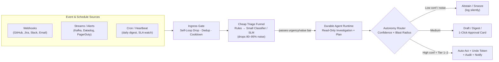

# Proactive, Event-Driven, and Ambient Agents

> **One-line summary**: Reactive agents wait for a user prompt; **proactive (ambient) agents** listen to event streams, schedules, and state changes — deciding *whether* to act, *how* to act, or *to stay silent*. In production, the hard problems are **precision over recall** (preventing alert fatigue), **event-storm & causal-loop prevention**, and **stale-state checks** before execution.
>
> **Keywords**: `proactive agent` `ambient agent` `event-driven` `alert fatigue` `autonomy spectrum` `triage funnel` `causal loop` `abstention` `optimistic concurrency`

## 1. Core concepts

Most real enterprise value sits outside chat boxes: triaging PagerDuty incidents at 3 AM, reviewing incoming PRs, chasing stalled customer tickets, monitoring fraud/drift alerts, or preparing daily executive digests. That shifts the architecture from **request-response** to **event-driven ambient execution**.



| Dimension | Reactive (Chat) Agent | Proactive / Ambient Agent |
| --- | --- | --- |
| Trigger | Explicit human prompt | Webhook, Kafka event, metric anomaly, cron/heartbeat |
| User tolerance for errors | Moderate (user is watching and steering) | **Very low** — uninvited false alarms rapidly trigger mute/uninstall |
| Primary metric | Task success rate & latency | **Precision**, **action acceptance rate**, **dismissal/mute rate**, cost per useful intervention |
| Scaling risk | Concurrent human users | **Event storms** (10k alerts in 1 min) & **infinite self-triggering loops** |
| First-class exit | Answer the user | **`no_action` / `snooze`** (knowing when *not* to interrupt) |

## 2. Principles and derivations

### 2.1 The economics of interruption (why Precision > Recall)

In a proactive system, every notification or autonomous action imposes an **interruption or cleanup cost** $C_{\mathrm{false}}$ on a busy human, while a useful intervention yields value $V_{\mathrm{true}}$. Act or interrupt only when expected net utility is positive:

$$
\mathbb{E}[\mathrm{Utility}] = p \cdot V_{\mathrm{true}} - (1 - p) \cdot C_{\mathrm{false}} > 0 \quad\Longleftrightarrow\quad p > \frac{C_{\mathrm{false}}}{V_{\mathrm{true}} + C_{\mathrm{false}}}
$$

- **Urgent outage root-cause** ($V_{\mathrm{true}}$ huge): moderate precision threshold is acceptable.
- **Slack DM / email draft nudge** ($C_{\mathrm{false}}$ high due to attention tax): require very high precision (often $>85\text{–}90$%) or downgrade to an **async daily digest** ($C_{\mathrm{false}} \approx 0$).
- **Interruptibility budget**: cap proactive interruptions per user/channel per day (e.g., max 3 real-time nudges/day; overflow coalesces into a single digest).

### 2.2 The graduated autonomy spectrum

Never launch a proactive agent at full autonomy on Day 1. Production teams ramp along four levels per workflow, promoted only when offline + shadow precision exceeds target bars:

| Level | Mode | What the agent does | How trust is earned |
| --- | --- | --- | --- |
| **L0** | Shadow / Silent | Runs in background, logs proposed action/diagnosis; user sees nothing | Compare logged proposals against what humans actually did (offline precision/recall) |
| **L1** | Draft & Digest | Pre-writes PR comment, incident summary, or email draft; delivered in batch or when user opens the app | Measure **draft adoption / edit-distance rate** with zero interruption cost |
| **L2** | Notify & Propose (HITL) | Sends interactive card (Slack/Teams/UI) with evidence + 1-click **Approve / Edit / Dismiss / Snooze** | Measure **accept vs. dismiss rate**; dismissals feed directly into the triage eval set |
| **L3** | Guarded Auto-Act | Executes reversible Tier 1–2 actions automatically (e.g., auto-label, restart stateless pod, revert bad flag) with undo link + audit | Track **revert / rollback rate** (<1% bar) and automated circuit breakers |

### 2.3 Multi-stage triage funnel (controlling cost under event volume)

Invoking a frontier reasoning model on every raw webhook or log line is financially ruinous. Filter in three cheap-to-expensive stages:

1. **Stage 1 — Deterministic ingress (<1 ms, USD 0)**: drop self-authored events (loop guard), deduplicate identical event fingerprints, apply per-entity **cooldown windows** (e.g., don't re-investigate the same failing service more than once per 15 min), and enforce hard entity/tenant rate limits.
2. **Stage 2 — Lightweight triage (50 ms, ~USD 0.0001)**: rules + small classifier or tiny LLM scores `(relevance, urgency, novelty)` and selects `drop` / `batch_for_digest` / `wake_agent`. Typically eliminates **80–95%** of raw events.
3. **Stage 3 — Full durable agent (seconds–minutes, USD 0.05–1)**: runs read-only investigation across tools (logs, git history, metrics, CRM) and emits either `no_action(reason)` or a structured proposal/action.

### 2.4 Four failure modes unique to proactive agents

1. **Causal infinite loops (echo chambers)**:
   - *Scenario*: Agent comments on a GitHub PR → GitHub fires `issue_comment` webhook → webhook wakes the agent again → infinite comments and spend spike.
   - *Fix*: Stamp every agent-created write with metadata (`x-agent-actor`, bot account ID, `correlation_id`, hop depth `depth <= max_hops`) and **drop self-triggered events deterministically at ingress**.
2. **Event storms & thundering herds**:
   - *Scenario*: A downstream DB blips, firing 2,000 alerts across 40 microservices in 30 seconds.
   - *Fix*: **Coalescing / debouncing windows** (group alerts by `service_id` or `incident_cluster` for 30–60 s before dispatching one agent run), global & per-tenant token-bucket budgets, and priority queues (P0 incidents preempt routine PR nudges).
3. **Stale context / world drift (TOCTOU)**:
   - *Scenario*: Proactive agent proposes rolling back commit `abc123` at 09:00; an engineer clicks **Approve** at 11:30, after two hotfixes were already deployed.
   - *Fix*: Attach **precondition assertions / ETags / version hashes** to every pending approval (`only execute if HEAD == abc123 and TTL < 30 min`). Re-verify world state immediately before execution; if drifted, re-plan or expire cleanly.
4. **Busywork / forced action bias**:
   - *Scenario*: An agent woken by a cron job feels "compelled" to file a ticket or message someone even when nothing is wrong.
   - *Fix*: Make **`no_action(reason)`** and **`snooze(duration, wake_condition)`** explicit first-class tools, reward correct abstention in the eval suite, and instruct the model that silence is the default outcome.

### 2.5 Proactive agent evaluation metrics

| Metric | Formula / meaning | Target signal |
| --- | --- | --- |
| **Intervention precision** | Useful interventions / total surfaced interventions | Primary north star (often >80–90%) |
| **Accept / Edit / Dismiss rate** | Share of L2 proposals accepted as-is, edited, or rejected | Directly tracks user trust & alert fatigue |
| **Mute / Opt-out rate** | Users disabling notifications or uninstalling the agent | Lagging guardrail — spike means alert fatigue |
| **Abstention accuracy** | Share of noise events correctly routed to `no_action` | Prevents wasted tokens and spam |
| **Revert rate (L3)** | Share of autonomous actions manually undone | Hard safety gate for L3 autonomy |
| **Time-to-triage / MTTR delta** | Reduction in incident/ticket resolution time vs. baseline | Real business ROI |

## 3. Implementation notes

Minimal event-driven ingress gate with self-loop protection, dedup/cooldown, and optimistic precondition verification:

```python
import time, hashlib

class ProactiveDispatcher:
    def __init__(self, agent_actor_id: str, cooldown_sec: int = 900, max_hops: int = 2):
        self.agent_actor_id = agent_actor_id
        self.cooldown_sec = cooldown_sec
        self.max_hops = max_hops
        self.last_seen: dict[str, float] = {}          # use Redis SET NX EX in prod

    def should_dispatch(self, event: dict) -> tuple[bool, str]:
        # 1. Causal loop guard: drop self-triggered or deep-hop events
        if event.get("actor_id") == self.agent_actor_id:
            return False, "drop: self-triggered event"
        if event.get("agent_hop_depth", 0) >= self.max_hops:
            return False, "drop: max causal hop depth reached"

        # 2. Dedup + cooldown per logical entity (e.g., repo + alert_type)
        fp = hashlib.sha256(f"{event['entity_id']}:{event['kind']}".encode()).hexdigest()
        now = time.time()
        if now - self.last_seen.get(fp, 0.0) < self.cooldown_sec:
            return False, "coalesce: entity in cooldown window"
        self.last_seen[fp] = now
        return True, "dispatch_to_triage"

def execute_approved_action(proposal, live_state_fn, tool_fn):
    # Optimistic concurrency / TOCTOU check before executing human-approved action
    if time.time() > proposal["expires_at"]:
        return {"status": "expired", "reason": "approval TTL exceeded"}
    if live_state_fn(proposal["entity_id"]) != proposal["expected_version"]:
        return {"status": "stale", "reason": "world state changed since proposal"}
    return tool_fn(**proposal["args"], idempotency_key=proposal["id"])
```

## 4. Interview Q&A

### Q1. How does designing a proactive (ambient) agent differ from designing a reactive chat agent?
**Answer**: Reactive agents start from explicit user intent and tolerate minor back-and-forth steering. Proactive agents wake on external events or schedules with **no human watching**, so three things dominate: (1) **precision over recall** (false alarms cause alert fatigue and uninstalls); (2) **multi-stage triage** (deterministic dedup/cooldown + cheap classifier before waking a frontier LLM); and (3) **distributed-systems hygiene** (causal-loop guards, storm coalescing, interruptibility budgets, and stale-state checks).

### Q2. How do you prevent a proactive agent from burning USD 10,000 during an incident alert storm or webhook loop?
**Answer**: Four layers: (1) **Self-loop guard** at ingress dropping any event carrying the agent's actor ID or exceeding `max_hops`; (2) **Debouncing & dedup** coalescing alerts per entity/service within a cooldown window; (3) **Token-bucket concurrency & spend circuit breakers** per tenant and globally; and (4) **Cheap pre-LLM triage** dropping 80–95% of low-signal events before the reasoning model runs.

### Q3. How do you roll out a proactive agent safely to an engineering or support org?
**Answer**: Climb the **autonomy ladder**: start in **L0 shadow mode** for 1–2 weeks to measure precision against historical human actions; graduate to **L1 silent drafts / daily digests** (zero interruption cost); move to **L2 interactive 1-click approval cards** once draft adoption is high; unlock **L3 auto-act** only for reversible Tier 1–2 actions with automatic rollback tokens and a <1% revert-rate gate.

### Q4. A human approves a proactive agent's proposal 2 hours late — what can go wrong and how do you handle it?
**Answer**: Classic **TOCTOU (Time-of-Check to Time-of-Use) drift** — the incident may already be resolved, the PR merged, or the customer already refunded, so blind execution corrupts state. Attach a **TTL expiry**, an **idempotency key**, and a **state version precondition** (ETag / commit SHA / ticket status) to every proposal, and re-verify right before execution; if drifted, abort cleanly and optionally re-triage.

### Q5. How do you stop a scheduled proactive agent from spamming users with low-value "busywork" updates?
**Answer**: Make `no_action(reason)` and `snooze(until)` explicit first-class tools, default to silence unless expected value exceeds the interruption threshold, enforce a per-user **interruptibility budget** (coalescing low-urgency items into a single digest), and include "do nothing" negative examples in the offline regression suite to track **abstention accuracy**.

## 5. Pitfalls and follow-ups

- **Waking a frontier model on every raw webhook**: Costs explode linearly with system noise; always place deterministic dedup + a cheap triage gate in front.
- **Forgetting self-loop headers on indirect side effects**: Even if Agent A ignores its own comments, Agent A editing a ticket can trigger Automation B which triggers Agent A — track `correlation_id` and `hop_depth` across services.
- **No user feedback loop on notifications**: Every proactive card needs 1-click **Useful / Not useful / Snooze** buttons wired back into the triage evaluation set and per-user preference profile.
- **Treating proactive recall as the top KPI**: High recall with 40% precision gets the agent muted within a week; optimize precision at an acceptable interruption budget first.

## 6. Cheat sheet

| Concept | Key practice |
| --- | --- |
| Interruption bar | Act only when $p > C_{\mathrm{false}} / (V_{\mathrm{true}} + C_{\mathrm{false}})$; **precision > recall** |
| Autonomy ladder | L0 Shadow → L1 Draft/Digest → L2 1-Click Approval → L3 Reversible Auto-Act + Undo |
| Triage funnel | Deterministic ingress (loop drop, dedup, cooldown) → cheap SLM/classifier → durable agent |
| Loop & storm defense | Tag `actor_id` + `hop_depth`, coalesce by entity, per-tenant token buckets & spend caps |
| Stale-state defense | Proposal TTL + state-version precondition (ETag/SHA) + idempotency key before execution |
| First-class silence | Explicit `no_action(reason)` and `snooze` tools; measure abstention accuracy & mute rate |

Mnemonic: **"Drop self-loops, coalesce storms, triage cheap, default to silence, climb the autonomy ladder, and re-check state before acting."**

## 7. References

- [Ambient Agents · LangChain Architecture Guide, 2025](https://blog.langchain.com/introducing-ambient-agents/)
- [Building Effective Agents · Anthropic Engineering](https://www.anthropic.com/engineering/building-effective-agents)
- [Temporal Event-Driven & Durable Workflows](https://temporal.io/)
- [Google SRE Workbook · Managing Alert Fatigue & On-Call Automation](https://sre.google/workbook/alerting-on-slo/)
