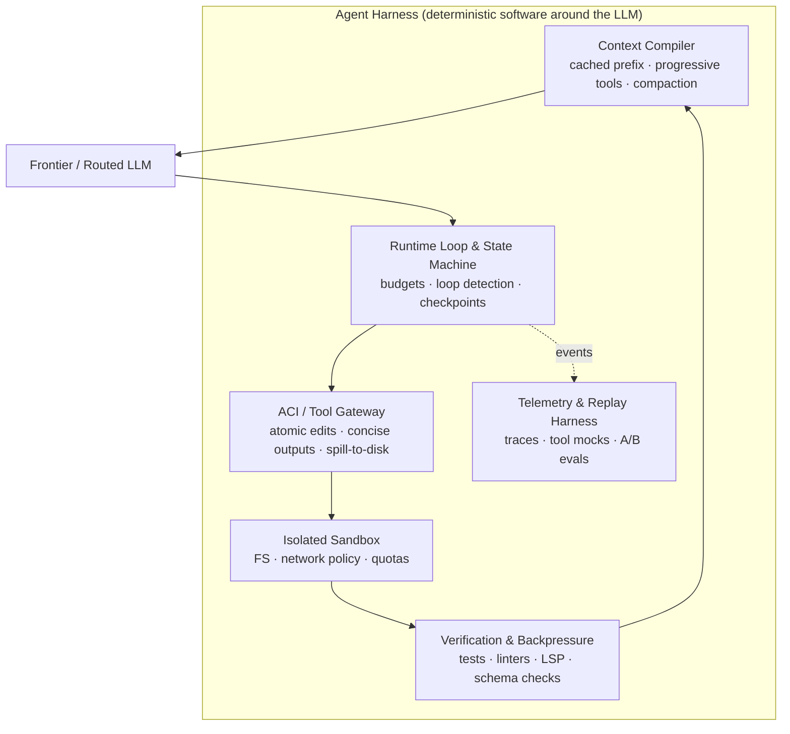

# Harness Engineering for Production Agents

> **One-line summary**: The **agent harness** is everything *around* the model — runtime loop, context compiler, Agent-Computer Interface (ACI), sandbox, deterministic verifiers, durable execution, and replay harness. In production, harness quality routinely swings end-to-end success by 15–30% on the exact same base model.
>
> **Keywords**: `agent harness` `ACI` `context compiler` `backpressure` `progressive disclosure` `sub-agent isolation` `durable execution` `record-replay`

## 1. Core concepts

A model checkpoint alone does not ship a reliable agent. Industry teams (coding agents, deep research, enterprise ops) increasingly separate **model capability** from **harness engineering**:



| Layer | Responsibility | Failure if poorly engineered |
| --- | --- | --- |
| **Context compiler** | Decides exact bytes entering every turn while preserving prompt cache | Cache misses (5–10× cost), context rot, lost early goals |
| **Agent-Computer Interface (ACI)** | Tool ergonomics tailored for LLMs rather than humans | Edit drift, token-bloated stdout, unrecoverable errors |
| **Backpressure / Verifiers** | Fast, objective signals (tests, types, schemas) after actions | Hallucinated "done", silent regressions, infinite guesswork |
| **Sub-agent isolation** | Runs noisy exploration in disposable child contexts | 50K lines of grep/HTML pollute the primary reasoning thread |
| **Durable execution & replay** | Checkpoints state and records tool I/O for deterministic replay | Crashes double-execute writes; impossible to debug regressions |

## 2. Principles and derivations

### 2.1 The "Bitter Lesson" of harness design: thin primitives over rigid scaffolding

Early agent stacks built sprawling 20-node hand-tuned prompt chains to compensate for weak models. As frontier reasoning and tool-use models improved, rigid scaffolding began **hurting** performance by blocking models from recovering naturally.

Industry best practice:
- **Start with a minimal, general loop + strong primitives** (filesystem read/search/edit, shell/sandbox, verifier, structured memory) rather than brittle hardcoded branches.
- **Re-test every heuristic on every model upgrade**: delete prompt hacks and extra routing hops that the newer model no longer needs — complexity compounds maintenance and latency.
- **Encode invariants in code, not prompts**: put hard constraints (budgets, schemas, permissions, stop rules, verification gates) in deterministic harness code; leave open-ended search and judgment to the model.

### 2.2 Agent-Computer Interface (ACI) design

Just as UX/UI governs human effectiveness, **ACI** (coined in SWE-agent / Anthropic agent engineering) governs model effectiveness:

1. **Design edit tools to prevent formatting and line-number errors**: raw `line_start..line_end` patching drifts after the first edit; search-and-replace blocks with exact unique context matching (or AST-aware edits) cut edit failures dramatically.
2. **Return concise, high-signal tool outputs**: cap raw stdout/search dumps (e.g., first/last $N$ lines + total line count) and **spill full payloads to a scratch file**, returning the path so the model can `grep` or slice only what it needs.
3. **Make errors self-healing**: return structured error codes plus the exact remediation hint (e.g., `"target string matched 3 locations at lines 14, 88, 120; include 2 surrounding lines to disambiguate"`).
4. **Support dry-run / preview modes**: let the agent validate SQL `EXPLAIN`, Terraform `plan`, or patch diffs before committing state changes.
5. **Prefer fewer, orthogonal tools**: overlapping tools (e.g., `search_code`, `find_files`, `grep_repo`, `locate_symbol`) confuse tool selection; expose a crisp orthogonal surface and load specialized skills/tools progressively on demand.

### 2.3 Context engineering as a compiler

Treat the context window as a **compiled artifact** rebuilt cleanly every turn:

- **Prefix-cache stability**: keep `[System Prompt] + [Static Tool Definitions] + [Pinned Repo/Env Summary]` byte-identical across turns. Never inject live timestamps, random IDs, or re-sorted tool lists into the prefix — breaking prefix caching raises prefill cost and TTFT by 3–10×.
- **Progressive disclosure**: keep an index of available skills/docs/MCP tools (~20 tokens each) in the prefix; load full instructions or schemas only when the task enters that domain.
- **Structured compaction**: before hitting the attention-degradation zone (often 50–70% of nominal context, not 100%), summarize completed history into a typed handoff block (`goal`, `completed_steps`, `key_artifacts`, `active_constraints`, `remaining_work`) and drop raw intermediate tool dumps while preserving the cached prefix.
- **Sub-agent context quarantine**: delegate broad exploration (reading 30 files, crawling 15 web pages) to a short-lived sub-agent that returns only a 500-token structured brief with citations, keeping the main coordinator's context clean.

### 2.4 Deterministic backpressure and verification loops

An agent's reliability jumps nonlinearly when every action meets fast, objective **backpressure**:

$$
P(\text{verified success within } k \text{ tries}) = 1 - (1 - p)^k \quad \text{provided } \mathrm{FPR}_{\text{verifier}} \approx 0
$$

| Domain | High-leverage deterministic backpressure |
| --- | --- |
| Software engineering | Static types (`mypy`/`tsc`), linters, LSP diagnostics, targeted unit tests, build check |
| Data / SQL | Schema catalog check, `EXPLAIN` dry-run, row-count & null-rate assertions |
| API / Ops | JSON Schema + business-rule validator, idempotency key check, staging canary |
| Document / RAG | Citation span existence check, numeric consistency check, PII/secrets regex |

Key rule: **run the cheapest check first** (syntax/schema in 10 ms → lint/types in 1 s → unit tests in 10 s → integration/LLM-judge last) and never allow the agent to declare completion before mandatory checks pass.

### 2.5 Durable execution, idempotency, and record-replay evaluation

Real production tasks run for minutes to hours, pause for human approval, and survive worker restarts:

- **Event-sourced step checkpoints**: persist `(step_id, prompt_hash, tool_call, tool_result, state_snapshot)` after every boundary (e.g., Temporal workflows, LangGraph checkpointers). On crash or HITL resume, replay recorded results instead of re-invoking side-effectful tools.
- **Record-and-replay CI harness**: record real production tool calls + responses into fixtures; when iterating on prompts, compaction, or tool schemas, replay offline deterministically in seconds without hitting live APIs or flaking on external state.
- **Isolate harness A/B from model A/B**: hold the model fixed when benchmarking harness changes (compaction threshold, edit tool format, verifier feedback) and track `pass@1`, `pass^k`, median steps, cache-hit rate, and cost per *successful* task.

## 3. Implementation notes

Minimal prefix-stable, spill-to-disk, backpressure-checked harness pattern:

```python
import hashlib, json, pathlib

MAX_INLINE_CHARS = 4000

def format_tool_output(call_id: str, raw: str, scratch_dir: pathlib.Path) -> str:
    """Keep context lean: inline small outputs, spill large ones with a pointer."""
    if len(raw) <= MAX_INLINE_CHARS:
        return raw
    out_path = scratch_dir / f"tool_{call_id}.log"
    out_path.write_text(raw, encoding="utf-8")
    head, tail = raw[:1500], raw[-1500:]
    return (f"[TRUNCATED: {len(raw)} chars saved to {out_path}; use grep/read_range]\n"
            f"--- HEAD ---\n{head}\n--- TAIL ---\n{tail}")

def run_step_with_checkpoint(store, run_id: str, step: int, call, exec_fn):
    """Durable execution: return recorded result on replay, never double-execute."""
    key = hashlib.sha256(f"{run_id}:{step}:{call.name}:{json.dumps(call.args, sort_keys=True)}".encode()).hexdigest()
    cached = store.get(key)
    if cached is not None:
        return cached
    result = exec_fn(call.name, call.args)
    store.put(key, result)
    return result
```

Engineering checklist:
- **Pin exact tool order** (`sorted(tools, key=lambda t: t["name"])`) so prompt-cache hashes remain deterministic across restarts.
- **Separate ephemeral reminders from the system prefix**: inject dynamic state (current time, remaining budget, active files) into the latest user/tool message rather than mutating the system prompt.
- **Track cache-hit ratio** (`cached_input_tokens / total_input_tokens`) as a first-class harness KPI (target >70–85% on multi-turn agent loops).

## 4. Interview Q&A

### Q1. What is "harness engineering", and why can two teams using the exact same LLM get 20–30% different task success rates?
**Answer**: The harness is all deterministic software wrapping the LLM: context compilation, tool/ACI design, sandboxing, verification backpressure, compaction, and state management. Two teams on the same model diverge sharply because edit-tool ergonomics, concise vs. noisy tool outputs, prompt-cache discipline, sub-agent context isolation, and fast objective verifiers (tests/types/schemas) dominate multi-step error compounding ($p^T$).
**Follow-up**: How do you prove a harness change actually helped? Fix the model version, run a fixed regression suite $k$ times, and compare `pass@1`, `pass^k`, cost per successful task, and prompt-cache hit rate.

### Q2. Why does mutating the system prompt (e.g., adding current timestamp or dynamic memory) hurt agent latency and cost?
**Answer**: LLM serving engines (vLLM APC, SGLang RadixAttention, provider prompt caches) reuse KV cache only for an **exact matching prefix**. Changing even one token near the start invalidates the entire prefix cache for every subsequent turn, forcing full prefill of 10K–100K tokens on every step — spiking TTFT and multiplying input token cost by 3–10×. Put dynamic state in the newest turn instead.

### Q3. How do you prevent large tool outputs (logs, search dumps, SQL tables) from causing context rot?
**Answer**: Never dump unbounded payloads directly into message history. Truncate inline to a fixed preview (head + tail + line count), **spill the full payload to a scratch file or artifact store**, and expose targeted inspection tools (`grep`, `read_range`, SQL `LIMIT`/aggregation). For multi-file discovery, run a disposable sub-agent whose noisy search trace is discarded after returning a concise brief.

### Q4. Explain "deterministic backpressure" in an agent harness.
**Answer**: Instead of asking the LLM "are you sure you're done?" (weak, correlated self-checking), wire fast deterministic checks directly into the loop — schema validation, static typechecks, linters, unit tests, SQL `EXPLAIN`, or state assertions — and feed exact machine-readable failures back as observations. The model can self-correct reliably when feedback is cheap, fast, and ground-truth.

### Q5. Why should you build a record-and-replay harness before scaling an agent?
**Answer**: Live agent runs hit external APIs, mutable databases, and nondeterministic environments, making bug reproduction and CI regression testing slow, expensive, and flaky. Recording `(tool_name, args) -> response` fixtures lets you replay full multi-step trajectories offline in seconds, pinpointing whether a regression came from a model update, prompt edit, or tool change.

### Q6. When should you simplify (remove parts of) an agent harness?
**Answer**: Every time you upgrade to a stronger base model. Scaffolding added to patch an older model's weaknesses (rigid multi-stage planners, forced scratchpad templates, complex tool routers for 10 tools) often adds latency, restricts recovery paths, and degrades performance on newer models. Run ablation tests on your eval suite and delete components that no longer beat a simpler baseline.

### Q7. How do you make a long-running agent survive worker crashes or a 6-hour human approval wait?
**Answer**: Make the runtime **stateless and event-sourced**: persist a checkpoint (message history, compaction state, completed tool call keys + outputs) to durable storage after every step, and use a workflow engine (Temporal, LangGraph checkpointer, or queue-backed state machine). On resume, hydrate state from the last checkpoint and return recorded results for completed idempotent calls rather than re-running side effects.

## 5. Pitfalls and follow-ups

- **Designing tools for humans instead of LLMs**: verbose CLI tables, ANSI color codes, or raw HTML waste thousands of tokens and degrade attention.
- **Compacting too late (at 98% context limit)**: attention quality degrades well before the hard window cap; compact proactively around 60–75% with a typed handoff schema.
- **Letting the model edit the verifier**: in coding agents, always run grading/CI checks outside the writable sandbox or verify that test assertions were not deleted or weakened.
- **No loop or thrash detector**: detect identical `(tool, args)` repeats or oscillating edits (`A -> B -> A`) and break out with a strategy-reset hint or escalation.

## 6. Cheat sheet

| Pillar | Industry best practice |
| --- | --- |
| Harness philosophy | Thin primitives + hard invariants in code; ablate heuristics on model upgrades |
| ACI / tools | Atomic search-replace edits, concise outputs, spill-to-disk, actionable errors, dry-run |
| Context compiler | Byte-stable cached prefix, progressive disclosure, structured compaction, sub-agent isolation |
| Backpressure | Fast deterministic checks first (schema → types/lint → unit tests → judge) |
| Durability | Event-sourced step checkpoints + idempotency keys for crash & HITL resume |
| Evaluation | Record-replay tool mocks; benchmark harness deltas independently of model swaps |

Mnemonic: **"Keep the prefix cached, spill big logs to disk, isolate noisy search, enforce deterministic backpressure, and replay everything."**

## 7. References

- [Building Effective Agents · Anthropic Engineering](https://www.anthropic.com/engineering/building-effective-agents)
- [Effective Context Engineering for AI Agents · Anthropic Engineering](https://www.anthropic.com/engineering/effective-context-engineering-for-ai-agents)
- [SWE-agent: Agent-Computer Interfaces Enable Automated Software Engineering · Yang et al., 2024](https://arxiv.org/abs/2405.15793)
- [Temporal Durable Execution](https://docs.temporal.io/) / [LangGraph Persistence & Checkpointing](https://langchain-ai.github.io/langgraph/)
