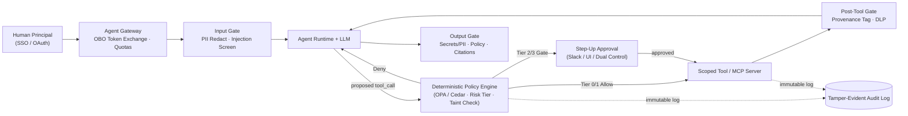

# Enterprise Agent Governance and Guardrails

> **One-line summary**: Production agent governance treats an LLM as an **untrusted, probabilistic actor** operating inside a zero-trust enterprise boundary: enforce identity delegation (OBO), deterministic Policy-as-Code (OPA/Cedar), graduated action risk tiers, taint-aware runtime guardrails, and immutable audit trails outside the prompt.
>
> **Keywords**: `policy-as-code` `OPA` `Cedar` `OBO delegation` `action tiers` `lethal trifecta` `taint tracking` `DLP` `kill switch` `audit log`

## 1. Core concepts

Chatbots mostly needed content moderation (toxicity, jailbreaks). Production agents hold **credentials, data access, and write APIs**, turning safety into a **security, IAM, and compliance architecture problem**:



### The "Lethal Trifecta" of agent risk

Security practitioners highlight that catastrophic agent incidents happen when **all three** capabilities coexist in one session without isolation:
1. **Access to private/sensitive data** (CRM, internal docs, customer PII, source code);
2. **Exposure to untrusted external content** (web pages, emails, GitHub issues, third-party MCP returns);
3. **Ability to communicate externally or mutate state** (send email, HTTP POST, merge PR, issue refund).

**Governance golden rule**: break at least one leg of the trifecta deterministically (e.g., taint-lock outbound/write tools once untrusted data enters context, or require explicit human approval with rendered payload preview).

## 2. Principles and derivations

### 2.1 Identity, delegation, and zero-trust credentials

Never hand an agent a shared static "god-mode" service key. Industry IAM patterns for agents:

- **Dual identity (Actor + Subject)**: every downstream call carries *both* the **agent identity** (non-human workload identity, e.g., SPIFFE/SPIRE or service principal) and the **delegated human principal** via **OAuth 2.0 Token Exchange (RFC 8693 / On-Behalf-Of, OBO)**.
- **Effective permissions = intersection**: the agent can only perform actions permitted to **both** the user *and* the agent's narrow role ($\mathrm{Perm}_{\mathrm{eff}} = \mathrm{Perm}_{\mathrm{user}} \cap \mathrm{Perm}_{\mathrm{agent}}$), eliminating confused-deputy privilege escalation.
- **Short-lived, task-scoped tokens**: mint ephemeral tokens (TTL 5–15 min) scoped to the single workspace/ticket/repo; keep credentials in a host-side **credential broker** — never inject raw secrets into prompt context or code-execution sandboxes.

### 2.2 Deterministic Policy-as-Code vs. Probabilistic Guardrails

| Layer | Mechanism | Latency | Guarantees | Use for |
| --- | --- | --- | --- | --- |
| **Deterministic Policy-as-Code** | OPA (Rego), AWS Cedar, Zanzibar/ReBAC, JSON Schema, SQL AST allowlist | <5 ms | **100% enforceable**, auditable, version-controlled | AuthZ/ACLs, spend caps, allowed domains/tables, action tiering, egress blocks |
| **Fast ML / Classifier Gate** | Small encoder / DeBERTa / Presidio NER / Guard model (Llama Guard, ShieldGemma) | 10–50 ms | High recall, low cost; imperfect | PII/secrets detection, prompt-injection screening, toxicity/off-topic filtering |
| **LLM-as-Guardrail / Judge** | Stronger model checking policy compliance against rubric | 300–1500 ms | Nuanced semantic understanding; bypassable | Ambiguous brand/policy review, final compliance check on high-value outputs |

**Best practice**: never use a prompt instruction or an LLM judge to enforce a hard security boundary. Put **hard invariants in deterministic Policy-as-Code** and reserve ML/LLM guardrails for semantic edge cases.

### 2.3 Action risk tiering and graduated autonomy

Classify every tool and parameter range into explicit risk tiers enforced by the gateway:

| Tier | Action class | Examples | Required control |
| --- | --- | --- | --- |
| **Tier 0** | Read-only (user-scoped) | Search docs, read ticket, `SELECT` with row-level ACL | OBO auth + rate limit + audit log |
| **Tier 1** | Reversible / draft write | Create draft email, open draft PR, add internal note | Schema validation + idempotency key + auto-undo metadata |
| **Tier 2** | External / material impact | Send customer email, refund \$50–\$500, merge PR, deploy staging | **Explicit HITL approval** showing exact diff/payload + step-up check |
| **Tier 3** | Irreversible / privileged | Prod DB DDL/delete, IAM policy edit, refund >\$500, bulk delete | **Deny by default** or dual-control approval + out-of-band verification |

Notice that tiering is **argument-aware**, not just tool-name-based: `refund_order(amount=15)` may be Tier 1 auto-approved, while `refund_order(amount=2500)` escalates to Tier 3.

### 2.4 Layered runtime guardrails and taint tracking

1. **Input gate**: redact/tokenize PII before sending to third-party LLM APIs (re-hydrate on return if needed); flag obvious direct-injection patterns.
2. **Pre-tool policy gate**: evaluate `allow(subject, agent, tool, args, session_taint)` in OPA/Cedar; verify egress allowlists (preventing markdown-image exfiltration `` or arbitrary `curl`).
3. **Data provenance & taint tracking**: tag every context block with a trust level (`TRUSTED_SYSTEM`, `USER_DIRECT`, `UNTRUSTED_EXTERNAL`). If a session reads `UNTRUSTED_EXTERNAL` content (a scraped web page or external email), mark the session **tainted** and deterministically block or require human confirmation for high-risk outbound/write tools (breaking the Lethal Trifecta).
4. **Output gate**: scan final responses for leaked API keys/secrets (entropy + regex), unauthorized PII, disallowed external URLs/images, and policy violations.
5. **Circuit breakers & kill switches**: hard caps on tool calls/min, dollar spend/hour, error spikes, and a global/per-tool **kill switch** (feature flag) that immediately drops an agent to read-only mode during an incident.

### 2.5 Enterprise lifecycle governance and compliance

- **Agent & MCP Registry**: maintain a central catalog of approved agents, models, prompts, and **pinned MCP server versions/digests** (preventing unvetted "Shadow AI" and rug-pull MCP tool-description updates).
- **Shadow (audit-only) guardrail rollout**: deploy new policy rules in `LOG_ONLY` mode first to measure false-positive rate against real traffic before flipping to `ENFORCE`.
- **Tamper-evident audit logs**: record `trace_id`, `human_user_id`, `agent_id`, `policy_version`, `model_version`, `prompt_hash`, `tool_name`, `redacted_args`, `decision (allow/deny/hitl_approved_by)`, and `result_status` — supporting SOC2, ISO 42001, NIST AI RMF, and EU AI Act traceability requirements.

## 3. Implementation notes

Deterministic pre-tool Policy-as-Code + Taint-Tracking gate (conceptual Python equivalent of an OPA/Cedar sidecar):

```python
from dataclasses import dataclass
from typing import Any, Dict, Set

@dataclass
class SessionContext:
    user_id: str
    user_scopes: Set[str]
    agent_scopes: Set[str]
    tainted_by_untrusted_data: bool = False
    spend_usd: float = 0.0

def evaluate_tool_policy(ctx: SessionContext, tool: str, args: Dict[str, Any]) -> tuple[str, str]:
    """Returns (decision, reason): 'ALLOW' | 'REQUIRE_HITL' | 'DENY'."""
    effective_scopes = ctx.user_scopes & ctx.agent_scopes
    if ctx.spend_usd >= 5.0:
        return "DENY", "session_budget_exceeded"

    if tool == "read_ticket":
        if "tickets:read" not in effective_scopes:
            return "DENY", "missing_effective_scope"
        return "ALLOW", "tier0_read"

    if tool == "issue_refund":
        if "billing:refund" not in effective_scopes:
            return "DENY", "missing_effective_scope"
        amount = float(args.get("amount_usd", 0))
        if amount <= 0 or amount > 5000:
            return "DENY", "amount_out_of_bounds"
        if ctx.tainted_by_untrusted_data or amount > 50:
            return "REQUIRE_HITL", "tainted_or_tier2_amount"
        return "ALLOW", "tier1_small_refund"

    if tool == "send_external_email":
        if ctx.tainted_by_untrusted_data:
            return "REQUIRE_HITL", "lethal_trifecta_guard"
        return "REQUIRE_HITL", "tier2_external_side_effect"

    return "DENY", "tool_not_in_allowlist"
```

Key design details:
- **Default-deny allowlist**: unknown tools are denied automatically.
- **Taint escalates writes**: reading an untrusted document flips `tainted_by_untrusted_data = True`, forcing HITL even on otherwise auto-approved writes.
- **No LLM in the authorization path**: policy evaluation is <1 ms, deterministic, unit-testable, and auditable.

## 4. Interview Q&A

### Q1. Why are system-prompt guardrails insufficient for enterprise agent security?
**Answer**: Prompts are soft statistical preferences, not security boundaries — indirect prompt injection, multi-turn persuasion, or encoding tricks can override prompt rules. Hard invariants (ACLs, spend caps, domain allowlists, approval gates) must be enforced **deterministically outside the LLM** via Policy-as-Code (OPA/Cedar) in the tool gateway.
**Follow-up**: Where do probabilistic guardrails still add value? Catching semantic policy violations, novel PII/jailbreak phrasing, and tone/brand checks *on top of* deterministic boundaries.

### Q2. Explain the "Lethal Trifecta" and how you mitigate it in a production email/support agent.
**Answer**: Risk spikes when one agent combines (1) private data access, (2) untrusted external inputs, and (3) external communication or state mutation — an attacker can embed an indirect injection in an inbound email instructing the agent to exfiltrate private CRM records via an outbound tool or markdown image URL. Mitigate by tracking provenance/taint (blocking or requiring HITL on outbound tools after reading untrusted content), stripping external image URLs in output rendering, and splitting untrusted-parsing into a privileged-tool-free sub-agent.

### Q3. How should authentication and permissions work when an agent acts on behalf of an employee?
**Answer**: Use **OAuth On-Behalf-Of (OBO) token exchange** with dual identity (`actor=agent`, `subject=user`) and compute **effective permissions as the intersection** of the user's ACLs and the agent's scoped role. Tokens must be short-lived, scoped to the current task, and held by a host-side broker — never passed inside prompts or sandboxes.

### Q4. How do you roll out guardrails without breaking user productivity with false positives?
**Answer**: (1) Classify actions into **risk tiers** so low-risk Tier 0 reads stay frictionless; (2) deploy new guardrail rules in **shadow / audit-only mode** first to measure precision/false-positive rate on live traces; (3) provide clear **step-up HITL approval** (showing the exact diff/arguments) rather than opaque hard denials for Tier 2 actions; (4) track guardrail latency, block rate, and override rate as operational SLOs.

### Q5. How do you prevent "MCP rug pulls" and Shadow AI in an enterprise?
**Answer**: Maintain an internal **Agent & MCP Registry** with allowlisted servers pinned to immutable versions/checksums; hash and diff tool descriptions on upgrade (detecting hidden prompt injections added post-approval); route all LLM and MCP traffic through a central **AI Gateway** that enforces DLP, quotas, model allowlists, and audit logging.

### Q6. What belongs in an agent's compliance audit log?
**Answer**: Every tool decision and action should emit an immutable record containing: `trace_id`/`span_id`, human `user_id` + `agent_id`, exact `model_version` + `prompt_hash` + `policy_version`, tool name + PII-redacted arguments, policy decision (`ALLOW`/`DENY`/`HITL`) + approver identity if escalated, and execution outcome. Without versioned policy and prompt hashes, you cannot reconstruct *why* an action happened months later.

### Q7. How do you protect against data exfiltration through seemingly "read-only" responses?
**Answer**: Even without write tools, an injected agent can exfiltrate private data by rendering markdown images/links (``) that the user's browser auto-fetches, or by calling a web-fetch tool with private data in query parameters. Mitigate by sanitizing/blocking arbitrary external image/link rendering in the UI, enforcing egress domain allowlists, and blocking URL-parameterization of sensitive context.

## 5. Pitfalls and follow-ups

- **Shared service accounts for agents**: breaks attribution and lets a low-privilege user query executive data through the agent (confused-deputy bug).
- **Approving tool names without validating arguments**: allowing `sql_query` without an AST read-only + row-level-ACL check lets the agent run `DROP TABLE` or dump other tenants.
- **Approval fatigue in HITL**: forcing human clicks on 20 trivial Tier 0/1 steps trains users to rubber-stamp "Approve" blindly, destroying real Tier 2/3 safety.
- **Forgetting a kill switch**: if an agent starts misbehaving across 1,000 sessions, you need a 1-click config flag to downgrade it to read-only/draft mode immediately.

## 6. Cheat sheet

| Pillar | Industry best practice |
| --- | --- |
| Identity | Dual identity (`actor` + `subject`) via OAuth OBO; effective perms = $\mathrm{User} \cap \mathrm{Agent}$ |
| Enforcement | Deterministic Policy-as-Code (OPA/Cedar) for hard bounds; ML/LLM gates for semantics |
| Risk tiers | Tier 0 read → Tier 1 reversible/draft → Tier 2 HITL w/ preview → Tier 3 deny/dual-control |
| Lethal Trifecta | Private data + untrusted input + outbound/write → break via taint tracking & sub-agent split |
| Lifecycle | Agent/MCP registry with pinned digests, shadow-mode rollout, kill switch, immutable audit |

Mnemonic: **"Never enforce auth in a prompt; intersect user and agent scopes, tier every write, break the Lethal Trifecta, and log every decision."**

## 7. References

- [OWASP Top 10 for Agentic Applications / LLM Applications](https://owasp.org/www-project-top-10-for-large-language-model-applications/)
- [NIST AI Risk Management Framework (AI RMF 1.0)](https://www.nist.gov/itl/ai-risk-management-framework)
- [Open Policy Agent (OPA)](https://www.openpolicyagent.org/docs/) / [AWS Cedar Policy Language](https://www.cedarpolicy.com/)
- [Design Patterns for Securing LLM Agents against Prompt Injections · Beurer-Kellner et al., 2025](https://arxiv.org/abs/2506.08837)
- [RFC 8693: OAuth 2.0 Token Exchange (On-Behalf-Of Delegation)](https://datatracker.ietf.org/doc/html/rfc8693)
