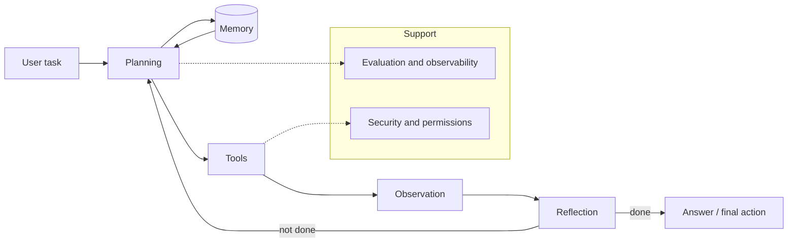

# Chapter 5 · AI Agents

> **One-line summary**: Agents turn an LLM from a one-shot question-answering endpoint into an executor that can plan, call tools, keep memory, and correct itself. Interviews almost always tie this to RAG, prompt engineering, and system design; the real test is the **engineering trade-offs of control flow**, not memorizing framework APIs.
>
> **Interview weight**: LLM application roles ★★★★★; MLE / algorithm roles ★★★★; research roles ★★★ (they probe the motivation and failure modes of ReAct / Reflexion / LATS more deeply).

## What this chapter covers

- [Agent basics and architecture](01-agent-fundamentals-and-architecture.md) — definitions, the agent loop, workflow vs agent, framework comparison, 2025-2026 trends
- [Tool use and function calling](02-tool-use-and-function-calling.md) — schema design, parallel calls, MCP, code sandboxes, computer use, tool security
- [Planning and reasoning](03-planning-and-reasoning.md) — CoT / ToT / GoT, ReAct, Plan-and-Execute, Reflexion, LATS, verifiers
- [Memory systems](04-memory-systems.md) — layered memory, context compression, vector memory, MemGPT, forgetting and privacy
- [Multi-agent systems](05-multi-agent-systems.md) — collaboration topologies, communication, consensus and conflict, cost models, when not to use them
- [Agentic RAG and knowledge augmentation](06-agentic-rag.md) — query planning, Self-RAG / CRAG, GraphRAG, enterprise knowledge bases
- [Production evaluation and safety](07-evaluation-and-safety.md) — trace / span, task success rate, cost optimization, injection defense, sandboxes
- [Agent interview Q&A](08-agent-interview-qa.md) — 50+ high-frequency questions organized by theme for quick review

## One diagram for the whole chapter

## The through-line of this chapter

One idea runs through all eight notes: **the freedom that comes from "the model decides" has to be paid for with structure**.

| Degree of freedom | Risk | Structural countermeasure in this chapter |
|---|---|---|
| The model picks which tool to call | Wrong tool, hallucinated arguments | schema / routing / validation in [02 Tool use](02-tool-use-and-function-calling.md) |
| The model picks how many steps to take | Infinite loops, runaway cost | budgets, verifiers, replanning in [03 Planning](03-planning-and-reasoning.md) |
| The model picks what to remember | Forgetting, cross-user leakage, privacy | layering, write policies, isolation in [04 Memory](04-memory-systems.md) |
| The model picks who does the work | Communication overhead, unclear ownership | topologies and arbitration in [05 Multi-agent](05-multi-agent-systems.md) |
| The model picks what to retrieve | Hallucination, permission overreach | query planning and citations in [06 Agentic RAG](06-agentic-rag.md) |
| The model picks how to run long tasks | Unobservable, not regressable | tracing and evaluation in [07 Production](07-evaluation-and-safety.md) |

## Study plan

- **Order**: 01 → 02 → 03 → 04 → 06 → 05 → 07 → 08. Build the "loop + tools + planning" skeleton first, then memory and RAG; leave multi-agent for later (it is a cost multiplier, not a starting point). Use 08 for a last-minute review.
- **Focus**: 80% of interview questions come from 01 / 02 / 03 / 06. What **differentiates** you is 07 (observability, cost, safety); most candidates answer it shallowly.
- **Time**: 8 hours reading + 4 hours memorizing Q&A + 2 hours writing a minimal agent (it only needs to run "tool call + retry on failure + trace").
- **Hands-on**: write a 150-line loop against any model API, wire two tools (one read-only retrieval, one write), deliberately make a tool fail, and watch how the model corrects itself. That beats reading ten articles.

## How it connects to other chapters

- **Prerequisites**: [LLM architecture evolution](../04-llm/02-llm-architecture-evolution.md), [Fine-tuning and PEFT](../04-llm/06-fine-tuning-and-peft.md), [Prompt engineering](../04-llm/12-prompt-engineering.md). Agents add control flow on top of prompts; structured output, JSON schema, and CoT all come from prompt engineering.
- **Strongly related**: [RAG](../04-llm/11-rag.md). Note 06 covers "RAG orchestrated as an agent"; retrieval itself (chunking, embeddings, ANN, rerank) lives in 04-11 and is not repeated here.
- **Downstream**: [LLM application system design](../06-ml-system-design/05-llm-application-design.md). Assemble the components of this chapter into a shippable support Copilot, enterprise knowledge base, or coding assistant.
- **Safety and evaluation**: [Evaluation and hallucination](../04-llm/10-evaluation-and-hallucination.md) covers model-level evaluation; note 07 covers **trajectory-level** evaluation and risks specific to agents (overreach, injection, side effects).
- **RL perspective**: [GRPO and reasoning RL](../03-reinforcement-learning/07-grpo-and-reasoning-rl.md). An agent's "thinking" can be viewed as policy sampling; test-time compute in reasoning models shares its roots with agent search and reflection.

## Using this chapter in interviews

1. **Fundamentals** ("What is an agent?", "What is ReAct?") → use the tables in 01 / 03, deliver the definition plus one trade-off in 30 seconds.
2. **Design** ("Design an enterprise knowledge-base agent") → use 06 + 07: back the common paths with a workflow, add the agent only for the long tail; then cover retrieval, permissions, tracing, and evaluation.
3. **Deep dives** ("Are multi-agent systems always better?", "Why is your agent's success rate only 60%?") → use the cost model in 05 and the failure-analysis frame in 07 (trajectory breakdown, per-step success rate, error attribution).
4. **Trends** ("What changed in 2025-2026?") → MCP standardization, computer use, A2A, and engineering-grade evaluation, one sentence each.

## Glossary (so the first mention is not scary)

| Term | Abbreviation | In one sentence |
|---|---|---|
| Agent | agent | An LLM-driven observe-decide-act loop |
| Tool use | function calling / tool use | The model emits a structured call; external code executes it |
| Model Context Protocol | MCP | A standard way to plug tools and data sources into hosts (proposed by Anthropic) |
| Agent2Agent | A2A | A protocol direction for agents to discover and delegate to each other |
| Reflection | reflection / self-critique | Self-evaluation and correction after execution |
| Human in the loop | HITL | A human confirms before high-risk actions |
| Trajectory | trajectory | All steps of one task (thought / action / observation) |
| Task success rate | task success rate | The core end-to-end metric for an agent |
| Context engineering | context engineering | Deciding what to put into the context at each step |

## Five common pitfalls (notes to myself)

1. **Treating an agent as a product feature instead of a systems problem**: it introduces unpredictable control flow, so it needs budgets, permissions, observability, and rollback.
2. **Assuming a stronger model fixes everything**: most production failures come from tool design, context organization, and permissions, not from model IQ.
3. **Quoting demo success as a conclusion**: run a fixed task set many times and look at the gap between pass@1 and pass^k.
4. **Going multi-agent too early**: stabilize a single agent with good tools first; multi-agent is usually a cost multiplier.
5. **Ignoring tool quality**: messy tool outputs and unreadable error messages leave even a strong model guessing.

## Focus by role

| Role | Priorities | Safe to skip |
|---|---|---|
| LLM application / agent engineering | 02 / 03 / 06 / 07: tool design, orchestration, evaluation, cost | MCTS details of LATS |
| MLE / recommender moving to LLMs | 01 / 02 / 07: architecture, tools, online metrics | Fine details of multi-agent topologies |
| Algorithm research | 03: motivation and experimental design for ReAct / Reflexion / LATS / verifiers | Low-code platforms, framework APIs |
| Infra / platform | 07 plus the sandbox and permission parts of 02: deployment, isolation, quotas, observability | Prompt tricks |

> **One line**: The right answer in an agent interview is rarely "add more capability"; it is "**stabilize the task with fewer degrees of freedom**".
