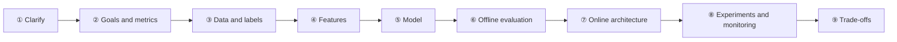

# Answer framework and methodology

> **One-line summary**: The right opening for a system design round is not drawing a model. It is using 9 steps to turn a one-line prompt into a plan with "metrics, data, layers, and numbers", then closing with trade-offs.
>
> **Keywords**: `clarify` `metrics hierarchy` `capacity estimation` `funnel` `trade-off` `A/B test`

## 1. Core concepts

### 1.1 What the interview actually tests

The scorecard in the interviewer's hand is not "the fancier the model, the higher the score". It is usually these six items:

| Signal | What loses points | What earns points |
| --- | --- | --- |
| Clarification instinct | Starts drawing a DNN the moment the prompt is read | Asks about scale, latency, goal, constraints first, and explains why |
| Structure | Talks wherever the thought goes | Gives the 9-step skeleton first, then drills down layer by layer |
| Data sense | Only talks about model architecture | Explains where samples come from, how labels are defined, what biases exist |
| Engineering sense | Does not know why retrieval needs multiple channels | Discusses funnel, caching, degradation, canary rollout, monitoring |
| Quantitative rigor | Uses adjectives throughout | Produces QPS, candidate counts, machine counts, latency budgets |
| Trade-off | "We want all of it" | Makes a decision under given constraints and states the cost |

In one sentence: **the interviewer is judging whether handing you this problem would lead to something shippable**.

### 1.2 The 9-step framework



Each step needs a **concrete deliverable**. Say it and stop; go deeper only when the interviewer asks:

| Step | Question to answer | Deliverable (what you write on the whiteboard) |
| --- | --- | --- |
| ① Clarify | What product? Who uses it? What scale? What latency? Is there an existing system? | A column of numbers: DAU, item count, QPS, p99, budget |
| ② Goals and metrics | What does the business want? Short term or long term? What must not get worse? | North star + 3–5 online metrics + 2 guardrails |
| ③ Data and labels | Where does the data come from? How are positive/negative samples defined? Any label delay or bias? | Data source table + sample construction rules |
| ④ Features | What user/item/context/cross/sequence features exist? Real-time or offline? | Feature group table + freshness annotations |
| ⑤ Model | What is the baseline? Why upgrade? What are the constraints? | Rationale for evolving from LR/GBDT to a DNN |
| ⑥ Offline evaluation | Which metrics? How to split? How to prevent leakage? | Metric + dataset + controlled experiment |
| ⑦ Online architecture | How does the request flow? How many candidates per layer? How to cache/degrade? | Architecture diagram + latency budget |
| ⑧ Experiments and monitoring | How to launch? Which metrics to watch? How to detect problems? | Rollout strategy + monitoring dashboard |
| ⑨ Trade-offs | What did you give up? Why is that reasonable? | 2–3 trade-offs + trigger conditions |

### 1.3 Three metric layers

The most common way to lose points is **treating an offline metric as the business objective**. Separate the three layers:

| Layer | Examples | Characteristics | Usage |
| --- | --- | --- | --- |
| North star (business) | Time spent per user, GMV, retention, default rate | Slow, noisy, driven by many factors | Sets direction; not optimized directly |
| Online proxy (system) | CTR, CVR, completion rate, resolution rate, approval rate | Fast, attributable | Compared directly in A/B tests |
| Offline proxy (model) | AUC, logloss, GAUC, NDCG@k, PR-AUC | Fastest, but has a gap with online | Model iteration and experiment screening |
| Guardrail | Latency p99, error rate, complaint rate, diversity, cost | Must not get worse | Veto power |

## 2. Principles and derivations

> The point of estimation is not precision. It is **showing that you have a sense of orders of magnitude**. Say every assumption out loud so the interviewer can correct you.

### 2.1 QPS

$$
\text{QPS}_{avg}=\frac{\text{DAU}\times\text{requests per user}}{86400},
\qquad
\text{QPS}_{peak}=\alpha\cdot\text{QPS}_{avg},\ \alpha\approx 2\text{–}5
$$

Example: 100M DAU × 10 feed requests per user per day → $10^9/86400\approx 11.6\text{k QPS}$; with a 3x peak factor ≈ **35k QPS**.

### 2.2 Candidate funnel and compute

$$
\text{scores/s}=\text{QPS}_{peak}\times N_{cand},
\qquad
F=\text{scores/s}\times f_{sample}
$$

Example: 300 candidates per request at the ranking stage, $f_{sample}=10^8$ FLOPs → $3.5\times10^4\times300\times10^8\approx1.05\times10^{15}$ FLOP/s ≈ **1 PFLOP/s**. An H100 delivers about 500 TFLOPS of dense bf16; at 20%–40% effective utilization (recommendation models are memory-bound) → on the order of **10 GPUs**.

### 2.3 Storage and memory

$$
S=\text{impressions/day}\times\text{sample size}\times\text{retention days}
$$

1e9 impressions/day × 1 KB/sample ≈ 1 TB/day; retaining 90 days = 90 TB of raw logs (about 1/3–1/5 after compression).

Embedding table size:

$$
M=N_{id}\times d\times 4\ \text{bytes}
$$

1e8 users × 128 dims × 4 B ≈ **51 GB**; 1e9 items × 128 dims × 4 B ≈ **512 GB** — which is why ID embeddings must be sharded, updated sparsely, and never broadcast in full.

### 2.4 Latency budget and concurrency

$$
L=\lambda W\quad(\text{Little's law})
$$

35k QPS × 100 ms = 3500 concurrent requests; with 32 concurrent requests per instance → about 110 instances (times another 1.5x for redundancy).

| Stage | p99 budget | Notes |
| --- | --- | --- |
| Gateway/auth/rate limiting | 5 ms | Often ignored, but real |
| Multi-channel retrieval (parallel) | 35 ms | Bounded by the slowest channel, usually vector search |
| Coarse ranking | 40 ms | ~1000 candidates |
| Ranking | 70 ms | ~300 candidates, heaviest features |
| Re-ranking + policy | 15 ms | Rules, diversification, frequency caps |
| Serialization + network | 15 ms | Mobile may add another RTT |
| **Total + headroom** | **200 ms** | Keep a 10%–20% buffer |

### 2.5 A/B sample size and MDE

Sample size per experiment arm (two-proportion test):

$$
n=\frac{2\left(z_{1-\alpha/2}+z_{1-\beta}\right)^2\sigma^2}{\Delta^2}
\approx\frac{15.7\,\sigma^2}{\Delta^2}
$$

CTR baseline $p=0.05$, detecting a 1% relative lift → $\Delta=5\times10^{-4}$, $\sigma^2=p(1-p)\approx0.0475$:

$$
n\approx\frac{15.7\times0.0475}{(5\times10^{-4})^2}\approx3.0\times10^{6}
$$

That is about **3 million impressions per arm**. If each arm gets 10 million impressions a day, roughly 8 hours; but retention metrics have far higher variance and usually need 1–2 weeks.

### 2.6 Quick-reference card

| Quantity | Formula | Typical magnitude |
| --- | --- | --- |
| Average QPS | DAU × requests/user / 86400 | 1e8 DAU → tens of thousands of QPS |
| Peak QPS | 2–5 × average | 3x is a common assumption |
| Candidate counts | retrieval 1e4 → coarse 1e3 → ranking 1e2 → display 1e1 | One order of magnitude per layer |
| Single-machine QPS (light model) | 100–1000 | 10–100 for heavy models |
| Embedding memory | N × d × 4 B | 1e9 × 128 ≈ 512 GB |
| Sample storage | impressions × sample size × days | 1e9/day ≈ 1 TB/day |

## 3. Implementation notes

Turn the estimates into code so you can do mental math and fall back on it in the interview:

```python
def qps(dau, req_per_user, peak=3.0):
    return dau * req_per_user / 86400 * peak

def ab_sample_size(p, mde_rel, alpha=0.05, power=0.8):
    """Two-proportion test: sample size per arm; mde_rel is the relative MDE"""
    z = 1.96 + 0.84          # alpha=0.05 two-sided, power=0.8
    delta = p * mde_rel
    return 2 * z**2 * p * (1 - p) / delta**2

print(qps(1e8, 10))                       # 34722 QPS
print(ab_sample_size(0.05, 0.01))         # about 3.0e6 per arm
```

Recommended whiteboard order: **write the numbers first, then draw the diagram**. Once the numbers are fixed, every layer of the architecture has a justification (why can retrieval take only 35 ms? because it does ANN plus lightweight scoring).

## 4. Interview Q&A

### Q1. Once you hear "design an X system", how do you use the first 5 minutes?
**Answer**: Ask four groups of questions — **product** (who uses it, what entry point, what behavior counts as success), **scale** (DAU, item count, growth expectations), **constraints** (p99, budget, compliance, existing system), and **goal** (north star plus guardrails that must not get worse). Then restate in one sentence: "So I understand this as short-video recommendations for 100M DAU within 200 ms, with watch time as the primary goal and latency and diversity as guardrails — is that right?" Start drawing only after the restatement is confirmed.
**Follow-up**: What if the interviewer says "your call"? State your default assumptions and label them: "This is my assumption; correct me if it is wrong."

### Q2. What if the interviewer gives no scale numbers?
**Answer**: Contribute an order of magnitude with its basis ("assume 100M DAU, 10 requests per user, 3x peak"), then emphasize the parts of the conclusion that are insensitive to scale. Design questions are scored on **the reasoning process**, not on the number itself.
**Follow-up**: Would the design change if scale were 100x different? Yes — retrieval goes from a single-machine ANN index to a sharded index, and ranking goes from one model to model sharding or distillation.

### Q3. How do you estimate how many machines or GPUs you need?
**Answer**: Four steps — QPS → compute per request → total FLOP/s → divide by per-GPU effective compute. Note that recommendation and search models are usually **memory-bound**; effective compute is only 20%–40% of peak. For LLMs, look at KV cache memory and the batch size ceiling. Finally add 1.5–2x redundancy for peaks and failures.
**Follow-up**: What can an H100 do? About 500 TFLOPS dense bf16, similar for fp16, roughly double for INT8 — but effective utilization is what matters.

### Q4. Offline metrics improved but online did not. How do you debug?
**Answer**: Check four layers — data, features, model, experiment: ① train/serve feature inconsistency (most common: time travel, different definitions, missing real-time features); ② offline evaluation misaligned with the online objective (optimizing AUC offline while online wants watch time); ③ sample selection bias (learning only from impressed samples while online must rank the full corpus); ④ bad experiment assignment (SRM, uneven new/old users); ⑤ the metric noise is not significant.
**Follow-up**: How to prevent it? Feature consistency checks (dual-write comparison for the same request), replay of online scoring logs, and shadow mode.

### Q5. How long should an A/B test run? How do you compute sample size?
**Answer**: Fix the baseline, MDE, significance level, and power; plug into the formula to get samples per arm; divide by daily split impressions to get days. It must also cover at least one full cycle (7 days) to remove day-of-week effects. Retention metrics are noisy and usually need 1–2 weeks.
**Follow-up**: Can you peek early? Not arbitrarily — peeking inflates false positives; use sequential testing or a fixed sample size. CUPED can also reduce variance.

### Q6. The latency budget is exceeded. Which layer do you cut first?
**Answer**: Cut in order of "quality gain per unit of latency": features first (drop high-cardinality cross features, reduce embedding dims), then candidate count (1000 → 500), then model complexity (distillation/quantization), and only then retrieval channels. Caching (popular results, user profiles, query-level results) is usually the best value cut.
**Follow-up**: Which matters more, p99 or the mean? p99 — users feel the tail; a good average still leaves 1% of users complaining.

### Q7. Should features be real-time or offline?
**Answer**: Split into three tiers by **freshness value × compute cost**: daily (profiles, statistics), minute-level (recent behavior aggregates computed in streaming and written to KV), and second/request-level (context, real-time sequences, computed at request time). For real-time features ask three questions: can we compute it in time? can we store it? is it consistent with the offline definition?
**Follow-up**: Why are real-time features prone to offline-online inconsistency? Window definitions, event time vs processing time, and different retraction/dedup logic all cause it.

### Q8. How do you answer follow-ups on cold start, position bias, and data drift?
**Answer**: Answer every one as "symptom → root cause → remedy (data/model/system layers) → cost". Cold start: side info + multimodal features + exploration traffic + default embeddings. Position bias: feed position as a feature during training and set it to 0 at inference, or use a click model for unbiased estimation. Drift: monitor feature distributions with PSI + periodic retraining + online learning.
**Follow-up**: Does exploration hurt short-term metrics? Yes, so cap the exploration traffic ratio and control cost with bandits.

### Q9. How do you talk about trade-offs gracefully?
**Answer**: Use the pattern "if ..., then ..., at the cost of ...", discuss one tension at a time, and state your choice plus its trigger condition. For example: "If we optimize quality, use early fusion with the full feature set, at the cost of a 70 ms ranking stage that can only score 300 candidates; if the latency budget is only 50 ms, I would use a two-tower model plus distillation."
**Follow-up**: What if the interviewer asks "why not do XXX"? Acknowledge that it is better first, then give the constraint (cost/latency/maintenance complexity/diminishing returns).

### Q10. How do you allocate 45 minutes?
**Answer**: Clarify 5 min → metrics 5 min → data and features 8 min → model and funnel 10 min → online architecture and capacity 8 min → evaluation and monitoring 5 min → keep 4 min for follow-ups. **After each layer ask "do you want me to expand on this?"** and spend time where the interviewer cares.
**Follow-up**: What if you cannot finish? A complete skeleton with gaps beats 20 minutes stuck on the first layer.

### Q11. What if you are asked about an unfamiliar area (say ad auctions)?
**Answer**: Be honest and transfer: "I do not know auction mechanics deeply, but I know ranking is by eCPM, and eCPM is pCTR × bid, so calibration is critical; if you want to go deeper into the auction, I may need you to tell me whether this is GSP or VCG." Steer the conversation back to what you know.
**Follow-up**: What if the interviewer keeps pushing? Reason from first principles: the constraints of the advertiser's goal, the platform's goal, and user experience.

### Q12. How do you close so the interviewer remembers you?
**Answer**: Close with three sentences: ① the system skeleton in one line; ② the one risk you worry about most (cold start/latency) and its fallback; ③ what you would do with two more weeks (data loop, online learning, experimentation platform). Show an "iteration mindset" rather than handing in homework.
**Follow-up**: How do you rank risks? By "probability × blast radius"; state high-probability, high-impact risks first.

## 5. Pitfalls and follow-ups

- **Model only, no data**: if you cannot answer "where do the labels come from", you drop a level immediately.
- **Unstated assumptions**: treating "200 ms" as a default when the other side is an offline batch scenario.
- **Ignoring online consistency**: training on T+1 features while serving real-time features with different definitions.
- **Single metric**: mentioning only AUC, not the business metric and guardrails.
- **Estimation as decoration**: computing QPS but letting it change no architectural decision (no sharding where it is needed).
- **No degradation path**: what happens when the model service dies? Cache fallback, rules fallback, degrade to coarse-ranking results.
- **No monitoring**: launch is treated as the end; no way to detect quality decay.
- **Reciting templates**: applying the same script to every prompt with no scenario-specific insight.

## 6. Cheat sheet

| Mantra | Content |
| --- | --- |
| Four opening questions | Product, scale, constraints, goal |
| Nine-step skeleton | clarify → metrics → data → features → model → offline → architecture → experiments → trade-offs |
| Three metric layers | North star / online proxy / offline proxy + guardrails |
| Five estimates | QPS, candidate compute, storage, latency and concurrency, A/B sample size |
| Universal sentence | "If ..., then ..., at the cost of ...; I choose X because of constraint Y" |
| Three-sentence close | One line on the skeleton, one on risk, one on next steps |

## 7. References

- [ML System Design 2.0 · Yuan Meng](https://www.yuan-meng.com/posts/mle_interviews_2.0/): the finite space of design problems and a step-by-step answer skeleton
- [ML Systems Design Interview Guide · Patrick Halina](http://patrickhalina.com/posts/ml-systems-design-interview-guide/)
- [Designing Machine Learning Systems · Chip Huyen](https://github.com/chiphuyen/machine-learning-systems-design)
- [Eugene Yan · System Design for Recommendations and Search](https://eugeneyan.com/writing/system-design-for-discovery/)
- [Trustworthy Online Controlled Experiments (A/B testing)](https://experimentguide.com/)
