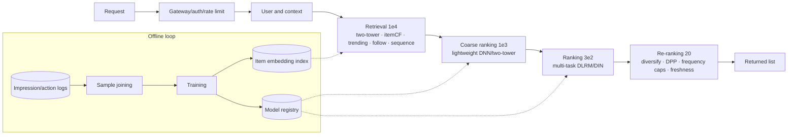

# Recommendation system design

> **One-line summary**: Recommendation system design = a **funnel from hundreds of millions of candidates down to a dozen slots** plus a **data loop that turns behavior logs into training samples**. In the interview, explain why the funnel is tiered before going into each layer's model and constraints.
>
> **Keywords**: `recall` `coarse ranking` `ranking` `re-ranking` `two-tower` `negative sampling` `multi-task` `GAUC` `position bias`

## 1. Clarifying requirements

Restate the prompt and state your assumptions first (the rest of this note assumes "a short-video feed for 100M DAU"):

| Dimension | Questions to confirm | Assumption here |
| --- | --- | --- |
| Product | Home feed / related recommendations / next video? | Home feed |
| Users and items | User count, content count, UGC or PGC? | 1e8 DAU, 1e9 videos, mostly UGC |
| Actions | Click, like, comment, share, completion, negative feedback? | All of them; the primary goal is watch time |
| Goal | Watch time / retention / engagement? | Time per user up; guardrails: DAU, diversity, latency |
| Constraints | p99 latency, cost, compliance | p99 200 ms, per-request cost constrained |
| Status quo | Existing system? Cold-start stage? | Rules + simple ranking; upgrade planned |

**Functional requirements**: personalized ranking, usable cold start, support for negative feedback and diversity.
**Non-functional requirements**: p99 ≤ 200 ms, 99.9% availability, rollback capability, explainability (at least enough to localize bad cases).

## 2. Goals and metrics

| Layer | Metrics | Notes |
| --- | --- | --- |
| North star | Time spent per user, 7-day retention | Slow variables that set direction |
| Online proxy | CTR, completion rate, engagement rate, impressions per user | Fast variables; compared directly in A/B |
| Offline proxy | AUC / GAUC, NDCG@k, HR@k, Recall@k | For model iteration |
| Guardrails | p99, error rate, report rate, content diversity, creator concentration | Veto power |

> Interview line: **"CTR is the means, watch time is the goal, retention is the endgame."** Optimizing CTR alone breeds clickbait, so add completion, negative-feedback, and diversity constraints.

## 3. Data and labels

- **Data sources**: client impression/click/play logs, server request logs (candidate set, scores, positions), user profiles, content metadata, and multimodal features.
- **Sample construction**: one sample per impression, with labels for click / completion / watch time. Joining must align the **feature snapshot at request time** with the **post-hoc action** by request_id, handling delays (completion is only known after 30 s of playback).
- **Positive and negative samples**:
  - Ranking: use "impressed but not clicked" as negatives; keep only **impressions above the clicked position** (skip-above) so "not seen" is not treated as "not interested".
  - Retrieval: do not use impressed-not-clicked (retrieval must stay broad); use global random negatives, in-batch negatives, and items eliminated by coarse ranking.
- **Common biases**:
  - Position bias (higher positions get more clicks), exposure bias (only learning from impressed items), popularity bias, and selection bias (experiments on only some users).
  - Delayed conversions (installs/payments) need delayed-feedback modeling or a waiting window.
- **Privacy and compliance**: log anonymization, users can opt out of personalization, and a retention limit for training data.

## 4. Features

| Group | Examples | Freshness |
| --- | --- | --- |
| User | Profile (age/region/device), historical statistics (7-day CTR, activity) | Daily |
| Item | ID/creator/category/tags, duration, publish time, multimodal embeddings (cover/title/video) | Daily + at upload |
| Sequence | Video IDs, creators, categories from the last N clicks/plays | Minutes (streaming) |
| Cross | User category preference × content category, creator-user interaction history | Daily / real-time |
| Context | Time, network, device model, scenario (Wi-Fi/4G), page number | Per request |

Feature engineering notes: embed ID features (dims 16–128, frequency capping + hashing fallback); apply log/bin/normalization to numeric features; encode sequences with a Transformer (DIN/SIM style); **high-cardinality cross features** are fine for ranking but risky for coarse ranking (latency).

## 5. Model: the four-stage funnel

### 5.1 Retrieval (1e8 → 1e4)

| Channel | Principle | Pros | Cons |
| --- | --- | --- | --- |
| Two-tower (u2i) | Encode user and item separately; dot-product nearest neighbors | Index built offline, fast | No feature crossing; weak cold start |
| itemCF | Co-occurrence similarity | Strong memorization, interpretable | Matthew effect, poor generalization |
| Sequence retrieval | Use the recent behavior sequence as the query | Captures short-term interest | Depends on real-time features |
| Trending | Time-decayed click counts | Fallback; helps cold start | Weak personalization |
| Follow/social | Diffuse over the follow graph | High relevance | Limited coverage |

**Why two-tower is fast**: user and item encoders do not cross → item vectors are precomputed offline and indexed with ANN (HNSW/IVF-PQ); online you compute one user vector and run nearest-neighbor search, so cost is independent of corpus size. **This is also why retrieval can only use late fusion.**

**Negative sampling and correction**:
- Sampling probability is often set to $p_i\propto\text{click}_i^{0.75}$ to suppress popular items; in-batch negatives share compute but over-penalize popularity.
- Sampling-bias correction: subtract $\log p_i$ from the logit during training ($p_i$ is the probability that the sample is drawn), so the model approaches the full-corpus softmax; at inference use the raw score.
- Down-sampling negatives (rate $w$) inflates the predicted probability; correct it with:

$$
p_{\text{true}}=\frac{p'}{p'+(1-p')/w}
$$

### 5.2 Coarse ranking (1e4 → 1e3)

The goal is not accuracy but **preserving recall**: do not filter out items that ranking would have selected. A lightweight two-tower or small DNN suffices, using a subset of the ranking features; distill from the ranking score (teacher-student) to keep consistency. Evaluate with the "coarse-to-ranking loss rate".

### 5.3 Ranking (1e3 → 1e2)

- **Architecture**: the DLRM paradigm of embeddings + MLP; cross features via DeepFM/DCN/MaskNet; user sequences via DIN (target attention) or SIM (long-sequence retrieval).
- **Multi-task**: predict click, completion, like, and negative feedback jointly. Fusion falls into three families — manual weighted sum, MMoE/PLE multi-task learning, and constrained optimization (maximize engagement subject to a watch-time constraint).
- **Watch-time modeling**: $y=t/(1+t)$ squashes unbounded time into (0,1), or use bucketed ordinal regression.
- **Calibration**: multi-task fusion requires comparable probabilities across heads, so calibrate pCTR with Platt/Isotonic.

### 5.4 Re-ranking (1e2 → 20)

Rules plus algorithms: filter already-read/blocked items, frequency caps, creator diversification, category diversity (DPP/MMR), freshness weighting, and exploration slots (bandit). Re-ranking is **where business intent is concentrated**, and the easiest place to show insight.

### 5.5 Cold start

- New users: registration info, device/region, first-session exploration traffic, and a fast-built interest profile.
- New items: multimodal embeddings (cover/title/ASR), a content retrieval channel, traffic support + small-traffic exploration, and default embeddings instead of random initialization.
- Cold start is fundamentally an **explore-exploit problem**; Thompson Sampling/UCB can control the cost of trial and error.

## 6. Offline evaluation

- **Ranking quality**: AUC (global), **GAUC** (per-user weighted, closer to online), NDCG@k, HR@k, Recall@k.
- **GAUC**:

$$
\text{GAUC}=\frac{\sum_u w_u\cdot\text{AUC}_u}{\sum_u w_u}
$$

  The weight $w_u$ is the impression count or click count. Global AUC is dominated by highly active users, while GAUC better reflects "whether we rank correctly within each user".
- **Evaluation traps**: a random split is worse than a **time-based split** (simulating the future in production); using only impressed samples overestimates; offline metrics must be sliced (new/old users, head/long tail).
- **Counterfactual evaluation**: use IPS/DR to estimate a new policy's performance on old logs; this requires propensity scores.

## 7. Online architecture and capacity estimation

**Architecture**: gateway (auth/rate limiting/degradation) → request context assembly → parallel multi-channel retrieval → coarse ranking → ranking → re-ranking → response; a side channel logs candidates, scores, and positions for training.

**Capacity** (same assumptions as 01):
- 1e8 DAU × 10 requests/day → 11.6k QPS average, 3x peak ≈ **35k QPS**.
- 300 candidates per request at ranking → $1.05\times10^{7}$ scores/s; with $10^8$ FLOPs per sample → ≈ 1 PFLOP/s → about 10 GPUs (20%–40% effective utilization).
- Retrieval index: 1e9 items × 128 dims × 4 B ≈ **512 GB**, which must be sharded; the user embedding table is 1e8 × 128 × 4 B ≈ 51 GB.
- For the latency budget, see the [budget table in 01](01-framework-and-methodology.md).

**Caching**: trending leaderboards, user profiles, retrieval results (short TTL), and embedding indexes kept resident in memory.

## 8. Experiments and monitoring

- **Launch**: offline AUC/GAUC targets met → small-traffic shadow (score only, no display) → 1% canary → stepped ramp-up → full traffic; keep a reverse experiment group.
- **A/B**: split by user (avoid one user seeing two policies), watch the primary metric plus guardrails, and run for a full 7 days.
- **Monitoring**: QPS/latency/error rate; drift in score distributions (mean, quantiles); feature missing rate and distribution PSI; CTR/watch time; content diversity; bad cases (consecutive negative feedback, reports).
- **Degradation**: model service timeout → return coarse-ranking or trending fallback; feature service failure → use defaults and tag the request.

## 9. Trade-offs

| Choice | Benefit | Cost | What I would choose |
| --- | --- | --- | --- |
| Ranking with early fusion + full features | Best quality | High latency; only 300 candidates | Use it within a 200 ms budget; distill if over |
| Multi-task MMoE | Balances engagement and watch time | Hard to train; task conflicts | Start with a weighted sum, move to MMoE once data is sufficient |
| Online learning | Follows trending topics fast | Less stable; feedback loops can bias it | Daily full training + minute-level embedding updates only |
| Strong exploration | Solves cold start | Short-term metrics drop | Cap at 5%–10% of traffic and control cost with bandits |

## 10. Interview Q&A

### Q1. Why do we need a "retrieval + ranking" funnel instead of ranking everything directly?
**Answer**: Cost. A ranking model scores one sample at roughly $10^8$ FLOPs; scoring 1e9 items would need $10^{17}$ FLOPs per request, which is unacceptable in both latency and compute. Retrieval uses ANN to cut candidates from hundreds of millions to tens of thousands at a cost nearly independent of corpus size. The essence of the funnel is **cheap models for coarse screening, expensive compute for a small candidate set**.
**Follow-up**: Is more funnel stages always better? No — each stage risks dropping good items and adds engineering cost; the industry commonly uses 3–4 stages.

### Q2. Why is two-tower fast? Why is retrieval late fusion while ranking is early fusion?
**Answer**: In a two-tower model the user and item encoders do not cross, so item vectors can be precomputed offline and indexed, and online you only compute the user vector for ANN — complexity is decoupled from item count. Retrieval must fuse late (otherwise the item side cannot be precomputed), at the cost of losing cross features. Ranking has few candidates, so it can fuse early (user, item, and cross features into one DNN) with much stronger expressiveness.
**Follow-up**: How do you restore crossing ability in two-tower? Add user-item statistical features, use a two-tower plus interaction layer ("two-tower ranker"), or use sequence/graph models.

### Q3. What bias does in-batch negative sampling introduce, and how do you correct it?
**Answer**: In-batch negatives are drawn from the positive items of the same batch, so popular items are sampled more often, which makes the model **over-penalize popularity** and shifts the predicted distribution. Two corrections: ① subtract $\log p_i$ from the logit during training (sampling-bias-corrected softmax); ② at inference, add $\log p_i$ back to the score, or restore probabilities with $p_{\text{true}}=p'/(p'+(1-p')/w)$.
**Follow-up**: Why use click count to the power 0.75 as the sampling probability? It is a compromise between suppressing popularity and preserving the impression distribution; 0.75 is an empirical value.

### Q4. How do you choose retrieval negatives? Why not use "impressed but not clicked"?
**Answer**: Retrieval's job is to find relevant items across the whole corpus, so its negatives should come from **random sampling over the corpus** (easy negatives) and **hard negatives** (items dropped by coarse ranking, or scored low but never impressed). "Impressed but not clicked" is a ranking-stage negative — ranking already judged it "possibly interesting", so training retrieval on it teaches retrieval only what ranking likes and loses breadth.
**Follow-up**: Do hard negatives destabilize training? Yes, so mix them in a controlled ratio (e.g., 1:100 easy negatives plus a few hard ones) and monitor recall.

### Q5. How do you handle position bias?
**Answer**: Three common approaches: ① feed position as a feature during training (a separate bias tower) and set position to 0 at inference; ② use a click model for unbiased estimation (PAL/EM-style); ③ on the data side, treat only "impressions above the clicked position" as negatives to reduce the "not seen ≠ not interested" noise. Validate online with a random-position experiment.
**Follow-up**: Would the position feature make the model learn only position? That is why position bias is modeled separately and the main tower learns relevance only.

### Q6. How do you fuse multiple objectives, and how do you set the weights?
**Answer**: Three tiers — **manual weighted sum** (fastest; weights from experience/grid search; interpretable); **multi-task learning** (MMoE/PLE with a shared bottom plus task gates; mitigates task conflict but is harder to train); **constrained optimization / value model** (watch time as the objective and engagement as a constraint, or learn a fusion weight model). Most companies start with a weighted sum and move to MMoE once data is sufficient.
**Follow-up**: What if tasks conflict? Use PLE with task grouping, loss weighting (uncertainty weighting), or model the conflicting task separately.

### Q7. What is GAUC, and why is it better than AUC?
**Answer**: GAUC is the "weighted average of per-user AUCs", usually weighted by impressions. Global AUC mixes samples across users and is dominated by highly active users, so a model may rank well for every user yet have a poor global AUC (or vice versa). Recommenders care about "ranking correctly for a single user", so GAUC is closer to online behavior.
**Follow-up**: What are the pitfalls of GAUC? AUC is noisy for users with few samples, so set a minimum sample count; choosing impressions versus clicks as weights changes the conclusion.

### Q8. How do you handle cold start?
**Answer**: Two sides. New users: build a quick profile from registration/device/region/first-session behavior, combined with exploration traffic and popular fallbacks. New items: content retrieval via multimodal embeddings, traffic support, default embedding initialization, and small-traffic bandit trials. At the system level, keep trending and rule-based channels as fallbacks so cold items are not starved of exposure forever.
**Follow-up**: How do you evaluate cold start? Look at new-item impression coverage, the convergence speed of new-item CTR, and day-1 retention of new users.

### Q9. Offline metrics improved but online did not. How do you debug?
**Answer**: Check four layers — data, features, model, experiment: offline-online feature inconsistency (time travel, different definitions, missing real-time features), misalignment between offline and online objectives (AUC vs watch time), sample selection bias (learning only from impressions), and uneven assignment (SRM). Tools: scoring-log replay, dual-write comparison, shadow experiments.
**Follow-up**: How do you prevent it? Make "feature consistency checks" a release gate that runs automatically before every model launch.

### Q10. How do you handle real-time behavior and online learning?
**Answer**: Three freshness tiers — daily full training (profiles, full ID-embedding refresh), minute-level incremental updates (embedding-only updates or warm-started fine-tuning), and real-time features (Flink aggregates behavior sequences into KV). Online learning must solve real-time sample joining (impression → action delay), feedback-loop bias (correct with exploration data), and stability (small learning rate, canary, rollback).
**Follow-up**: Why not make everything real-time? Cost and stability; real-time training overfits the day's trending topics and is hard to roll back.

## 11. Pitfalls and follow-ups

- Describing retrieval as "a kind of ranking" without explaining ANN and precomputation.
- Forgetting position/exposure bias and failing "is your sample biased?".
- Knowing only the weighted sum for multi-objective, not MMoE/PLE or constrained optimization.
- Saying only "use content features" for cold start, without traffic support and exploration.
- Reporting only AUC, without GAUC/NDCG and business metrics.
- Capacity estimation disconnected from architecture (computing a 512 GB index but never mentioning sharding).
- No degradation or monitoring plan.

## 12. Cheat sheet

| Layer | Candidates | Goal | Model | Key metrics |
| --- | --- | --- | --- | --- |
| Retrieval | 1e8→1e4 | Recall | Two-tower/CF/trending/sequence | Recall@k, coverage |
| Coarse ranking | 1e4→1e3 | Preserve recall | Lightweight DNN/distillation | Coarse-to-ranking loss rate |
| Ranking | 1e3→1e2 | Ranking accuracy | DLRM/DIN/multi-task | AUC/GAUC |
| Re-ranking | 1e2→20 | Business constraints | Rules/DPP/bandit | Diversity, watch time |

Mantra: **"Retrieval broad, coarse ranking stable, ranking accurate, re-ranking business-aware."**

## 13. References

- [Deep Neural Networks for YouTube Recommendations](https://static.googleusercontent.com/media/research.google.com/en//pubs/archive/45530.pdf)
- [Sampling-Bias-Corrected Neural Modeling for Large Corpus Item Recommendations](https://research.google/pubs/sampling-bias-corrected-neural-modeling-for-large-corpus-item-recommendations/)
- [Recommending What Video to Watch Next: A Multitask Ranking System](https://daiwk.github.io/assets/youtube-multitask.pdf)
- [MLE Interview · recommendation](https://github.com/longxingtan/MLE-interview/blob/main/03_system/03_ml/recommendation.md)
- [ML System Design 2.0 · Yuan Meng](https://www.yuan-meng.com/posts/mle_interviews_2.0/)
- [Meituan · Deep learning in search and recommendation](https://tech.meituan.com/)
