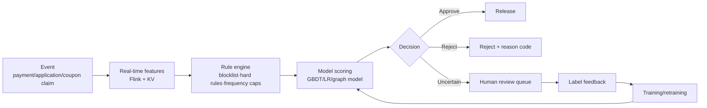

# Risk and finance design

> **One-line summary**: The core of risk system design is not "getting AUC as high as possible". It is **defining an explainable decision boundary between false-positive cost, missed-loss, explainability, and compliance**. The model is only one link in the decision flow; rules, graphs, human review, and cold-start strategy matter just as much.
>
> **Keywords**: `fraud detection` `class imbalance` `KS` `PSI` `WOE/IV` `graph feature` `cost-sensitive` `uplift` `credit risk`

## 1. Clarifying requirements

Three common interview prompts share one skeleton: **fraud detection (payments/accounts)**, **loan origination**, and **coupon distribution (marketing)**.

| Prompt | Business goal | Cost of errors | Key constraints |
| --- | --- | --- | --- |
| Fraud detection | Block card fraud/abuse/rings | Missed fraud = direct monetary loss; false positive = poor experience, complaints | p99 < 100 ms, explainable |
| Loan approval | Approve good borrowers, reject bad ones, maximize profit | Bad debt = principal loss; wrongful rejection = interest loss | Compliance (fair lending), explainable |
| Coupons | Use the smallest budget to drive the largest incremental purchase | Sending to "would buy anyway" users = wasted budget | Budget, frequency caps, no long-term value harm |

Clarification checklist: business stage (pre-loan/in-loan/post-loan, pre-payment/post-payment), risk type (fraud vs credit vs cash-out), sample time span, current approval rate, tolerable false-positive rate, regulatory requirements, and human-review capacity.

## 2. Goals and metrics

| Layer | Fraud | Credit | Coupons |
| --- | --- | --- | --- |
| North star | Loss rate, fraud rate | Risk-adjusted return, default rate | Incremental GMV / ROI |
| Online | Block rate, false-positive rate, appeal rate | Approval rate, delinquency rate, KS | Redemption rate, incremental conversion |
| Offline | PR-AUC, Precision@k | AUC, KS, cross-period stability | Qini / AUUC |
| Guardrails | Payment success rate, complaints | Compliance, fairness, PSI | Budget burn, user fatigue |

Key business metric:

$$
\text{Expected loss }EL=PD\times LGD\times EAD
$$

(PD = probability of default, LGD = loss given default, EAD = exposure at default.) It translates "model probability" into "money" and is the basis for threshold decisions.

## 3. Data and labels

### 3.1 Fraud

- **Labels**: blocklists, human-review conclusions, user complaints, chargebacks (30–90 days delayed), police/partner feedback.
- **Delay and incompleteness**: fraud labels are inherently delayed and only visible for "caught" cases (a missing label is not a negative). Set an **observation window** and approximate negatives with "no risk during the observation period".
- **Sample bias**: labels exist only for blocked/reviewed samples, so you need reject inference or exploration traffic.

### 3.2 Credit

- **Labels**: delinquency defined as DPD30/DPD60 (days past due); the observation period is usually 6–12 months. Use **vintage analysis** (track delinquency evolution for the same loan cohort by origination month) and **roll rates** (M0→M1→M2 migration) to judge asset quality.
- **Time split**: always do out-of-time validation (train on the past, test on the future); a random split overestimates performance.
- **Sample window**: the performance window plus the observation window must cover a segment of a full economic cycle.

### 3.3 Coupons

- **Causal labels**: you need the increment of "coupon group vs control group", not "did they buy after receiving a coupon". Core user segments: **persuadable** (marketing-sensitive), **sure thing** (would buy anyway), **lost cause** (will not buy even with a coupon), and **sleeping dog** (buys less when given a coupon).

## 4. Features

| Group | Examples | Freshness |
| --- | --- | --- |
| Identity/device | Device fingerprint, IDFV, IP, phone number attribution, installed apps | Per request |
| Behavior statistics | Transaction count, amount, failure rate, login failures over 1h/24h/7d | Minutes (streaming) |
| Relationship graph | Shared device-account-card-IP links, ring clustering coefficient | Hourly/daily |
| Credit | Credit score, historical delinquency, debt ratio, income proof | Daily/monthly |
| Content/transaction | Product category, price, shipping address, refund rate | Per request |
| External | Third-party scores, blocklists, judicial/company registry data | Daily |

Risk feature notes: **check WOE monotonicity** (e.g., higher debt ratio should imply higher default probability); non-monotonicity often signals a data problem or overfitting. Be careful with high-cardinality ID features (easy to overfit, hard to explain).

## 5. Model

- **Rules + models + humans** in three layers: rules handle "known hard constraints" (blocklists, limits, regions), models handle generalization to "unseen combinations", and humans handle high-value/high-uncertainty cases. Rules are explainable and can ship in seconds; models catch combinations rules do not cover.
- **Model choice**: scorecards (LR + WOE) are explainable and stable, and are the credit baseline; GBDT/XGBoost performs better but needs SHAP explanations; graph models (GraphSAGE/label propagation) catch rings; sequence models capture behavior patterns.
- **Imbalance handling**: resampling (carefully — it breaks probability calibration), cost-sensitive losses (higher weight on bad samples), threshold shifting; evaluate with PR-AUC rather than ROC-AUC (which is overly optimistic under extreme imbalance).
- **Explainability and compliance**: SHAP, rejection reason codes, WOE direction consistency; fairness checks (approval/false-positive gaps across groups); satisfy regulatory requirements for "explainable rejection reasons".

## 6. Offline evaluation

- **Discrimination**: AUC and **KS** (most common in risk):

$$
KS=\max_s\left|F_{\text{good}}(s)-F_{\text{bad}}(s)\right|
$$

  KS > 0.3 is usually considered usable; KS measures "the maximum gap between the score CDFs of good and bad samples".
- **Ranking/recall**: Precision@fixed approval rate, Recall@fixed false-positive rate; in business terms, "how much does bad debt drop at the same approval rate".
- **Stability**: **PSI** (Population Stability Index):

$$
PSI=\sum_i\left(\text{actual}_i\%-\text{expected}_i\%\right)\ln\frac{\text{actual}_i\%}{\text{expected}_i\%}
$$

  PSI < 0.1 is stable, 0.1–0.25 needs attention, > 0.25 indicates significant drift.
- **Threshold**: use a cost matrix or expected-loss minimization; in credit, "approve if and only if expected profit > 0"; in fraud, "blocking benefit > false-positive cost".
- **Cross-period validation**: time-based splits plus multi-period backtests (vintage) to avoid using future information.

## 7. Online architecture and capacity

- Path: event → rule engine (< 10 ms) → real-time features (KV read 10–20 ms) → model scoring (< 10 ms) → decision/human queue; overall p99 < 100 ms (stricter for payment risk).
- Capacity: payment peak of 50k QPS × 100 features; feature storage sharded by user/device; 1e9 transaction records per day, with cold data in object storage.
- High availability: rules and models run on two paths; if the model service dies, rules provide the fallback; all decision logs are persisted for replay and appeals.
- Human review: a queue sorted by risk score plus sampling; review outcomes flow back as labels.

## 8. Experiments and monitoring

- **Risk control cannot run A/B tests casually**: rejecting a user is irreversible and causes monetary loss and complaints. Common practice: challenger models in shadow mode (score only, no effect on production), small-traffic canaries, risk-stratified experiments, and replay-based evaluation on historical data.
- Monitoring: approval rate, block rate, false-positive rate, appeal rate, PSI, model score distribution, rule hit rate, loss rate, bad-debt vintage.
- Drift response: PSI over threshold → investigate feature/population changes → retrain or roll back; backtest on similar historical days before major sales.
- Feedback loop: review and appeal outcomes flow back as labels; retrain periodically (weekly/monthly) and apply reject inference to correct sample bias.

## 9. Trade-offs

| Choice | Benefit | Cost |
| --- | --- | --- |
| Stricter threshold | Lower loss/default rate | Higher false positives, lower approval rate, lost revenue |
| Complex models (GBDT/graph) | Better discrimination | Worse explainability, compliance cost, stability risk |
| More real-time features | Catch instant fraud | Latency; more failure surface in the streaming path |
| More human review | Reduces false positives | Labor cost, slower turnaround |
| Precise coupon targeting (uplift) | Higher budget efficiency | Needs control-group data; complex models |

## 10. Interview Q&A

### Q1. Why do risk systems use "rules + models" instead of models alone?
**Answer**: Rules handle **deterministic constraints** (blocklists, region restrictions, per-transaction limits, frequency caps) and are explainable, auditable, shippable in seconds, and independent of historical data. Models handle generalization to **unseen combinations**. Pure rules get bypassed; pure models are uncontrollable in cold start, regulatory explanation, and extreme cases. The industry-standard architecture is "hard rules in front + model scoring + human fallback".
**Follow-up**: What if a rule and a model disagree? Rules win (compliance/loss floor), and the model score is used for ordering and canary decisions.

### Q2. How do you model and evaluate extremely imbalanced samples (1e-4)?
**Answer**: For modeling, use cost-sensitive losses (higher weight on positives), stratified sampling (careful — it breaks calibration and must be corrected), and ensembles/anomaly detection as auxiliary signals. For evaluation you **must use PR-AUC / Precision@k / Recall@fixed false-positive rate**, because ROC-AUC is inflated by the huge number of true negatives under extreme imbalance and hides the model's weakness on the minority class.
**Follow-up**: How do you restore probabilities after sampling? Use the prior correction $p_{\text{true}} = \frac{p'}{p'+(1-p')/w}$ ($w$ is the negative sampling rate).

### Q3. What do you do when fraud labels arrive months late?
**Answer**: Three routes: ① **observation window + mature samples**: train only on samples past the observation period, sacrificing freshness; ② **proxy labels**: use short-horizon observable signals (e.g., chargeback within 7 days, complaints, device anomalies); ③ **delayed-feedback modeling**: treat "not yet observed" as uncertain and estimate the final label probability with survival analysis or delayed-conversion models. Supplement with unsupervised/semi-supervised data for unlabeled samples.
**Follow-up**: What about newly emerging fraud patterns? Rules for fast response + anomaly detection + ring discovery on the graph; retraining always lags behind.

### Q4. How do you set the decision threshold?
**Answer**: Do not guess — use a **cost matrix**: the loss from approving a bad customer ($LGD\times EAD$) versus the lost profit from rejecting a good one (interest/fees). Set the expected values equal, or minimize expected loss. In credit you can also back out the threshold from a "target approval rate" and then check whether the resulting default rate is acceptable. Re-estimate the threshold periodically as the customer base and costs change.
**Follow-up**: Can different segments use different thresholds? Yes, but it must be compliant and explainable, avoiding discrimination.

### Q5. What are KS and PSI, and how are they used?
**Answer**: KS measures **discrimination**: the maximum difference between the score CDFs of good and bad samples; larger is better (> 0.3 is usable). PSI measures **stability**: it compares the share of current samples versus training/baseline samples in each bin; < 0.1 stable, > 0.25 significant drift. KS decides "can the model be used"; PSI decides "can the model still be used".
**Follow-up**: Does high PSI always mean a bad model? No — it may reflect a population/business change; read it together with KS and the default rate.

### Q6. How do you catch fraud rings?
**Answer**: A single-point model cannot see them; build a **relationship graph** with devices, accounts, phone numbers, bank cards, IPs, and shipping addresses as nodes/edges, then extract graph features such as shared-device count, community clustering coefficient, PageRank, and second-hop neighbor risk. Use graph algorithms (label propagation, community detection, GraphSAGE) to identify rings. In engineering, build the graph offline and query graph features online, and account for graph update lag.
**Follow-up**: What about graph feature latency? Two layers: a full offline graph (daily) plus incremental online edges (minute-level); block critical risks with real-time rules.

### Q7. How do you reduce false positives?
**Answer**: ① Stratify thresholds by customer segment/scenario instead of one global cutoff; ② add step-up verification (SMS/face/human review) instead of outright rejection; ③ separate "risk" from "inconvenience" in features (a login from a new city is not fraud); ④ provide an appeal channel with label feedback and continuous correction; ⑤ use explainable models to localize false-positive causes.
**Follow-up**: Does reducing false positives increase missed losses? Yes — it is movement along the same ROC curve; you need a better model to lift the whole curve.

### Q8. Which models do you build for pre-loan, in-loan, and post-loan stages?
**Answer**: Pre-loan (A-card): application scoring, predicting default over the next 6–12 months from application information plus credit bureau data. In-loan (B-card): behavior scoring, predicting future delinquency/churn for existing customers from transaction and repayment behavior, used for limit adjustment and collection strategy. Post-loan (C-card): collection response/recovery models that choose collection method and priority. The data windows and targets differ across the three stages.
**Follow-up**: Why must in-loan models be more real-time? Behavior changes quickly, and limits and pricing need dynamic adjustment.

### Q9. How do you model and evaluate coupons/uplift?
**Answer**: The target is the increment $\text{uplift}=P(\text{buy}|T)-P(\text{buy}|C)$, not the purchase probability. Methods: two-model (T-learner), one-model with a treatment feature (S-learner), causal forests/uplift trees. Evaluate with the **Qini curve / AUUC** (are the segments with the largest increment ranked first?); in business terms, look at "incremental GMV per unit of budget".
**Follow-up**: Why not just look at the redemption rate? A high redemption rate may come from users who "would buy anyway", so the increment is zero or even negative (sleeping dog).

### Q10. Can risk control run A/B tests, and how do you do it safely?
**Answer**: Carefully. Rejections are irreversible and carry monetary risk, so you cannot split traffic as casually as in recommendations. Safe practices: ① **shadow mode**: the new model only scores, with no production effect, and is compared against online decisions; ② **challenger canary**: small traffic, only on high-risk or low-risk strata; ③ **historical replay**: evaluate offline on past decision logs; ④ staged ramp-up + one-click rollback + loss circuit breakers.
**Follow-up**: How do you measure the value of a new model? Lower bad debt at the same approval rate, or a higher approval rate at the same bad debt.

## 11. Pitfalls and follow-ups

- Treating risk control as a binary-classification competition and discussing only AUC, not business cost and thresholds.
- Ignoring label delay and sample selection bias (learning only from reviewed samples).
- Discussing only the model, not the rule engine, human review, or decision flow.
- Not knowing KS/PSI/WOE, or knowing the names but not their purpose.
- Ignoring compliance and fairness (protected groups, rejection reasons).
- Judging coupons only by redemption rate, without increment or budget constraints.
- Assuming risk control can run regular A/B tests.

## 12. Cheat sheet

| Scenario | Labels | Core metrics | Key techniques |
| --- | --- | --- | --- |
| Payment fraud | Chargeback/review/complaints | PR-AUC, false-positive rate | Rules + real-time features + graph |
| Credit application | DPD30/60 | AUC, KS, approval rate | Scorecard/GBDT + cost threshold |
| In-loan behavior | Future delinquency | KS, PSI | Behavior sequences + limit policy |
| Coupons | Incremental purchases | Qini/AUUC | Uplift + budget optimization |

Mantra: **"KS for discrimination, PSI for stability, expected loss for cost, Qini for increment."**

## 13. References

- [MLE Interview · loan decision](https://github.com/longxingtan/MLE-interview/blob/main/03_system/03_ml/loan_decision.md)
- [MLE Interview · coupon deliver](https://github.com/longxingtan/MLE-interview/blob/main/03_system/03_ml/coupon_deliver.md)
- [Meituan · Building an efficient rule engine for complex risk scenarios](https://tech.meituan.com/2020/05/14/meituan-security-zeus.html)
- [Risk models · A deep dive into the KS metric](https://zhuanlan.zhihu.com/p/79934510)
- [Uplift modeling survey](https://zhuanlan.zhihu.com/p/599355166)
- [ML System Design 2.0 · Yuan Meng](https://www.yuan-meng.com/posts/mle_interviews_2.0/)
