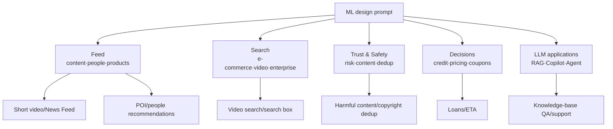

# Case library: 14 interview problems at a glance

> **One-line summary**: ML design prompts come from a finite set — **Feed (content/people/products), Search, Trust & Safety, decision problems, and LLM applications**. Do one prompt per type thoroughly; the rest transfer via "clarify + skeleton + one pitfall".
>
> **Keywords**: `case library` `news feed` `POI` `dedup` `harmful content` `ETA` `PYMK` `RAG`

## 1. Usage

Remember only four things per case: **prompt → what to clarify → skeleton (3–5 steps) → the easiest pitfall to hit**. In the interview, finish the skeleton first, then go deep on one pitfall; that is the highest-value answer style.

## 2. Problem-type map

## 3. The fourteen cases

### 1) News Feed (Facebook / Weibo)

- **Prompt**: Design a personalized feed showing posts from people and pages a user follows.
- **Clarify**: Only followed entities, or out-of-network recommendations too? Which actions (like/comment/share/hide)? Ad slots? Freshness requirements?
- **Skeleton**: Multi-channel retrieval (follow, friend engagement, trending, interest-based) → lightweight ranking (engagement probability) → ranking (multi-task: click/comment/dwell/negative feedback) → re-ranking (read filtering, creator diversification, freshness decay, ad mixing).
- **Pitfall**: **Balancing social graph and interest**; duplicate read items; negative feedback (hide/unfollow) must enter the model; the freshness decay function must be tunable.

### 2) Short-video recommendation (TikTok / YouTube Shorts)

- **Prompt**: Design home-feed short-video recommendations.
- **Clarify**: DAU, video volume, watch time or completion as the primary goal, whether repeats are allowed, cold-start stage.
- **Skeleton**: Retrieval (two-tower, itemCF, follow, trending, sequence) → coarse ranking → ranking (multi-task: click/completion/watch time/engagement) → re-ranking (diversify, diversity, frequency caps, exploration slots).
- **Pitfall**: **A watch-time objective is easily gamed by clickbait** (pair it with completion and negative feedback); position bias; new-video cold start; trending topics cannot be caught up in time, so online learning or minute-level increments are needed.

### 3) Video search (YouTube Search)

- **Prompt**: Given a query, return a ranking of relevant videos.
- **Clarify**: Is personalization needed? Query language/multilingual? Latency budget? Are relevance labels available?
- **Skeleton**: Query understanding (spelling/rewrite/intent) → two-tower or text-video multimodal embedding retrieval → LTR ranking (relevance + quality + personalization) → re-ranking (dedup, diversity, freshness).
- **Pitfall**: **Relevance is not click-through rate** (clickbait, thumbnail tricks); evaluate with MRR/NDCG@k plus human relevance labels; online, watch total watch time rather than CTR alone.

### 4) POI / nearby restaurant recommendation (Yelp / Meituan)

- **Prompt**: Recommend nearby merchants based on location and preferences.
- **Clarify**: Only nearby, or also regional preferences? Real-time (in-store scenario)? Share of new merchants? Delivery/queueing constraints?
- **Skeleton**: Geographic filter (GeoHash/radius) → multi-channel retrieval (location, category, collaborative, trending) → ranking (click/visit/dwell time) → re-ranking (distance, rating, diversity, monetization).
- **Pitfall**: **Geographic constraints are a hard filter**, not just a feature; many cold-start merchants; distance conflicts with relevance; dwell time can be modeled as $t/(1+t)$ into a 0–1 target.

### 5) People you may know (PYMK / LinkedIn)

- **Prompt**: Recommend people a user might want to add as friends.
- **Clarify**: Is the friendship symmetric or one-way? Privacy boundaries? Use contacts/common groups? Latency?
- **Skeleton**: Candidate generation (second-hop friends, same school/company, contacts, common groups) → graph features (mutual friends, Jaccard, communities, path length) → binary classification (whether a connection forms) → re-ranking (dedup, already-invited filtering, diversity).
- **Pitfall**: **The graph is huge** (second-hop explosion), so candidate pruning and sampling are needed; privacy (never expose contacts); sparse feedback; recommending people already known.

### 6) Ad click-through rate prediction (Ad CTR)

- **Prompt**: Design a CTR prediction system for display/search ads.
- **Clarify**: Billing model (CPC/CPM/oCPC)? Ad slot? Budget and pacing constraints? Latency?
- **Skeleton**: Targeting/retrieval → coarse ranking → ranking (pCTR/pCVR, DeepFM/DIN/DCN) → **calibration** (PCOC≈1) → auction (eCPM = pCTR × bid) → pacing.
- **Pitfall**: **Without calibration the money math is simply wrong**; conversion delay and sample selection bias; ad cold start; balancing ad density with user experience.

### 7) Harmful content detection

- **Prompt**: Detect and handle harmful content such as hate, pornography, violence, and fraud.
- **Clarify**: Which types to detect (multi-label)? Which costs more, missed content or false positives? Human review? Multimodal? Latency?
- **Skeleton**: Multimodal features (text/image/video/audio) → multi-task multi-label classification → tiered handling (block high-confidence, demote low-confidence, human review) → appeals flow back.
- **Pitfall**: **Extreme class imbalance + adversarial evolution** (LLM-generated variants); evaluate with PR-AUC and prevalence (block rate); false positives hurt creators, so appeals and explainability matter; labels come from reviewers/user reports/LLMs and are noisy.

### 8) Dedup and copyright detection

- **Prompt**: Detect whether an uploaded video/product duplicates something in the library.
- **Clarify**: Exact duplicates or near-duplicates (edits/speed changes/filters)? Real-time or offline? Cost of false positives (copyright overreach)?
- **Skeleton**: Coarse screening (audio fingerprint, hashing, LSH) → fine-grained embeddings (keyframes + text + audio) → ANN nearest-neighbor search → similarity threshold + human review.
- **Pitfall**: **Near-duplicates** (transform invariance) are much harder than exact duplicates; thresholds must be tuned per business (copyright false positives are costly); large scale needs sharded indexes and caching; retrieval latency for a million-item library.

### 9) Loan origination

- **Prompt**: Decide loan approval/rejection/limit in real time.
- **Clarify**: Pre-loan/in-loan/post-loan? Loan type and risk type? Approval rate and bad-debt targets? Compliance requirements?
- **Skeleton**: Rules (blocklists/hard constraints) → features (credit bureau, income, debt, behavior, graph) → model (scorecard/GBDT) → cost-based threshold decision → human review.
- **Pitfall**: **Label delay** (DPD30 needs 6–12 months); sample selection bias (only approved applicants have outcomes); explainability and fairness; cross-period validation, never a random split.

### 10) Coupon distribution (Coupon / Uplift)

- **Prompt**: Under a budget constraint, decide which users get which coupons.
- **Clarify**: Target incremental purchases or retention? Budget size? Coupon type/face value? Multiple coupons per user?
- **Skeleton**: Segment users (sensitive/sure thing/lost cause/adverse effect) → uplift model (T-learner/causal forest) → budget-constrained optimization (knapsack/greedy) → frequency caps and fatigue control → incremental evaluation.
- **Pitfall**: **Judging by redemption rate alone loses money** (coupons go to "would buy anyway" users); a control group is required; budget constraint makes it a combinatorial optimization problem; the "sleeping dog" segment buys less when given a coupon.

### 11) Enterprise knowledge-base Q&A (RAG)

- **Prompt**: Design a Q&A assistant over company documents.
- **Clarify**: User scale, document types and update frequency, multi-turn/multi-hop, permission model, whether data can leave the network.
- **Skeleton**: Parse and ingest (chunks + metadata + ACL) → hybrid retrieval + rerank → prompt assembly (citations/format/refusal) → streaming LLM generation → citation validation and post-processing → evaluation and bad-case feedback.
- **Pitfall**: **Permissions must be enforced at the retrieval layer**; over-splitting chunks breaks semantics; knowledge versions change; hallucination and fabricated citations; cost (caching + context trimming).

### 12) Customer-support Copilot

- **Prompt**: Give support agents real-time assistance (drafts, knowledge cards, ticket summaries).
- **Clarify**: Assist or auto-reply? Which business systems can it call (read/write)? Latency tolerance? Compliance?
- **Skeleton**: ASR/text input → intent and customer-context aggregation → knowledge retrieval + tool queries (orders/logistics) → draft generation with citations → agent adopts/edits → feedback loop.
- **Pitfall**: **Human in the loop** (it must not promise compensation automatically); tool write actions need second confirmation; adoption rate is not resolution rate; sensitive data must be masked; latency affects agent experience.

### 13) Search box autocomplete (Search Suggestion)

- **Prompt**: Given a prefix, return candidate queries in real time.
- **Clarify**: Personalized? Include search history? Sensitive-word policy? QPS and latency?
- **Skeleton**: Offline mining of high-frequency queries and prefixes → trie/prefix KV index → online top-K + personal history + popularity decay → spelling correction and safety filtering → log feedback.
- **Pitfall**: **Every keystroke triggers a request** (5–10x search QPS), so caching and prefetching are required; vulgar/sensitive-word filtering; long-tail prefixes have no candidates; generative completion has latency and controllability issues.

### 14) ETA / delivery-time estimation

- **Prompt**: Estimate the time from order to delivery (or rider arrival time).
- **Clarify**: Which segment (food preparation/pickup/delivery)? Mean or P90? Is real-time traffic available? Late-delivery compensation constraints?
- **Skeleton**: Distance/traffic/time of day/merchant prep time/rider features → GBDT or deep regression (optionally with **quantile loss** for P50/P90) → online real-time features → calibration by city/trade area.
- **Pitfall**: **Merchant prep time is the largest uncertainty**; traffic freshness; long-tail merchants and bad weather; training with MAE underestimates the tail, while the business cares about the P90 late rate.

## 4. One-page comparison

| Case | Core difficulty | Must-have components | Common follow-up |
| --- | --- | --- | --- |
| News Feed | Social + interest + freshness | Multi-channel retrieval, multi-task, re-ranking | How to use negative feedback? How to dedup read items? |
| Short video | Watch-time target + real-time | Two-tower, sequence models, online learning | How to prevent clickbait? Cold start? |
| Video search | Relevance | Query rewriting, two-tower, LTR | How are relevance labels collected? |
| POI | Geographic constraint | GeoHash, location retrieval | New-merchant cold start? |
| PYMK | Graph scale | Second-hop, graph features, binary classification | How to prune candidates? Privacy? |
| Ad CTR | Calibration + auction | pCTR/pCVR, ESMM, GSP | What happens without calibration? |
| Harmful content | Imbalance + adversaries | Multimodal, multi-task, tiered handling | Missed vs false positive trade-off? |
| Dedup | Near-duplicates | LSH, embeddings, ANN | How to set the threshold? |
| Credit | Label delay + compliance | Scorecard, cost threshold, KS/PSI | How to handle sample bias? |
| Coupons | Causal increment | Uplift, budget optimization | How to prove it is incremental? |
| RAG | Retrieval + hallucination | Hybrid, rerank, ACL, evaluation | How to isolate permissions? |
| Support Copilot | Human in the loop | Tool calls, ASR, review | How to prevent write mistakes? |
| Suggestion | High QPS, low latency | Trie, caching, safety filtering | How to get latency under 50 ms? |
| ETA | Uncertainty | Quantile regression, real-time features | How to guarantee P90? |

## 5. Interview Q&A

### Q1. Given only "design an XX system", how do you locate the problem type quickly?
**Answer**: Ask two questions first: **is the user arriving with a query, or is the system guessing** (Search vs Feed); **is the output content or a decision** (ranking vs approve/reject/price). Land in that 2x2 and the skeleton follows. Then ask for three numbers — scale, latency, goal — and start drawing.
**Follow-up**: What if you have never seen the prompt? Transfer to the closest case and explicitly state "the difference from XX is ...".

### Q2. How do you reuse skeletons across cases?
**Answer**: All ranking systems share "retrieval → coarse ranking → ranking → re-ranking"; all decision systems share "rules → features → model → threshold → human"; all LLM applications share "retrieval/tools → context → generation → evaluation". Memorize three skeletons; the rest is domain features and constraints.
**Follow-up**: What cannot be reused? Metrics and compliance constraints — what "must not get worse" is completely different per domain.

### Q3. What if the interviewer pushes for a specific number you do not know?
**Answer**: Give the derivation instead of a memorized number: "Assume 1e8 DAU and 10 requests per user: 11.6k QPS average, 35k at 3x peak. The exact number depends on the business, but the architecture choice is insensitive to the order of magnitude." Admitting uncertainty plus an estimation method is safer than inventing a number.
**Follow-up**: If they insist on an exact value? State the required inputs (DAU, requests per user, peak factor) and turn the question into a formula.

### Q4. With 45 minutes and only one case, how do you allocate time?
**Answer**: Clarify 5 min, metrics 4 min, data and features 8 min, model and funnel 12 min, architecture and capacity 8 min, evaluation and monitoring 4 min, and the rest for follow-ups. Prepare one "highlight deep dive" per case (e.g., position bias, calibration, cold start) and either wait for the question or volunteer it.
**Follow-up**: What if you cannot finish? A complete skeleton beats being stuck on the first layer.

### Q5. Which cases are asked most often?
**Answer**: By role — recommendation/ads: short-video recommendation, News Feed, ad CTR; search: video search, suggestions; risk: fraud, credit; LLM applications: RAG, support Copilot, code assistant; general: monitoring systems, dedup. Prioritize the two closest to your resume.
**Follow-up**: What about a cross-domain interview? Use the generic skeleton plus one domain pitfall; do not pretend to be an expert.

### Q6. Where do the "highlights" of a case come from?
**Answer**: Three sources: ① **a concrete number** (latency budget, candidate count, cost); ② **a real pitfall** (position bias, label delay, cache leaking answers); ③ **an improvement plan** (distillation, online learning, calibration, evaluation loop). With these three, a 40-minute design has the texture of "I actually built this".
**Follow-up**: What if you have no industry experience? Describe details from papers/open-source implementations and say they are public practice.

### Q7. How do you answer "what if scale grows 100x"?
**Answer**: Cover four dimensions: ① storage and index sharding (retrieval index, embedding tables); ② compute (model sharding/distillation, more GPUs, batching); ③ traffic (multi-level caching, read/write separation, rate limiting and degradation); ④ data (sampling, feature versions, parallel training). Add which designs break (single-machine ANN, full broadcast).
**Follow-up**: What about cost? Tiered storage, hot/cold separation, and allocating compute by ROI.

### Q8. How do you avoid being caught reciting a template?
**Answer**: Templates give the order; the content must come from **scenario-specific trade-offs**: say "here I assume ..., so I choose ..., at the cost of ..."; when challenged, acknowledge the boundary ("this design does not hold under X"). Interviewers dislike "the same script for every question", not "having a framework".
**Follow-up**: What if they point out a flaw? Confirm their premise first, then correct it, rather than arguing.

### Q9. How do you expand the case library yourself?
**Answer**: Maintain it as "new scenario → find the closest existing case → record the difference". After every interview, add the prompt, the clarifying points, and the pitfalls you were pushed on; in three months you will see the problem types repeat heavily.
**Follow-up**: How do you verify you have learned it? Without notes, deliver a case's skeleton plus one pitfall in 5 minutes.

## 6. Cheat sheet

| Type | Skeleton keywords | High-frequency pitfalls |
| --- | --- | --- |
| Feed | retrieval → coarse → ranking → re-ranking | Position bias, objective misalignment, cold start |
| Search | query understanding → retrieval → LTR → re-ranking | Relevance ≠ clicks, long tail |
| T&S | features → multi-task → tiered handling → appeals | Imbalance, adversaries, false positives |
| Decisions | rules → features → model → threshold → human | Label delay, cost matrix, compliance |
| LLM | retrieval/tools → context → generation → evaluation | Permissions, hallucination, cost, injection |

## 7. References

- [MLE Interview · 03_system/03_ml](https://github.com/longxingtan/MLE-interview/tree/main/03_system/03_ml): original notes for 20+ Chinese case studies
- [ML System Design 2.0 · Yuan Meng](https://www.yuan-meng.com/posts/mle_interviews_2.0/): the finite problem space and three complete design examples
- [Machine Learning Interviews · alirezadir](https://github.com/alirezadir/Machine-Learning-Interviews)
- [Eugene Yan · System Design for Recommendations and Search](https://eugeneyan.com/writing/system-design-for-discovery/)
- [Twitter · the-algorithm](https://github.com/twitter/the-algorithm)
