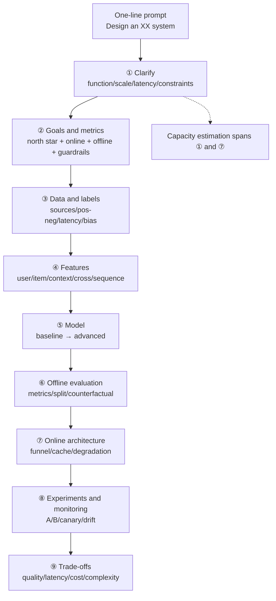

# Chapter 6 · ML System Design

> **One-line summary**: The ML system design round is not about how many models you know. It tests **whether you can turn a fuzzy problem into a shippable system under constraints**: clarify requirements → define metrics → build data → choose models → design evaluation → draw the architecture → articulate trade-offs. This chapter first gives a reusable answer skeleton (01), then walks through one full design for each of four tracks — recommendations (02), search and ads (03), risk and finance (04), and LLM applications (05) — and closes with a case library (06) covering common variants of real interview questions.
>
> **Keywords**: `ML design` `clarify` `funnel` `capacity estimation` `trade-off` `offline-online consistency` `A/B test`

## Chapter overview

- **Format**: 45–60 minutes, a one-line prompt ("design a short-video recommendation system"), a whiteboard or shared doc, and you draw while you talk.
- **What is scored, in order**: clarification and structure (most important) > data and metrics > system layers > model details > scale and cost > trade-offs.
- **How this differs from the ML Infra round**: this chapter is **modeling-side** design — metrics, samples, features, models, funnels. Chapter 7 is **infrastructure-side** — the internals of a feature store, training clusters, GPU serving, scheduling. The two rounds reference each other, but the emphasis differs; do not spend 20 minutes on Kafka partitions in a modeling round.
- **One-line rule of thumb**: give the "skeleton + numbers" first, then go deeper wherever the interviewer pushes.

## The chapter at a glance

## What this chapter covers

| Note | Content | How to use it |
| --- | --- | --- |
| [01 Answer framework and methodology](01-framework-and-methodology.md) | 9-step framework, three metric layers, capacity formulas, trade-off phrasing, common failure modes | Recite before a design round |
| [02 Recommendation system design](02-recommender-system-design.md) | Full funnel: retrieval/coarse ranking/ranking/re-ranking, samples and negative sampling, multi-task, cold start, evaluation and latency | Feed, short video, e-commerce recommendations |
| [03 Search and ads design](03-search-and-ads-design.md) | Query understanding, retrieval and ranking, CTR/CVR prediction, ESMM, calibration, bidding and auctions, search box | Search, ads, suggestions |
| [04 Risk and finance design](04-risk-and-finance-design.md) | Fraud detection, class imbalance, graph features, rules + models, false-positive cost, credit and coupons | Risk, payments, credit, marketing |
| [05 LLM application system design](05-llm-application-design.md) | RAG/agent systems, token cost and capacity, caching, streaming, evaluation, safety, multi-tenancy | Mandatory for LLM application roles |
| [06 Case library](06-case-studies.md) | 14 interview questions at a glance: news feed, video search, POI, dedup, content safety, ETA... | Skim before an interview to fill gaps |

## Interview rounds

| Round | Typical prompt | What is tested | Coverage here |
| --- | --- | --- | --- |
| ML Model Design | "Design a short-video recommendation system" | Problem decomposition, metrics, data, funnel, trade-offs | 01–04 |
| ML Infra Design | "Design a feature platform / training platform" | Component depth, consistency, scheduling, capacity | Chapter 7 |
| LLM App Design | "Design an enterprise knowledge-base QA system" | RAG, agents, token cost, evaluation and safety | 05 |
| Project Deep Dive | "Walk me through a system you built" | Real details and reflection | 01 + 06 |

> Rule of thumb: **Model Design is judged on structure, Infra Design on details**. In the former you can say "we use an ANN index here"; in the latter you will be asked how the index is updated incrementally, what happens when it does not fit in memory, and how versions are rolled back.

## Seven tensions behind every design

Every trade-off in system design comes from one of these tensions. When you get stuck, come back to this table:

| Tension | One end | The other end | Common compromise |
| --- | --- | --- | --- |
| Quality vs latency | Big models, many features, early fusion | 200 ms p99 | Tiered funnel, feature pruning, caching, distillation |
| Memorization vs generalization | ID embeddings, sequence features | Cold start, long tail | Two-tower + side info, multi-channel retrieval |
| Offline vs online | Offline metrics are easy to optimize | Online is the real target | Counterfactual evaluation, A/B, offline-online consistency checks |
| Single vs multiple objectives | CTR is easy to optimize | Watch time/retention/GMV | Multi-task learning, constrained optimization, value models |
| Real-time vs cost | Streaming features, online learning | Stability and compute | Tiered freshness (seconds/minutes/days), incremental training |
| Personalization vs diversity/ecosystem | Chasing clicks | Filter bubbles, creator ecosystem | Re-ranking diversification, exploration traffic, frequency caps |
| Accuracy vs explainability/compliance | Complex models | Risk control, financial regulation | Rules + models, SHAP, monotonicity constraints |

## Study plan

1. **Memorize the framework before reading cases**: the 9 steps and capacity formulas from 01 must be reproducible without notes (~2 hours).
2. **Do one full design per track**: pick one from 02–05, present it on a whiteboard in 45 minutes, record it, and listen back (~1–2 hours each).
3. **Use the case library to fill gaps**: for each of the 14 cases in 06, remember only "clarifying questions + skeleton + one pitfall" (~2 hours).
4. **One hour before the interview**: read only the [system design and infra cheat sheet](../08-interview-bank/05-system-design-and-infra-cheatsheet.md).

Estimated total: **2–3 days**.

## How it connects to other chapters

- [01 ML fundamentals](../01-ml-fundamentals/README.md): evaluation metrics (AUC/PR/NDCG), class imbalance, and calibration are the "parts" used in design rounds — go back for the formulas when a metrics question comes up.
- [02 Deep learning fundamentals](../02-dl-fundamentals/README.md): DNNs, Transformers, and sequence modeling determine what a ranking model can look like.
- [04 Large language models](../04-llm/README.md) and [11 RAG](../04-llm/11-rag.md): the design questions in 05 reuse RAG, KV cache, and inference optimization heavily.
- [05 AI Agents](../05-agents/README.md): control flow, tools, memory, and evaluation for agent system design.
- [07 ML Infra](../07-ml-infra/README.md): this chapter only says which components to use; internals, consistency, scheduling, and cost models are covered in Chapter 7.
- [08 Interview bank](../08-interview-bank/README.md): last-minute cheat sheets and cross-topic Q&A.

## References

- [ML System Design 2.0 · Yuan Meng](https://www.yuan-meng.com/posts/mle_interviews_2.0/): problem taxonomy, answer skeleton, funnel numbers, and a deep-dive checklist
- [ML Systems Design Interview Guide · Patrick Halina](http://patrickhalina.com/posts/ml-systems-design-interview-guide/)
- [Designing Machine Learning Systems · Chip Huyen](https://github.com/chiphuyen/machine-learning-systems-design)
- [MLE Interview · longxingtan](https://longxingtan.gitbook.io/mle-interview): 20+ Chinese system design case studies
- [Machine Learning Interviews · alirezadir](https://github.com/alirezadir/Machine-Learning-Interviews)
- [Eugene Yan · System Design for Recommendations and Search](https://eugeneyan.com/writing/system-design-for-discovery/)
- [ML Infra Interviews · Yuan Meng](https://www.yuan-meng.com/posts/ml_infra_interviews/)
