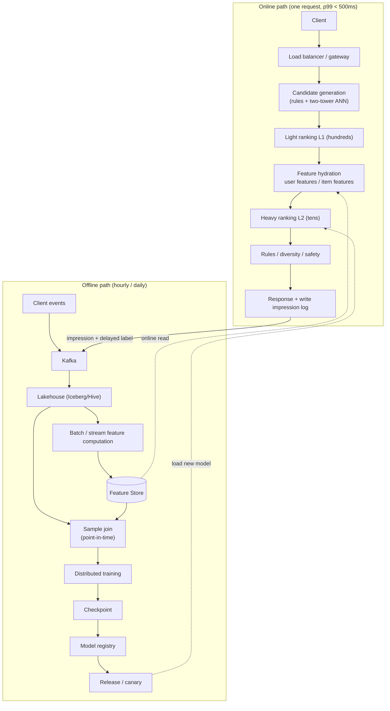

# ML Infra in a nutshell: what an end-to-end ML system looks like

> **One-line summary**: ML infra turns the chain "events → features → samples → training → release → monitoring" into a reusable, operable pipeline whose cost you can estimate. The interview tests whether you can draw the whole map, explain the two paths (online and offline), and argue consistency across three consumers (training, serving, backfill).
>
> **Keywords**: `end-to-end ML system` `offline/online path` `training-serving skew` `DAG orchestration` `feature store` `model registry`

## 1. Core concepts

### 1.1 What "ML infra" means

Model code is only a small part of a production system. An ML system that ships also needs **data ingestion, storage, feature computation, sample assembly, distributed training, model management, online serving, and monitoring** — collectively called ML infra (the ML platform). What makes it different from ordinary backend infrastructure: the workload runs on GPUs, the data has time semantics, and quality problems degrade silently.

I remember it as five layers, which makes it easy to walk through in an interview:

| Layer | What it covers | Typical tech | What interviewers probe |
| --- | --- | --- | --- |
| Hardware / network | GPUs, NVLink, InfiniBand/RDMA, object storage | H100, 400G IB, S3 | Topology, bandwidth, failure rate |
| Cluster / scheduling | Container orchestration, gang scheduling, quota | K8s, Slurm, Volcano, Kueue | Utilization, queueing, preemption, fragmentation |
| Framework / runtime | Training framework, communication library, inference engine | PyTorch, NCCL, DeepSpeed, TensorRT | Parallelism strategy, kernels, memory |
| Platform / tooling | Feature platform, training platform, experiment platform, registry | Feast, Kubeflow, MLflow | Abstraction, consistency, usability |
| Application / business | Ranking service, policy layer, experiments | In-house | SLA, metrics, cost |

### 1.2 Component checklist

| Component | Problem it solves | One-line design point |
| --- | --- | --- |
| Ingestion | Pull in data from client events and business databases | Land events in Kafka first so they can be replayed |
| Data lakehouse | Store raw and processed data at scale | Partitions + columnar storage (Iceberg/Hive/Delta) + versions |
| Feature store | Define a feature once, use it both offline and online | Dual storage + point-in-time join (see [02](02-feature-store-and-realtime-features.md)) |
| Training platform | Submit, queue, tolerate failures, produce checkpoints | Gang scheduling + elasticity + resume from checkpoint (see [03](03-distributed-training-infrastructure.md)) |
| Model registry | Versions, lineage, stages (staging/prod) | Model + feature version + code commit as one triple |
| Inference service | Score with low latency and high throughput | Layered architecture + batching + autoscaling (see [04](04-inference-serving-and-gpu-optimization.md)) |
| Monitoring / alerting | Catch data, feature, model, and system problems | Four families of metrics, none optional (see [05](05-data-and-experiment-platform.md)) |
| Workflow orchestration | Run all of the above in dependency order | DAG + idempotency + retries + backfill |

## 2. Principles and derivations: two paths and one hub

### 2.1 The full picture



### 2.2 The online path: follow one request through its lifecycle

1. **Request**: the user refreshes the feed or types a query; the client sends a request; the gateway handles auth, rate limiting, and routing.
2. **Candidate generation**: pull a few thousand candidates out of millions or billions. Multiple generators run in parallel (trending, followed authors, interest tags, two-tower ANN) to balance recall and diversity.
3. **Light ranking (L1)**: a small model with few features cuts thousands down to hundreds at controllable cost.
4. **Feature hydration**: batch-fetch online features by key. User features are fetched once per request (request-level broadcasting); item features are numerous, so the feature store is often co-located with the model server to avoid RPC.
5. **Heavy ranking (L2)**: a heavy model with the full feature set cuts hundreds down to tens.
6. **Policy layer**: diversity, deduplication, safety filtering, ads blending.
7. **Logging**: write **the features used for scoring, the predictions, and the request context** to disk — this is the source of training data.

### 2.3 The offline path: turn logs into models

1. Events land in Kafka (replayable), then get written periodically into lakehouse tables (partitioned by day/hour).
2. Stream jobs compute near-real-time features; batch jobs recompute hourly/daily and repair what the stream job missed or got wrong.
3. **Sample join**: left-join the impression log with the feature values at that time. Two sources: **forward logging** (record the scoring-time features directly, most consistent) and **backfill** (join from historical feature tables by impression time; fast, but must guard against leakage).
4. Training (DDP or hybrid parallelism, see [Chapter 4](../04-llm/07-distributed-training.md)) → checkpoint → offline evaluation → registry → canary → full rollout.
5. Watch online metrics; roll back if they degrade.

### 2.4 The hub: the impression log

The system closes the loop because every request leaves behind "**who, in what context, saw which candidates, with what features, what score the model gave, and what the user did afterwards**". It is simultaneously the source of training samples, the source of online metrics, the basis for debugging, and (importantly) a **feature snapshot**.

**Delayed labels** are the hard part of the interface: a click may arrive seconds later, a purchase days later. The usual approach is to log separately (impression table + engagement table), then join offline on `impression_id` or `(user_id, item_id, ts)`, and give the join a **label observation window** (e.g., only samples older than 7 days are used for training, so positive labels are not systematically undercounted).

### 2.5 Batch processing vs. stream processing

| Dimension | Batch | Stream |
| --- | --- | --- |
| Input | Bounded (one day of files) | Unbounded (events arriving continuously) |
| Latency | Hours to days | Seconds to minutes |
| Correctness | Fully recomputable, deterministic | Must handle out-of-order, late, duplicate events (event time + watermark) |
| Typical tools | Spark, Hive, Iceberg | Kafka, Flink, Spark Structured Streaming |
| Fits which features | User profiles, content embeddings, long-window aggregates | Clicks in the last N minutes, in-session behavior, real-time sequences |
| Cost | High peak resources, can run off-peak | Always-on resources, but only computes increments |

In practice you combine them (a simplified lambda architecture): the stream job keeps data fresh, the batch job keeps it complete. When one feature definition has two implementations, they must be generated from **the same feature DSL** or the same code, otherwise the offline and online numbers drift apart.

### 2.6 Workflow orchestration

An ML system is a set of tasks (pull data, compute features, join, train, evaluate, release) with dependencies. An orchestrator (Airflow, Kubeflow Pipelines, Argo Workflows, Metaflow, Dagster) provides:

- **Dependencies and triggers**: schedules, upstream data readiness, event-driven runs;
- **Retries and idempotency**: a rerun must not duplicate data (partition overwrite + dedup keys);
- **Backfill**: recompute a historical date range, with the range as a parameter;
- **Observability**: inputs, outputs, runtime, and logs are queryable for every run.

When asked "why not just chain cron scripts", the standard answer is: you would be missing dependency management, retries and idempotency, backfill, and lineage — at any real scale that becomes an operational disaster.

## 3. Implementation notes

A minimal orchestration definition (Airflow style); the point is that the partition date is a parameter and the tasks are idempotent:

```python
from airflow.decorators import dag, task
from datetime import datetime

@dag(schedule="0 2 * * *", start_date=datetime(2025, 1, 1), catchup=True)
def daily_training_pipeline():
    @task
    def build_features(ds: str) -> str:        # ds = logical date, injected by the scheduler
        out = f"s3://lake/features/dt={ds}"
        # partition overwrite: rerunning the same day yields the same result (idempotent)
        return out

    @task
    def build_samples(feature_path: str, ds: str) -> str:
        # only features from ds and earlier, and never newer than that day's watermark
        return f"s3://lake/samples/dt={ds}"

    @task
    def train(sample_path: str) -> str:
        # submit to the training platform, wait for completion, return the checkpoint path
        return f"s3://models/ckpt/{sample_path.split('dt=')[1]}"

    train(build_samples(build_features(), "{{ ds }}"))

daily_training_pipeline()
```

Submitting a distributed training job (the minimal torchrun form):

```bash
# run once per node; WORLD_SIZE = number of nodes x GPUs per node
torchrun --nnodes=4 --nproc_per_node=8 \
  --rdzv_backend=c10d --rdzv_endpoint=train-svc:29500 \
  train.py --config config.yaml
```

## 4. Interview Q&A

### Q1. What is the difference between an ML infra interview and an ML system design interview?
**Answer**: System design focuses on "business goal → ML objective → data/labels/model/metrics" and produces a design; infra design focuses on "the offline + online pipelines that support that design" and produces components and engineering trade-offs. The test is simple: "is recall good enough" is the former; "how do you guarantee point-in-time correctness" or "how do you schedule 10k GPUs" is the latter.
**Follow-up**: Why do big companies run a separate infra round? Because at scale, "the model can be trained" and "the system can train and ship every day" are two different problems, and the latter sets your iteration speed.

### Q2. Why is the impression log the hub of the system?
**Answer**: It is the only place that carries the model input (features), the model output (prediction), and the real feedback (label) together. Training samples come from it, online metrics are computed from it, and bad cases are reproduced from it. Without it, offline and online are two systems that cannot be aligned.
**Follow-up**: What about delayed labels? Log separately + observation window + join on `impression_id`; in extreme cases, correct or weight recent samples.

### Q3. Where does training-serving skew come from, and how do you prevent it?
**Answer**: Three sources: (1) **code mismatch** — features are written in Spark/Python offline and rewritten in C++/Go online, so floating point, defaults, and time zones diverge; (2) **data mismatch** — the offline join picks up "future" feature values, inflating offline AUC; (3) **time mismatch** — online reads the incremental value at time T while offline reads a whole-day aggregate. The fix: generate both execution paths from one feature definition, enforce point-in-time join, and after launch run a consistency spot check of "online features vs. offline recomputation".
**Follow-up**: How do you detect that you are already skewed? Watch the gap between offline and online AUC; or recompute features for the same requests with the offline pipeline and compare distributions (PSI).

### Q4. Batch or streaming, how do you choose?
**Answer**: Look at the time value of the feature and the cost of recomputation. User profiles and content embeddings that only need daily updates are batch; anything that must affect ranking within minutes of a click (real-time interest, trending) is streaming. Do not stream for its own sake — stream jobs carry much higher operational and out-of-order correctness costs.
**Follow-up**: What if one feature is needed both ways? Use a unified aggregation abstraction (blocks + mergeable operators): the stream computes fine-grained blocks, the batch recomputes to fill gaps.

### Q5. What are the core capabilities of an orchestrator, and why is idempotency mandatory?
**Answer**: Dependency management, triggers, retries, backfill, lineage, observability. Idempotency is the precondition for retries and backfill: when a task reruns or a historical partition is recomputed, it must be "same input, same output, overwrite instead of append", otherwise you get duplicate samples and duplicate features, and the training data is silently polluted.
**Follow-up**: How do you achieve it? Partition overwrite, `MERGE`/`INSERT OVERWRITE` writes, and downstream reads of versioned table snapshots.

### Q6. Build in-house or use open source (Kubeflow/Metaflow/Feast)?
**Answer**: Default to open source or managed services and spend engineering effort on business features and models. Build only when (1) scale or latency has hit the limits of the open-source option (10k-GPU scheduling, millisecond feature reads), or (2) you already have a strong platform team and the open-source abstraction does not match your internal data stack. The test is "is this component part of our differentiation".
**Follow-up**: What is the biggest trap in building a platform? Abstracting too early — support three real use cases before generalizing, or you will build a framework nobody wants to use.

### Q7. Why abstract out a feature store or a model registry?
**Answer**: Because they solve **reuse and governance**. A feature store lets one feature be shared by many models, stay consistent offline and online, and be backfilled and monitored; a model registry binds "model file + feature version + code commit + metrics" into a traceable artifact that supports canary, rollback, and audit. Without the abstraction, every team writes its own copy, duplicating work and drifting in definitions.
**Follow-up**: Is a feature store always necessary? Small teams can get by with "an offline table + Redis + naming conventions"; the reuse and consistency payoff only becomes obvious at hundreds of features and a dozen models.

### Q8. How does infra differ between large and small companies?
**Answer**: Large companies (Meta/Snap/Uber/Pinterest) build end-to-end platforms characterized by "unified abstraction + extreme scale", at the cost of migration effort and a learning curve; smaller companies assemble managed cloud services (SageMaker/Vertex) and open source (Airflow + Feast + MLflow), characterized by "fast iteration, small scale, outsourced operations". Do not copy a hyperscaler design into a small setting — you will be asked "how many teams does that take to maintain".
**Follow-up**: How would you build it with only 3 MLEs? One lakehouse table + one orchestrator + one online KV store + one model registry; get the loop closed first, then optimize.

### Q9. Building a recommender's ML infra from scratch, what comes first?
**Answer**: The **closed loop**, not performance: client events and impression logs → offline sample join → single-machine training → simple serving → offline/online metric dashboards. Once the loop runs, optimize by bottleneck: if samples are not fresh enough, add streaming features; if training is slow, add GPUs; if serving latency is high, add batching and move to GPUs.
**Follow-up**: What is the most error-prone step in the loop? The time semantics of the sample join (leakage) and delayed labels — neither raises an error, they just make the model "look great".

### Q10. How do you measure whether ML infra is good?
**Answer**: Four families: (1) **iteration efficiency** — days from idea to launch, experiment throughput (how many A/B tests per week); (2) **resource efficiency** — GPU utilization/MFU, cost per request, storage cost; (3) **reliability** — training-job success rate, time to recover (MTTR), serving availability and p99; (4) **correctness** — feature-consistency spot-check pass rate, data-quality alerts, number of rollbacks.
**Follow-up**: If you could only look at one metric? Model iterations per unit cost — it captures both efficiency and reliability.

## 5. Pitfalls and follow-ups

- **Drawing only the online path**: an infra interview must cover both paths and explain how logs close the loop.
- **Treating "real-time" as automatically correct**: out-of-order, duplicate, and retracted events make real-time features an order of magnitude harder than batch; be able to state the cost.
- **Ignoring delayed labels**: the most hidden trap in sample construction; the positive rate in the training set is systematically undercounted.
- **Estimating capacity with GPUs only**: feature storage, log volume, and cross-node bandwidth are often the real bottlenecks.
- **Over-abstracting**: saying "I would design a general platform" without grounding it in a concrete use case invites follow-ups you cannot answer.
- **Confusing model versions with feature versions**: when production breaks, you must be able to answer "which day's features trained this model".

## 6. Cheat sheet

| Question | One-line answer |
| --- | --- |
| What are the end-to-end stages? | Ingestion → storage → features → samples → training → registry → serving → monitoring |
| What closes the loop between the two paths? | The impression log (features + prediction + label) |
| Three lines of defense for consistency? | One feature definition, point-in-time join, online/offline spot checks |
| Four orchestrator capabilities? | Dependencies, retry/idempotency, backfill, lineage |
| Batch vs. stream? | Look at the time value of the feature; do not stream for its own sake |
| North star for infra quality? | Iteration speed per unit cost |
| Build vs. buy? | Is it differentiation, and has open source hit its limit? |
| Most hidden pitfall? | Feature leakage and delayed labels — neither raises an error |

## 7. References

- [Preparing for ML Infra System Design Interviews · Yuan Meng](https://www.yuan-meng.com/posts/ml_infra_interviews/) (primary source for the pipeline walk-through, Robusta/feature store, Kafka/Flink, and GPU serving)
- [Distributed Machine Learning Patterns](https://github.com/mercari/distributed-ml-patterns) (the four components of a bare-bone ML system: ingestion/batching/sharding/caching)
- [Introducing Bento, Snap's ML platform](https://eng.snap.com/bento-ml-platform)
- [Scaling AI/ML Infrastructure at Uber](https://www.uber.com/blog/scaling-ai-ml-infrastructure/)
- [Metaflow · Netflix](https://github.com/Netflix/metaflow)
- [Designing Data-Intensive Applications (DDIA), Chapter 11: Stream Processing](https://dataintensive.net/)
- [MLE Interview · MLOps and distributed ML notes](https://longxingtan.gitbook.io/mle-interview)
