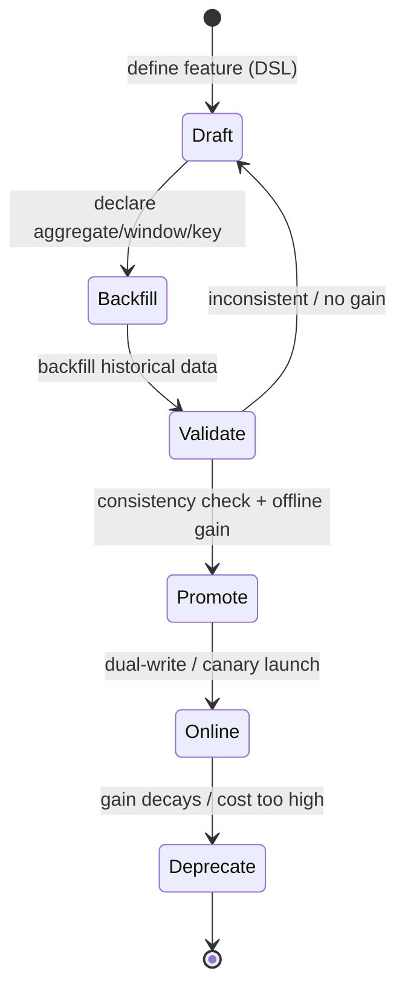

# Feature platforms and real-time features

> **One-line summary**: A feature platform = one feature definition + two stores (offline and online) + point-in-time join; real-time features = Kafka providing an event stream that is ordered within a partition and replayable, plus Flink providing event-time windows, state, and exactly-once. Together they let "the click that just happened" influence the next ranking within tens of seconds.
>
> **Keywords**: `feature store` `point-in-time join` `forward logging` `backfill` `Kafka` `Flink` `watermark` `real-time sequence features`

## 1. Core concepts

### 1.1 The three problems a feature platform solves

| Pain point | Life without a platform | What the platform provides |
| --- | --- | --- |
| Training/serving mismatch | Write it once in Python offline, rewrite it in C++ online | One declarative definition, two execution paths |
| Duplicated work | Every model team recomputes "user clicks in 7 days" | Feature registration, reuse, lineage |
| Slow feature launches | Wait for next month's forward logs to accumulate | Backfill + point-in-time join |
| Unexplainable online features | Cannot tell which version was used when things break | Feature versions + watermark + monitoring |

So the functional requirements are exactly three: **forward logging** (record feature values at inference time), **batch backfill** (generate new features offline and join them with correct timing), and **near-real-time updates** (frequently changing features take effect within seconds). See [01 Overview](01-ml-infra-overview.md) for where this sits in the full pipeline.

### 1.2 The dual-store model

| Dimension | Offline store | Online store |
| --- | --- | --- |
| Medium | Data lake/warehouse: Hive, Iceberg, BigQuery, S3 Parquet | KV/wide table: Redis, Cassandra, Aerospike, HBase |
| Purpose | Training samples, backfill, analytics | Per-key reads during online inference |
| Latency | Minutes to hours (job scheduling) | Sub-millisecond to a few milliseconds |
| Capacity | Petabyte scale | Only "the current value per key", terabyte scale |
| Query pattern | Large scans + time-based joins | Point lookups (batch get) |
| Consistency requirement | Point-in-time correct | Freshness + alignable with offline |

A feature's "current value" must sync from the offline table to the online table (batch sync), while real-time features write to the online store directly and sink back to offline. Both paths must line up — that is the entire difficulty of "offline-online consistency".

### 1.3 Two design philosophies

- **Block-first (Snap Robusta)**: pre-aggregate events into **small fixed-granularity blocks** (e.g., 5-minute blocks) and assemble any window from them. Pros: no recomputation, cheap backfill. Cost: a complex abstraction, and only works for mergeable aggregation features.
- **Feature-first (Uber Palette)**: the core abstraction is the **feature**, and its source can be anything — an RPC, a Flink SQL job, or an offline batch job. Pros: flexible, can host "weird" features. Cost: wasted compute when re-aggregating.

Saying clearly "my system leans block or feature" in an interview scores better than reciting component names.

## 2. Principles and derivations

### 2.1 Point-in-time join: the definition of correctness

Let impression $i$ happen at $t_i$, and let feature $x$ be a mergeable aggregate over events in the past $W$ time. Then the feature value in the training sample must be

$$x_i = \bigoplus_{\{e \,:\, t_e < \min(t_i,\ w_i)\}} \phi(e)$$

where $\oplus$ is an associative, commutative aggregate (count/sum/max) and $w_i$ is the **feature watermark** recorded with the request ("I only trust blocks up to this time"). We cap at $\min(t_i, w_i)$ rather than $t_i$ because the online scoring may have read a slightly older block (database sync lag), and training must reproduce what the model **actually saw**, not what was "theoretically correct". That is point-in-time correctness: **use the value from that moment, not the most accurate value**.

**A typical leakage example**: the impression happens on March 1 at 10:00, and the feature is "user clicks in 7 days". Joining the entire March 1 partition (or even March 2) includes clicks after 10:00 and even in the future — the online model never saw them, offline AUC looks inflated, and metrics drop the moment you ship. An even subtler version: using the T+1 partition, which contains all of day T.

### 2.2 Forward logging vs. backfill

| Dimension | Forward logging | Backfill |
| --- | --- | --- |
| How | Write the features into the impression log at scoring time | Recompute/join from historical feature tables by $t_i$ |
| Consistency | Highest (exactly what the model saw) | Depends on watermark and join logic |
| New features | Must wait X days to accumulate X days of data | Train immediately on historical data |
| Cost | Large log volume (especially high-dimensional/sequence features) | Compute cost + engineering complexity |
| Risk | Lost logs, format evolution | Data leakage, definition drift |

In practice you need both legs: main features go through forward logging, new or fixed features go through backfill. After a backfill, run a **consistency spot check** on the samples that have both a forward-logged value and a backfilled value; the difference should be zero (or an explainable sync lag).

### 2.3 Pre-aggregated blocks and mergeable operators

Suppose you need `item_view_count_last_6h`. Scanning 6 hours of raw events on every query costs more as QPS grows. The block approach:

1. A stream job aggregates events into a block every 5 minutes: `rep_block(item_id, 16:00-16:05) += 1`, written to Iceberg;
2. A batch job rolls 12 five-minute blocks into one-hour blocks every hour, and rescans raw tables to repair what the stream job missed;
3. Queries **assemble arbitrary windows** from 1-hour + 5-minute blocks.

This works only if the aggregate is **associative** (grouping does not change the result) and **commutative** (order does not change the result) — count/sum/min/max qualify, `approx_quantile` approximately, while `last_n` or distinct counts need extra structures (HyperLogLog, sorted lists). That is why block designs excel at aggregation features and struggle with sequences.

Greedy window assembly: starting from the window start, take the largest granularity that fits and is **aligned to its own boundary**. Complexity is $O(\log W)$ in the number of block levels; a query reads only a constant number of blocks.

### 2.4 Kafka: why it is the default

| Concept | Role | Interview point |
| --- | --- | --- |
| topic | Logical grouping (e.g., `post_clicks`) | One topic per event type |
| partition | Physical shard, append-only log | **Ordering is guaranteed only within a partition** |
| key | Decides the partition: `hash(key) % num_partitions` | To keep per-user order, key by userId |
| offset | Consumer position | Replayable = can backfill and fix bugs |
| consumer group | A set of consumers sharing partitions | Partition count caps parallelism |
| replication | Leader-follower copies | Only `acks=all` avoids loss |

The key trade-off: **Kafka does not guarantee global ordering, only per-partition ordering**. So "the event sequence of one user" must land in the same partition (key by userId), otherwise sequence features get scrambled.

### 2.5 Flink: time semantics and correctness

Stream processing has to handle three things: **out-of-order** events (arrival order is not event order), **late** events (arriving after the watermark), and **duplicates** (at-least-once delivery).

- **Event time vs. processing time**: features must aggregate by when the event happened to match offline; with processing time, a traffic spike mixes events from different moments into one window.
- **Watermark**: the system's estimate of event-time progress, $watermark = max\,event\_time - allowed\,lateness$. A window fires when the watermark passes its end.
- **Window types**: tumbling (non-overlapping), sliding (overlapping, used for "last 5 minutes, updated every minute"), session (split by inactivity gaps).
- **State and checkpointing**: aggregates live in a state backend (RocksDB) and are checkpointed to HDFS/S3 periodically; on restart the job recovers from the checkpoint so results do not regress.
- **Exactly-once**: replayable source + state checkpoints + two-phase-commit sink (or idempotent upsert). Feature pipelines often prefer **idempotent writes** (overwrite by key + window) over transactions: simpler and fast enough.

### 2.6 Real-time aggregation: increment, do not recompute

The most expensive mistake is recomputing a user's entire history whenever an event arrives. The right approach is a **dependency graph**: `clicks_5min`, `clicks_1h`, and `clicks_24h` all depend on the click stream, and a new event only increments the affected windows (+1), then upserts the updated values into the online KV store. On cold start or when drift is detected, an offline batch job recomputes and overwrites (stream for freshness, batch for completeness).

### 2.7 Real-time sequence features: order is a first-class citizen

"Last 100 interactions of a user" is a high-value feature in recommendation and ads, but it is much harder than aggregation:

1. **Order**: for aggregates, out-of-order events landing in the same window do not change the result; for sequences, strict event-time ordering is mandatory.
2. **Approach**: keep one append-only, time-ordered log per user (a per-user key-value or document) with $O(1)$ inserts; **key by userId** so all of a user's events land in the same partition.
3. **Reordering buffer**: hold early/late events in a small in-memory buffer (e.g., 60 seconds), insert them in event-time order, and flush periodically to reduce out-of-order writes.
4. **Backfilling new attributes**: do you store item_id or the embedding in the sequence? If a better embedding model arrives later, you should be able to regenerate the sequence from "historical timestamps + new embedding version" — so the log must keep **event time and entity ID**, not just the final vector.
5. **Truncation and deduplication**: keep only the last N entries (TTL and length caps), and deduplicate repeated exposures.

### 2.8 Feature lifecycle and the backfill flow



In practice teams use **two-stage backfill** (Pinterest's approach): first backfill a small sample over a short window to validate the gain, then backfill the full history for real training; meanwhile use **training-time join** (compute features on the fly during training) to reduce dependence on materialized tables. Scheduling, versioning, and quality checks for backfills belong to the data platform — see [05 Data and experiment platform](05-data-and-experiment-platform.md).

## 3. Implementation notes

Assembling a 6-hour window online from blocks (Python pseudocode):

```python
BLOCK_LEVELS = [3600, 300]  # 1h, 5min; must go from largest to smallest

def assemble(key: str, end_ts: int, window: int) -> float:
    start, cur, total = end_ts - window, end_ts - window, 0.0
    for size in BLOCK_LEVELS:
        # only take blocks that are aligned to this granularity and do not pass end_ts
        while cur % size == 0 and cur + size <= end_ts:
            total += blocks[(size, key)].get(cur, 0.0)
            cur += size
    assert cur == end_ts, "window not fully covered; fall back to a finer granularity"
    return total
```

Flink computing "clicks in the last 5 minutes, updated every minute":

```java
DataStream<Click> clicks = env.addSource(new FlinkKafkaConsumer<>("post_clicks", ...));

clicks.keyBy(Click::getPostId)
      .window(SlidingEventTimeWindows.of(Time.minutes(5), Time.minutes(1)))
      .allowedLateness(Time.seconds(30))          // keep updating within 30s of lateness
      .reduce((a, b) -> a.plus(b))                // incremental merge, keep no raw events
      .addSink(new FeatureStoreSink());           // idempotent upsert(key, window_start)
```

An offline point-in-time join (engine supporting ASOF JOIN):

```sql
SELECT i.impression_id, i.user_id, i.item_id, i.label,
       f.clicks_7d, f.watermark
FROM impressions i
ASOF LEFT JOIN feature_snapshots f
  ON i.user_id = f.user_id
 AND i.event_ts >= f.feature_ts          -- only snapshots at or before that moment
 AND f.feature_ts >= i.event_ts - INTERVAL '7' DAY;
```

(When Spark/Flink SQL lacks ASOF JOIN, use a window plus `ROW_NUMBER() OVER (PARTITION BY impression_id ORDER BY feature_ts DESC)` and take the first row.)

## 4. Interview Q&A

### Q1. What problem does a feature store actually solve, and should a small team build one?
**Answer**: Three things: a single definition of features for training and serving, feature reuse and lineage, and fast backfill for new features. It is not mandatory middleware; you build it when hundreds of features, a dozen models, and more than 3 people make duplicated work and definition drift more expensive than the platform.
**Follow-up**: What is the minimal viable version? One offline table (daily partitions) + one online KV store + one sync job + a feature definition document; get "offline and online from the same source" working first.

### Q2. Why is point-in-time join mandatory, and how do you implement it?
**Answer**: Because training samples must reproduce the information the model had at scoring time. If you join features from after the impression (even within the same day's partition), offline evaluation sees the future, metrics inflate, and production drops. Implementation: feature tables carry timestamps/partitions, and you use ASOF JOIN or a window function to take "the latest row with $t \le t_{impression}$", plus a watermark cap so you never use blocks that had not synced at scoring time.
**Follow-up**: Why does forward logging not have this problem? It records the value at that moment; the cost is log volume and delayed launches for new features.

### Q3. How do forward logging and backfill work together?
**Answer**: Regular features use forward logging (consistent, cheap, debuggable); new features, corrected features, and expensive features (e.g., very long sequences) use backfill. Afterwards, run a consistency spot check on samples that have both, and the difference should approach zero; a large difference means sync lag or a definition mismatch.
**Follow-up**: The backfilled training set looks great but production drops — what do you check first? Time semantics (leakage), then offline/online implementation differences (floating point, defaults, time zones), then sample-selection bias.

### Q4. Why not keep only one store?
**Answer**: The access patterns are fundamentally different. Offline training needs large scans and time-based joins, which suits columnar/object storage; online inference needs millisecond point lookups, which suits KV/wide tables. Using the offline store online cannot meet latency, and using the online store for training cannot scan history and is unacceptably expensive.
**Follow-up**: How do the two stores stay consistent? Batch sync (offline → online) + streaming direct writes (real-time features → online, then sink to offline), monitored with a freshness/lag metric.

### Q5. Why use Kafka for real-time features instead of writing straight to Redis?
**Answer**: Kafka provides **buffering, replay, multiple consumers, and ordering guarantees**. Writing straight to Redis couples producers to the online store (if it goes down, events are lost), makes replay impossible (no raw stream to fix bugs or backfill), and blocks downstream reuse (offline, monitoring, and training all need the same events). Kafka is the home of the event; Redis is just a cached view of the features.
**Follow-up**: Can Kafka duplicate or lose events? Default semantics are at-least-once, so consumers must be idempotent (dedupe by offset/event id); only `acks=all` plus replication avoids loss.

### Q6. What is Flink's watermark, and how do you handle late data?
**Answer**: A watermark is a monotonically advancing estimate of event-time progress that decides when a window can fire. With allowed disorder $L$, $watermark = \max(event\_time) - L$. Late data has three treatments: allow lateness and update the window after it closes (`allowedLateness`), emit to a side output for separate correction, or drop it and rely on a batch recompute to fill in.
**Follow-up**: What goes wrong if the watermark is too large or too small? Too large: windows fire late and features become stale; too small: late events are dropped and results undercount.

### Q7. How do you keep real-time aggregates correct after a restart?
**Answer**: Three steps: persist state (RocksDB + periodic checkpoints to object storage), make the source replayable (restore Kafka offsets from the checkpoint), and make the sink idempotent (overwrite by key + window, or two-phase commit). Then "roll back to the last checkpoint and recompute" yields the same result as before the failure.
**Follow-up**: Why prefer idempotent writes over transactions? Feature writes are naturally idempotent when they overwrite the same key; that is simpler and higher throughput, whereas cross-store strong consistency slows the main path.

### Q8. Why are sequence features hard, and how do you guarantee order?
**Answer**: Aggregates are order-insensitive, but sequences depend entirely on order, and distributed stream processing is inherently out of order (multiple partitions, retries, late arrivals). The approach: **partition by userId** so one user's events stay in one partition; keep a per-user append-only ordered log; sort late events in a short buffer before inserting; keep only the last N entries and deduplicate.
**Follow-up**: Store embeddings or item_ids in the sequence? Storing IDs plus timestamps is more flexible (you can re-backfill with a new embedding version); storing vectors saves online compute but forces a full re-backfill when the embedding changes.

### Q9. How do you backfill features without affecting production and still iterate fast?
**Answer**: Two stages: first backfill a small sample over a short period to show an offline gain, then backfill the full history to train the production model. Decouple backfill from training (produce versioned tables, training reads a specific version) and guarantee reruns with partition overwrite + idempotency. Pinterest's two-stage backfill and training-time join follow this idea.
**Follow-up**: For a 30-day aggregate, must you recompute the 29 overlapping days every day? Not with mergeable pre-aggregated blocks — which is exactly the main benefit of the block design.

### Q10. What should you monitor after a feature goes live?
**Answer**: Four families: (1) **freshness** — online feature lag and how far the watermark trails; (2) **distribution** — mean/quantiles/null rate, with PSI against the training set; (3) **consistency** — recompute sampled requests through the offline pipeline and compare with online values; (4) **downstream impact** — model AUC/CTR and business metrics. Add a fifth: **coverage**, i.e., the share of default values for new users/items.
**Follow-up**: PSI spikes — what first? Check whether upstream event volume changed (business or instrumentation failure) or the computation changed (a release), then whether it only affects some keys (data skew).

## 5. Pitfalls and follow-ups

- **Treating "offline AUC went up" as a conclusion**: first confirm the join did not use future information, then check online.
- **Off-by-one window boundaries**: `[t-W, t)` vs. `(t-W, t]`; inconsistent inclusive/exclusive ends make offline and online differ by one block.
- **Time zones and timestamp precision**: UTC vs. local time, seconds vs. milliseconds — the most common root cause of feature misalignment.
- **Forgetting defaults**: new users have no history; do you serve 0 or the global mean online? Training must follow the same convention.
- **Ignoring hot keys**: aggregates for a super-popular item become a single point; pre-aggregate locally before the shuffle.
- **Streaming without batch**: stream jobs always need a batch job as a safety net, or one bug pollutes months of training data.

## 6. Cheat sheet

| Topic | One line |
| --- | --- |
| Feature store trio | One definition, two stores (offline + online), three paths (forward log/backfill/real-time) |
| PIT join | Use features with $t \le \min(t_{impression}, watermark)$ to reproduce what was seen at the time |
| Essence of leakage | Using information from after the impression: metrics inflate, production drops |
| Consistency check | Sample the same requests, recompute offline vs. forward log, compare the deltas |
| Kafka's three guarantees | Order within a partition, replayability, no loss with replicas |
| Flink's three essentials | Event time, watermark, state + checkpoint |
| Real-time aggregation | Incremental updates (+1), not full recomputation |
| Sequence features | Key by userId, per-user ordered log, reorder buffer, cap at N |
| Backfill preconditions | Replayable source, mergeable features, join with a time cap |
| Monitoring quartet | Freshness, distribution (PSI), consistency, downstream metrics |

## 7. References

- [Preparing for ML Infra System Design Interviews · Yuan Meng](https://www.yuan-meng.com/posts/ml_infra_interviews/) (Robusta block design, watermark and bucketed join, Kafka/Flink, Pinterest real-time sequences)
- [Speed Up Feature Engineering for Recommendation Systems (Snap Robusta)](https://eng.snap.com/speed-up-feature-engineering-recommendation-systems)
- [Michelangelo Palette: A Feature Engineering Platform at Uber](https://www.uber.com/blog/michelangelo-palette/)
- [Point-in-Time Correctness in Real-Time Machine Learning](https://www.hopsworks.ai/dictionary/point-in-time-correctness)
- [How Pinterest Accelerates ML Feature Iterations via Effective Backfill](https://medium.com/pinterest-engineering/how-pinterest-accelerates-ml-feature-iterations-via-effective-backfill-d67da125519c)
- [Real-Time User Signal Serving for Feature Engineering · Pinterest](https://medium.com/pinterest-engineering/real-time-user-signal-serving-for-feature-engineering-4a5d3e5a4c8b)
- [Designing Data-Intensive Applications · Chapter 11, Stream Processing](https://dataintensive.net/)
- [The Dataflow Model (2015)](https://research.google/pubs/pub43864/)
