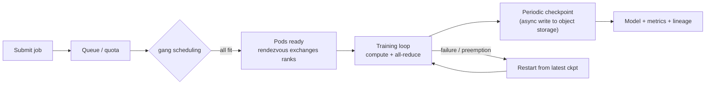

# Distributed training infrastructure

> **One-line summary**: The algorithm side answers "how do we split the model" (see [Chapter 4](../04-llm/07-distributed-training.md) for the DP/TP/PP/ZeRO derivations); the infrastructure side answers "how do we turn ten thousand GPUs into one machine" — **gang scheduling so it is all-or-nothing, all-reduce with NCCL/RDMA and topology awareness so communication is not the bottleneck, checkpointing and elasticity so failures do not kill the job, and MFU so you can put a price on it**.
>
> **Keywords**: `gang scheduling` `Kubernetes` `parameter server` `ring all-reduce` `NCCL` `RDMA` `checkpoint` `elastic training` `MFU`

## 1. Core concepts

### 1.1 The layers of training infrastructure

Five layers, bottom up: **hardware/network** (NVLink, InfiniBand/RoCE, which cap bandwidth) → **cluster scheduling** (K8s + Volcano/Kueue or Slurm, which decides who gets GPUs) → **runtime/communication** (NCCL, torch.distributed, which syncs gradients) → **job/platform** (PyTorchJob, Kubeflow, Ray, which handles submission and fault tolerance) → **storage/data** (object storage, Lustre, which decides whether the GPUs stay fed). Walk through these layers in an interview, then go deep on one.

### 1.2 K8s or Slurm

| Dimension | Slurm (HPC scheduler) | Kubernetes (container orchestration) |
| --- | --- | --- |
| Job model | Whole-job atomic allocation (gang by nature) | Pod-by-pod, needs an extra gang plugin |
| Strengths | Large homogeneous jobs, mature topology/quota support | Multi-tenancy, elasticity, unified with business systems |
| Weaknesses | Weak cloud-native story; extending means patching plugins | The scheduler is gang/topology-unaware by default; needs Volcano, Kueue, or Topology Manager |

Most companies now build training platforms on K8s: a **device plugin** exposes GPUs, an **operator** (Training Operator / Kubeflow) expresses "a job = a set of ranked pods", and **Volcano/Kueue** adds gang scheduling and queue quotas.

### 1.3 Lifecycle of a training job



## 2. Principles and derivations

### 2.1 Why gang scheduling is mandatory

Take a 128-GPU DDP job that only gets 120 GPUs scheduled: the 120 workers that started **block at the all-reduce waiting for the remaining 8**, while holding 120 GPUs doing nothing. Worse, those 8 GPUs may be held by another job, creating a **deadlock** (two jobs waiting for each other to release).

So a training job needs **all-or-nothing (gang) semantics**: the scheduler reserves/preempts first and only binds all $N$ pods once every one of them can be satisfied. Slurm does this natively; K8s schedules pod by pod, so it needs coscheduling/gang plugins:

- **Volcano**: `PodGroup` + gang plugin (`minMember`), with queues, priorities, and preemption;
- **Kueue**: queues + quota + borrowing, admitting at the Job level;
- **Native option**: coscheduling from `scheduler-plugins`.

Engineering detail: also account for **resource fragmentation** (128 free GPUs spread over 3 nodes cannot form an 8-GPU machine) → the scheduler needs bin-packing and **topology awareness** (keep a job under the same leaf switch).

### 2.2 The parameter server

Architecture: a set of server shards holds the global parameters, and $N$ workers each compute gradients.

1. a worker pulls the current parameters $w_t$;
2. the worker computes a gradient $g_i$ on its local batch;
3. the worker pushes the gradient to the server;
4. the server updates: $w_{t+1} = w_t - \eta \sum_{i=1}^{N} g_i$.

Three problems:

- **Bandwidth bottleneck**: all worker gradients converge on the server, so the egress bandwidth is an $O(N)$ bottleneck (the server must receive and broadcast $N \times S$ of data);
- **Stale gradients plus operational complexity**: in async mode, a slow worker's gradient computed on old parameters "pushes the model in the wrong direction", i.e. $g_i = \nabla f(w_{t-\tau_i})$, and the larger $\tau_i$, the worse; the server itself also needs sharding, replicas, and failure recovery.

Synchronous PS (a barrier every round) actually degenerates into a centralized all-reduce with worse bandwidth. That is why modern frameworks (PyTorch DDP/FSDP, Megatron, DeepSpeed) all use **collective communication**.

### 2.3 All-reduce: from $O(N^2)$ to $O(2S)$

**Naive all-to-all**: each GPU sends its gradient $S$ to the other $N-1$ GPUs, so each sends $(N-1)S$ and total traffic is $O(N^2 S)$ — infeasible at ten thousand GPUs.

**Ring all-reduce**: split each GPU's gradient into $N$ chunks, arrange the GPUs in a ring, and run two phases:

- **reduce-scatter** ($N-1$ steps): each step, a GPU sends one chunk downstream and receives one from upstream, accumulating. After $N-1$ steps, GPU $i$ holds the **global sum** of chunk $i$.
- **all-gather** ($N-1$ steps): circulate the summed chunks around the ring so every GPU gets all of them.

Total steps $2(N-1)$, each sending $S/N$, so each GPU sends:

$$V_{ring} = 2(N-1)\cdot\frac{S}{N} = 2S\left(1-\frac{1}{N}\right) \xrightarrow{N\gg1} 2S$$

This is independent of $N$ and close to the lower bound (each GPU must at least send its own $S$ and receive the reduced result, i.e. $2S$), so ring all-reduce is **bandwidth-optimal**. Time model ($\alpha$ = per-transfer latency, $B$ = effective bandwidth):

$$t_{allreduce} \approx 2(N-1)\alpha + \frac{2S(N-1)}{N\,B} \approx 2(N-1)\alpha + \frac{2S}{B}$$

**A feel for the numbers** (7B parameters, bf16 gradients = 14 GB):

| Link | Effective bandwidth | Per-GPU all-reduce time ($2S/B$) |
| --- | --- | --- |
| Intra-node NVLink | ~900 GB/s | $2\times14/900 \approx 31$ ms |
| Inter-node 400G IB | ~50 GB/s | $2\times14/50 \approx 0.56$ s |
| Inter-node 100G Ethernet | ~12.5 GB/s | $2\times14/12.5 \approx 2.2$ s |

The same gradient is 18x slower across nodes than inside one — that is why **topology awareness** and **hybrid parallelism** exist. It also explains why large-model training constrains the DP group size and keeps communication inside the NVLink domain (TP within a node, DP across nodes), and why gradients are **bucketed and overlapped with backward computation**: as soon as the backward pass produces a layer's gradient, the all-reduce for that bucket starts so network transfer overlaps with the rest of the backward pass.

### 2.4 NCCL, RDMA, and topology

- **NCCL**: NVIDIA's collective communication library; it probes the topology (NVLink/PCIe/IB/RoCE) and picks ring or tree algorithms, double binary trees, etc. PyTorch DDP runs on top of it.
- **RDMA**: bypasses the kernel network stack so the NIC reads and writes memory directly (IB or RoCEv2); with **GPUDirect RDMA**, data goes from GPU memory straight to the NIC, saving two copies. This is what lets inter-node bandwidth approach line rate.
- **Topology layers and scheduling**: GPU → NVLink/NVSwitch (intra-node) → PCIe/NIC → leaf switch → spine switch. Modern clusters are often **rail-optimized** (the $k$-th GPU in each machine connects to the $k$-th leaf), so intra-rail traffic crosses one switch. The scheduler places a job's pods on the same leaf/rail to cut cross-spine traffic, and NUMA awareness avoids GPU-NIC cross-NUMA copies.
- **NCCL tuning**: bind multiple NICs (`NCCL_IB_HCA`), configure RoCE GID/PFC properly, pick `NCCL_ALGO` (Ring vs. Tree) by message size, raise `NCCL_BUFFSIZE`, and avoid crossing NUMA.

### 2.5 Failures, checkpoints, and elastic training

At scale, failures are normal: GPU/node failures, ECC errors, NIC drops, silent data corruption. A rough rule of thumb is that **a thousand-GPU cluster needs a handful of restart-worthy failures every day** — so fault tolerance is not a bonus, it is mandatory.

**The optimal checkpoint interval (Young/Daly approximation)**: let $C$ be the time for one checkpoint and $MTBF = M$ the job's mean time between failures; the optimal interval is

$$\tau_{opt} = \sqrt{2CM}, \qquad \text{wasted fraction} \approx \sqrt{\frac{2C}{M}}$$

Example: $M = 5$ hours (a typical scale for a 10k-GPU job, the per-GPU MTBF divided by the GPU count), $C = 60$ s, then $\tau_{opt}=\sqrt{2\times60\times18000}\approx1470$ s, about 24.5 minutes, wasting about $2\times60/1470\approx8\%$.

The supporting engineering:
- **Async checkpointing**: write quickly to local NVMe/memory, then a background thread copies to object storage so training never stalls; the cost is that the newest checkpoint may be lost on power failure.
- **Sharded plus multi-tier retention**: each GPU writes only its own shard (aligned with FSDP/ZeRO sharding) in parallel; keep the last few plus a long-term copy every N hours so a bad checkpoint cannot overwrite a good one.
- **Data-side resume point**: record consumed batches/shards (epoch + step or a global sample index) and skip them on resume, otherwise data repeats and the model overfits.
- **Elastic training**: torchrun's `--rdzv_backend=c10d --rdzv_endpoint=...` tolerates membership changes; on resize, rebuild the process group, recompute shards, and keep the LR schedule and data order correct. The hard part is "the batch composition changes after a shrink — what happens to gradient scale and optimizer state".

### 2.6 Training platform abstraction

The minimum contract a platform exposes is **a job description**: image, launch command, replica count, GPUs per replica, data and checkpoint mounts, environment variables. On K8s this is usually a Volcano Job (`minAvailable` expresses gang) or a PyTorchJob expressing "a set of ranked pods":

```yaml
apiVersion: batch.volcano.sh/v1alpha1
kind: Job
spec:
  minAvailable: 32            # gang: all 32 pods must start together
  tasks: [{ name: worker, replicas: 32, template: { spec: {
    containers: [{ name: pytorch, image: registry/train:2025-11,
      resources: { limits: { nvidia.com/gpu: 8 } },
      command: [torchrun, --nnodes=4, --nproc_per_node=8, train.py] }] } } }]
```

The platform layer also provides: environment pinning, data mounts and caching, logs/metrics/traces, failure retries, checkpoint lifecycle management, quotas and priorities (training can be preempted by online traffic), and model/data lineage.

### 2.7 MFU and cost estimation

**MFU (Model FLOPs Utilization)** measures how much of the compute you bought is actually used:

$$MFU = \frac{6ND}{T \cdot P_{peak} \cdot N_{GPU}}$$

where $N$ is the parameter count, $D$ the number of training tokens, $T$ the wall-clock time, $P_{peak}$ the per-GPU peak (dense bf16), and $N_{GPU}$ the GPU count. $6ND$ comes from $2ND$ forward plus $4ND$ backward.

Example: a 7B model trained on 1T tokens with 1000 H100s ($P_{peak}\approx990$ TFLOPS bf16), measured at 29.4 hours:

$$MFU = \frac{6\times7\times10^9\times10^{12}}{1.06\times10^5 \times 990\times10^{12}\times1000} \approx 0.40$$

That is **29,400 GPU-hours**; at 2 USD per GPU-hour it costs about **59k USD**, or about **0.06 USD per million tokens**. In practice 30%-50% MFU is normal and >55% is very good; MFU drops because of unoverlapped communication, starved data loading, inefficient kernels, small batches, or frequent checkpoints.

## 3. Implementation notes

Skeleton of async checkpointing (the training loop is not blocked by the write):

```python
import torch, threading

def async_save(step, model, opt, path):
    state = {"step": step, "model": model.state_dict(), "opt": opt.state_dict()}
    def _write():                     # write locally first, background copy to object storage later
        torch.save(state, f"{path}/step={step}.pt")
    threading.Thread(target=_write).start()          # non-blocking

for step, batch in enumerate(loader, start=resume_step):
    loss = model(**batch).loss; loss.backward(); opt.step(); opt.zero_grad(set_to_none=True)
    if step % CKPT_EVERY == 0:
        async_save(step, model, opt, CKPT_DIR)
```

Launch and elasticity (run the same command on each of 4 nodes):

```bash
torchrun --nnodes=4 --nproc_per_node=8 \
  --rdzv_backend=c10d --rdzv_endpoint=train-svc:29500 \
  --max_restarts=3 train.py --config cfg/sft.yaml
```

## 4. Interview Q&A

### Q1. Why must a training job use gang scheduling? What happens without it?
**Answer**: Training uses synchronous collective communication, so if any worker is missing the rest block at the all-reduce while holding GPUs idle; worse, two jobs holding half the GPUs each wait on each other forever, a deadlock. Gang semantics (all-or-nothing) guarantee either the whole group starts together or nobody takes a GPU. K8s schedules pod by pod natively, so plugins like Volcano/Kueue fill the gap.
**Follow-up**: Does gang scheduling hurt utilization? It lowers short-term fill rate but raises effective utilization — an idle-but-held GPU costs more than a free one; it is usually paired with queues, preemption, and bin-packing.

### Q2. Why did all-reduce replace parameter servers?
**Answer**: PS has an $O(N)$ server-side bandwidth bottleneck, and async updates introduce stale gradients (slow workers drag the model in the wrong direction); synchronous PS degenerates into worse centralized synchronization. All-reduce makes every worker a peer, is essentially independent of $N$ in traffic (about $2S$ per GPU), and with NCCL/RDMA it saturates the links.
**Follow-up**: Is PS still useful? For very large sparse embeddings (recommendation): the table does not fit on one machine and is sharded across CPUs/PS nodes, where the PS idea survives.

### Q3. Derive the communication volume and time of ring all-reduce.
**Answer**: Each GPU splits its gradient into $N$ chunks; reduce-scatter takes $N-1$ steps and all-gather takes $N-1$ steps, each sending $S/N$, so total sent is $2(N-1)S/N \approx 2S$, independent of $N$; time $\approx 2(N-1)\alpha + 2S/B$. Since each GPU must at least send its own $S$ and receive the result, $2S$ is a lower bound, so it is bandwidth-optimal.
**Follow-up**: Why tree algorithms then? For large $N$ and small messages the $2(N-1)\alpha$ latency term dominates; trees and double binary trees reduce hop count, and NCCL picks the algorithm by message size.

### Q4. Is DDP enough for a 7B model? Why also TP/PP?
**Answer**: Memory says no — full-parameter AdamW training of 7B needs ~112 GB of state (28 GB parameters + 28 GB gradients + 56 GB optimizer, roughly fp32), which does not fit in one 80 GB GPU; even with ZeRO/FSDP sharding the optimizer state, a single layer may exceed memory, and DP's gradient all-reduce is a lot of traffic. TP splits a layer's matrices across GPUs (frequent but over NVLink), PP splits layers across machines (point-to-point, with bubbles), and the combination fits and performs. See [Chapter 4](../04-llm/07-distributed-training.md) for the derivations.
**Follow-up**: Why do recommenders not do this? The model is small (GB scale) and the data is huge (hundreds of billions of samples), so the bottleneck is data throughput, not memory; DDP with large batches suffices, and only giant embedding tables need model splitting.

### Q5. How do you overlap communication with computation?
**Answer**: The core trick is **bucketing**: split gradients into buckets by layer or size, and as soon as the backward pass produces a bucket, trigger its all-reduce to run alongside the rest of the backward pass (PyTorch DDP's `bucket_cap_mb` does exactly this); FSDP prefetches the next layer's parameters before the forward pass, hiding all-gather inside compute. The principle is "keep the network and the GPU busy at the same time", ideally hiding communication completely.
**Follow-up**: What are the limits? Too small a bucket adds launch latency and wastes bandwidth; too large a bucket coarsens overlap and costs memory. Start at tens of MB and tune.

### Q6. NCCL communication is slow — how do you debug it?
**Answer**: Work down the layers: (1) **bandwidth** — run `nccl-tests` and compare actual all-reduce bandwidth with the theoretical value to separate a link problem from a topology problem; (2) **topology** — check `nvidia-smi topo -m` and `NCCL_DEBUG=INFO` for cross-NUMA or cross-spine paths; (3) **parallelism** — is the DP group too large across nodes, was TP placed across nodes; (4) **environment** — only one of several NICs in use, RoCE GID/MTU/PFC configuration, GPUDirect enabled; (5) **contention** — other jobs or inference traffic eating the links. The usual conclusion is "NCCL is not slow, the topology is wrong".
**Follow-up**: Small-message all-reduce is slow? Latency dominates: switch to the tree algorithm, enlarge buckets, reduce GPU count, or keep it inside NVLink via TP.

### Q7. How do you estimate failure rates at 10k GPUs, and how do you choose the checkpoint interval?
**Answer**: The job's $MTBF \approx$ per-GPU MTBF / GPU count (approximately independent Poisson failures). Use Young/Daly: $\tau_{opt}=\sqrt{2CM}$ with wasted fraction $\sqrt{2C/M}$. For $M=5$ h and $C=60$ s that is a checkpoint about every 24 minutes with about 8% loss. Then use async writes, sharded writes, and multi-tier retention to push $C$ down.
**Follow-up**: What is wrong with checkpointing too often? It consumes storage bandwidth and interferes with training (even async writes contend for IO/network), and one write of a large model can be tens of GB to a TB.

### Q8. What makes elastic training hard?
**Answer**: Staying correct while membership changes: (1) rebuild the process group and rank mapping; (2) reassign dataset shards so nothing is repeated or skipped (track a global sample position); (3) the relationship between LR/optimizer state and global batch — if the global batch changes on resize, the schedule may need recomputing; (4) safely abort in-flight collectives when shrinking; (5) elasticity usually comes with preemption, so the job must resume at any step.
**Follow-up**: Why not just restart the whole group on failure? Fine at small scale; at 10k GPUs the queueing and initialization cost per restart is huge, so elasticity/hot spares significantly raise effective compute.

### Q9. What problem does topology-aware scheduling solve?
**Answer**: Inter-node bandwidth is an order of magnitude lower than intra-node (400G IB ~50 GB/s vs. NVLink ~900 GB/s), and the dominant term in all-reduce time is $2S/B$. Placing a job's pods on the same leaf/rail, keeping TP within a node, and avoiding cross-spine traffic directly shortens each step's communication; NUMA awareness also avoids the extra copy when GPU and NIC sit on different NUMA nodes.
**Follow-up**: How is it implemented? The scheduler reads topology labels (host/rack/leaf) and scores affinity; Slurm has a topology plugin and K8s has Topology Manager plus custom schedulers.

### Q10. How do you compute MFU, and what is a normal value?
**Answer**: $MFU = 6ND / (T\cdot P_{peak}\cdot N_{GPU})$. For 7B/1T tokens/1000 H100s/29.4 h it is about 40%. LLM pretraining at 30%-50% is normal and >55% is very good; recommender and small models often have lower MFU because of kernel efficiency and batch structure, but that does not make them uneconomical.
**Follow-up**: How do you improve low MFU? Profile first (see [04](04-inference-serving-and-gpu-optimization.md)) to separate compute, communication, and data-loading bottlenecks, then try overlap, bucketing, larger batches, FlashAttention, and fewer checkpoint stalls.

### Q11. How do you estimate training cost, and are spot instances worth it?
**Answer**: Cost = GPUs x wall-clock x unit price, and GPUs = $\dfrac{6ND}{MFU\cdot P_{peak}}$, so "raise MFU" and "lower unit price" are the two main levers. Spot instances save 50%-70% but can be preempted at any time; the payoff depends on checkpoint frequency and recovery speed. An even cheaper route is shortening training (smaller model, more efficient data) rather than piling on GPUs. Include storage, network, and idle queueing time in any quote.
**Follow-up**: Why is "training cost" often underestimated in earnings reports? Because it counts GPU-hours only, ignoring cluster idleness, data processing, and failed reruns (expensive at 10k GPUs).

## 5. Pitfalls and follow-ups

- **Equating "more GPUs" with "faster"**: if communication, data loading, or scheduling cannot keep up, adding GPUs lowers MFU.
- **Ignoring the intra-node vs. inter-node bandwidth gap**: placing TP across nodes multiplies each step's communication by more than 10x.
- **Writing checkpoints without testing them**: a checkpoint that has never been restored is not a checkpoint; run restore drills regularly.
- **Forgetting the consumed-data position**: re-consuming data after a restart silently overfits, and the logs will not show it.
- **Gang scheduling conflicting with quota**: if the queue quota is smaller than the job, the job queues forever; define a minimum runnable size and a shrink policy.
- **Counting GPUs but not network, and decoupling LR from global batch**: IB switches and storage bandwidth are often the hidden bottleneck at 10k GPUs; after resizing, the batch changes and the LR/warmup must follow.

## 6. Cheat sheet

| Topic | One line |
| --- | --- |
| Gang scheduling | All start or none take GPUs; otherwise all-reduce stalls and jobs deadlock |
| Three sins of PS | $O(N)$ server bandwidth, stale gradients, operational complexity |
| Ring all-reduce | $2(N-1)S/N\approx2S$ per GPU, $2(N-1)$ steps, bandwidth-optimal |
| Communication time | $t\approx 2S/B + 2(N-1)\alpha$ |
| 7B bf16 gradients | 14 GB; NVLink 31 ms vs. 400G IB 0.56 s (18x) |
| Checkpoint | $\tau=\sqrt{2CM}$, async + sharded + multi-tier retention |
| MFU / cost | $6ND/(T\cdot P_{peak}\cdot N_{GPU})$, 30%-50% is normal; cost = GPUs x hours x price |

## 7. References

- [How to Train a Model on 10k H100 GPUs · PyTorch](https://pytorch.org/blog/how-to-train-a-model-on-10k-h100-gpus/) (four lessons: parallelism, overlap, topology, fault tolerance)
- [The Ultra-Scale Playbook](https://github.com/huggingface/ultra-scale-playbook) (engineering details and measurements for large-scale training)
- [Preparing for ML Infra System Design Interviews · Yuan Meng](https://www.yuan-meng.com/posts/ml_infra_interviews/) (PS vs. all-reduce, TPU pods, GPU serving)
- [Training Large-Scale Recommendation Models with TPUs · Snap](https://eng.snap.com/training-large-scale-recommendation-models-with-tpus)
- [NCCL documentation](https://docs.nvidia.com/deeplearning/nccl/user-guide/docs/)
- [Volcano](https://volcano.sh/en/docs/) / [Kueue](https://kueue.sigs.k8s.io/) (gang scheduling and queue quotas on K8s)
- [Distributed Machine Learning Patterns · parameter servers and collective communication](https://github.com/mercari/distributed-ml-patterns)
- [Chapter 4 · Distributed training](../04-llm/07-distributed-training.md) (algorithm derivations for DP/TP/PP/ZeRO, complementary to this note)
