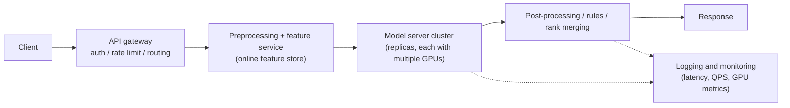

# Inference serving and GPU optimization

> **One-line summary**: Inference optimization is three things — **compute less** (batching, quantization, operator fusion), **move less** (fewer H2D copies, fewer HBM ↔ SRAM round trips), and **wait less** (CUDA graphs, overlap, autoscaling). The order is always "profile first to find the bottleneck, then optimize", otherwise you end up speeding up the 5% that did not matter.
>
> **Keywords**: `nsys/ncu profiling` `dynamic batching` `CUDA graph` `Triton` `kernel fusion` `roofline` `SLA` `capacity planning`

## 1. Core concepts

### 1.1 The layered architecture of online inference



Key design points: **stateless services with horizontal scaling**, **co-locate the model and feature store** to avoid RPC, **every stage scales independently**, and **requests degrade on timeout** (if re-ranking fails, serve the light-ranker results).

### 1.2 Latency and throughput metrics

| Metric | Meaning | Note |
| --- | --- | --- |
| p50 / p99 latency | End-to-end time at a percentile | SLAs usually target p99; averages lie |
| QPS / throughput | Requests per second | Strongly tied to batch size and model size |
| TTFT / TPOT | Time to first token / time per output token | Core metrics for LLMs (see [Chapter 4](../04-llm/08-inference-optimization-and-serving.md)) |
| GPU utilization / MFU | Share of compute actually used | Low utilization usually means the bottleneck is not compute |
| goodput | Throughput that meets the SLO | Closer to business value than raw QPS |
| USD per million requests | Unit cost | One of the ultimate north stars for inference optimization |

**Little's law** links QPS, latency, and concurrency: the number of in-flight requests is $L = \lambda W$ ($\lambda$ = arrival rate, $W$ = average time in system). For a 20k QPS peak and a 100 ms p99 target you need capacity for at least 2000 concurrent requests (and in practice more, to cover the distribution and queueing).

### 1.3 Deployment modes

| Mode | Characteristics | Fits |
| --- | --- | --- |
| Online synchronous | One forward pass per request, latency-sensitive | Recommendation/search ranking, real-time risk |
| Online async/streaming | Long-lived connections, incremental output | LLM chat, speech recognition |
| Batch inference | Run the full corpus offline, throughput-first | Content understanding, embedding generation, offline scoring |
| Edge-cloud hybrid | Small model on device + large model in cloud | Latency-sensitive with a quality fallback |

## 2. Principles and derivations

### 2.1 When a GPU is not fast

GPUs excel at **massive parallelism plus high arithmetic intensity (FLOPs / Bytes)**. Use the roofline model to tell whether an op is **compute-bound** or **memory-bound**:

$$\text{attainable performance} = \min(P_{peak},\ I \times B_{mem})$$

where $I$ is arithmetic intensity and $B_{mem}$ is memory bandwidth. GEMM/convolution have large $I$ and are compute-bound; LayerNorm, elementwise ops, and embedding lookups have small $I$ and are memory-bound, so the fix is fusion and fewer reads/writes, not a faster math library.

Four structural reasons inference gets slow:

1. **Kernel launch overhead**: each kernel launch costs a few microseconds; with hundreds of small operators, the CPU-side launch becomes the bottleneck (the GPU waits for the CPU to issue commands).
2. **Small kernels cannot fill the GPU**: with tiny batches or tensors, SM occupancy is low and memory bandwidth is underused.
3. **Data movement**: CPU → GPU H2D copies and intermediate results written to HBM and read back are pure overhead.
4. **Queueing and scheduling**: a poor batching policy, too few replicas, or tail latency (one large request slowing a whole batch).

### 2.2 Batching: the leverage between throughput and latency

Let one forward pass take $t(b) = a + b\cdot c$ ($a$ = fixed overhead: kernel launch, framework scheduling; $c$ = marginal cost per request). Per-request latency is $L(b)=t(b)$ and throughput is $\text{TPS}(b)=b/t(b)$.

| batch $b$ | $t(b)$ ($a=1.0$ ms, $c=0.15$ ms) | Per-request latency | Throughput (relative to $b=1$) |
| --- | --- | --- | --- |
| 1 | 1.15 ms | 1.15 ms | 1.0× |
| 8 | 2.20 ms | 2.20 ms | 4.2× |
| 32 | 5.80 ms | 5.80 ms | 6.4× |
| 128 | 20.2 ms | 20.2 ms | 7.3× |

The pattern: **as batch grows, throughput rises quickly then saturates, while latency grows linearly**. So:

- Offline/batch inference: use the largest batch possible (even queue requests for minutes).
- Online: use **dynamic batching** — set a max batch and a max waiting window (e.g., `max_batch=32, timeout=5ms`); requests accumulate until the batch is full or the timeout fires, and the two together bound latency.
- LLMs use **continuous batching**: do not wait for a whole batch to finish; schedule token by token, retire finished requests immediately, and admit new ones (the core of vLLM/SGLang, see [Chapter 4](../04-llm/08-inference-optimization-and-serving.md)).

### 2.3 Profiling: timeline first, then kernels

| Tool | What to look at | Typical conclusion |
| --- | --- | --- |
| Nsight Systems (nsys) | Timeline: GPU idle gaps, kernel sequence, memcpy, CPU calls | "The GPU spends half its time waiting on the CPU or on copies" |
| Nsight Compute (ncu) | A single kernel: SM occupancy, memory throughput, instruction efficiency | "This kernel is memory-bound; fuse it away" |
| PyTorch Profiler / torch.profiler | Per-operator time, CPU/GPU time | "The top 10 operators take 70% of the time" |
| Framework metrics | Batch size, queue depth, GPU utilization | "The autoscaling policy is wrong" |

Debug order: **look at the end-to-end timeline for gaps first** (idle GPU → CPU/IO bottleneck) → find the top kernels → use ncu to classify the bound → decide whether to fuse, change the algorithm, or increase the batch. Pinterest's case is exactly this: they profiled the running model and found "many small kernels dominating the timeline", not "the model is too big to compute".

### 2.4 Eliminating small kernels: four moves

Recommendation models at TikTok/Xiaohongshu scale have many features, many embedding lookups, and fragmented operators. Practical optimizations (from Pinterest's GPU serving work):

1. **Fused embedding lookup**: one request looks up hundreds or thousands of IDs, and one-by-one lookups generate many small kernels. Use a GPU hash table such as `cuCollections` to fuse all lookups into one batched operation.
2. **One-shot H2D copy**: pack all feature tensors into one contiguous host buffer, copy it to the GPU with a single `cudaMemcpy`, then rebuild views on the GPU with offsets — turning hundreds of copies into one. Pinterest reported copy latency dropping from **~10 ms to under 1 ms**.
3. **CUDA Graph**: capture the whole inference pass (a sequence of kernels and copies) as one static graph and submit it once, so the GPU executes it back to back, eliminating launch overhead and inter-kernel gaps. The cost: tensor shapes must be fixed (padding required), memory use grows slightly, and flexibility drops.
4. **Larger batches**: merge multiple requests so the M dimension of the GEMM grows, improving SM and bandwidth utilization.

### 2.5 Triton: write your own fused kernels

Triton is OpenAI's GPU kernel compiler (a Python DSL) that can produce kernels close to hand-written CUDA, and fuse across libraries and across autograd boundaries. Its abstraction is "process tensors in blocks": the programmer controls tile size and on-chip memory use, and the compiler handles thread mapping and pipelining.

The typical gain comes from **fewer HBM round trips**: fusing QKV projection + attention + LayerNorm + FFN into one operator keeps intermediates in SRAM/registers instead of writing them back to HBM. Pinterest applied this to a long-sequence model and improved throughput by **6.6×** (while also eliminating kernel launch overhead). The idea matches FlashAttention: **IO-aware kernel design**.

### 2.6 Inference engines and graph optimization

| Engine / approach | Strengths | Notes |
| --- | --- | --- |
| TorchScript / torch.compile | Seamless with PyTorch, easy to adopt | Graph capture has a fallback path |
| ONNX Runtime | Cross-framework, runs on CPU and GPU | Verify operator coverage and version compatibility |
| TensorRT / TensorRT-LLM | Deep NVIDIA optimization, quantization, fusion | Build time; limited dynamic-shape support |
| Triton Inference Server | Multi-framework/multi-model hosting, dynamic batching, ensembles | Usually the serving layer rather than the optimizer |
| vLLM / SGLang | LLM-specific: PagedAttention, prefix cache, continuous batching | Prefer these for LLMs (see Chapter 4) |

Common graph optimizations: constant folding, operator fusion, layout conversion (NCHW↔NHWC), quantization (FP16/BF16/INT8/FP8), KV cache reuse. The **optimization order** should be: reduce the number of requests (caching, recall pruning) → batching → graph/operator optimization → and only then buy more expensive GPUs.

### 2.7 Capacity planning and autoscaling

**GPU count estimate** (the most-used interview formula):

$$N_{GPU} = \frac{\text{QPS} \times t_{GPU}}{\eta}, \qquad \eta \in [0.4, 0.7]$$

$t_{GPU}$ is the GPU-seconds per request (already amortized by batching) and $\eta$ is the target utilization (leaving headroom for bursts and tail latency). Example: peak 20k QPS, $t_{GPU}=2$ ms, $\eta=0.5$ → $N=20000\times0.002/0.5=80$ GPUs. At 2 USD per GPU-hour that is about 160 USD per hour; at 72 million requests per hour, about **2.2 USD per million requests**.

Autoscaling practice:

- **Metrics**: CPU/GPU utilization, queue depth, p99 latency (queue depth reacts faster than utilization);
- **Cold start**: bringing up a GPU node and loading the model can take tens of seconds to minutes → keep a **warm pool** of pre-warmed replicas, preload weights to local disk/memory, and cache image layers;
- **Scale out aggressively, scale in conservatively**: scaling in too fast causes flapping, scaling out too slowly causes timeouts;
- **Multi-level fallbacks**: under overload, degrade to a lighter model, served-from-cache, or rate limiting instead of a full outage;
- **Capacity validation**: load tests (steady QPS plus bursts) and chaos drills (kill replicas, drop the network, pull a GPU).

## 3. Implementation notes

Key settings for Triton Inference Server dynamic batching (`config.pbtxt`):

```text
dynamic_batching {
  max_batch_size: 32
  preferred_batch_size: [8, 16, 32]
  max_queue_delay_microseconds: 5000     # wait at most 5 ms, one of the latency bounds
}
instance_group [{ count: 2, kind: KIND_GPU }]
```

Minimal CUDA Graph capture skeleton (PyTorch):

```python
import torch

static_in = torch.randn(32, 128, device="cuda")
g = torch.cuda.CUDAGraph()
model = model.eval().cuda()

with torch.no_grad():
    for _ in range(3):                    # warm up so the allocator/algorithms are ready
        model(static_in)
    torch.cuda.synchronize()
    with torch.cuda.graph(g):             # capture: all kernels afterwards run as one graph
        static_out = model(static_in)

# At inference time: copy real data into static_in, replay, and read static_out
g.replay()
```

Note: CUDA graphs require **fixed addresses and fixed shapes**, so input/output buffers must be pre-allocated and padded; for dynamic shapes, bucket by shape (shape bucketing).

## 4. Interview Q&A

### Q1. Online inference latency is high — what is your first step?
**Answer**: Quantify instead of guessing: look at end-to-end p50/p99, per-stage time (gateway/features/model/post-processing), GPU utilization, and queue depth, then capture one nsys timeline. Decide whether it is "computing slowly" (GPU busy but slow), "waiting long" (GPU has idle gaps), or "queueing long" (not enough replicas/concurrency). The three fixes are completely different.
**Follow-up**: No profiling access? Add per-layer timing and run experiments (change batch, add replicas, disable features) and use A/B to localize.

### Q2. Why do many small kernels slow things down so much?
**Answer**: Every kernel launch has a few microseconds of fixed overhead (CPU issues the command, GPU schedules it). A few kernels are invisible; hundreds make the CPU the bottleneck and leave large idle gaps on the GPU. Small kernels also have low parallelism, so they cannot fill the SMs or memory bandwidth. The symptom is "low GPU utilization but high latency".
**Follow-up**: How do you confirm? The nsys timeline shows dense small kernels and gaps, with a high share of CPU-side launch calls.

### Q3. How does a CUDA Graph work, and what are its limits?
**Answer**: It "records" a fixed sequence of kernels and copies into a graph, then submits it once so the GPU executes it contiguously, removing per-launch and dependency-resolution overhead and shrinking inter-kernel gaps. Limits: input/output addresses and shapes must be fixed (pre-allocation + padding/bucketing), memory use grows, and it is unsuitable for dynamic control flow; the graph must be re-captured after a model update.
**Follow-up**: How does it relate to `torch.compile`? compile does graph capture and operator fusion; CUDA Graphs optimize the execution layer. They compose.

### Q4. How do you set dynamic batching parameters?
**Answer**: `max_batch_size` comes from memory and the model; `max_queue_delay` comes from the SLA — it directly adds an upper bound to latency (e.g., 5 ms) and must be computed together with the downstream compute time and the p99 target. In practice, load-test to draw the batch-latency-throughput curve, pick a point near the throughput knee that still meets p99, then adjust by time of day.
**Follow-up**: Under a burst, could batching blow up latency? Use queue-depth-triggered fast scaling, a hard max batch, and timeout-based drop/degrade.

### Q5. Is a bigger batch always better?
**Answer**: No. Throughput rises then saturates with batch, while latency grows linearly; large batches also amplify tail latency (one slow request holds the batch) and raise peak memory. The right objective for an online service is to **maximize goodput within the SLA**, not to maximize batch size.
**Follow-up**: How do you find the optimum? Fix the p99 constraint, sweep batch/timeout parameters, and take the highest throughput; or use queueing theory to estimate waiting time.

### Q6. Why does quantization speed things up, and when does it not?
**Answer**: Quantization moves FP16/FP32 to INT8/FP8, and the gain comes from three places: less memory bandwidth used (memory-bound operators benefit directly), higher integer/low-precision throughput on Tensor Cores, and smaller models that load faster. It does not help when the operator is already memory-bound at the bandwidth limit, the hardware lacks the low-precision instruction, or the accuracy loss needs extra calibration and fallbacks; dequantization overhead can also eat the gain.
**Follow-up**: When FP8 instead of INT8? On hardware with FP8 support (Hopper/Blackwell) and a training-inference stack of the same precision, FP8 has better dynamic range and smaller accuracy loss.

### Q7. How can multiple models share a GPU?
**Answer**: Four levels: (1) **multiple models in one process** — a serving process loads several models and routes by request (Triton ensembles/BLS); (2) **MIG** — split a GPU into isolated instances, good for small models and hard isolation; (3) **MPS** — multiple processes share the same GPU's SMs, improving utilization for small models; (4) **time slicing or mixed batching** — pack requests for different models into one batch (requires compatible input shapes; harder). Choose based on isolation, latency stability, and memory.
**Follow-up**: Does sharing cause interference? Yes — one model's memory peak or long request affects another's tail latency; production usually groups by SLO and isolates with MIG or separate replicas.

### Q8. How do you estimate capacity, and how do you survive bursts?
**Answer**: $N_{GPU}=\text{QPS}\times t_{GPU}/\eta$ with $\eta$ between 0.4 and 0.7 for headroom, then validate p99 with load tests. Survive bursts with a warm pool, queue-depth-based fast scaling, and overload protection (rate limiting, degrading to a light model, returning cached results). GPU cold start is slow, so "scaling speed" itself is a design metric.
**Follow-up**: Why not size for average QPS? Peak-to-trough ratios are commonly 5-10x; sizing for the average collapses at peak, and sizing for the peak wastes money — so you need elasticity plus degradation.

### Q9. What could cause low GPU utilization?
**Answer**: Four families: (1) **CPU side** — slow Python preprocessing, feature assembly, or kernel launches, with the GPU waiting; (2) **IO side** — H2D copies, data loading, blocking network RPC; (3) **parallelism** — batch too small, poor model-parallel split, low SM occupancy; (4) **scheduling** — too many replicas leaving each GPU with sparse requests, autoscaling flapping, or models contending on the same GPU. Eliminate them one by one with profiling and metrics.
**Follow-up**: High utilization but also high latency? Compute is being wasted on inefficient operators (memory-bound, redundant work); optimize kernels instead of adding GPUs.

### Q10. Triton or hand-written CUDA?
**Answer**: Triton offers a Python DSL plus automatic thread mapping: fast to develop, portable (NVIDIA/AMD), and well suited to fused operators (attention, LayerNorm, embedding). Hand-written CUDA can squeeze hardware details (async copies, warp specialization, Tensor Core instructions) but costs much more to build and maintain. Most teams cover 80% of fusion needs with Triton and write CUDA only for extreme performance.
**Follow-up**: Is Triton always faster than PyTorch? No — if the operator is already efficient or the shape is unfriendly it can be slower; compare with ncu before deciding.

### Q11. How do you define and validate the SLO of an inference service?
**Answer**: Derive it from the business: end-to-end p99, availability (e.g., 99.9%), error rate, timeout rate. Validate with load tests (step up until the knee), production canaries (ramp traffic while watching p99 and errors), and capacity redundancy (N+1 replicas, multiple availability zones). Write "behavior under overload" into the SLO too, otherwise peak behavior is unpredictable.
**Follow-up**: p99 meets the target but users complain? The tail may come from specific regions, device types, or large requests; look at per-bucket percentiles, not the global one.

## 5. Pitfalls and follow-ups

- **Buying GPUs before optimizing**: most online inference bottlenecks are CPU preprocessing, copies, and scheduling, not compute.
- **Looking only at average latency**: p99 is the SLA, and batching/queueing inflate the tail.
- **Using CUDA graphs with dynamic shapes**: capturing without padding gives wrong results or fails to capture.
- **Ignoring model load time**: slow scale-out is often weight loading and initialization, not scheduling.
- **Load-testing only the steady state**: a test with no bursts and no replica failures is not a test.
- **Treating quantization as free lunch**: accuracy loss, dequant overhead, and missing operators all need verification.
- **Sharing GPUs without isolation**: one model's memory peak can OOM its neighbor on the same GPU.

## 6. Cheat sheet

| Topic | One line |
| --- | --- |
| Optimization order | Profile first, then compute less / move less / wait less |
| Three bottleneck classes | Computing slowly, waiting (gaps), queueing (not enough concurrency) |
| Roofline | Compute-bound looks at $P_{peak}$; memory-bound looks at $I\times B_{mem}$ |
| Batching | Throughput rises then saturates, latency grows linearly; use dynamic batching online |
| Four small-kernel moves | Fuse embeddings, one-shot H2D, CUDA graph, larger batch |
| Triton | IO-aware fused kernels, intermediates stay in SRAM, 6.6x at Pinterest |
| Capacity formula | $N=QPS\times t_{GPU}/\eta$, $\eta\approx0.5$ |
| Autoscaling | Queue-depth trigger, warm pool, scale out fast and in slow |
| SLO | p99 + availability + degrade behavior |
| Cost | USD per million requests = GPU-hour price ÷ requests per hour |

## 7. References

- [Preparing for ML Infra System Design Interviews · Yuan Meng](https://www.yuan-meng.com/posts/ml_infra_interviews/) (GPU serving profiling, small kernels, the Triton 6.6x case)
- [GPU-Accelerated ML Inference at Pinterest](https://medium.com/pinterest-engineering/gpu-accelerated-ml-inference-at-pinterest-1a7b8b7f5f7e)
- [Applying GPU to Snap](https://eng.snap.com/applying-gpu-to-snap)
- [Getting Started with CUDA Graphs](https://developer.nvidia.com/blog/cuda-graphs/)
- [Introducing Triton: Open-Source GPU Programming for Neural Networks](https://openai.com/index/triton/)
- [Triton Inference Server · Dynamic Batcher](https://docs.nvidia.com/deeplearning/triton-inference-server/user-guide/docs/user_guide/batcher.html)
- [NVIDIA Nsight Systems documentation](https://docs.nvidia.com/nsight-systems/)
- [Chapter 4 · Inference optimization and deployment](../04-llm/08-inference-optimization-and-serving.md) (LLM KV cache / continuous batching / PD disaggregation)
