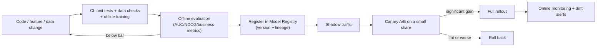

# Data and experiment platform

> **One-line summary**: The data platform guarantees that every piece of data fed to a model is reproducible, rollback-able, and traceable; the experiment platform guarantees that every change is judged fairly. Together they set a team's **iteration speed** — which is also the most underrated part of an ML infra interview.
>
> **Keywords**: `data pipeline` `Iceberg/Delta` `data versioning` `backfill` `A/B testing` `sample size` `SRM` `CUPED` `model registry` `data drift` `PSI`

## 1. Core concepts

### 1.1 The layers of a data platform

| Layer | Role | Typical implementation |
| --- | --- | --- |
| Ingestion | Client events, CDC, and logs into the lake | Kafka, Flink CDC, Sqoop |
| Raw layer (ODS) | Landed as-is, replayable | Object storage + daily/hourly partitions |
| Detail layer (DWD) | Cleaning, deduplication, normalization | Spark/Flink SQL |
| Summary layer (DWS) | Wide tables, aggregates, samples | Spark, dbt |
| Application layer (ADS) | Features, training sets, reports | Feature platform / training platform |
| Governance | Metadata, lineage, permissions, quality | DataHub, Atlas, Great Expectations |

Layering is not fussiness: it makes the chain "replayable raw data → recomputable intermediate results → reproducible downstream outputs" hold, so when something breaks you can localize it to one layer and rerun only that layer.

### 1.2 Table formats and data versioning

| Dimension | Hive/Parquet directories | Iceberg / Delta / Hudi |
| --- | --- | --- |
| Writes | Overwrite/append a partition | ACID transactions, snapshot isolation |
| Mutations | Rewrite the partition | Row-level update/delete (merge-on-read or copy-on-write) |
| Time travel | None (unless you keep old directories) | Query history by snapshot/timestamp |
| Concurrent writes | Conflict-prone | Optimistic concurrency control |
| Small files | Periodic compaction needed | Built-in compaction tools |
| Fits | Simple batch jobs | Production tables needing rollback, backfill, incremental updates |

**Why data versioning matters**: when a model underperforms you must be able to answer "did the data change". The version metadata should bind at least: table snapshot/partition, SQL/code commit, feature-definition version, and sampling logic. `git` manages code, not terabytes of data; DVC/lakeFS manage file-level versions and table formats manage table-level snapshots — production usually combines them.

### 1.3 Data quality checks

| Dimension | Check | Consequence of failure |
| --- | --- | --- |
| Schema | Field types/required fields | The job fails outright |
| Completeness | Row counts, null rate, partition existence | Training set too small |
| Uniqueness | Primary-key duplicate rate | Duplicate samples, overfitting |
| Distribution | Mean/quantiles/category shares | Feature drift, model degradation |
| Freshness | How far the partition timestamp lags | Train/serve on stale data |
| Business constraints | Non-negative amounts, valid enums | Dirty data reaches production |

Checks must **shift left**: put them in the pipeline (run on every job) and fail fast, instead of investigating after the model degrades.

### 1.4 The experiment platform

- **Assignment**: bucket by `hash(user_id + salt) % 10000` so the same user always lands in the same group;
- **Layers**: place independent experiments in orthogonal layers so "experiment A perturbs experiment B's metrics";
- **Metrics**: a primary metric (north star) + guardrail metrics (latency, error rate, cost) + exploratory metrics;
- **Analysis**: significance tests, confidence intervals, SRM checks, multiple-comparison correction.

### 1.5 Model registry and CI/CD

The full path of a "model release":



**A release artifact must be a triple**: model file + feature-definition version + code commit. If any one is missing, a production issue cannot be reproduced.

## 2. Principles and derivations

### 2.1 Idempotency and reruns

A data pipeline must satisfy: **rerunning the same logical date any number of times gives the same result**. Three requirements:

1. **Deterministic inputs**: read tables with a snapshot/partition version, not "latest state";
2. **Overwrite writes**: `INSERT OVERWRITE`/partition replacement rather than `INSERT INTO` appends;
3. **Deduplicable keys**: at least one business key (e.g., `impression_id`) for merging and deduplication.

Typical traps: a job fails midway and the retry appends, doubling the data; or the job joins against the "current latest dimension table", so a rerun sees a changed dimension and the result is not reproducible (exactly why you read snapshots).

### 2.2 Backfill

After adding a feature or fixing a bug you must recompute history. Watch out for:

- **Scope**: roll through partitions, cap per-run parallelism, and do not overwhelm upstream;
- **Time boundary**: each day of the backfill may only use data from that day and earlier, to prevent leakage from the future (the same point-in-time principle, see [02](02-feature-store-and-realtime-features.md));
- **Two stages**: validate the gain on a small sample before the full backfill;
- **Do not block training**: backfills produce a new versioned table that training reads on demand; never mutate the live table in place;
- **Rollback**: keep the new and old tables side by side and switch back if the metrics look wrong.

### 2.3 A/B tests: sample size and significance

**Hypothesis testing**: the null $H_0$ is no difference between the groups; the alternative $H_1$ is a difference. Given significance level $\alpha$ (type-I error) and power $1-\beta$ (type-II error), the required sample size per group (equal groups) is:

$$n = \frac{\left(z_{1-\alpha/2}+z_{1-\beta}\right)^2 \left(p_1(1-p_1)+p_2(1-p_2)\right)}{\Delta^2} \approx \frac{16\,\sigma^2}{\Delta^2}$$

(For $\alpha=0.05, \beta=0.2$ the two $z$ values sum to about 2.8, squared about 7.84; use $\sigma^2$ for continuous metrics and $p(1-p)$ for proportions.)

**Worked example**: baseline CTR 5%, targeting detection of 5%→5.1% (a relative +2%, absolute $\Delta=0.001$), $\sigma^2 \approx p(1-p)=0.0475$:

$$n \approx \frac{7.84 \times (0.0475+0.0479)}{10^{-6}} \approx 7.5\times10^{5}$$

That is about 750k **impressions** per group. If each user sees 20 impressions a day and traffic splits 1:1, the number of impressions each group can accumulate per day determines how many days the test must run. **A small-traffic experiment cannot detect a small gain** — which is exactly why you compute the sample size first.

Related concepts:

- **SRM (sample ratio mismatch)**: the observed assignment ratio differs significantly from the design (chi-square test), usually meaning the assignment has a bug and the experiment is untrustworthy;
- **Peeking**: checking while the test runs and stopping at the first significant result inflates the false-positive rate; either fix the sample size or use a sequential test;
- **Multiple comparisons**: with 20 metrics, at least one "significant" result is guaranteed; apply Bonferroni or FDR correction, or pre-register the primary metric;
- **CUPED**: use a pre-experiment covariate $X$ to reduce variance, $Y_{adj}=Y-\theta(X-\mathbb{E}[X])$, $\theta=\mathrm{Cov}(Y,X)/\mathrm{Var}(X)$; variance drops by $\rho^2$ ($\rho$ = correlation of $Y$ and $X$), equivalent to conjuring extra sample size;
- **Network effects/spillover**: in social or two-sided markets the control group is affected by the treatment (e.g., a pricing experiment), so you need cluster randomization (by city or user group) or switchback experiments.

### 2.4 Drift detection

When the training and serving distributions diverge, metrics degrade silently. A common metric:

$$PSI = \sum_{i=1}^{B} (p_i - q_i)\ln\frac{p_i}{q_i}$$

Split the feature into $B$ buckets, with $p_i$ and $q_i$ the shares during training and now. Rules of thumb: $<0.1$ stable, $0.1\sim0.25$ watch, $>0.25$ significant drift. For continuous features you can also use a KS test; for categorical features, chi-square or the share of unseen categories. Monitor: input feature distributions, prediction distribution, label distribution, business metrics.

### 2.5 Release and rollback

- **Shadow**: the new model scores in parallel without affecting production; compare predictions and latency;
- **Canary**: route 1%-5% of traffic to the new model and watch the primary and guardrail metrics;
- **Full rollout**: ramp in stages (5% → 20% → 50% → 100%), checking after each step;
- **Rollback**: both the model and feature versions must switch back in seconds; rehearse the rollback plan before release;
- **Compatibility**: a new model may depend on new features; when rolling back, do the features roll back too? Yes — so feature versions must be bound to the model.

## 3. Implementation notes

Bucketing, sample size, and PSI:

```python
import hashlib, numpy as np

def bucket(user_id: str, salt: str = "exp_2025_q4", n: int = 10000) -> int:
    h = hashlib.md5(f"{user_id}:{salt}".encode()).hexdigest()
    return int(h, 16) % n            # stable bucketing: same user, same bucket forever

def in_treatment(user_id: str) -> bool:
    return bucket(user_id) < 5000    # 50% of traffic into the treatment

def sample_size(p: float, delta: float, alpha: float = 0.05, power: float = 0.8) -> int:
    z_a, z_b = 1.96, 0.8416
    var = p * (1 - p) * 2
    return int((z_a + z_b) ** 2 * var / delta ** 2) + 1

def psi(expected: np.ndarray, actual: np.ndarray, bins: int = 10) -> float:
    qs = np.linspace(0, 1, bins + 1)
    edges = np.quantile(expected, qs)
    e = np.histogram(expected, bins=edges)[0] / len(expected) + 1e-6
    a = np.histogram(actual, bins=edges)[0] / len(actual) + 1e-6
    return float(np.sum((e - a) * np.log(e / a)))

print(sample_size(0.05, 0.001))      # about 7.4e5 per group
```

```sql
-- idempotent daily partition overwrite: rerunning the same day gives the same result
INSERT OVERWRITE TABLE dwd.impression_dt PARTITION (dt = '2025-11-06')
SELECT impression_id, user_id, item_id, event_ts, label
FROM ods.impression_raw
WHERE dt = '2025-11-06'
  AND event_ts < TIMESTAMP '2025-11-07 00:00:00';
```

## 4. Interview Q&A

### Q1. How do the data platform and the feature platform relate?
**Answer**: The data platform owns "from raw events to analyzable, trainable tables" (ingestion, cleaning, layering, quality, versioning); the feature platform sits on top and owns "feature definitions, the offline/online dual store, point-in-time join, and backfill". Think of it as: the data platform provides raw materials and the warehouse, the feature platform provides standardized "feature products" and online serving. Small teams often merge them into one team/system.
**Follow-up**: What goes wrong when the boundary is unclear? Feature logic scatters across the data platform's SQL, with two implementations offline and online and nobody owning consistency.

### Q2. Why do we need data versioning? Is git not enough?
**Answer**: git manages code, not snapshots of terabyte-scale data. When a model misbehaves you need to reproduce which data version was used; and data keeps changing (upstream fixes, reruns), so without versions you cannot answer "did the data change or did the code change". The approach is table-format snapshots (Iceberg/Delta time travel) + dataset versions (DVC/lakeFS) + metadata lineage, bound together.
**Follow-up**: What happens without versioning? The same code retrained two weeks later produces a completely different model, and you cannot explain the difference.

### Q3. How does a data pipeline guarantee idempotency and rerunnability?
**Answer**: Three things — deterministic inputs (snapshots/fixed partitions), overwrite writes (partition replacement, not append), and a dedup key (merge on a business key). Add the scheduler's retry and backfill support, and make every run emit an observable input version, row counts, and check results. With these, backfilling history and retrying failures are safe.
**Follow-up**: Upstream fixes one record — how does downstream sync? Walk the dependency DAG and recompute the affected partitions downstream of the change, not the whole world.

### Q4. What should you watch out for when backfilling history?
**Answer**: Time boundaries (only that day and earlier to prevent leakage), resource isolation (rate-limit parallelism so upstream is not overwhelmed), two stages (validate on a sample, then full), not blocking production (produce a new versioned table rather than mutating in place), and rollback (keep old and new side by side). Also record "which feature logic version the backfill used", or a month later nobody can explain where the training set came from.
**Follow-up**: Backfilling 90 days is slow — what then? Parallelize by day, merge incrementally, backfill only necessary fields; or replace materialized backfill with a training-time join first.

### Q5. How do you design an A/B test, and how do you compute sample size?
**Answer**: Define the hypothesis first (primary metric, guardrail metrics, minimum detectable effect MDE), compute $n\approx16\sigma^2/\Delta^2$, assign traffic (hash bucketing, orthogonal layers), run until the sample size is reached (or use a sequential test), then read confidence intervals and business meaning. If the sample size is too large, either relax the MDE or use variance reduction (CUPED) or a longer run.
**Follow-up**: Why not "run it for two days and look"? With too few samples the confidence interval is wide and any conclusion may be noise; moreover the novelty effect inflates early results.

### Q6. The experiment is not significant — what now?
**Answer**: First rule out bugs (SRM, lost instrumentation, wrong assignment, metric definitions), then decide whether the effect is genuinely absent. If it is, accept the conclusion and revisit the hypothesis; maybe the effect is too small, the sample too small, or the metric too lagging. Do not keep swapping metrics and time windows until something is "significant" — that is p-hacking.
**Follow-up**: How do you handle peeking? Fix the sample size or duration, or use an always-valid sequential test; write the analysis plan into the experiment doc before starting.

### Q7. What is SRM, and why does it matter?
**Answer**: Sample Ratio Mismatch means the number of users/exposures actually entering each group differs significantly from the design (chi-square test, with p<0.001 a common threshold). It usually means assignment, instrumentation, or filtering has a bug (e.g., one group's requests are more likely to time out and be dropped); the two groups are then not comparable and the result is invalid. The SRM check should be the first automated step of an experiment platform.
**Follow-up**: How do you investigate an SRM? Look at ratios by platform/region/new-vs-old users, check that the assignment hash is stable, whether request-level filtering exists, and whether the treatment triggers a different code path.

### Q8. How does CUPED work?
**Answer**: Use a pre-experiment covariate $X$ (e.g., historical CTR) to build $Y_{adj}=Y-\theta(X-\mathbb{E}[X])$ with $\theta=\mathrm{Cov}(Y,X)/\mathrm{Var}(X)$. $Y_{adj}$ has the same expectation as $Y$ but smaller variance (roughly by $\rho^2$), equivalent to higher statistical power and a shorter experiment. The premise is that $X$ is measured before the experiment and is unaffected by the treatment.
**Follow-up**: Which covariates work best? Variables strongly correlated with the metric and unaffected by the experiment (historical behavior, user attributes); never use variables produced during the experiment.

### Q9. How do you design the model release process (CI/CD)?
**Answer**: CI does unit tests, data checks, offline training and evaluation (gate: no metric regression); CD does model registration (binding the feature version and commit), shadow traffic, canary A/B, staged ramps, and automatic rollback. Every step needs explicit entry/rollback criteria and an owner, recorded in the release system rather than shouted in a chat channel.
**Follow-up**: How do you prevent "the model is fine but the feature never shipped"? Bind the model and feature versions into one release unit; the service validates the feature version at startup and refuses to start if it is missing.

### Q10. How do you monitor data/model drift, and how do you set thresholds?
**Answer**: On the data side monitor schema, row counts, null rates, feature distributions (PSI/KS), and label rate; on the model side, prediction distribution, AUC/CTR (with delayed labels), and business metrics; on the system side, latency and error rate. Do not invent thresholds: baseline on historical volatility quantiles (e.g., the past 30 days' p99) and adjust against "cost of alerting vs. cost of missing"; a drift alert should trigger investigation, not automatic retraining.
**Follow-up**: Does drift always mean retrain? No — first decide whether it is a data bug or a real distribution change; a real drift still needs offline replay validation before the normal release path.

### Q11. How do you prevent data-quality incidents?
**Answer**: Four defenses — (1) validate on write (schema, non-null, primary-key uniqueness) and block on failure; (2) pipeline-level checks (row count vs. previous day, partition freshness, distributions) with alerts to humans; (3) sample health checks before training (label rate, feature missing rate, time range); (4) canary release and fast rollback. Add "data incident postmortems" that turn each incident class into a check rule.
**Follow-up**: What is the most dangerous quality problem? "Wrong but no error" — e.g., a join silently drops a batch of users, a time zone is off by 8 hours, or a unit changes from yuan to cents. These are only caught by distribution and sampling comparisons.

## 5. Pitfalls and follow-ups

- **Joining historical facts against the "current latest" dimension table**: reruns are not reproducible; read snapshots instead.
- **Launching an experiment without computing sample size**: small traffic plus a small effect means never significant, a pure waste of time.
- **Watching only the primary metric**: guardrail metrics (latency, cost, negative feedback) degrade unnoticed.
- **Different feature definitions in treatment and control**: e.g., the new model also uses real-time features, so the gain actually comes from the features.
- **Drift alerts triggering automatic retraining, or backfills without a concurrency cap**: the former may train on dirty data, the latter can overwhelm upstream and hurt production — both need human confirmation and rate limits.
- **A model registry that stores only the model file**: it cannot answer "which feature version and which day's data did this model use".

## 6. Cheat sheet

| Topic | One line |
| --- | --- |
| Data layers | ODS → DWD → DWS → ADS; every layer is recomputable |
| Table formats | Iceberg/Delta provide ACID, snapshots, time travel |
| Five backfill rules | Time boundary, rate limit, two stages, new versioned table, rollback |
| Sample size | $n\approx16\sigma^2/\Delta^2$ (per group) |
| Three experiment traps | SRM, peeking, multiple comparisons |
| CUPED | Pre-experiment covariate variance reduction, $1-\rho^2$ |
| Release pipeline | CI evaluation → registry → shadow → canary → full → rollback |
| Release unit | Model + feature version + code commit |
| Drift | PSI: <0.1 stable, 0.1-0.25 watch, >0.25 significant |

## 7. References

- [Preparing for ML Infra System Design Interviews · Yuan Meng](https://www.yuan-meng.com/posts/ml_infra_interviews/) (data/feature pipelines, monitoring, and release)
- [Michelangelo Palette · Uber](https://www.uber.com/blog/michelangelo-palette/) (offline/online feature stores and sync)
- [Zipline: Airbnb's ML Data Management Framework](https://databricks.com/session_eu19/zipline-airbnbs-declarative-feature-engineering-framework)
- [Trustworthy Online Controlled Experiments (the classic A/B testing text)](https://experimentguide.com/)
- [Trustworthy Analysis of Online A/B Tests: Pitfalls, challenges and solutions (SRM paper)](https://dl.acm.org/doi/10.1145/3078701)
- [Apache Iceberg documentation](https://iceberg.apache.org/docs/latest/)
- [Great Expectations](https://greatexpectations.io/) / [dbt data tests](https://docs.getdbt.com/docs/build/tests) (data-quality checks)
- [Chapter 1 · Evaluation metrics](../01-ml-fundamentals/05-evaluation-metrics.md) (definitions of AUC/NDCG/confidence intervals)
