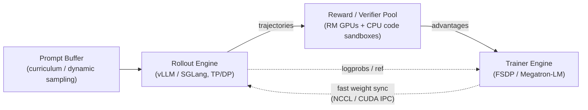

# RL Post-Training Infrastructure and GPU Orchestration

> **One-line summary**: RL post-training (PPO / GRPO / RLVR) couples two opposite GPU workloads — memory-bandwidth-bound autoregressive **rollouts** and compute-bound **policy training** — so throughput depends on fast weight resharding, eliminating long-tail CoT stragglers, sandboxed verifiers, and smart cluster scheduling.
>
> **Keywords**: `verl` `OpenRLHF` `colocated vs disaggregated` `weight sync` `straggler` `async RL` `verifier sandbox` `Slurm vs Kubernetes vs Ray`

## 1. Core concepts

Unlike SFT (a pure training loop), an RLVR / RLHF step runs a **heterogeneous multi-stage pipeline** every iteration:



| Stage | Bottleneck | Optimal parallelism | Typical engine |
| --- | --- | --- | --- |
| **Rollout generation** | HBM bandwidth + KV cache + long-tail sequence length (often 60–80% of step time) | Small TP + large DP + continuous batching | vLLM, SGLang, TensorRT-LLM |
| **Ref / Critic / RM forward** | Prefill compute (no decode) | Large micro-batch + sequence packing | FSDP / Megatron |
| **Verifier / Sandbox** | CPU isolation, unit-test execution, network-free containers | Stateless worker pool (Firecracker / gVisor / nsjail) | Ray actors / K8s jobs |
| **Actor update** | FLOPs + collective comms + activation memory | DP/FSDP + TP + PP + CP | FSDP2, Megatron-Core, DeepSpeed |

## 2. Principles and derivations

### 2.1 Colocated (HybridFlow) vs. Disaggregated RL architectures

| Mode | Placement | Pros | Cons | Representative |
| --- | --- | --- | --- | --- |
| **Colocated (time-shared)** | Trainer and rollout share the *same* GPUs; sleep/offload one while the other runs | 100% of GPUs serve rollouts, then 100% train; no inter-pool ratio tuning; zero cross-cluster transfer | Must offload optimizer states & KV cache + reshard weights every step; synchronous barrier | **verl (HybridFlow)** |
| **Disaggregated (space-shared)** | Dedicated GPU pool for rollout, dedicated pool for training | Continuous async pipelining; independent scaling & zero offload overhead | Tuning rollout/train GPU ratio is hard; introduces **off-policy staleness** (1–$k$ steps lag) | **OpenRLHF (async)**, **AReaL**, **StreamRL** |

**Rule of thumb**: start **colocated** when on-policy purity and GPU utilization matter most (small-to-medium clusters); move to **disaggregated async RL** when long-tail reasoning trajectories (32K+ tokens) create severe synchronous idle bubbles.

### 2.2 Fast weight synchronization and resharding

Rollout engines prefer small TP (e.g., `TP=4` across 1 node) while training uses `FSDP` or `TP=4, PP=2, DP=8`. Naively writing checkpoints to disk takes minutes; production RL infra does **in-memory weight sync in <1–3 seconds**:

1. **Colocated (verl 3D-HybridEngine)**: AllGather sharded FSDP parameters layer-by-layer (streaming to avoid OOM) and copy directly into vLLM/SGLang GPU buffers via CUDA IPC / zero-copy pointer exchange, while offloading Adam states to CPU RAM (`sleep mode`).
2. **Disaggregated**: trainer rank-0s broadcast updated weights to rollout workers over **NCCL / RDMA** in bucketed FP16/BF16 (or FP8 directly when rollout runs quantized).
3. **Train-inference numerical mismatch**: FP8/BF16 kernel differences between FSDP and vLLM cause $\pi_{\mathrm{rollout}}(a|s) \neq \pi_{\mathrm{train}}(a|s)$; track KL divergence between rollout logprobs and recomputed training logprobs, and apply **truncated importance sampling** when mismatch grows.

### 2.3 The long-tail straggler problem in Reasoning RL

In GRPO, each prompt samples $G$ responses up to 16K–32K tokens. Response lengths are heavy-tailed: 95% of sequences finish in 2K tokens while 5% run to 32K tokens. In a synchronous batch, **95% of rollout GPUs sit idle waiting for the last 5%**.

Four production mitigations:
1. **Partial rollouts / trajectory pausing** (Kimi k1.5 / AReaL): pause unfinished sequences at a time/token budget and resume them in the next step (bounded staleness).
2. **Async streaming RL**: rollout workers push completed groups into a replay queue continuously; trainer pulls batches without waiting for slow stragglers (requires bounded staleness $\Delta t \le \tau_{\max}$ + importance-ratio clipping).
3. **Dynamic over-generation + early cutoff**: launch $1.2\times$ prompts and close the rollout batch once the target group count completes.
4. **Length-aware packing** during policy update: pack variable-length CoTs into fixed-length sequences with `flash_attn_varlen` to eliminate padding waste.

### 2.4 Sandboxed verifiers and multi-turn environment pools

For coding and agentic RLVR, running untrusted model-generated code on training nodes is both a **security hazard** and a **latency bottleneck**:
- Decouple verifiers into an autoscaled CPU pool running microVMs (**Firecracker**) or **gVisor/nsjail** containers with strict CPU/RAM/wall-clock timeouts (e.g., 5–10 s per test) and zero outbound network.
- Pre-warm container snapshots for repo environments (e.g., SWE-bench Docker layers) so per-rollout startup drops from seconds to tens of milliseconds.
- Stream verification **asynchronously as each trajectory finishes** instead of waiting for the whole rollout batch.

### 2.5 GPU cluster orchestration: Slurm vs. Kubernetes vs. Ray

| Dimension | **Slurm** | **Kubernetes (+ Kueue / Volcano)** | **Ray** |
| --- | --- | --- | --- |
| Primary sweet spot | Static HPC / large monolithic pretraining jobs | Multi-tenant orgs mixing serving, batch, and training | Heterogeneous Python pipelines (RL rollouts + actors + data) |
| Gang scheduling | Native, battle-tested | Needs add-on (**Volcano** / **Kueue** / **Coscheduling**) | Placement groups (best layered *on top* of K8s/Slurm) |
| Elasticity & serving | Weak (batch-oriented) | Strong (autoscaling, ingress, canary, unified infra) | Strong for dynamic actor pools and RLHF/RLVR control planes |
| Multi-tenancy / GPU sharing | Coarse (node/GPU partition) | MIG, MPS, fractional GPUs, quota fairness | Fractional resource tags on worker nodes |

Modern stacks often layer them: **Kubernetes (or Slurm)** manages nodes, topology-aware gang scheduling, and hardware health checks, while **Ray** runs inside the allocation to orchestrate heterogeneous RL actors (vLLM rollout workers + FSDP trainers + CPU verifiers).

## 3. Implementation notes

Minimal colocated sleep/wake + weight-sync loop pattern (verl-style pseudocode):

```python
for step in range(num_steps):
    # 1. Rollout phase: wake vLLM KV cache, keep trainer optimizer on CPU
    rollout_engine.wake_up()
    trajectories = rollout_engine.generate(prompts, n=G, max_tokens=16384)
    rollout_engine.sleep(level=1)                      # free KV cache & weights

    # 2. Async verification on CPU sandbox pool
    rewards = ray.get([verify_remote.remote(t) for t in trajectories])
    batch = compute_group_advantages(trajectories, rewards)

    # 3. Train phase: move optimizer states back, run packed FSDP update
    trainer.load_optimizer_to_gpu()
    metrics = trainer.ppo_grpo_update(batch)           # varlen FlashAttention packing
    trainer.offload_optimizer_to_cpu()

    # 4. In-memory reshard & sync updated weights to rollout engine
    sync_weights_fsdp_to_vllm(trainer, rollout_engine) # streaming AllGather + IPC
```

Key engineering checks:
- **Pin NUMA / PCIe affinity** for CPU offload so optimizer swap runs at full PCIe Gen5 bandwidth (~50+ GB/s).
- **Log rollout vs. trainer logprob KL** every step; a sudden jump signals a weight-sync bug, chat-template mismatch, or quantization divergence.

## 4. Interview Q&A

### Q1. Why is RL post-training infrastructure fundamentally harder than pretraining or SFT?
**Answer**: Pretraining is homogeneous compute with fixed sequence lengths and predictable throughput. RL alternates between **decode-heavy rollouts** (bandwidth-bound, variable length, straggler-prone), **CPU/sandbox verification**, and **compute-heavy training**, each wanting different parallelism layouts. Achieving high GPU utilization requires fast in-memory weight resharding, memory offloading, and straggler/async-staleness control.
**Follow-up**: Where does most wall-clock time go in GRPO? Typically 60–80% in autoregressive rollout generation, especially the top 5% longest CoT sequences.

### Q2. Colocated (verl) vs. Disaggregated (async) RL — how do you choose?
**Answer**: Colocated time-shares all GPUs between rollout and training, maximizing peak parallelism per phase and staying strictly on-policy, at the cost of weight-sync/offload overhead and synchronous straggler bubbles. Disaggregated splits GPUs into dedicated rollout and training pools, hiding long-tail generation via async streaming, at the cost of pool-ratio tuning and off-policy staleness. Choose colocated up to ~128–256 GPUs or short CoTs; choose disaggregated async for very long CoTs (32K+) and multi-turn tool/agent RL.

### Q3. How does off-policy staleness affect async RL, and how do you control it?
**Answer**: When rollout workers generate using weights $\theta_{t-\Delta}$ while the trainer updates $\theta_t$, the importance ratio $\pi_{\theta_t}/\pi_{\theta_{t-\Delta}}$ drifts, causing high variance or entropy collapse. Control it by (1) capping maximum staleness ($\Delta \le 1\text{–}4$ steps, discarding older trajectories), (2) using **rollout-engine logprobs** as the true behavior policy $\mu$ in importance sampling (not stale trainer recomputations), and (3) asymmetric clipping (DAPO clip-higher / CISPO).

### Q4. Why can rollout logprobs from vLLM differ from recomputed training logprobs even with identical weights?
**Answer**: Different kernel implementations (FlashAttention vs. PagedAttention), different batching/reduction order in BF16/FP8, FP8 quantization in rollout vs. BF16 in training, or subtle tokenization/chat-template mismatches (e.g., re-tokenizing decoded text instead of passing raw token IDs!). Always pass **exact rollout token IDs** directly to the trainer — never decode-then-re-encode.

### Q5. When would you pick Kubernetes + Kueue over Slurm for an ML organization?
**Answer**: Slurm wins for pure research labs running giant monolithic training jobs on bare-metal clusters with minimal ops overhead. Kubernetes (+ Kueue/Volcano for gang scheduling and topology awareness) wins when the org needs unified infrastructure for **online serving + batch pipelines + training**, elastic autoscaling, multi-tenant quotas, and standard CI/CD observability.

## 5. Pitfalls and follow-ups

- **Re-tokenizing text between rollout and trainer**: BPE boundaries can shift (`token_ids -> text -> token_ids` is not always round-trip lossless), silently poisoning logprobs and advantages.
- **Forgetting to mask tool-observation tokens**: In multi-turn agent RL, computing policy gradients on environment/tool output tokens trains the model to imitate error messages and breaks alignment.
- **Unbounded verifier timeouts**: One infinite loop in model-generated Python code stalls an entire synchronous step unless sandboxes enforce hard wall-clock/CPU/memory caps.
- **Ignoring network topology in Ray/K8s**: Spreading a single TP=8 rollout worker across two nodes over Ethernet instead of intra-node NVLink tanks rollout throughput by 5–10×.

## 6. Cheat sheet

| Topic | Key point |
| --- | --- |
| Main RL infra bottleneck | Autoregressive rollouts (60–80% of step time) + long-tail CoT stragglers |
| Colocated (verl) | Same GPUs time-share rollout & train; sleep/offload + streaming AllGather weight sync |
| Disaggregated async | Separate rollout/train pools; hides stragglers; needs staleness cap + IS correction |
| Straggler fixes | Partial rollouts, async streaming, over-generation cutoff, varlen packing |
| Token-ID rule | Pass raw rollout token IDs to trainer — never decode & re-tokenize |
| Orchestrators | Slurm (HPC pretraining), K8s + Kueue/Volcano (unified serving+train), Ray (RL actor control plane) |

Mnemonic: **"Rollout dominates, sync weights in RAM, pass raw token IDs, kill stragglers, sandbox every verifier."**

## 7. References

- [HybridFlow (verl): A Flexible and Efficient RLHF Framework · Sheng et al., 2024](https://arxiv.org/abs/2409.19256)
- [OpenRLHF: An Easy-to-use, Scalable and High-performance RLHF Framework · Hu et al., 2024](https://arxiv.org/abs/2405.11143)
- [AReaL: A Large-Scale Asynchronous Reinforcement Learning System · Fu et al., 2025](https://arxiv.org/abs/2505.24298)
- [Kimi k1.5 Technical Report (Partial Rollouts & Long-CoT RL Infra) · 2025](https://arxiv.org/abs/2501.12599)
- [Kubernetes Kueue documentation](https://kueue.sigs.k8s.io/) / [Ray Core documentation](https://docs.ray.io/)
