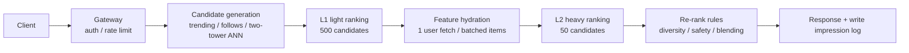

# Infra interview cases

> **One-line summary**: Infra interviews are not won by memorizing component names; they are won by **structure + numbers + consistency arguments**: clarify first, draw both the online and offline paths completely, then pick 1-2 components and go deep into the mechanism, and close with capacity estimates and failure modes.
>
> **Keywords**: `pipeline walk-through` `component design` `latency budget` `capacity estimation` `back-of-envelope` `failure mode`

## 1. Time allocation and answer skeleton

The standard 45-minute allocation (the version I have practiced):

| Phase | Time | Output | Common mistake |
| --- | --- | --- | --- |
| Clarify | 4-5 min | Scenario, scale, QPS, latency target, scope | Drawing immediately without a question, or asking 10 useless ones |
| Online path | 10 min | Request lifecycle + per-stage latency budget | Only discussing recall/ranking algorithms, not features and logging |
| Offline path | 10 min | Events → lakehouse → features → samples → training → release | Missing point-in-time and label delay |
| Deep dive | 10 min | 1-2 components down to the mechanism (e.g., CUDA graphs, block pre-aggregation) | Spreading effort evenly, deep on nothing |
| Capacity/cost | 5 min | GPUs, storage, bandwidth, USD estimates | Counting GPUs but not storage and network |
| Wrap-up | 5 min | Monitoring, failure modes, next steps | Running out of time and being cut off |

Three arguments that **must** appear:

1. **Why data cannot leak** (point-in-time + watermark);
2. **Why latency is met** (end-to-end budget + queueing theory + headroom);
3. **Why this is cheaper** (unit cost of $N_{GPU}$, storage, bandwidth).

For the more general clarifying/metrics/capacity template see [Chapter 6 · Answer framework](../06-ml-system-design/01-framework-and-methodology.md); this note only adds the infra angle.

## 2. Case one: pipeline walk-through (short-video recommendation)

### 2.1 Clarification and problem statement

Assumptions (state every number explicitly and let the interviewer correct you): Explore feed, organic content; 100M DAU, 10 requests per user per day; a corpus of 1B videos; end-to-end p99 < 500 ms; 99.9% availability; the focus today is online ranking + real-time features.

$$\text{average QPS} = \frac{10^8 \times 10}{86400} \approx 1.2\times10^4, \qquad \text{peak} \approx 8\times \approx 10^5$$

### 2.2 Online path and latency budget

| Stage | p99 budget | Key techniques |
| --- | --- | --- |
| Gateway + network | 20 ms | Same-region deployment, connection reuse |
| Candidate generation (parallel) | 60 ms | Concurrent sources, ANN indexes resident in memory, timeout truncation |
| L1 light ranking | 40 ms | Light model, few features, large batch |
| Feature hydration | 25 ms | Feature store co-located with model server, one user-feature fetch per request |
| L2 heavy ranking | 80 ms | Heavy model + full features, GPU inference |
| Re-rank rules | 15 ms | Pure in-memory computation |
| Serialization + headroom | 60 ms | Reserve 25% for bursts and GC |
| **Total** | **≤ 300 ms** | Leaves 200 ms for tail and retries |

Key design trade-offs (interviewers love these):

- **Why not rank all candidates with the heavy model**: 500 candidates x heavy model = latency explosion; layering is "use a cheap model to cut 90%".
- **What to cache**: candidate results by `(userId, feedType)` for 5-10 minutes; user features for 1 minute; item features for 1 hour; L1 results for 1 minute. TTL follows how fast things change.
- **Hot keys**: a super-popular video overloads a single shard — add a random salt, use a compound key (`postId+region`), and cache locally.
- **Degradation**: L2 timeout → serve L1 results; feature service timeout → use the previous cached features and mark them; full-path timeout → return a cached feed.

### 2.3 Offline path

1. **Events**: impression/click/completion → Kafka (key=userId, for ordered replay per user).
2. **Into the lake**: Flink writes Iceberg (daily/hourly partitions); the raw table is replayable.
3. **Features**: stream jobs compute near-real-time aggregates (5-minute blocks) and sequence features; batch jobs recompute hourly/daily features and fill gaps.
4. **Samples**: left-join the impression log with features. Main features use **forward logging** (already in the log); new features use **backfill + watermark cap** to avoid the future.
5. **Training**: about 1B records/day (after downsampling) with a GB-scale model → **DDP as the default**, 8 nodes x 8 GPUs; a few hours per round.
6. **Release**: offline AUC/NDCG must not regress → shadow → 1% canary → staged rollout, with second-level rollback on anomalies.

### 2.4 Monitoring and capacity

| Category | Metrics | Alert action |
| --- | --- | --- |
| Model | AUC/GAUC, NCE, online CTR/CVR | Drop → check feature freshness and data bugs |
| Features | PSI, null rate, lag/watermark trailing | Drift → pause training, human confirmation |
| System | Per-stage p99, GPU utilization, queue depth | SLA breach → scale out / degrade |
| Pipeline | Per-stage survival rate, timeout rate | Abnormal survival → check upstream scoring bugs |

**Capacity estimate** (L2 is the GPU-heavy stage): peak 100k QPS, about 2 ms of L2 GPU time per request (already amortized by batching), target utilization 0.5:

$$N_{GPU} = \frac{10^5 \times 2\times10^{-3}}{0.5} = 400 \text{ GPUs}$$

At 2 USD per GPU-hour that is about **800 USD/hour**; if demand were flat over 24 hours (it is not; elasticity saves 30%-50%) about **14k USD/day**. L1 and candidate generation can run on CPU clusters, counted separately.

### 2.5 Failure modes

- **Feature backfill leakage**: offline AUC up 3 points, production down 1 point — check the join's time boundary first.
- **Real-time feature stream outage**: Flink restarts, window state rolls back, feature values jump — rely on batch recomputation plus sanity checks on feature values.
- **Traffic spike on a hot event**: QPS up 5x, GPUs saturated — rate limit + degrade to L1 + pre-warmed replicas.
- **Latency rises after a model release**: the new model has more operators and smaller batches — run a shadow load test before release and make p99 a release gate.

## 3. Case two: four component designs (skeletons)

### 3.1 Design a feature store

1. **Requirements**: forward logging, batch backfill, near-real-time updates; declarative definitions; thousands of features and a billion events/day.
2. **Abstraction**: feature-first (Uber Palette) or block-first (Snap Robusta) — the former is flexible, the latter saves compute.
3. **Three paths**: online read (KV point lookups), offline read (lakehouse scans), write (streaming direct write + batch sync).
4. **Correctness**: point-in-time join + watermark; consistency spot checks against forward logs.
5. **Scale**: size the online store as keys x features x 4B; partition offline by day; rate-limit the sync jobs.

### 3.2 Design a real-time feature system

1. **Requirements**: second-level updates, tolerance of out-of-order events, no loss on restart, ordered sequences.
2. **Pipeline**: Kafka (ordered within a partition, replayable) → Flink (event time, watermark, state checkpoints) → online KV (idempotent upsert) → sink back to offline.
3. **Correctness**: event time rather than processing time; `allowedLateness` for late data; incremental updates rather than full recomputation.
4. **Sequences**: key by userId to keep one partition per user + a per-user append-only log + a reorder buffer + cap at N.
5. **Safety net**: batch recomputation covers what the stream job missed.

### 3.3 Design a distributed training platform

1. **Requirements**: multi-node multi-GPU, gang scheduling, fault tolerance, quota, observability.
2. **Scheduling**: K8s + Volcano/Kueue; topology awareness; priorities and preemption.
3. **Communication**: NCCL + RDMA; DP across nodes, TP within a node; gradient bucketing overlapped with backward.
4. **Fault tolerance**: async sharded checkpoints with $\tau=\sqrt{2CM}$; record consumed positions; elastic rendezvous.
5. **Cost**: MFU 30%-50%; spot instances + checkpoints; utilization dashboards.

### 3.4 Design a GPU inference service

1. **Requirements**: QPS, p99, model size, single or multiple models.
2. **Architecture**: gateway → preprocessing/features → multiple Triton/vLLM replicas → post-processing; stateless and horizontally scaled.
3. **Optimization**: profile to localize → dynamic batching → fuse small kernels / one-shot H2D copy → CUDA graphs → custom Triton kernels.
4. **Capacity**: $N=QPS\times t_{GPU}/\eta$; warm pool + queue-depth autoscaling + degradation.
5. **SLO**: p99 + availability + overload degradation behavior, validated by load tests and chaos drills.

## 4. Capacity estimation exercises

### Exercise 1: how much memory does the online feature store need?

Assume 100M users x 500 features and 1B items x 50 features, stored as float32: $10^8\times500\times4 \approx 2\times10^{11}$ B = 200 GB; $10^9\times50\times4 = 2\times10^{11}$ B = 200 GB; about 400 GB total. Two replicas → 800 GB, plus 30% headroom and index overhead → about 1 TB of memory. Conclusion: you must shard (e.g., 32 shards x 32 GB), and consider downcasting cold features to fp16/int8.

### Exercise 2: how long does one gradient sync take for a 13B model?

bf16 gradients $S = 13\times10^9\times2 = 26$ GB; ring all-reduce sends about $2S = 52$ GB per GPU. At an effective 50 GB/s on 400G IB → $52/50\approx1.04$ s; inside a node over NVLink (900 GB/s) it is 58 ms. Conclusion: inter-node communication dominates → constrain the DP group, use higher-bandwidth networking, and overlap communication with compute.

### Exercise 3: how big is one day of impression logs?

Peak 100k QPS, 2 KB per log entry (with a feature snapshot it is larger; we use the slim version here): $10^5\times2\times10^3\times86400 \approx 1.7\times10^{13}$ B ≈ **17 TB/day**. Parquet + zstd compresses about 5x → 3.5 TB/day, 1.3 PB per year. Conclusion: tier the logs (7 days hot, 90 days cold, older archived to object storage), and consider logging full features only for sampled requests.

### Exercise 4: how long must an A/B test run?

Baseline CTR 5%, targeting a +2% relative lift ($\Delta=0.001$); each group needs about 750k impressions (see [05](05-data-and-experiment-platform.md)). At a peak of 100k QPS with 1% of traffic in the experiment → 1000 impressions/s, 1.5M across both groups → about 25 minutes. With only 0.1% of traffic → 4 hours; to detect a +1% relative lift the sample size is 4x → 100 minutes. Conclusion: **MDE and traffic together determine the experiment duration**; small traffic cannot detect small gains.

## 5. Interview Q&A

### Q1. With only 45 minutes, do you draw online or offline first?
**Answer**: Online first. The online path is where the interviewer can most easily verify that you understand real systems, and once the latency budget is on the board, capacity, batching, and GPU counts follow naturally. Present the offline path second and focus on "how logs become samples". Confirm the pacing with one sentence: "I will walk the online path following a request, then switch to offline, does that work".
**Follow-up**: What if the interviewer says "I care more about the training side"? Adapt immediately: spend 2 minutes on the online skeleton and put the time into sample joins, training scheduling, and release.

### Q2. The interviewer says "assume the scale yourself" — what do you do?
**Answer**: Give a set of **self-consistent, easy-to-compute** numbers and state where they come from, e.g., "100M DAU, 10 requests each → about 12k average QPS, 100k at an 8x peak". The numbers do not need to be right; they need to support the later derivations (latency budget, GPU count, storage). Then add proactively: "if the real number is 10x, I would scale L2 replicas proportionally; the architecture does not change".
**Follow-up**: What if you are told a number is wrong? Accept it and recompute a key conclusion live (e.g., the GPU count) — that scores better than defending it.

### Q3. Which component do you go deep on, and how do you choose?
**Answer**: Pick the one that is "what you know best + most relevant to the prompt + has numbers to tell". For recommendation systems the default is the feature platform (point-in-time and real-time features); for LLM scenarios, GPU serving (batching/kernels); for training-platform questions, gang scheduling and communication. After choosing, give one conclusion and then the mechanism, so the 10 minutes do not go into setup.
**Follow-up**: What if the interviewer does not know your chosen component well? Use the structure "problem → naive approach → bottleneck → my optimization → number", which anyone can follow.

### Q4. Latency exceeds the SLA but GPU utilization is low — how do you answer?
**Answer**: Say the bottleneck is not compute but waiting or queueing, and give the debug order: check the timeline for GPU idle gaps (CPU preprocessing/kernel launch/copy bottleneck), check queue depth (not enough replicas or a poor batching policy), check the tail distribution (one large request slowing a whole batch). The fixes are respectively: fusion/async copies/CUDA graphs, more replicas plus dynamic batching, request bucketing and timeout isolation.
**Follow-up**: How do you validate the diagnosis? Run single-variable experiments: add replicas only, change the batch only, replace the preprocessing only, and measure p99 each time.

### Q5. How do you guarantee that data leakage never happens?
**Answer**: Three lines of defense: the definition layer (the feature DSL specifies window and time semantics), the execution layer (joins allow only $t\le t_{impression}$ and never exceed the watermark), and the verification layer (spot-check forward logs vs. backfilled values, and monitor the offline-vs-online AUC gap). Add one process rule: a new feature's backfill must go through two stages, validated on a small sample first.
**Follow-up**: What if forward-logged and backfilled values differ a lot? Check sync lag first (was the watermark recorded accurately), then definitions (floating point, time zones, defaults), and only then suspect an implementation bug.

### Q6. If the team has only 3 MLEs, how do you simplify?
**Answer**: Drop the in-house platform and assemble the minimal loop from "lakehouse + orchestrator + one online KV store + one model registry"; the feature platform degrades to "offline tables + sync scripts + naming conventions"; training runs single-node multi-GPU or on a managed service; monitoring starts with off-the-shelf dashboards. The principle is "close the loop first, optimize later", adding complexity only when a real bottleneck appears.
**Follow-up**: When must you upgrade? When features reach the hundreds, models reach a dozen, and the iteration cycle is blocked waiting on data — that is when platform abstractions start to pay off.

### Q7. How do you show leadership and time management in an infra interview?
**Answer**: Set the pace proactively ("I will draw the skeleton first and we can come back to your area of interest around minute 20"), make trade-offs proactively ("we will skip ads blending today because it would crowd out ranking depth"), and surface risks proactively ("the biggest risk here is feature leakage; I would validate offline"). On disagreements, accept the interviewer's preference first and then add your reasoning instead of arguing.
**Follow-up**: What if the interviewer drifts into irrelevant detail? Close with one sentence ("I can expand on that, but to cover the main path let me note it and move on") and bring the conversation back.

### Q8. How do you answer "what infra project have you done"?
**Answer**: STAR plus numbers: background (what scale, what pain), the abstraction/change you made (one sentence on the technical approach), results (specific changes in latency/cost/iteration speed), and reflection (what you would do differently). Infra projects are always probed with "how did you measure the benefit", so prepare 2-3 numbers in advance (how much p99 dropped, how many GPUs were saved, how the release cycle went from days to hours).
**Follow-up**: What if the project was small? Explain the general trade-off it still contained, e.g., you scaled on queue depth rather than CPU utilization — that is transferable judgment.

### Q9. The interviewer challenges you: "this is too expensive" — how do you respond?
**Answer**: Give the cost structure first (shares for GPU, storage, network, and people), then the priority order for reducing it: raise utilization (MFU/η) → elasticity and spot instances → remove unnecessary computation (caching, candidate pruning, quantization) → and only then replace hardware. Also explain whether "expensive" is worth it: compare unit cost (USD per million requests) with business value rather than absolute spend.
**Follow-up**: When cost and latency conflict? Tier by SLO: keep latency for core traffic and put non-core traffic (prefetch, batch scoring) on cheaper resource pools.

## 6. Common ways to lose points

- Not asking about scale during clarification and pasting a hyperscaler architecture, then being asked "where did 100k QPS come from".
- Discussing only ranking algorithms on the online path, not feature hydration, logging, or degradation.
- Missing label delay, point-in-time join, and backfill on the offline path.
- Counting GPUs for capacity but not feature storage, log storage, or network bandwidth.
- Talking about "real-time features" without explaining out-of-order events, duplicates, and correctness after a restart.
- Stopping the deep dive at "use CUDA graphs" without explaining that it removes launch overhead at the cost of fixed shapes.
- Not mentioning failure modes: every distributed system gets "what happens if this component dies".

## 7. Cheat sheet: the 45-minute template

| Time | What to say | Keywords |
| --- | --- | --- |
| 0-5 | Clarify with 5 questions | Scenario/scale/QPS/latency/scope |
| 5-15 | Online path + latency budget table | Recall → L1 → features → L2 → rules → logs |
| 15-25 | Offline path | Kafka → lakehouse → features → PIT join → training → release |
| 25-35 | Deep dive on one component | Mechanism, trade-offs, numbers |
| 35-40 | Capacity and cost | $N=QPS\times t/\eta$, storage, bandwidth |
| 40-45 | Monitoring / failure modes / evolution | Four monitoring families, degradation, next steps |

## 8. References

- [Preparing for ML Infra System Design Interviews · Yuan Meng](https://www.yuan-meng.com/posts/ml_infra_interviews/) (the prototypes for both cases here: the Xiaohongshu Explore Feed and component design)
- [Hello Interview · Design an Ad Click Aggregator](https://www.hellointerview.com/learn/system-design/problem-breakdowns/ad-click-aggregator) (the classic backend question for real-time aggregation)
- [ML System Design 2.0 · Yuan Meng](https://www.yuan-meng.com/posts/mle_interviews_2.0/) (model and metric perspectives beyond the pipeline)
- [System Design Interview (Alex Xu)](https://www.systemdesigninterview.com/) (capacity estimation and general distributed-systems patterns)
- [Chapter 6 · ML system design](../06-ml-system-design/README.md): model design for recommendation/search/ads, complementary to this note
- [Chapter 4 · Distributed training](../04-llm/07-distributed-training.md): parallelism strategy derivations
