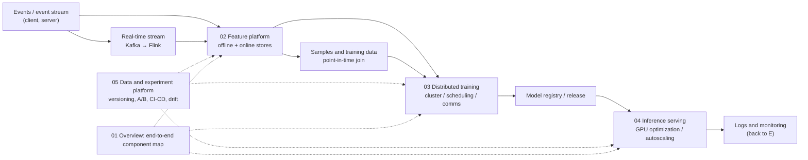

# Chapter 7 · ML Infra

> **Chapter intro**: An ML Infra interview does not test "which model would you pick"; it tests "how does this system actually run on real machines, fast and cheap". The chapter follows five stages — **data → features → training → serving → platform** — and closes with two full case studies that turn the pieces into a story you can tell in 45 minutes. The split with [Chapter 6 · ML System Design](../06-ml-system-design/README.md) is: Chapter 6 covers "the model and business design", this chapter covers "the pipelines, clusters, scheduling, and serving engineering that support it".

## 1. ML infra vs. ML system design

Both appear in MLE interviews, but the follow-up questions point in completely different directions. My one-line summary: **system design answers "what to build and why", infra design answers "where it runs, how it stays up, and how it stays cheap".**

| Dimension | ML System Design (Chapter 6) | ML Infra System Design (this chapter) |
| --- | --- | --- |
| Core question | How do we translate a business goal into an ML objective? | Which offline + online pipelines support that objective? |
| Main output | Features, samples, models, metrics, experiment plan | Pipelines, storage, scheduling, serving, capacity, cost |
| Key trade-offs | Recall vs. precision, single-objective vs. multi-objective | Latency vs. freshness, cost vs. throughput, consistency vs. speed |
| Typical follow-up | "How do you handle cold start?" "How do you pick negatives?" | "How do you guarantee point-in-time correctness?" "How do you schedule 10k GPUs?" |
| Depth expected | Explain the trade-offs clearly | Explain the component internals and the numbers |

## 2. Chapter map

## 3. Chapter contents

- [01 · ML Infra overview](01-ml-infra-overview.md) — the components of an end-to-end ML system; how the offline and online paths divide the work; workflow orchestration (DAG), batch vs. streaming, platform layers; how Meta/Snap/Uber/Pinterest/Netflix differ, and how to decide build vs. buy.
- [02 · Feature platform and real-time features](02-feature-store-and-realtime-features.md) — the dual-store model of a feature store; point-in-time join and data leakage; forward logging vs. backfill; Kafka/Flink basics (partitions, event time, windows, watermarks, state); incremental computation and pre-aggregated blocks for real-time aggregation; ordering guarantees for real-time sequence features; feature monitoring and the backfill flow.
- [03 · Distributed training infrastructure](03-distributed-training-infrastructure.md) — clusters and scheduling (K8s, gang scheduling, topology awareness); parameter servers vs. all-reduce (including the communication-volume derivation); NCCL/RDMA/NVLink topology; checkpointing, elastic training, and failure recovery; training-platform abstractions and cost estimation.
- [04 · Inference serving and GPU optimization](04-inference-serving-and-gpu-optimization.md) — the layered online-inference architecture; dynamic batching and autoscaling; GPU utilization and MFU; profiling with nsys/ncu; eliminating small kernels (fused embedding lookup, one-shot H2D copy, CUDA graphs); custom Triton kernels; multi-model sharing; SLA and capacity-planning formulas.
- [05 · Data and experiment platform](05-data-and-experiment-platform.md) — batch/stream data pipelines and idempotent reruns; data versioning and table formats (Iceberg/Hudi/Delta); data-quality checks; the experiment platform (assignment, layers, sample size, SRM, CUPED); model registry and CI/CD, canary and rollback; drift monitoring and alerting.
- [06 · Infra interview cases](06-infra-case-studies.md) — a full pipeline walk-through (short-video recommendation); four component-design templates (feature store / real-time features / distributed training / GPU serving); capacity-estimation exercises with solutions; time allocation and common ways to lose points.

## 4. The two question types and answer skeletons

Infra interviews basically come in two shapes, and they are prepared differently:

### Type A: Pipeline walk-through (end to end, ~45 min)

The interviewer says "design the ML infra for an XX recommender / search / risk system". Skeleton:

1. **Clarify 3-5 questions** (each one either narrows the scope or clarifies a requirement): which feed or scenario? Ads or organic content? Corpus size? QPS and latency targets? Is the focus features, training, or serving today?
2. **Draw the online path first** (follow one request through its lifecycle): client → load balancer → candidate generation (multiple sources + ANN) → light ranking L1 → heavy ranking L2 → re-rank rules → logging.
3. **Then draw the offline path**: events land in Kafka → lakehouse → feature backfill/join → training → checkpoint → evaluation → release.
4. **Close with monitoring and capacity**: model metrics, feature distributions and freshness, latency/throughput, cost.
5. **Proactively go deep on 1-2 components** (this is where depth shows): how point-in-time join prevents leakage, why gang scheduling is necessary, how GPU kernels get fused.

### Type B: Component design (one component, deep, ~45 min)

The interviewer says "design a feature store / real-time feature system / distributed training platform / GPU inference service". Skeleton:

1. **Functional and non-functional requirements** (consistency, freshness, scale, latency, cost).
2. **Core abstraction**: is a feature store "features or blocks"? Is a training platform "a job or a pod"? Is serving "a model or a runtime"?
3. **Draw the read and write paths separately** (online read, offline read, write/backfill — three paths).
4. **Argue consistency and correctness**: this is the dividing line between an infra interview and a plain backend interview — you must explain "why nothing leaks" and "why offline and online agree".
5. **Scale and failure**: QPS, storage, single points of failure, retries, idempotency.

## 5. Study plan

- **Suggested order**: 01 → 02 → 04 → 03 → 05 → 06. First get "one request" and "one feature" working end to end (01/02), then move to GPUs and training (04/03), then fill in the platform and the cases (05/06).
- **Time budget**: 3 days. 02 and 04 get one day each (most frequently asked, most detail); 01/03/05/06 share one day.
- **Do the math by hand**: all-reduce communication volume, checkpoint size, GPU count, A/B sample size — these four are the "calculation questions" of an infra interview.
- **Review method**: close the notes and spend 5 minutes walking a colleague through "the online and offline paths of the Xiaohongshu Explore Feed"; whatever you cannot explain is what you have not learned.
- **Speaking habit**: give the conclusion first ("I would use the existing feature platform rather than build one"), then 2-3 reasons, then "here is what I would change if the scale were different".

## 6. How it connects to other chapters

- [Chapter 4 · Distributed training](../04-llm/07-distributed-training.md): the **algorithm and memory derivations** for DP/TP/PP/ZeRO live there; [03](03-distributed-training-infrastructure.md) here only covers **clusters, scheduling, communication libraries, fault tolerance, and cost**, without repeating the derivations.
- [Chapter 4 · Inference optimization and deployment](../04-llm/08-inference-optimization-and-serving.md): LLM-side KV cache/PagedAttention/continuous batching live there; [04](04-inference-serving-and-gpu-optimization.md) here covers **general GPU serving engineering and capacity planning**, and only bridges to the LLM side.
- [Chapter 6 · Answer framework](../06-ml-system-design/01-framework-and-methodology.md): the general part on clarifying questions, metrics, and capacity templates; [06](06-infra-case-studies.md) here is that framework applied from an infra angle.
- [Chapter 1 · Evaluation metrics](../01-ml-fundamentals/05-evaluation-metrics.md): definitions of AUC/GAUC/NDCG; [05](05-data-and-experiment-platform.md) here covers how those metrics are computed and compared on the experiment platform.
- [Chapter 8 · System design and infra cheat sheet](../08-interview-bank/05-system-design-and-infra-cheatsheet.md): the compressed version for the day before an interview.

## 7. One-page cheat sheet

| Topic | Must-remember conclusion | Details |
| --- | --- | --- |
| End-to-end components | Ingestion → batching/sharding/caching → training → serving; orchestrated with a DAG | [01](01-ml-infra-overview.md) |
| Feature store | One definition, two stores: offline (Iceberg/Hive) + online (Redis/Cassandra) | [02](02-feature-store-and-realtime-features.md) |
| Point-in-time | Only features from at or before the impression time, capped by the watermark | [02](02-feature-store-and-realtime-features.md) |
| Offline-online consistency | Forward logging is the most reliable; backfill is fast but leaks easily; you need both | [02](02-feature-store-and-realtime-features.md) |
| Real-time features | Kafka (ordering, partitions) + Flink (event time, windows, state, exactly-once) | [02](02-feature-store-and-realtime-features.md) |
| Training cluster | Gang scheduling avoids "some workers hold GPUs while waiting"; topology awareness cuts cross-node traffic | [03](03-distributed-training-infrastructure.md) |
| Parameter server vs. all-reduce | PS suffers from stale gradients and becomes a bottleneck; modern systems use ring all-reduce, about $2S$ per GPU | [03](03-distributed-training-infrastructure.md) |
| Communication time | $t \approx 2S/B$; a 7B bf16 gradient is about 14 GB → about 28 GB per GPU per step | [03](03-distributed-training-infrastructure.md) |
| GPU serving | Profile first to find the bottleneck; small kernels, H2D copies, and launch overhead are the three killers | [04](04-inference-serving-and-gpu-optimization.md) |
| Capacity estimation | GPUs = QPS × per-request GPU time / target utilization | [04](04-inference-serving-and-gpu-optimization.md) |
| Experiments | Stratified randomization, sample size $n\approx16\sigma^2/\Delta^2$, check SRM and confidence intervals | [05](05-data-and-experiment-platform.md) |
| Interview output | Online then offline, go deep on 1-2 components, give numbers and failure modes | [06](06-infra-case-studies.md) |
